# 斯坦福大学《统计学习导论2023Python版｜An Introduction to Statistical Learning with Python》中英字幕 - P14：-014-Statistical Learning_ 3.2 Hypothesis Testing and Confidence Intervals.zh_en - GPT中英字幕课程资源 - BV1u4421A7ZU

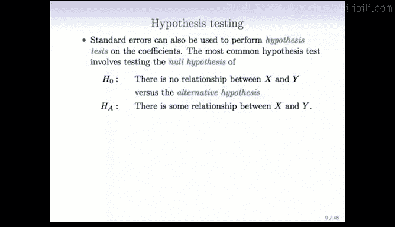

Welcome back。We just finished talking about confidence intervals in the previous segment。

 and now we'll talk about hypothesis testing， which is a closely related idea。

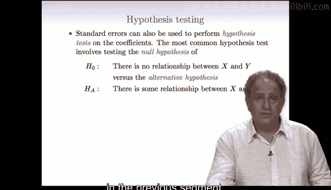

We want to ask a question about a specific value of a parameter， like， is that coefficient zero？

And the statistics as known as hypothesis testing。 So hypothesis testing。Is a test of a。

Of a relationship between， it's a test of a certain value of a parameter。In particular。

 here the hypothesis test we'll make is that is that parameter  zero， is a slope zero。

 so what's called the null hypothesis is that there's no relationship between x and Y。

In wordsIn other words， beta 1。Equals zero， right？That's this equivalent statement。

 the alternative hypothesis is that relationship there is some relationship between x and y。

 in other words， beta 1 is not zero。

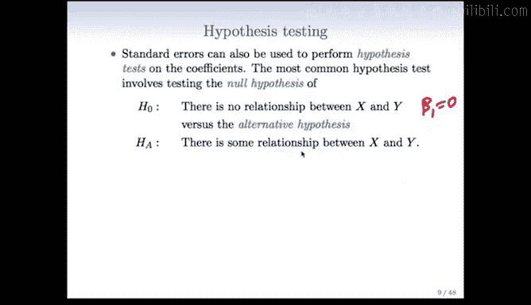

And beta 1 could be。Positive or negative。Okay。So mathematically， this corresponds to。

Beta 1 being 0 as the nupa beta 1 not equals 0。

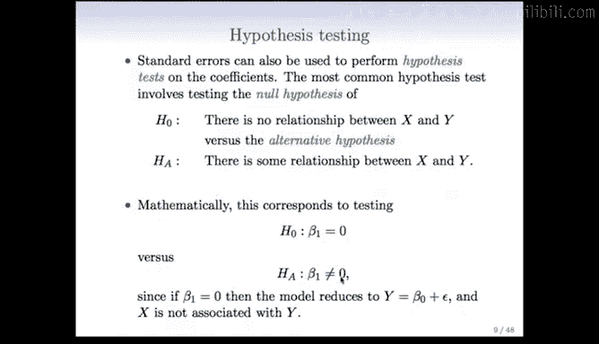

So that's often the question you want to ask， that's usually the first question you want to ask about the predictors。

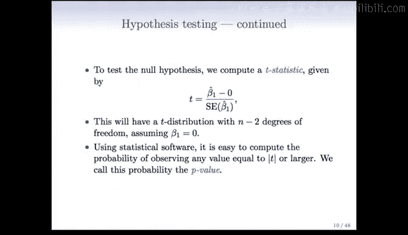

So to testest the hypothesis。We。Forour months called a T statistic。

 we take the estimated slope divided by a standard error。

This will approximately have a T distribution with M minus-2 degrees of freedom under assuming that the hypothesis is true。

Now what is a T distribution， you don't have to worry too much about that。

 it's basically you look this up in a table or nowadays you look in software or compute it for you。

 it's basically a normal random variable except for small numbers of samples and it's a little bit different。

In any case， you ask the computer to compute。The P value based on this statistic。嗯。

P value is the probability of getting the value of T。At least as large as you got。In absolute value。

Okay。

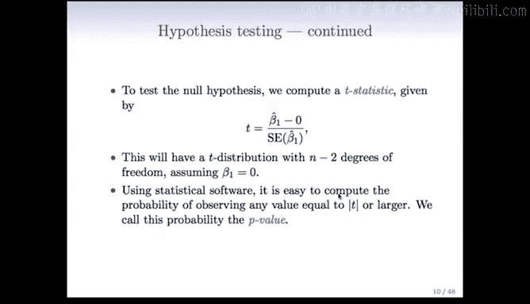

So for the advertising data using again just TV。Here are the results。

 here the slope and intercept of that line， we saw the least squares line， standard errors。

Here are the T statistics， that's just the coefficient divided by the standard error。

The one we care most about is for TV， the intercept isn't really very interesting。

 that's telling us what happens。What's the sales when the TV is zero， TVs budget is zero？

But the one I care most about here is this guy。 So this is this is measuring the effect of。

TV advertising on sales and the T statistic is huge。It， it turns out the in order to be。To have a。

P value of below 。05， which is quite significant。You need a T statistic of about two。 We're at 17。

 So it's very， very significant。 So the P value is very， very small。So how do we interpret this。

 it says the chance of seeing this data。Under the assumption of the null hypothesis。

 there's no effect of TV advertising on sales。Is less than 10 to the -4。

 So it's very unlikely to have seen this data It's possible， but very unlikely。

Under the assumption that TV advertising has no effect。Our conclusion， therefore。

 is that TV advertising has an effect。On sales as we。

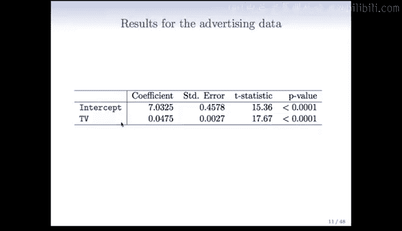

With hope。Okay， so we've seen how to fit a model with a single predictor。

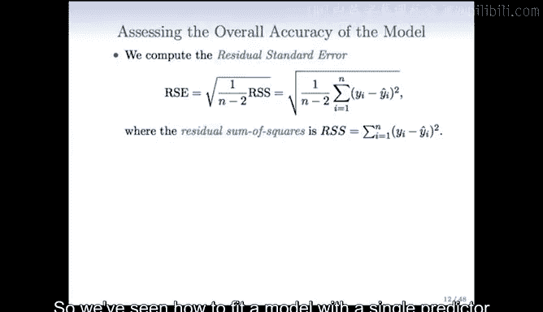

And how to assess the slope of that predictor， both in terms of confidence intervals。

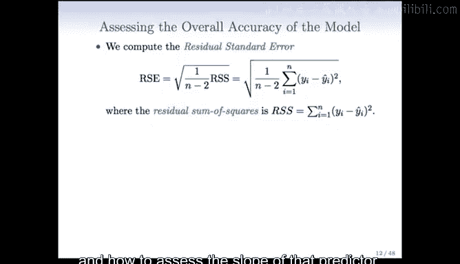

And I pause this test I did want to add one thing。

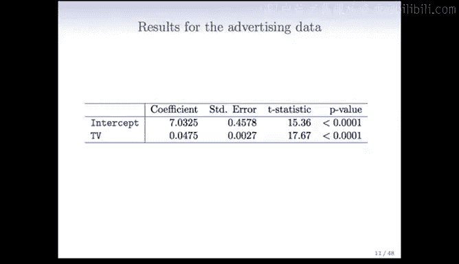

That's important， so we've seen the hypothesis test and before that we saw confidence intervals。

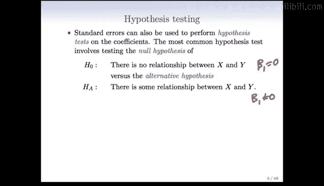

There's actually a one to one correspondence， in other words， they're doing equivalent things。

To be more precise， if the hypothesis test fails， words if we reject the nu hypothesis and conclude that beta 1 is not zero。

 as we did for TV advertising，Correspondingly， the confidence interval constructed for that data for the parameter will not contain zero。

Andversely， if the hypothesis test does not reject。

 so we cannot conclude that TV advertising has an effect， its slope may be zero。

 the confidence interval for that parameter will contain zero。

 so the confidence interval is also doing hypothesis testing for you。

That it's also telling you how big the effect is。So it's always good to compute confidence intervals as well as do hypothesis tests。

So for example， here we see。The interval doesn't contain zero。Furthermore。

 we see that a lower limit on the effective。TV advertising is 0042。

Which we can interpret is these are $1，000 units that we're going to affect sales by 1，000 times。Oh。

 so for every 1000 change in。TV advertising we'll get a corresponding change in sales。

 so this tells us not only is the effect zero or not， but how big is the effect likely to be？

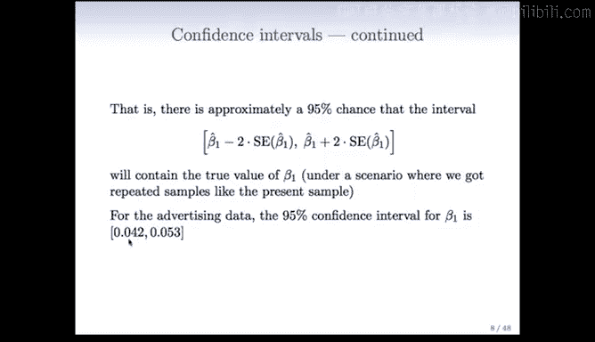

Okay。

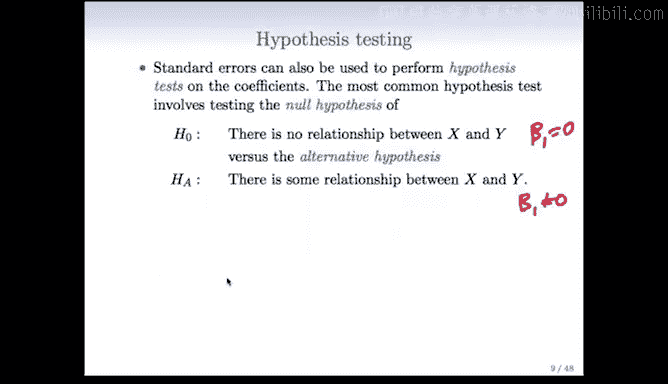

So where are we now， let's see？So。We've talked about how to assess the slope of an individual predictor。

How about the， the overall fit of the model， the accuracy of the model？ Well。

 what we can do here is we'll take the。There was id summa squares。

 remember this is the quantity that we minimize in the first place to get the best estimates of the intercepted slope。

 the least squares estimates。So we'll take what's called the mean squared residual and take the square root。

 this is the average square deviation that we achieve using the best the least fitting line。

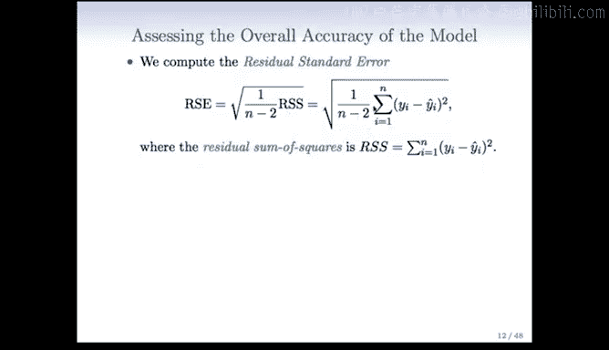

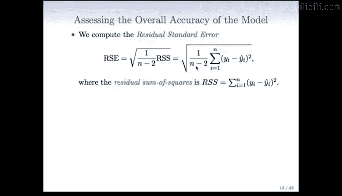

Where this is the residual sum of squares。And。We compute what's called the r squared or the fraction of variance explained。

 and here it is。It's the total sum squares。mininus the residual sum of squares over the total summit of squares so what is this conceptually well。

 if we didn't fit a model at all if we forget about TV advertising。

 just use the mean of sales as the prediction that's sort of the simplest prediction you can imagine。

This would be our。Our error， right， this is， here's our prediction。 Here's the true sales。

 So this is the no model error。And now the residualidsma squares of the fitted model is RSS。

This is how much is going to be lower than this guy right it's going to be lower because we could always achieve this guy just by choosing a slope of zero。

 so since we've done these squares we've optimized over the parameters。

 we know that RSS will be less than TSS， but this quantity measures how much did we reduce the total sum of squares relative to itself。

And here it can be written in this way or this way。 So this is the fraction of variances explained。

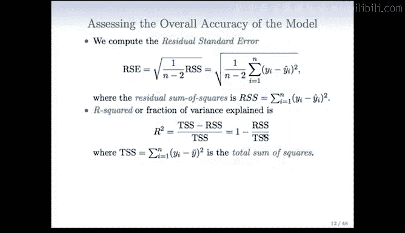

And。It can be shown algebraic， because this is actually equivalent。

To the squared correlation between x and y。 So this is simple correlation between the predictor and the outcome。

Kind of makes sense， right， the higher the correlation。The more that we will explain the variance。

 and there's actually an exact algebraic relationship that the squared correlation is equal to this fraction of variance explained。

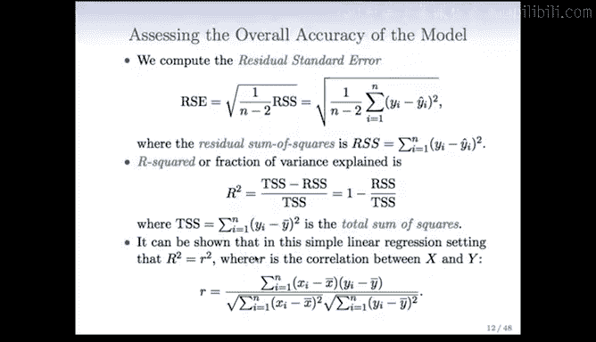

So what do we get for our data？The r squared is 0。61。Here it is， so in other words。

We've using TV sales。We've the， the budget， excuse me， TV budget。 we reduce the variance。In in sales。

By 61%。So that's a very strong predictor。The F statistic we'll talk about in a few minutes。

 it's also a measure of。How well the overall model is doing。So。This is quite impressive。

 in business in some kind of physical sciences， we see R squares like this in medicine。

We don't tend to see R squares， you might see r squared of 5%， you might get excited。

So always one has to remember the domain to have a judge of how good an R squared is。

 but this is an impressive r squared which you see sometimes in business and finance applications。

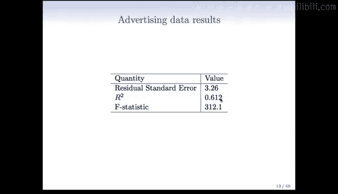

So that completes our discussion of regression with a single predictor in the next section we'll move on to the harder problem where we have multiple predictors and we do a multiple regression。

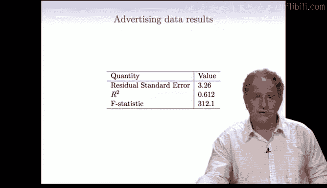