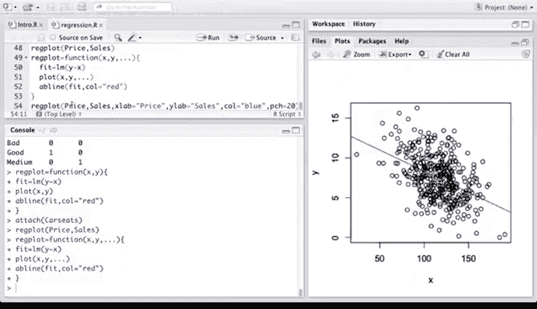

# 斯坦福大学《统计学习导论2023R语言版｜An Introduction to Statistical Learning with R》中英字幕 - P14：-014-Statistical Learning_ 3.R Regression in R.zh_en - GPT中英字幕课程资源 - BV1yU421o7WA

Okay。We're going to have an R session now in our studio。

 we've learned about some techniques for fitting linear regression models and now we're going to see how we do it in R so you'll see I've got a session open in our studio with some commands that I've already typed in and I'm just going to go through these with you and we'll see some of the features in our forfiing regression models。

Okay， so here we are。We've got a script window over here and we'll send commands down to the console so first we'll do library mass which has some data sets that we're going to access and then we'll do library ILR which is our own library with datas used in the book okay and so first of all we'll do simple linear regression。

So one of the data sets is the Boston data and it's got a bunch of variables and if you say names of Boston。

 you see all the names of the variables。Well， they kind of abbreviated names and so if you want more detail you can ask for help on Boston。

 so we do that by putting in a question mark before Boston， Boston's a data frame。

And in the right panel now， we see the help file for the Boston。

 so we see its housing values in suburbs of Boston。It's got 506 rows and 14 columns。

And now tells you details about each of the variables。So Cm， for example。

 is per capita crime rate by town。ZN is proportion of residential land zone for lots over 25。

000 square feet。And so on， if you go down the list， and these are all features about these regions。

In Boston， and they sort of summary features that describe the socioeconomic conditions in those regions。

Et lower status of the population percentage。 So it's a percentage of the population in that region。

 that's of lower status。And Med V is median value of owner occupied homes in $100，000。

 so you can to help on data frames。Okay， so the first thing we do is we to a linear model。U。

Oh I bigger your par， the first thing we do is plot some variables， so we'll plot。MedV and LStt。

 the two variables we just mentioned， and Com Boston。

 which tells the plot function to find those variables in the data frame Boston。

 and by using a twiddle between MedV and LSStAT， you're actually telling it that really the response is MV。

 that's the median housing value。It's going to put that on the vertical axises。

And so there's the plot on the right。 And sure enough， as。

As the lower status in the region percentage increases， the median housing value decreases。

We'll fit a linear model now to those data and you'll see the formula is the same as we used in the plot and we call that fit one and there it's fit and then we'll print it out。

And it gives us an intercept and a coefficient， and sure enough， the coefficient's negative。

 as you can see， there's a negative relationship。So printing out a linear model fit gives you a very brief summary and for a more detailed summary you can say summary of foot and when we do that we get a lot more so we get residuals。

Some of it's got cut off here， if you just look up， you'll see you get the call that created the fit。

You get。And then you get the coefficients， there standard errors。T values。And P values。

 And both of these are very significant。We typically are not interested too much in the intercept。

 it's the coefficient of。El stept that we're interested here。

 and it's negative and very significantly so， and then there's some other submarine material underneath。

 which we'll maybe touch on a bit later。Okay， so one the nice thing。 So notice in the formula here。

 we， we。We had the response on the left hand side Twiddle means to be means is modeled as and then Lt is a single predictor in this case。

 and then we give the name of the data frame where these variables can be found。

 So that's a standard format for fitting linear models and the other options too。

 but for the moment we won't need them。Now， we can add that linear model fit to the plot and there's a function called A B line in R。

 which。Is able to pick up a linear model and just do that。 And you'll see in the right hand plot。

 and it was。嗯。Augmented with the line that corresponds to the fit。Okay， now。

We've done various things with the fit。 we've plotted it with this A B line。

 we've looked at it with summary and with print by just printing its name。

 you can see what other components on it actually has got quite a few components。

These are largely to do with the details of fitting the model and we won't trouble ourselves too much with them。

 but basically you can see the coefficients on the fit。And that was picked up by the summary。

 and then a whole lot of other things that I used rather internally so we won't really concern ourselves with them。

Confit finds your confidence interval for the fit。And in this case。

 it gives a confidence interval for the coefficients and by default it gives the lower 25% and upper 97。

5% bound， so this is a 95% confidence interval for each of those coefficients。

The predict function is another one of these methods that we can use to query a linear model fit in this case we're going to predict with three new values for Ltatt or three particular values。

 5， 10 and 15 and we're going to not only ask for predictions we're going to ask for a confidence interval so those are additional arguments to predict。

And when we do that， we get the foot at those three values。

And then the lower confidence interval and the upper confidence band。

And so you can give as many values as you like and get those lower and upper values。

So that's simple linear your regression。😊，Let's move on to multiple linear regression and now we fit a linear model fit2。

 which is going to be a linear model with Ltat and age。

 and we separate those with a plus in the right hand side of the formula。

And and we can fit that and do a summary well it's just much like we had before。

 except now we've got two coefficients， two standard plus a intercepts。

 a three altogether together with their standard areasT value and P values。

And age is also significant。Quite strongly so， but not as significant as Lstt。

One of the things down below is the R squared which we talked about as well for the model。

 remember R squared， it's the higher the better。It's a percentage of errs explained。And。

It also gives you a summary， other summary of the model。

 the F statistic is the F statistic that we'd obtain if we dropped out both of the predictors in this model。

For three， we're going to fit a linear model with responseMV and it goes twiddle dot。

 and what that signifies is that we're supposed to use all the other variables in the Boston data frame except MV。

 which is the response and all the others will be predictors。And sure enough。

 when we do a summary of that model， you see there's a lot of coefficients。And。

They each get the estimate， their standard error， the T value and the P value。

Most of them are significant。 Some are not。 Age now is no longer significant。

So age when it was in the model just with Lstat， was significant。

 but now it's in the model with all these other predictors。And it's no longer significant。

 Now what that means is there's basically a lot of other predictors that are very correlated with age。

And in the presence of them， age is no longer required。Let's do a plot， you can plot linear models。

 I made a two by two layout because I know that these four plots get produced when you do a plot。

These are a little smaller， but we can see what's going on。

 These give you various views of the linear model。 The first one is the residuals against the fitted values。

The vector fitted values is just a single vector， so we can plot the residuals against that。

And the reason we do that is were looking for nonlinearities and we kind of know there's a nonlinearity in this when we saw that in the very first plot。

And by the curve in the residuals here， we can see that the model not quite capturing everything that's going on。

 there seems to be in some nonlinearity。And。These' other plots。

 which are somewhat beyond the scope of what we do in here today。

That give you aspects of the linear model fit。This one here is this lower left one is the square root of the absolute standardized residuals。

And when。Pluss this to see perhaps if the variance is changing with the mean or the fit。

 in this case， it looks like there may be some relationship there。

 but that could be a result of the nonlinearity that we seem to have missed in the model。

Update is a nice command， you fit a model for three。

 and you can update it and in this case we're going to update the formula we give is 20 dot minus age。

Twil means nothing on the left means we're going to use the same response。

Dot means whatever the model was in fit3 that's replaced in dot and minus age means we want to remove age and minus in this we want to remove in this as well so this will fit the model with those two variables removed all the others in。

And sure enough， if we do the fit。We see that those two variables are out。

 and now everything that's left in the model appears to be significant。Okay， moving on。

Non nonlinearities。And interactions， the first thing we'll do is make a fit where we put an interaction between Ltat and age。

And that we do with a star sort of like multiply， but in this formula language it means an interaction。

And we've just got those two variables in the model， and so when we do a summary of the foot。

We see that we get。The a main effect for L state， a main effect for age and then the interaction。

 which here is represented as a colon， so that star in the formula means that we're going to have main effects for each and the interaction and the pure interaction is indicated by a colon。

And while the main effect for age is not significant here， the interaction is somewhat significant。

Next thing we do is we fit Ltad and we saw that there was a nonlinear looking scatter plot between MV and LStad。

 and so yeah we explicitly put in a quadratic term。And there's two things going on here， the one is。

We the quadraically indicate by Lstt power2， but power has a meaning in this formula language and so if you want it to be mean actually just raise Ltt to the power too。

 we protect it with this identity function， so the formula language doesn't dig inside this identity function。

 so it literally puts in the square of Ltat。And the other thing that's going on here is we've put two commands in one line。

 which you can do in R but you have to separate them with semicolon so you can have as many commands in one line as you like。

 but separate them with semicolonons。And。And so both of those commands got executed now。

And sure enough， as no surprise， both coefficients are strongly significant。

 the linear and the quadratic。Okay， so now we're going to plot this。What I do now is attach Boston。

 we've seen this before， it means that the names， the named variables in Boston are available in our data space。

 just makes it easier for making nice looking plots。We go back to a single pane plot layout。

 so par MF equals c11 it means a one by one layout。And now we'll plot。Our two variables。

 There they are。 We've seen that plug before， and now we'll include。The quadratic foot。Now。

We we can't use AB line anymore because that only works when you've got a straight line fit now we need to somehow get the fitted values from our quadratic foot and include them in the plot。

And so we do that with a points command。 And the first argument is L Sta itself。

 and the first argument， The second argument are the fitted values from fit6。

 That was our quadratic fit。 So the fitted values are for each value of L status'。

 the fitted value from the model。 So that's exactly what we want。

 And that'll be plotted as a series of points。And we tell it the color should be red。And。The PCH。

 which is the plottin character， is to be 20。 Let's see what it does for us first。Well。

 it puts the quadratic fit in the plot。Looks like the plotting character 20 is a little round ball。

 we'll have a little look in a moment and see a bit more about that。

Before we do that there's an easier way of fitting polynomials and that's to use the polyfunction in R and so yeah we're going to fit MV as a polynomial of degree4 in Ltt。

And we'll add that to the plot with color blue。And。You can see that the fourth degree polynomial is。

 is， is getting a little bit too wgggly。 It's， it's chasing。

 it's starting to overfoot the data a little bit especially you can see in the right tail over here。

 it's maybe， you know， going after the these rather。嗯。Theses rather isolated points here。Okay。

 so before we end let's have a look at what plotting characters are available。

 so here's a simple way of seeing them all plot 1 to 21 to 20 and plotting characters 1 to 20 and we can see the whole lot。

And there you see them。And so you have available a whole bunch of plotting characters actually more than these。

 and number 20 was sure enough this one over year。And Cx equals 2 means that we want to enlarge those plotting characters by。

But we want to double the size。Qulititative predictors。So。Car seats is another one of the data sets。

嗯。Okay。嗯。So the command fix is a way of throwing up an editor in R。

 so you can actually look at the data that you're about to use。

 so it'll throw up a data frame and allow you to use it。

And so here' the car seats data frame thrown up on the screen。

 maybe a little bit small for you to use， just wanted to show you that， I'll quit out of that。

 get back to our studio session。And。So that's one way of seeing the data， there's the names。

Of course， its。And so this is， this was a study on on children's car seats。 Okay。

 you can also do a summary of a data frame and it。For each variable。

 it tells you something about the values in the data frame for that variable。

And you can see for quantitative variables， it gives you summaries like the mean。

 the median and up and lower quantiles。But for categorical or quantitative variables。

 it actually gives you a table of the distinct values。 Okay， so she lock is a。

A qualitative variable in this case。Okay， so。So。So we'll fit a model for the car seats data。And。

The first call is sales twiddle。t means everything in the frame but sales。

 plus we're going to add in interactions between income and advertising and age and price。

And we do that。And sure enough， may we get the model。And there's again。

 a bunch of significant variables。 and there are those two interactions we put in and income and advertising。

Appears to be strongly significant， but price and age is not。嗯。S show of lock。嗯。

Was a qualitative variable。If you look at contrasts， at contrasts。Function。

 it shows you how R will code that variable when it's put in a linear model。 and in this case。

 it's a three level factor， and so it puts in two dummy variables。And。The values are。

 if Shelock is bad， zero for both， if it's good。The first one is one， and the second one is， is0。

 If it's medium， see， they named actually good and medium， 0 and1。

 And so bad is not neither good nor medium。 So that's 0 in both。

So that you can actually find out how are codes quantitative variables。

So the final thing we'll do here is see some examples of writing R functions。

So let's write a little r function to fit a regression model and make a plot。

So we start off by saying red plot is equal to function of X Y， open curly brace。

And then so that open curly brace indicates that we're going to start giving the code in our function。

 and the X and Y says our function is going to take arguments x and y。Okay。

 and so the first thing we do is we're going to fit a linear model between y and x。

 Then we're going to plot x Y， and then we're going to A B line the fit with color equals red and then。

And then close curly brace that's the end of our function。Okay。

 so it's a very simple little function which we've written and so now let's try it out well attach car seats and we will do a red plot of price and sales。

 so it takes two arguments we've given it price and sales。And you see the plot on the right。

Rake plot silently went off and did that and produced the plot and put in the line。Okay。Well。

 let's make our function a little bit more useful and you can see I'm defining it with essentially the same commands。

But I've added a dot dot dot in the arguments， and this is a very useful construct in arm in writing functions。

Dot dot， dot means these are unnamed arguments。😡，But you' allow to add extra arguments。

 and they all get passed on exactly as they supplied wherever they used inside the function。

 And here， I've passed them on to the plot function。

 And what that does is it allows us to add extra arguments to the plot function via our ra plot。

And so now when we make the call， we call rig price and sales。And we give it。Xla and Yla。

 so that tells it how to annotate the labels of the axes of the plot and we add some color and other information See Re plot just called the axes X and Y。

 mean our variables were price and sales。So。

Now， when we make the plot， you see the plot points were colored in blue and。

And the axes were labeled。Okay， so that's a little introduction to some of the linear model software in R。

 that the scope is really large and there's many other things you can do。

 but as always with software you've got to start at the beginning and get your hands dirty and so we've done that a little bit here and I encourage you to play with this yourself and explore the functions。

 use the help files and see how far you can get。

