# 斯坦福大学《统计学习导论2023Python版｜An Introduction to Statistical Learning with Python》中英字幕 - P16：-016-Statistical Learning_ 3.4 Some important questions.zh_en - GPT中英字幕课程资源 - BV1u4421A7ZU

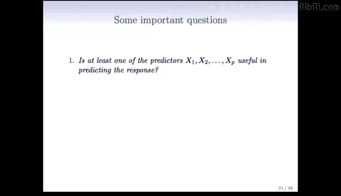

Welcome back， we're not going to talk about some important questions in arise when you use regression in real problems。

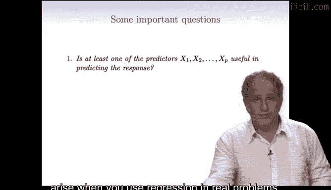

So。Well， is at least one of the predictors useful in predicting their response。

 right that's sort of the first order question？IsDo the predictors on the whole have anything anything to say about the outcome。

 if not， we probably want to stop there。

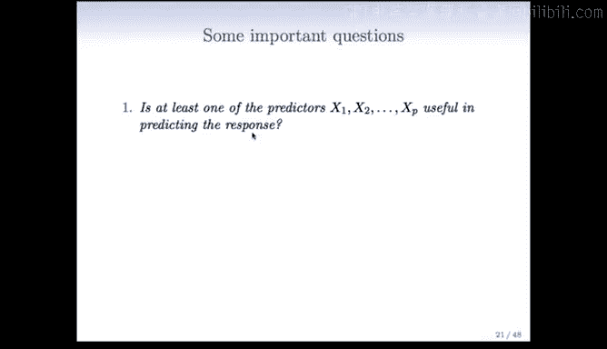

But given that there is some effect overall。Which of the predictors are important。

 are they all important or only some subset？

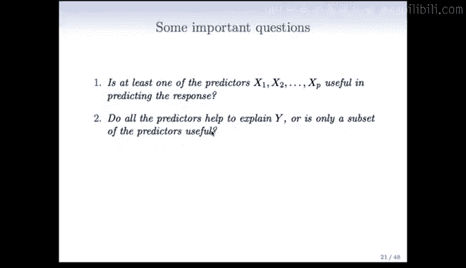

How well does a model fit the data？

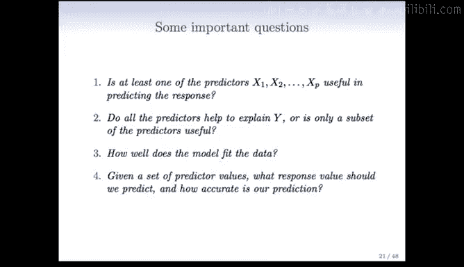

And also， given a set of predictive values， what response that value should we predict。

 so what's our prediction？

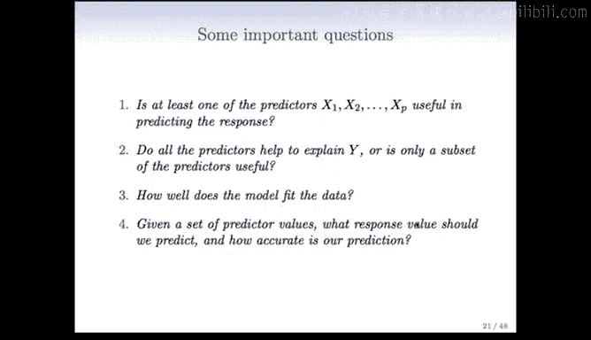

Of sales， given a certain level of advertising in the three modes。

 and how accurate is that prediction。 So these are all things we can answer from the model。Well。

 at these one， two and four， three will examine by looking at some alternative models。

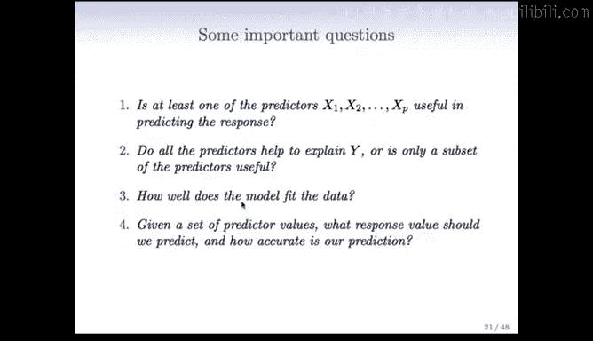

So。The answer the first question is at least one predictor use。

 does the model overall have any predictive value？We we do。We look at the drop in training error。

 so this is the total sum of squares， if we just use the mean to predict。

 that's the no predictor model。This is the residual sum of squares achieved using all three predictors。

嗯。And。We can look at the drop， the present variance explained。Which actually I've got here。

 further for that， we defined this earlier， now it's 0。897。So it was about 0。

6 something before now by adding the two more predictions， we've increased that to 0897。

 so this says that we reduce the variance of sales around its mean。By almost 90%。

 by using these three predictors， that seems pretty impressive。

To quantify that in in a more statistical way， we can form。The F ratio， which is defined as follows。

It's the drop in training error。Divided by P， P is the number of parameters we fit here it's three。

 the three kinds of advertising budgets。Divided by the mean squared residual。N is a sample size。

 and we subtract off the number of parameters we fit， which is P plus1 for the intercept。

So statistical theory tells us that we can compute the statistic and under the nu hypothesis that there's no effect of any of the predictors。

This will have a。An F distribution with P and n minus p minus1 degrees of freedom。And again。

 there are tables of this or your computer program will compute this for you。

The Ftistic here is huge。And it's P value。I haven't recorded here， but it's less than 。0001。

 So this says what we kind of believe already looking at the。

At the previous tables in the graphs that there's a strong effect here of the predictors on the outcome。

 they certainly have something to say about the。

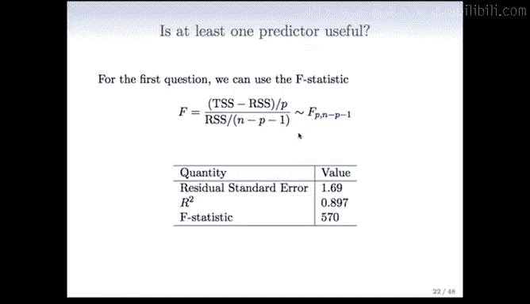

The outcome。Okay， when we fit linear regression models。

 one of the things we have to do is decide on what are the important variables to include in the model。

 by the way。

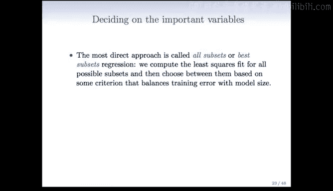

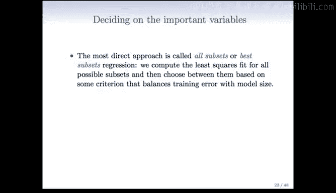

This is not job anymore。Roob asked me to do this section because it's a little hard for him。

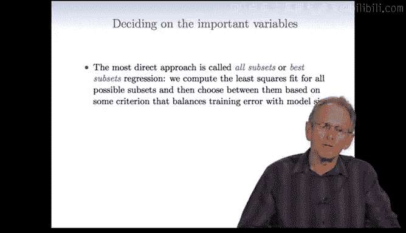

Kding。So。

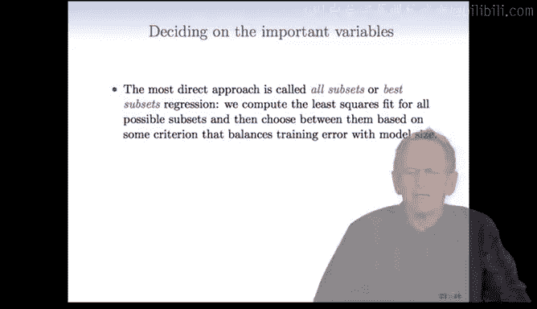

The most direct approach is called all subsets or best subsets regression。

 So basically what you're going to do is you're going to compute the least square foot for all the possible subsets of the variables and then choose between them based on some criterion。

That balances the training error with the model size。

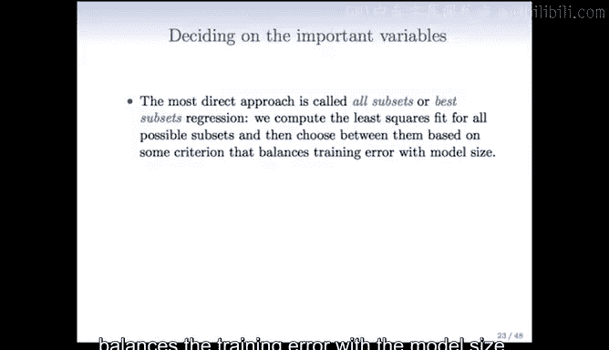

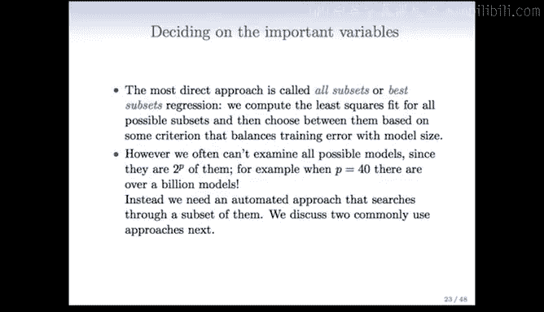

Now， this might seem like a reasonable thing to do。If you have a small number of variables。

But it gets really hard when the number of variables gets large。

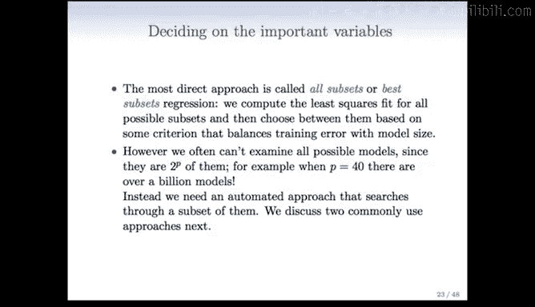

So if you've got P variables， there's  two to the P subsets。And， you know。

 that2 to the P grows exponentially with the number of variables。 So， for example， when P is 40。

 the over a billion models。

RightSo we're talking about subsets like a model might have variable 1，3 and 5 in it。

 That's a subset of size 3。And then another model might have a subset of size 4。

 And with 40 variables， there's over a billion such models。

 So that clearly becomes cumbersome searching through such a big model space。

And so what we need instead is an automated approach that searches through for that finds a subset of them。

And so we'll describe two commonly used approaches next。

Forward selection is a very attractive approach because it's both tractable and it gives a good sequence of models。

 So this is how it works。

You start with a null model， and the null model has no predictors in it。

 but it'll just have the intercept in it， and the intercept is the mean of why。

With no other variables in the model。And now what you do is you add variables one at a time。

The first variable you add you do it as follows。 you fit P simple linear regression models。

 each with one of the variables in and the intercept。

 and you look at each of them and you add to the null model。

 the variable that results in the lowest residual summer squares。 So basically。

 you just search through all the single variable models and pick the best one。

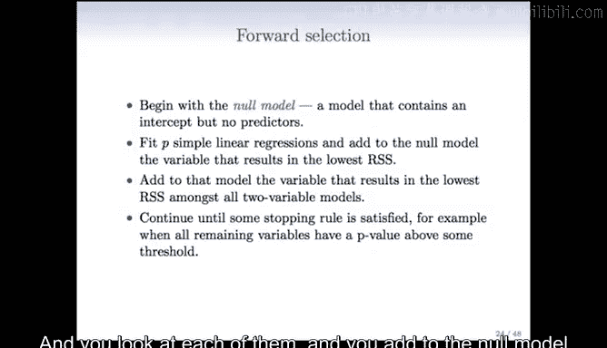

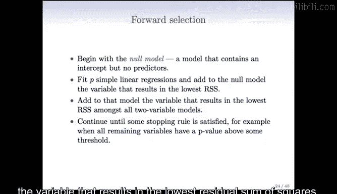

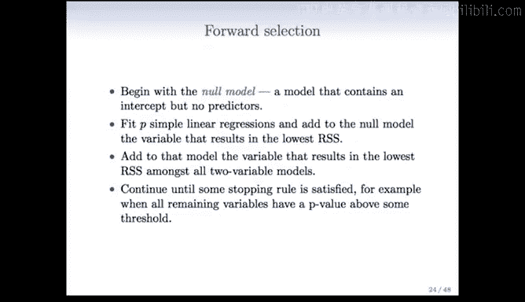

Now having picked that， you fix that variable in the model and now you search through the remaining p minus1 variables again and find out which variable should be added to the variable you've already picked to best improve the residual summer squares。

And you continue in this fashion， adding in one variable at a time until some stop you rulely satisfied。

 for example， in all the remaining variables have a P value above some threshold。

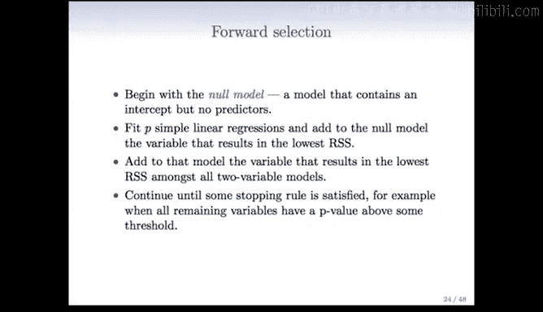

Now， this sounds like it might be computationally quite difficult as well。

 but it turns out it's not there's some clever tricks you can use to do all these evaluations very efficiently。

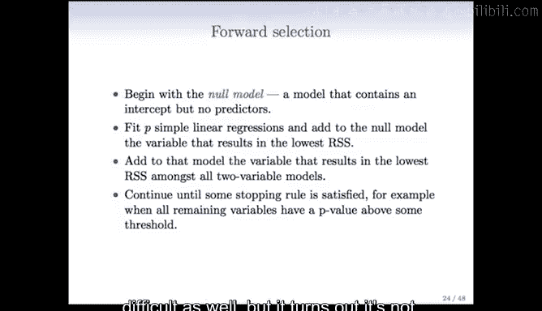

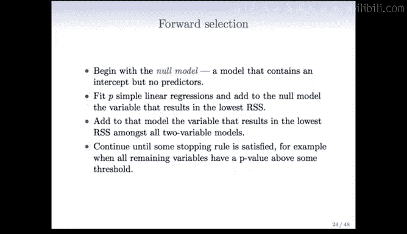

So in a similar fashion， and this is if P' is not too large， you can start from the other end。

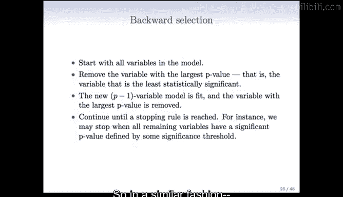

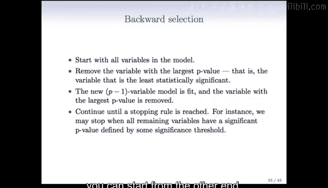

So you start with the model with all the variables in the model。

And now you're going to remove them one at a time。

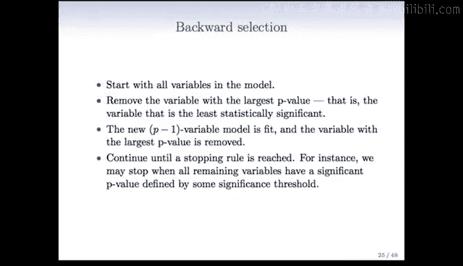

And this time you're going to remove each at each step。

 you're going to remove the variable that does the least damage to the model。 In other words。

 you want to remove a variable that's got the least significance。

And that you can actually find from looking at the T statistics for each of the variables。

And remove the one with the least significant T statistic。

Now you've got a model with p minus-1 variables and you just repeat and you keep on going in that fashion again until you reach some threshold that you've defined。

 perhaps in terms of a P value。

So these are two approaches， they might seem somewhat ad hoc， but theyre very effective。

 and later we will discuss more systematic criteria for choosing an optimal member in the path of models produced by either forward or stepwise model selection。

Some of these criteria include something known as Mallow CP， Akaki information criterion， AIC。

 that's abbreviation， and then BIC， which is Bayesian information criterion。

These all sound like very important methods they named after important people and they're very popular and then there's something called adjusted R squared and one of our favorites is cross validation which you'll be learning about。

We will talk more about model selection in in， in， in the later， in later sessions。

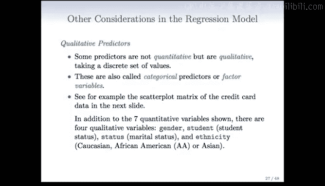

Now， there's some other considerations in regression models that we haven't really touched on yet。

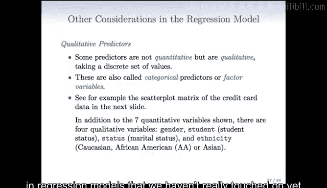

And the one is qualitative predictors。So some variables are not quantitative but qualitative。

 in other words， they dont take values on a continuous scale， but they take values in a discrete set。

So we call them categorical predictors or factor variables。Were going to see us。A matrix of。

Data in the next slide， it's a credit card data。 In fact， I'll just take you there now。

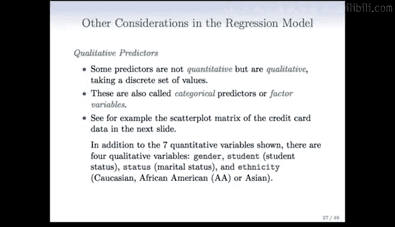

And so here's a bunch of variables。OnOn credit cards and ratings。

 and we see the current balance on the credit card， the age， number of cards and so on。

 these are all quantitative variables。Now， in addition to these variables， we have。

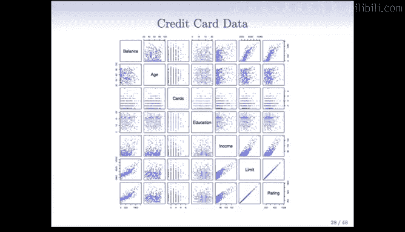

We have some qualitative variables， so one of them is gender。

 so that takes on values male and female。Student， so the student status of the of the card holder。

 whether they are a student or not。 So these are qualitative values， marital status。Say married。

 single or divorced。There's no order really in those variables， they're just different categories。

And likewise， ethnicity， say Caucasian， African American or Asian， again。

 not in no way an ordered variable。So how do we deal with such qualitative predictors when we fit in linear regression models。

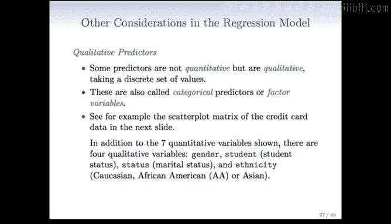

So let's， let's consider our example on， on credit cards。 again。

 Imagine and investigating the difference in credit card balance between males and females ignoring the other variables。

So what we do is we create a new variable。Let's call it X， I。 And it's gonna well， X， we call it X。

 And the I value is going to be one。 If the I person is a female and a 0， if the I person is a male。

So we got a name for such a variable。 We call it a dummy variable。

 It's a created variable just to represent this categorical feature。

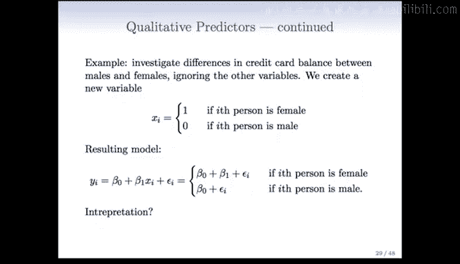

Okay， so for each value of I， we， we score an individual as 01， depending if they female。

 male or female。

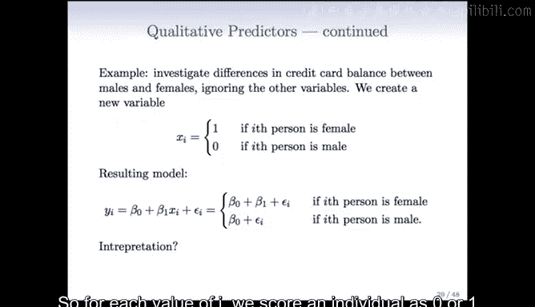

And so now if we put such a variable in a model， let's say on its own。😊。

We've got the linear regression model with a coefficient for this dummy variable。Xi。

 And let's see what it it produces。 Well， since Xi takes on only two possible values，0 or1。

 the model is either going to be beta 0 plus beta 1 plus error。

If the person is female and if the person is male， it's just going to be beta 0 plus error。

So beta 1 is telling us。The effect of being female versus the baseline in this case， of being male。

And so that's how we deal with the categorical variable with just two levels。

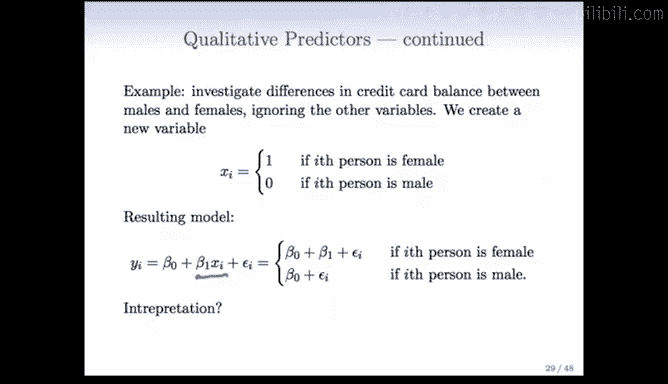

So here we see the results of the regression model using just the single variable gender and the dummy variable 01 that the one represent in female。

And so we see the result and the coefficients 19。73， but it's not significant， the P values 0。66。

 which is not significant。 so contrary to popular wisdom。

 females don't generally have a higher credit card balance than males。

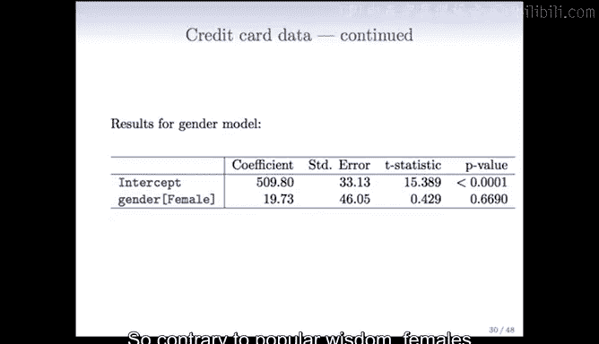

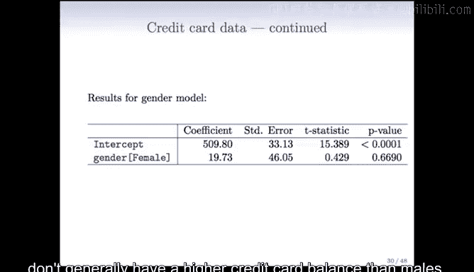

The number is 19。73 slightly higher， but it's not significant。

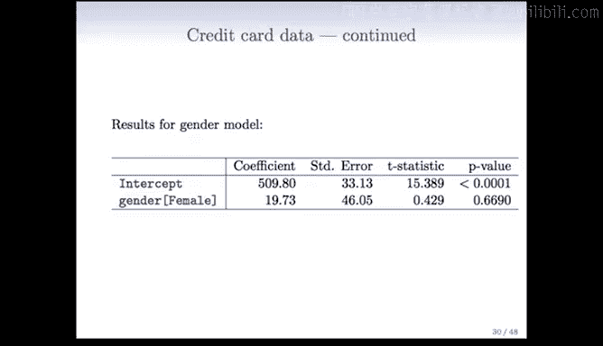

So what do we do if you have a variable with more than two levels？So ethnicity is such a variable。

 Well， we just make more dummy variables。 So ethnicity takes has three levels。

So we'll make two dummy variables in this case and we'll call them X1 and x2。

 and so X I1 is the value for the I individual for dummy variable1。

 we'll call it one if the persons Ih person's Asian， otherwise0。

And the second du variable will be one if the eighth person is Caucasian and zero， if not。And。

 of course， if they both zero， the person， the individual will be African American。

And so that's the general rule if you've got a categorical variable with three levels。

 you make two dummy variables， if it's got two levels， you make one dummy variable。

 and if it's got k levels， you'll make k minus1 dummy variables to represent each of those categories。

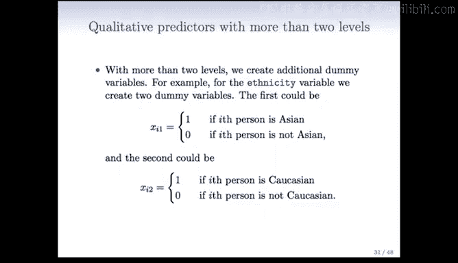

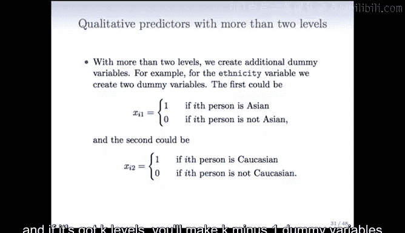

So what does the model look like in this case？Well， we'll have a model now with two coefficients。

 one for each of these dummy variables。And let's look at the different cases。

 So if the person's Asian。They get the beta 1。If the person's Caucasian， they'll get the beta 2。

And if the person's African American， they don't have beta 1 or beta 2。

 So the baseline beta 0 represents such an individual。

And so what we see now is that beta 1 represents the difference between the baseline beta 0。

 which is African American and the difference between that individual and an Asian。

 so it's the additional effect for being an Asian and beta 2 is the additional effect for being Caucasian。

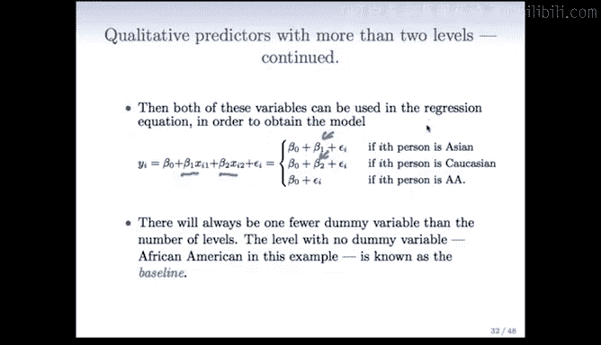

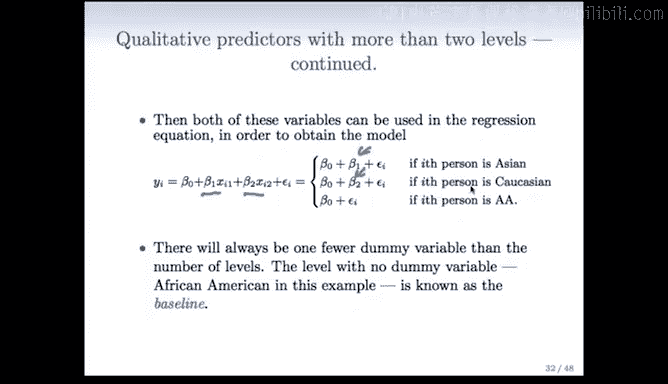

And as I said， there will be always one fewer dummy variable than the number of levels。

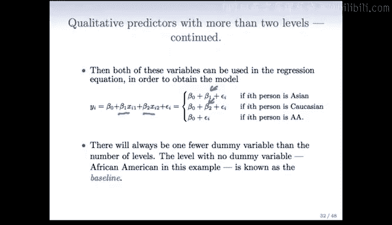

So in this case， we call。The， the category， African American is known as the baseline level。

 because it doesn't have a parameter representing it， except beta 0。

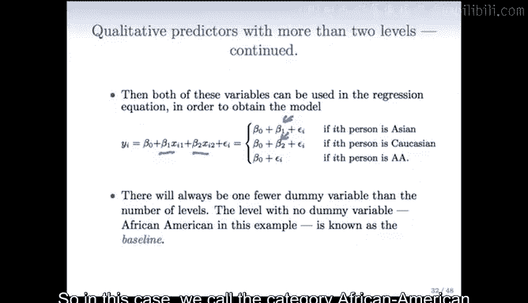

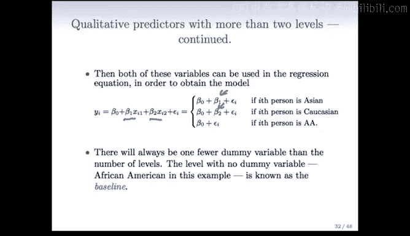

So here's the linear model， we've picked African American as a baseline。

 and so that actually determines which comparisons we make so the coefficient minus- 18。

69 is comparing Asian to African American and that's not significant and likewise the Caucasian to African American。

 which is also not significant。Now it turns out the choice of the baseline does not affect the foot of the model。

 the residual sum squares would be the same no matter which category you chose as the baseline。

But the contrasts would change， because that would determine picking the baseline determines which contrasts you make。

 And so the P values potentially will change as you change the baseline。

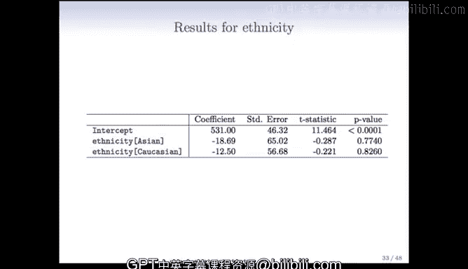