# 斯坦福大学《统计学习导论2023Python版｜An Introduction to Statistical Learning with Python》中英字幕 - P18：-018-Statistical Learning_ 3.Py Linear Regression and statsmodels Package I 2023 - GPT中英字幕课程资源 - BV1u4421A7ZU

Okay， here we are in chapter3 linear regression， which is obviously important thing when you study statistics。

 so we're going to show you some of the tools for doing linear regression and importantly we're going to show you some new tools that Jonathans developed specifically for this book and for the ISLP package that make specifying linear models much easier。

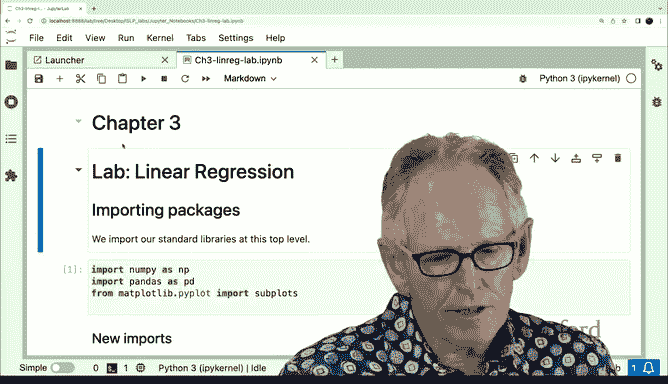

Okay， thanks， chair。Okay， so。As we'll see in most labs。

We talked and we talked a bit about this in the first lab。

 wheneverever you want to use code in Python， you have to find it somewhere。

 and that's done with an import statement。 Now， import statements can be put anywhere in the code。

 but sort of good practice is to put them all at the beginning so。

We've seen a few libraries in our last lab， we're going to import some of those same objects。

 and there's a new library that fits linear regression as well as logistic regression。

 which we'll see in chapterpt 4， that's the stats models package that is the sort of package for fitting regression models in R。

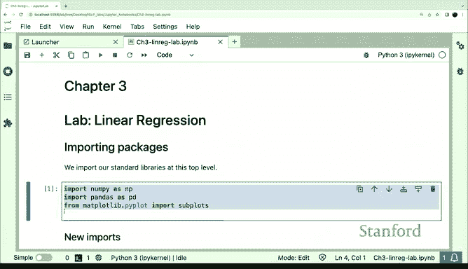

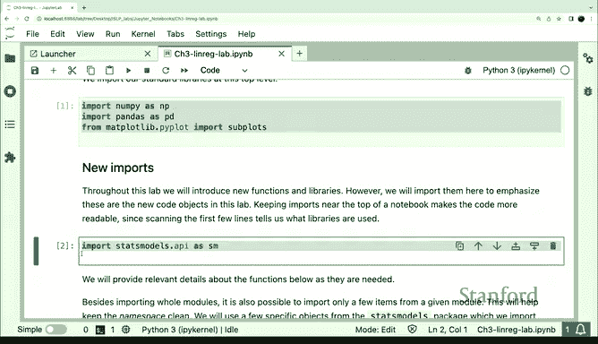

Okay， and as Trevor mentioned。One of the things we did for these labs was try to recreate。

 try to create a way to make specifying regression models easier。

 There are a few different ways to do this in Python。

 but we chose to do something specific that was we felt a little simpler。 and that's this model spec。

 So we'll see。

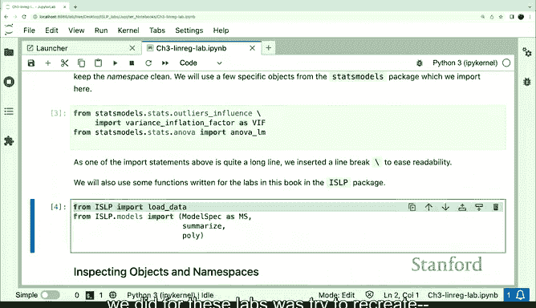

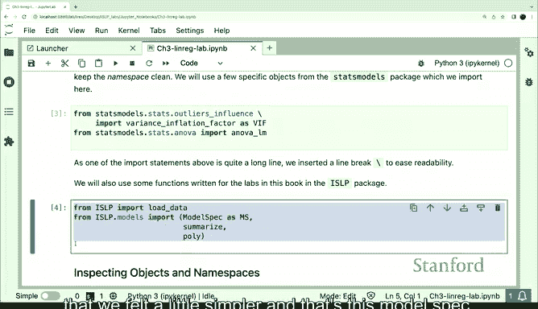

In a moment how we use this to build design matrices for the regression problem and that's really besides fitting the model。

 specifying the design matrix is one of the important deciding what columns you want to use。

 what affects， what interactions， etcter。

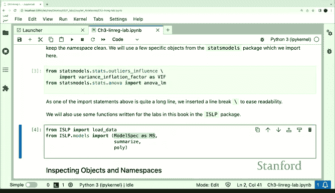

Okay， so let's jump right to。linearar regression。I better be careful and run these cells。

 so I havent made the imports。 let's fit our first simple regression model and see how this model specification works。

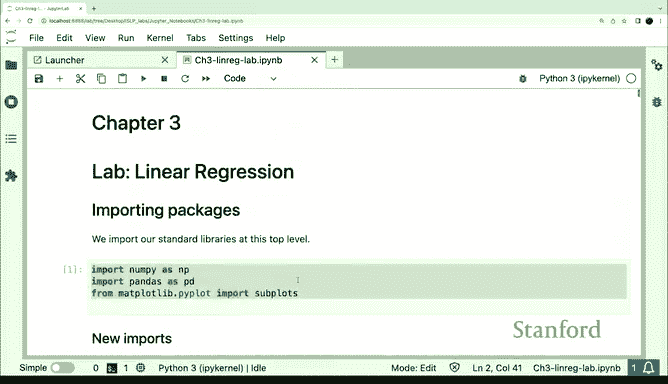

We're going to use the classic regression example of the Boston housingous data。

And we use this low data function from the ISLP package。 Most of the data sets we'll use。

 besides for deep learning， can be accessed with the low data function。

 It gives us a data frame and with these columns， a description of the variables。

What can be found here or。On as well。Okay， so to fit a regression model。

 we need a design matrix here， let's make a design matrix by hand。

 We're going to have a column for an intercept and a column for Ltt。

 This variable here stands for a percent of the population of lower social economicconomic status。

 Not sure exactly how that's measured， but that's what the documentation tells each observation is the sameus in Boston Oh。

 that's right。 the response here is。

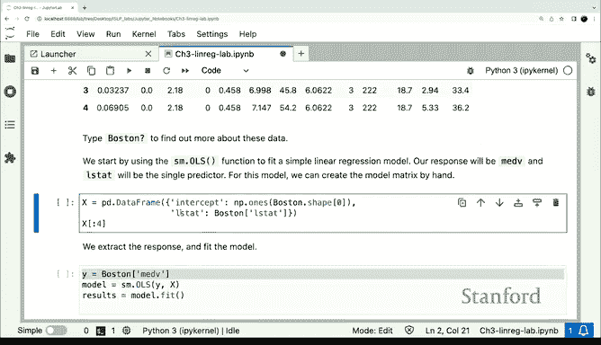

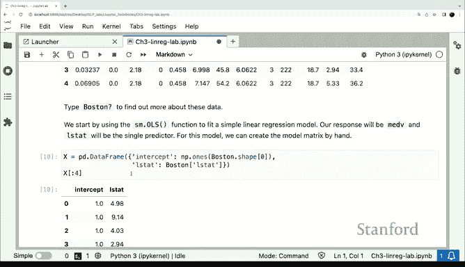

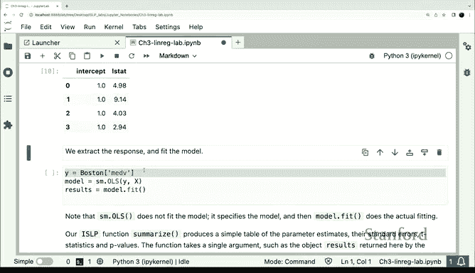

Med V， which stands for median value。 and that's the the median value of a how of of a house in that particular census district。

Okay， so the way we fit these models is given a response in a design matrix。

 we're going to use this OLS method from the Stats models package。

 which is an ordinarily squares models。We'll fit it with the fit method。

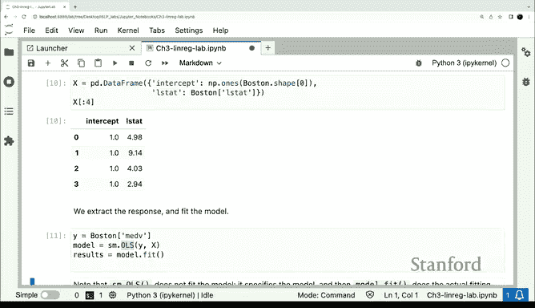

And we'll take a look at you know the usual summary of a regression model that has coefficient estimates and estimates of the standard error。

 Of course， the T statistic is the ratio of these two。

 and this is you know the P values here are tiny， so there is some association between a parent association between Ltt and median value and by the way。

 summarizes in one of the nice functions written for the ISOP package which gives a nice compact summary compared to the default summary which is rather big and ugly。

 Yes you can see the default summary below but we't we won't dwell on it。

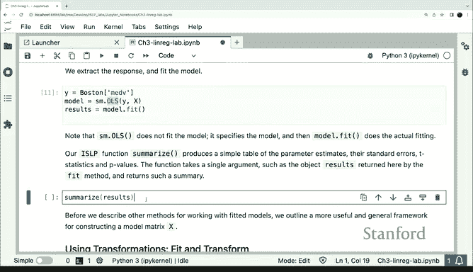

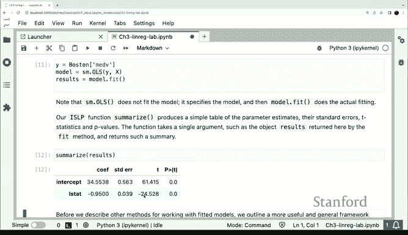

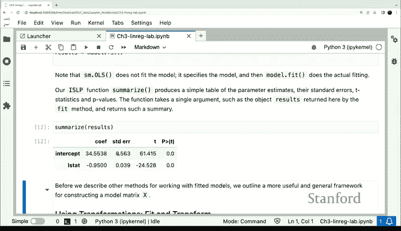

Okay， so we're going to have to create more design matrices and more complicated design matrices so we use we're going to use this thing called model spec or model for model specification and it uses this sort of paradigm we'll see later that is a transformer from the psyit learn package so these transformers they you can think of them as ways to。

To process features or sort of feature engineering kits。

 you'll notice in the text we use the word model matrix and design matrix interchangeably。Yes。

And so these transformers， they have these two methods fit and transform that are used。

Throughout whenever you see a transformer。 and this is our first example of one。

 we'll see later when we do principal components analysis that it is another example of a transform。

 I I just want to say something， and that is that if you a lot of time is often spent in booleing up these model matrices to do regression and instead's tedious and especially when you make transformations or variables and you have interactions and things like that。

 you can spend a lot of time， just getting set up to do the regression。

 and Jonathan's created these tools that make it much easier to do as you'll see。

 and especially as the examples get more complicated Yes， yeah， and another key thing， of course。

 if you're just to make these design matrices by hand。

 sort of keeping track of what the columns are and how they relate to everything else is kind of is important being able to manipulate them as useful。

 Like you might want to you know drop one of the terms of the of a regression model and being able to do that。

 those are some of the capabilities of this models back。But we won't touch on that today。Okay。

 so let's jump right in， we want to fit a regression with only a single feature。

 so the way we specify the features in the simplest case is just a list of column names and we use we apply the fit method to the Boston data frame and what this will do is essentially just check that there is an LtAT column in the Boston data frame and recognize it that it's a float and so when it creates a design matrix it'll just extract that column and add that to the matrix if we had more columns would it would have more columns to the design matrix we'll see that shortly。

Okay， so doing this， when we want to actually construct the design matrix of the model matrix。

 we call the transform method on a data frame Boston in this case。

 and this constructs the actual design matrix or model matrix and notice just by default。

 it put in an intercept column which is something if you did it manually you'd have to do yourself。

 just by default it just put in the intercept column which is usually what you want。 Yes。

 that's a good point。 you can turn it。 there's an option。 if you don't want it。

 you can we can not have it。 but most of the time we want it it just。Okay。

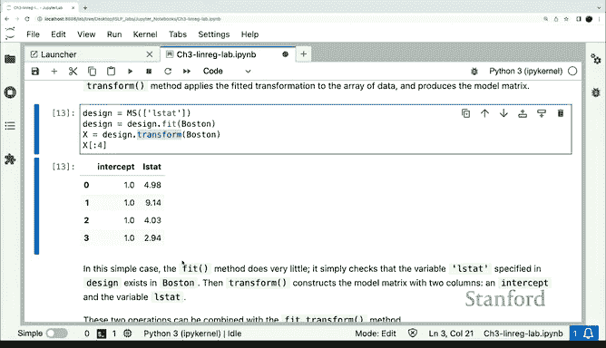

Let's see。 So just one small comment about this。 If you look at when I constructed this。

 this model specification doesn't know anything about the Boston data， right。

 It just has the name of the column。 It's this part here that when we call the fit method on Boston。

 it inspects the Boston data and recognize there actually is a column called Elstad and then knows what to do with it when we call transform。

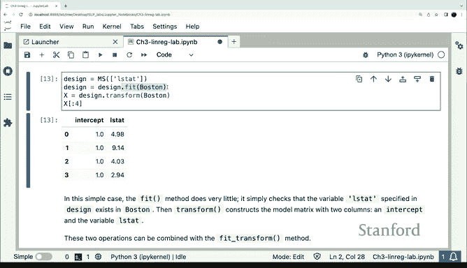

Okay。

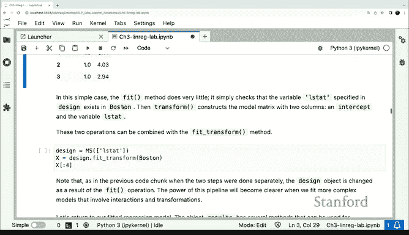

So。Moving on， let's go on to the next topic which be multiple which will be confidence intervals and predicting at new points。

So， you know， as commonly， we'll have a another。Yes。

Maybe some other census districts that weren't included in the fit。

 or maybe if we think of this model relating median value to L Sta is applicable to other areas。

 we might go to， you know， Philadelphia and find the percent lowest Ltt in those census districts and try to predict there so。

That's what we'll do now。 So to do that， we need to。Provide the transform method。

 a data frame that has all the the necessary variables。 In this case， it just needs to have Ltt and。

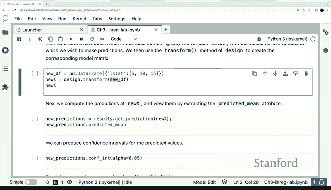

This transform will create the design。 these rows， the design matrix corresponding to these values of Lstt。

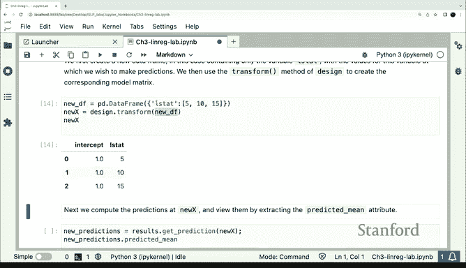

I see。 So the design object that you created knows how to set up the design matrix。

 and you've just given it a new data from and uses the recipe you set up to do that。 That's right。

 And so if you for more complicated designs，' you know。

 it will produce the design matrix in exactly the same way it did for the original data when you fit the model。

 thatll be important when some of the transformations get complicated like for principal components or or polynomial regression。

 for instance。

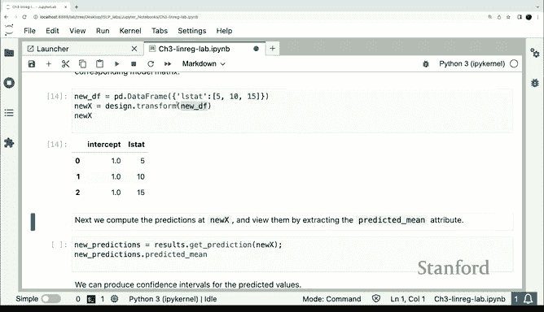

Okay， so and to actually get confidence intervals or new predictions。

 that's we rely on the stats models。 So this get prediction method gives us fitted values for the。

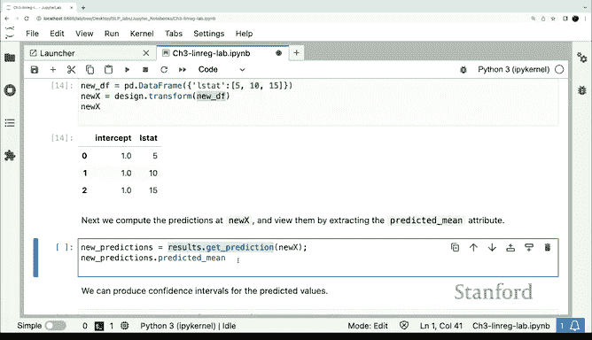

At the new points， so。Those of the would be centers of our confidence intervals。

 And from the new predictions method， we can similarly get confidence intervals。

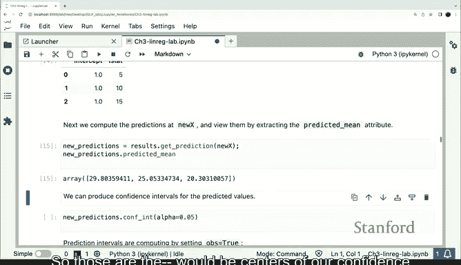

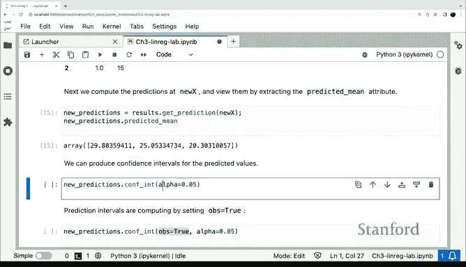

Wonderful， so that's simple linear linear regression。

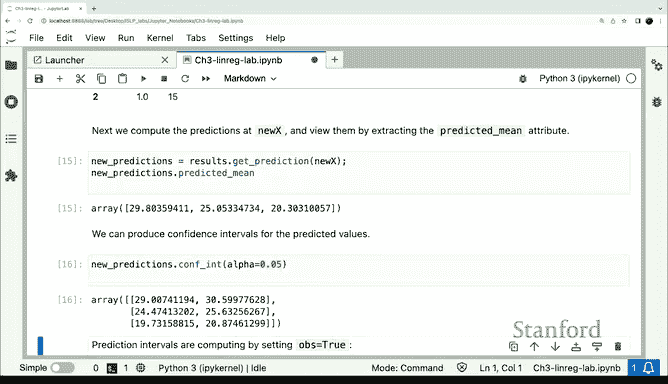

And the next section we'll deal with is multiple linear regression。

