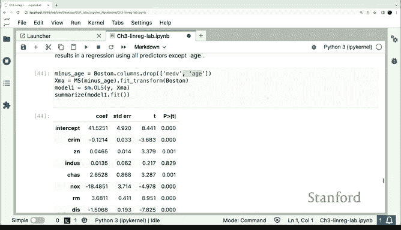

# 斯坦福大学《统计学习导论2023Python版｜An Introduction to Statistical Learning with Python》中英字幕 - P19：-019-Statistical Learning_ 3.Py Multiple Linear Regression Package I 2023.zh_en - GPT中英字幕课程资源 - BV1u4421A7ZU

Our next example is multiple linear regression， where we have more than one column added to the design matrix。

 So here we'll， we'll use the age variable， as well as the L stat to。

To predict the median value in census districts。And。As above。

 if we just want the design matrix directly， we'll use this fit transform method。

 which calls fit and then transform just as a shorthand， but。Really， what's got going under the hood。

 First fit is called and then transformers called on Boston。 Oh， so yeah， you do it all on the fly。

 called model spec。M。And。The fit and transform。 and it just creates a matrix X all in one。 Yes。

 whereas above we get in in several steps，Okay， so as above， we create the design matrix。

 the stats models object， and then we can summarize the results to get our。Table as we saw above。

 and now there's an effect for LStAT and effect for age， and of course。

 these are interpreted just as above estimates of the coefficients， standard errors， etc。Okay。嗯。

So now， let's。do have another example。 So here we had two columns and easy to make a list of two columns。

 but we might have an example。 in this case， there are 13 or so features in the Boston data set。

 And if we wanted maybe all but or all of the features。 be we'd have to write all 12 names。

 that would be kind of a pain when Yeah， but well。So how do， you know， of course。

 P Python is just a language where we can find all the columns that aren't median value， so。

If we just look at the columns of Boston and drop the meeting value。

 this gives us all 12 of the column names， and then we can just pass that as our argument to Model spec。

Then now we'll get a model that has all the， you know， all the features except， of course。

 the response fit in the in the regression model。 Well， that's very convenient。Yes。Okay。

 now supposed we want it all but age well。We would just similarly drop age。And， of course， okay。

 we don't need to inspect that。 It'll just have one row less。

 and it will be the fit as if we dropped age。

