# 斯坦福大学《统计学习导论2023Python版｜An Introduction to Statistical Learning with Python》中英字幕 - P1：-001-Statistical Learning_ 1.1 Opening Remarks.zh_en - GPT中英字幕课程资源 - BV1u4421A7ZU

Hi， I'm Trevor Hasty and I'm Rob Tpscii and then you say welcome to the course San Cis Francisco hii。

 I'm Trevor Hasty and I'm Rob Tps。Hi I'm Trevor no I'm Rob Tipssanni and I'm Trevor Haty and welcome to our course on statistical learning It's the first online course we've ever given and I're really excited to tell you about it and a little nervous as you can hear。

😊，So a way of background， what is statistical learning？Trevvin and I are both statisticians。

 we were actually graduate students here at Stanford in the 80s。

 we've known each other for about 30 yearsness and back then。

 well we did applied statistics like a lot of statisticians did。

 statistics have been around since about 1900 or before。But in the 1980s。

 people in computer science developed a field of machine learning。

 especially neural networks became a very hot topic。

 I was at University of Toronto and Trevor was at Bell Labs and one of the first neural networks was developed at Bell Labs to solve the zip code recognition problem which we'll show you a little bit about in a few slides So around that time Trevor and I and then some colleagues Jerry Friedman。

 Brad Afron'Ben， O'bririman and you actually you'll hear from Jerry and Brad both in this course。

 we have in some interviews with them both that time we started to work on the area of machine learning and sort of developed our own view of it which is now called it statistical learning so we're along with colleagues here at Stanford and other places we developed this field of statistical learning。

So in this course， we'll talk to you about some of the developments in this area and give lots of examples。

 so let's start with our first example， which is a computer program playing Jeeopardy called Watson at IBM builtilt。

And it beat the players in a threega match and the people at IBM who developed the systems that it was really a triumph of machine learning。

 there were a lot of very smart technology， both hardware。

 but also the software and the algorithms were based on machine learning。

 so this was a watershed moment I think for the area of artificial intelligence and machine learning。

Google is a big user of data and a big analyzer of data。

 and here's a quote that came in the New York Times in 2009 from Halvariarian is a chief economist at Google。

 you can see the quote there I keep saying that the sexy job in the next 10 years will be statisticians and indeed there's a picture of Carrie Grimes。

 who was a graduate from Stanford Statistics。 She was one of the first statisticians hired at Google。

 Now Google has many statisticians。Our next example this is a picture of Nate Silver on the right。

 and N has a master's in economics， but he calls himself a statistician。

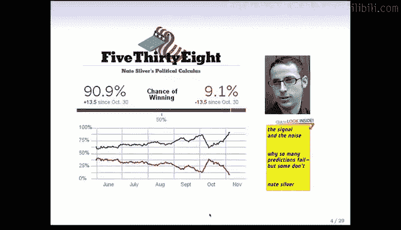

And he writes， at least he did write a blog called 538 for the New York Times。

 and in that blog along he predicted the outcome of the 2012 presidential and Senate elections。

 very well， of fact， he got all the Senate races right and the presidential election he predicted very very accurately using statistics。

 using carefully carefully sampled data from various places。

 I'm careful now says he did an extremely accurate job of predicting the election when a lot of places where a lot of news outlets weren't sure who's going to win pretty nerty looking guys Yes。

 but he's very famous。 and it's like a rock star these days Yes。

 we joke about when you' were a statistician when you go to the party and tell someone says know what do you do。

 when say I'm a statistician， they run for the door But nowadays we can say， well。

 we do machine learning and well， they still run for the door， but take a little longer to get there。

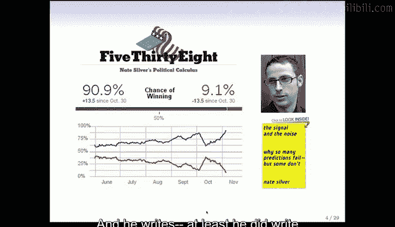

In fact， we now call ourselves data scientists。 It's a trend year word。

So we're going to run through a number of statistical learning problems。

 you can see there's a bunch of examples on this page and we'll go through them one by one just to give you a flavor of what sort of problems we're going to be thinking about。

So the first data we're going to look at is on prostate cancer。

 this is a relatively small data set 97 men sampled from 97 men with prostate cancer。

 actually by a Stanford physician Dr。 Stay in the late 80s。

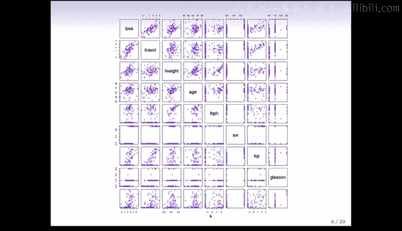

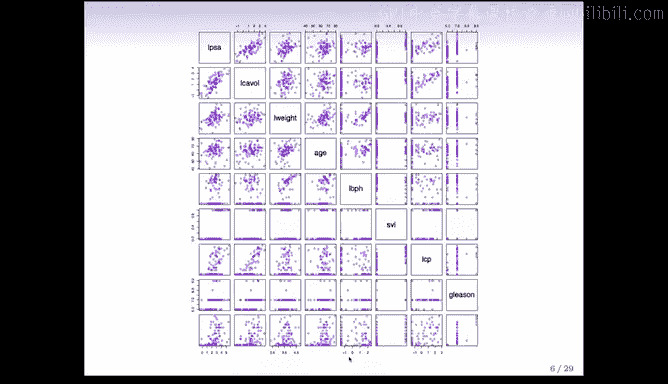

And。What we have is the PSA measurement for each subject。

 along with a number of clinical and blood measurements from the patients。

 some measurements on the cancer itself and some measurements from the blood the measurements to do with cancer size and the severity of the cancer and this is a scatterclockgged matrix which actually show shows the data and you see on the diagonal is the name of each of the variables。

 and each little plot is a pair of variables。 So you get in one picture if you've got a relatively small number of variables。

 you can see all the data at once in a picture like this and you can see the nature of the data。

 what variables are correlated and so on。 and so this is a good way of getting a view of your data and in this particular case the goal was to try and predict the PSA from the other measurements。

 So it's along the top and you can see there's some correlations between these measurements。

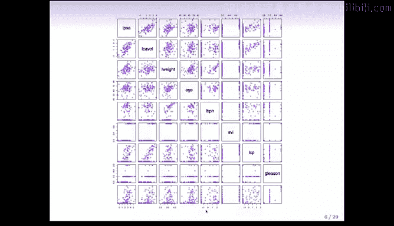

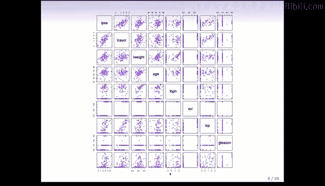

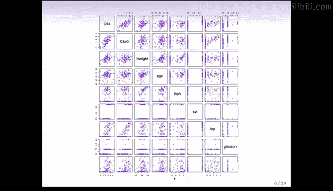

Here's actually another view of these data， which looks rather similar。

 except in the one instance over here， which is this is the log weight。

 this is variables on the log scale， and this is log weight。And you notice there's a point over。

 It looks like somewhat of an outlier。 Well， it turns out on the log scale。

 looks a bit like an outlier， but when you， when you look on the normal scale， it's enormous。

 And basically， that was a typo。 And that would say if that was a real measurement。

 it would say that a patient。This particular patient would have a。a 449 gra prostate。 Well。

 we got an message from a retired urologist， Dr。 Stephen Li。

 who pointed this out to us and so we corrected an earlier published version of this of this scatterpl。

 which is a good thing to remember the first thing to do when you get a set of data for analysis is not to run it through a fancy algorithm make some graphs some plots。

 look at the data。 I think the old days before computers。

 people did that much more because it was it was easy。 I mean。

 you do it by hand and do analysis took many， many hours So people would look first at the data much more and we needed to keep remember that that even with big data。

 you should look at it first before you you jump in with analysis。

So the next example is phoneme for two vowel sounds。

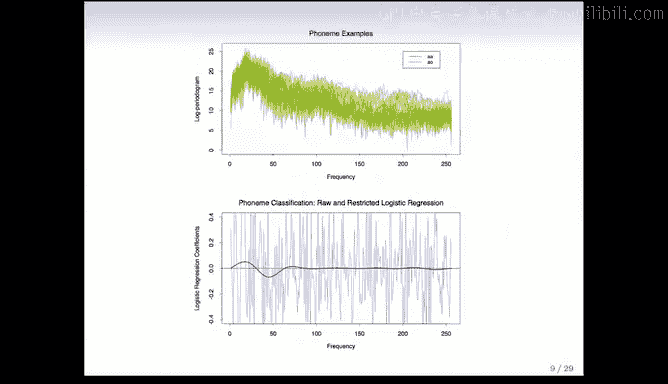

And this is looking at that this graph has the log periodograms of。For two different phonemes。

 the power at different frequencies for two different phonemes， A A A and AO。

 how do you pronounce those trevor， AA is odd and AI is odd。

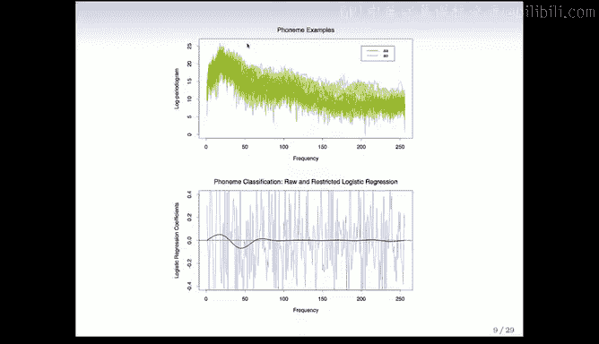

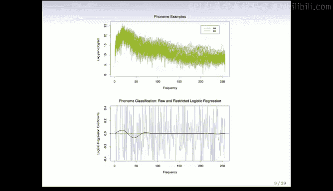

As as you can tell， Trevor talks funny， but hopefully during the course you'll be able to help you save them。

Od and art。😮，Okay， so you see the log periodograms at various frequencies of these two vowel sounds that's spoken by different people。

 the orange and the green。

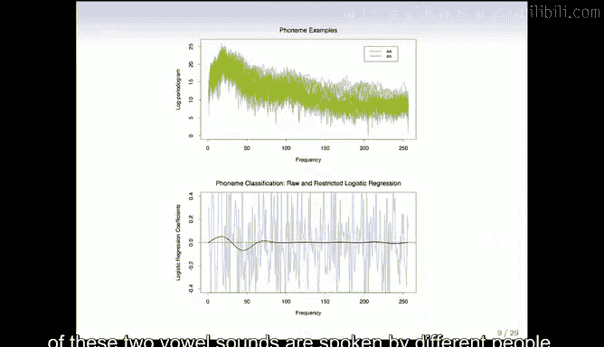

And the goal here is to try to classify the two vowel sounds based on the power at different frequencies。

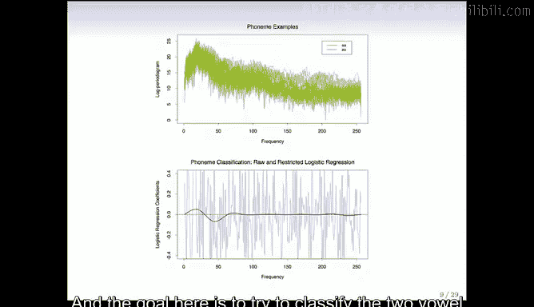

So， on the bottom。

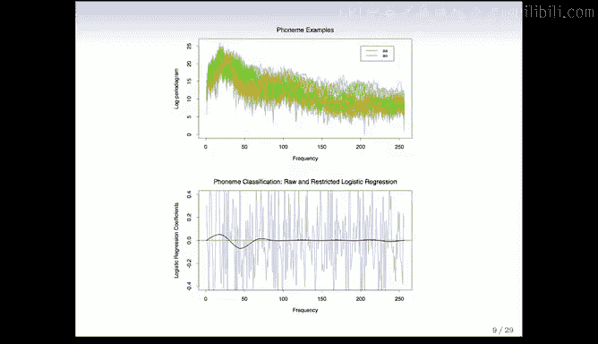

We see a log of model has been fit to the data looking at trying to classify the two classes from each other based on the power different frequencies。

 the loaded models from logistic regression， which is used to classify it into one of the two vowel sounds based on the log periodic and we'll cover it in detail in the course and the coefficients。

 the estimated coefficients from the logistic model are in the gray。Of。

Profiles here in the bottom plot。 And you can see they're very non smooth。

 you'd be be hard pressed to tell where the important frequencies were。

But when you apply a kind of smoothing， which we'll also discuss in the course。

 which will use the fact that the nearby frequency should be similar， which the gray did not exploit。

 We get the red curve and the red curve shows you pretty clearly that the important frequencies。

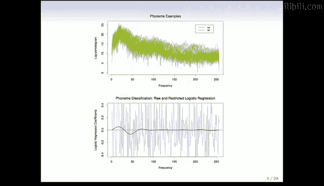

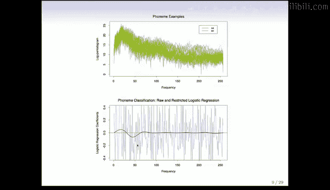

Looks like the one vowel sounds got more power around 25。

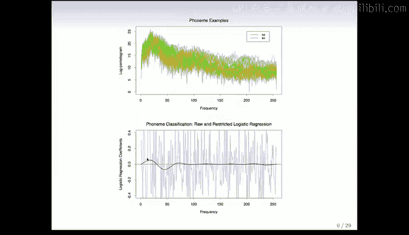

And the other vow sound has more power rung just before 50。

Predict whether someone will have a heart attack on the basis of demographic diet and clinical measurements。

So these are some data on actually men from South Africa。

 the red ones are those that had heart disease and the blue points are those that didn't。

 It's a case control sample。 So all the heart attack cases were taken as cases and the sample of the controls were made and the idea was to understand the risk factors in heart disease。

 Now when you have a binary response like this， you can color the scatterpl matrix so you can see the points which is rather handy。

And these these data come from a region of South Africa where the heart the risk of heart disease is very high。

 It's over 5% for this age group。 The people especially men around， they eat lots of these were men。

 they eat lots of meat， they have meat for all three meals and in fact， meat so prevalent。

Chickens regarded as a vegetable。Porer and Rob loves the。I used to love that job。 Okay， so again。

 you can see there correlations in these data and， and the goallia is to。

 is to filter fit a model that jointty involves all these different risk factors in。

 in coming up with a risk model for， for heart disease， which in this case is not is， is。😊，As I said。

 coloured in red。Our next example is email spam detection Now as everyone use email and spam is definitely a problem。

 And so spam filter is a very important application of Ci machine learning。

 The data in this on this table actually， I think it's from maybe the late 90s。Is that before Yeah。

 late 9s exactly It's from Hewlett Packard。 So this is a person named George who wrote to Hewlett Packard。

 So this was early in the days of email where as well， spam was also not very sophisticated。

 So what we have here is data from over 4000 emails sent to an individual named George at H P Labs。

 Each one's been hand labeled is either being spam or good email。

 And the goal here is to try to predict。 Actually， they call good email ham these days Okay， so。

The goal was start to classify spam from hand based on the frequencies of words in the email。

So here we just have a summary table of some of the more important features。

 so it's based on words and characters in the email。 So for example。

 this is saying that if this email had George in it， it was more likely to be good email than spam。

Back then if you saw your names George and you saw George in your email it was more likely to be good email nowadays。

 of course， spam is much more sophisticated。 they know your name， they know a lot about your life。

 And the fact that your names in actually it made me a smaller chance It's actually a good email。

 but back then this that you spam spammers much less sophisticated。 So for example。

 if your name is in it， small chance to be high email， what with that remove with remove。 Okay。

 so I guess it probably says something like don't remove。 is that right。

I think it says if you want to be removed from this list click。

 obviously that's usually a spam right so the goal was that and we'll talk about this example in detail to use the 57 features and heres these are seven of those features as a classifier together to try to predict whether an email is spam or ham。

😊，Identify the numbers in a handwritten zip code。 This is what we were alluding to earlier。 You。

 some handwritten digits taken from envelopes and the goal is to。

 based on an image of any of these digits to， to say what the digits is is to classify into the 10 digit classes。

Well， to humans， this looks like a pretty easy task。 You know。

 we're pretty good at pattern recognition。 Turns out it's a notoriously difficult task for。

 for computers。 I getting better and better all the time。 So this。

 this was one of the first learning tasks that was used。To develop neural networks。

 neural networks were first bought to bear on this problem。

And we thought this should be an easy problem to crack， turns out it's really difficult。

I remember the first time Trarev that we worked on a machine learning problem is this problem。

 And you were working at Bell Labs。 I visited Bell Labs。 And you just gotten this data。

 and you said these people in artificial intelligence are working on this。 and that we thought， oh。

 let's try some statistical methods。 and we tried discriminant analysis。

 right we got an error rate of about 8 and half%。 and the best error rate in about 20 minutes and the best error rating anyone else had is about 4 or 5% at that point。

 We thought， oh， this is going to be easy。 We're already at 8% in 10 or 15 minutes。6 months later。

6 months later， we were maybe at the same place。 So we realized actually， know as often as the case。

 you can get some of the signal pretty quickly， but getting down to a very good error rate In this case。

 trying to trying to classify some of the harder to classify things like maybe this4。Or actually。

 most these are pretty easy。 But if if if you look at the database， some of them are very hard。

 so hard that the human eye can't really tell what they are。 or it has difficulty。

 And those are the ones that machine learning algorithms have are really challenged by。 anyway。

 it's a lovely problem and's fascinated machine learners and statisticians for a long time。

So the next example comes from medicine， classifying a tissue sample into one of several cancer classes based on the gene expression profile。

 so Trevor and I both work in the medical school part time here at Stanford and a lot of what we do and others do is to try to use machine learning。

 ci learning， big data analysis to learn about data in cancer and other diseases。

 so this is an example of that， this is data in breast cancer， is called gene expression data。

 so this has been collected from gene chips。And what we see here on the left is a matrix of data。

Each row is a gene， and there's about 8000 genes here， I think。And each column is a patient。

 And this is called a heat map。 So what this heat map is representing is low and high gene expression for a given patient for given gene。

 So green mean low and red meaning high。And gene expression means the if a gene is expressing。

 it's working hard in the cell。 if it's not expressing， it's quiet， it's silent。

And the goal was to try to figure out which genes well try to figure out the pattern of gene expression。

 these are patients， these are women with breast cancer。

 trying to figure out the common patterns of gene expression for women with breast cancer and seeing why there are subcategories of breast cancer showing different gene expression。

So we see here is a heat map of the full data，88 women in the columns and again about 8000 genes in the rows。

 and hierarchical clustering， which we'll discuss in the last part of this course。

 has been applied to the columns and you see the clustering tree at the top here。

 which has been expanded。For your view at the top。And howcho clustering has been used to divide these women into roughly one。

 two， three，4， five， six subgroups based on the gene expression。Very effective。

 especially with these colors。 you can just see these clusters standing out。

 Yeah hiarchical clustering and heat maps actually been a very important contribution for genomics。

 which is this is an example of simply because they enable you to see and organize the full set of data on just in a single picture。

And in the bottom right here is some more we've drilled down to look more at the gene expression。

 like， for example， this subgroup here， these red patients seem to be high。

 largely in these genes and maybe in these genes。So we'll talk about this example in detail later on the course。

Establish the relationship between salary and demographic variables in a population in population survey data。

 so here's some survey data we see income from the central Atlantic region of the USA in 2009 and you see what you might expect to see as a function of age income initially goes up then levels off and then finally goes down as people get older。

Incomes gradually increase with year as the cost of living increases and incomes change with education level。

 that's the right end plot， those are box plots。And so yeah。

 we see the three of the variables that affect income and again。

 the goal is we'll use regression models to try and understand the roles of these variables together and see if if there's interactions and so on。

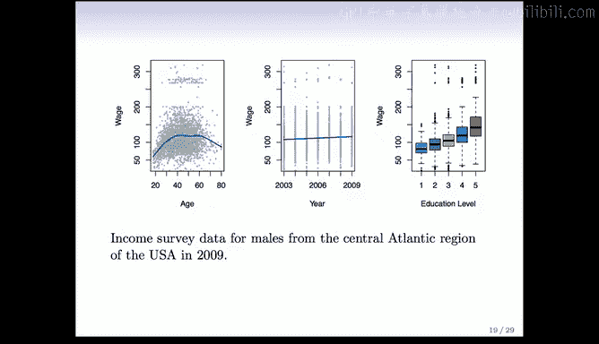

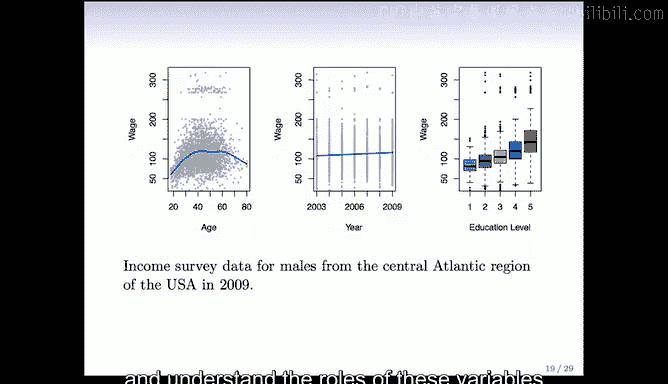

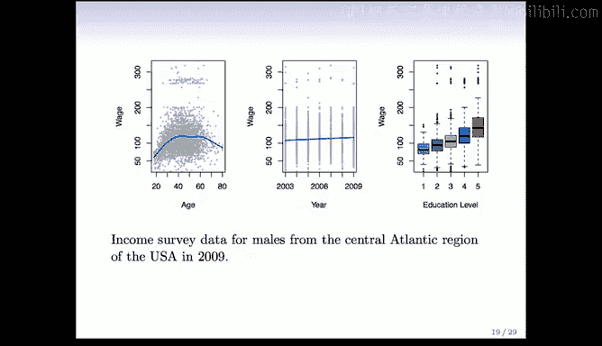

And our last example is Landsat images of a land use area in Australia。

 So this is a rural area of Australia。 There's a harsh colors， Rob， did you。

 did you choose those colors， you probably did you the color color might developed taste。

When did that happen？I didn't didn't see the news memo。 Okay。

 so here are these are from Landsat images。 So let's start here in the this panel。 So this is again。

 a rural area of Australia where the land use has been labeled。

 I think actually by by graduate students or or。Researchers into one of1，2，3，4，5。

6 So they've been labeled in these colors are indicating the different labels。

 these are the true labels and the goal is to try to predict these true labels from the spectral bands at four frequencies taken from a satellite image。

 And so here's the power at the different frequencies。In four spectral bands。

So we have features which are now they're pretty complicated because we have features。

 spatial features， four layers of them， and we're going to try to use those combination of features to predict the land use that we see here。

And pixel by pixel pixel by pixel although we might want to use the fact that nearby pixels are more likely to be the same land use than ones that are far away。

And we'll talk about classifiers。 I think the one we use here is actually nearest neighbors。

's a very simple classifier。 And that produces the prediction in the bottom right。

 And you can see it's quite good。 It's not perfect。 There's a few mistakes it makes。But it's。

 for the most part， quite accurate。Okay， so that's the end of a series of examples in the next session we'll just tell you some notation on how we set up problems for supervised learning which we'll use for the rest of the course。

