# 斯坦福大学《统计学习导论2023Python版｜An Introduction to Statistical Learning with Python》中英字幕 - P20：-020-Statistical Learning_ 3.Py Interactions, Qualitative Predictors and Other D - GPT中英字幕课程资源 - BV1u4421A7ZU

Okay， so now we're going to go to some more complicated examples and examples where you'll see the power of model speaking。

All right， thanks， Cha， Okay， so you know， we've seen how to have design majores with just a list of column names。

You know， another common modeling tool is an interaction。

 So the way we specify interaction with model spec is just instead of just having the column name。

 we put this is tuple a two tuple of the two column name。

 So this tells model spec make me an interaction of the variable L stat and H。

 So once it knows how to create the variable L stat and the variable age。

 it can make the interaction between L sta and H。

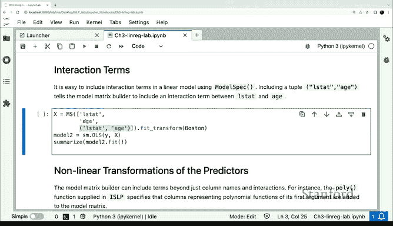

Okay， so let's just。Fit this model。 And here we have coefficient。 It's just another。

Affect in the regression model。 And in this case， because both L state and age are quantitative variables。

 It just multiplies those to。That's right together entry wise。 Yes， we'll see in a moment， you know。

 there are regression problems where not all variables are quantitative。 in the Boston housing data。

 actually， all of them are， but。We'll see many are categorical and then the interaction would look different。

 but yeah。

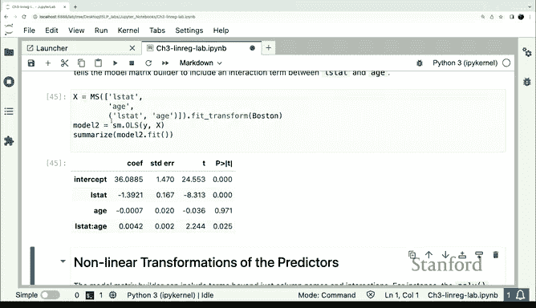

So。Another example， you know， another modelling tool that people might use is rather than fit just a linear effect for a variable might put a polynomial effect so。

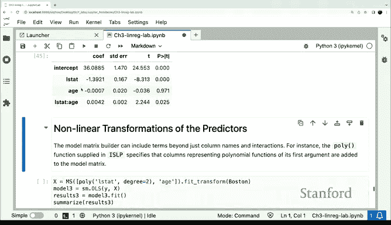

There's a function poly that allows us to specify。You know。

 a polynomial effect in some feature here will put a quadratic effect for Ltt and a linear effect for age。

 Again， the model is specified the same way。 It's a list of terms。

 It's just that this term here poly has actually two columns corresponding to it let's fit the model and summarize and we can see that the two columns each one gets a separate coefficient estimate and indicated by this is the first column corresponding and the second column because of course。

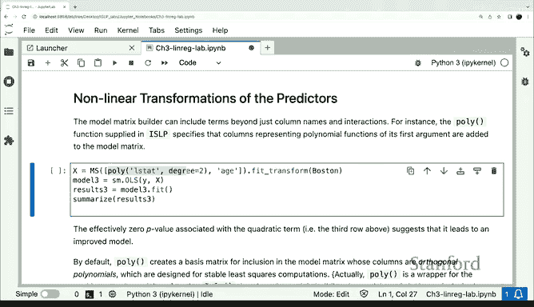

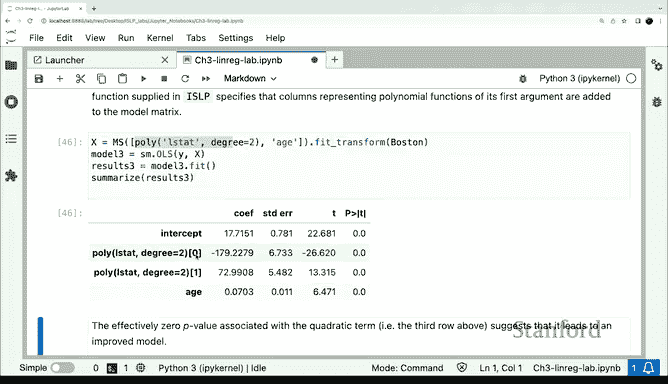

2 degree polynomial has's got a quadratic term and a linear term。 That's right， yeah。嗯。

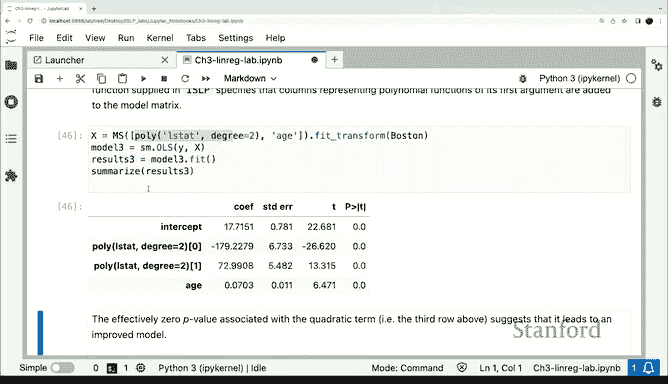

And。If we wanted to， actually， we could。

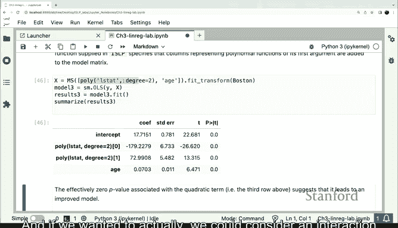

We could consider an interaction between the polynomial and age。

 but we'll leave that for another day。

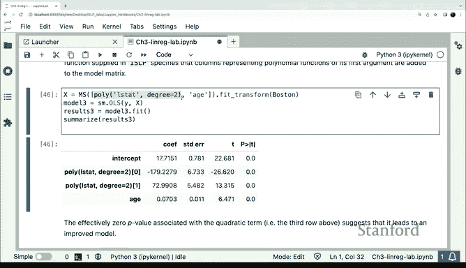

Okay so now this example here， we've gone from just a linear term for Ltt to a quadratic。

 we might be interested in deciding whether there was really a significant improvement in fit going from linear to quadratic we can actually see here that the P value is small but there's another method that's commonly used that is thenovava method to compare two different fitted models so this anovava LM function from the stats models。

 what it will do is carry out you know a test an f test comparing two nested models and we can use that to decide whether one model is significantly better than the other this F statistic here 177 that's huge that's huge and it's also should be about 13。

3 square that's that T statistic to correspond to that。Though maybe not exactly。

Oh alwaysway has the action of it children。 it should be， yes， you know， okay。Let's see。So。

Part of the section that we skipped。

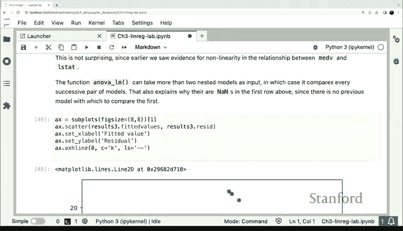

Looked at residuals of our earlier regression model and noted a trend in the residuals plot as a function of fitted value in this plot。

 actually， we can see that that trend has been removed， but we didn't see the first plot。

 So that's not well too much on it。

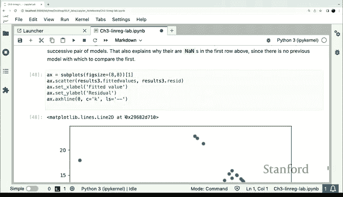

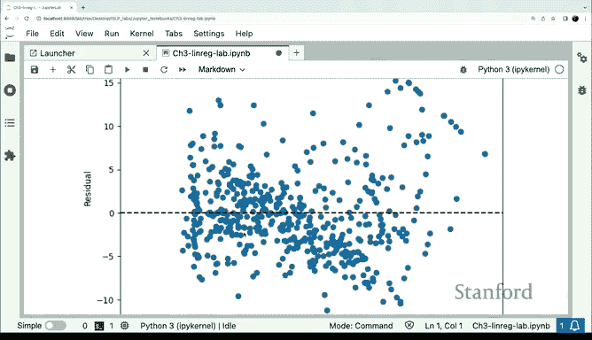

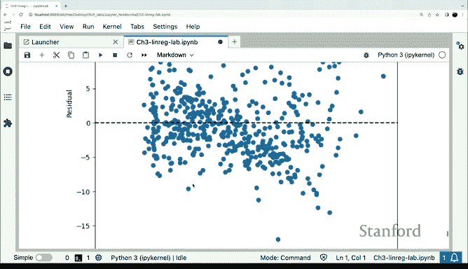

The last example of model spec we'll use is。Is qualitative predictors or categorical variables。So。

In another data set in the ISLP package， the car seats data tries to predict the sales of car seats as a function of different features。

So different features like you know。The competitor's price。 So forget this is maybe a chain like。

Walbart and maybe we'll compare its competitors price like targetrg， maybe this is。

Income of the typical income in the neighborhood of the of that particular store， etc ceter。

 One of these variables is shelf location。 This is sort of where the car seat is placed in the and the shell。

 I think low medium high are the levels。 And so that's， you know。

 we could encode low medium high as 0，1 and 2。 But those are kind of arbitrary。

 So this is really categorical variable right， And if we look at。

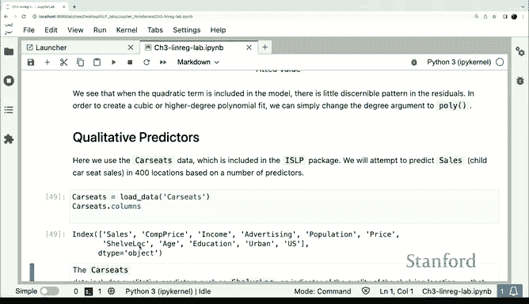

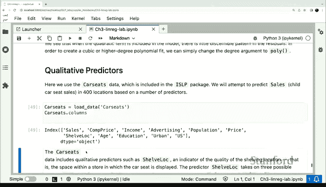

The column。Sheve Lo in the in the data frame。 We see， whoops， that's not right。

We'll see that it's been recognized as a category by pandas and so Moal spec will then。

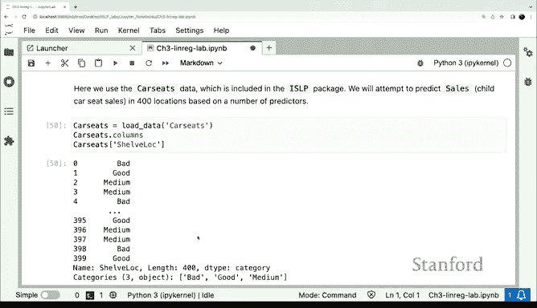

If we use She lo as a predictor， you will treat it as categorical。

So here we have we fit a rather complicated model， we first found all the features besides the response sales and we'll add all those features to the model and we added a few interactions just for the fun of it。

What we're going to see is for the variable shelf location， which is categorical。

 it will have created more than one column。 So here， August， rather low medium high is good。

 medium and poor， I suppose I don't actually know the levels， but。So it's， it's done。

 What it's done is it's made dummy variables for these three categories。

 and you always need to leave one of the amount because。The alias with the intercept。 That's right。

 And， and so it's done it all automatically for you。

 So this is another instance of things you would normally have to do yourself to set up the model matrix。

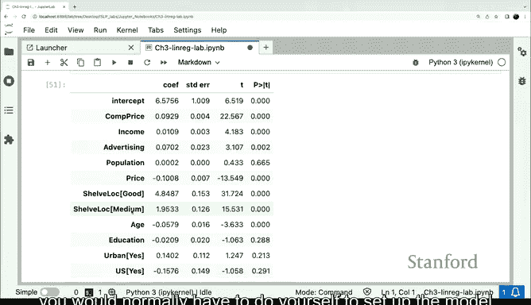

This MS model speaker has just done it all for you， made it much easier。

And there of course there are various ways you can add these two columns， so experts。

 if experts in specifying these can do it their own way if you like。

 but we're definitely not going to dwell on up。

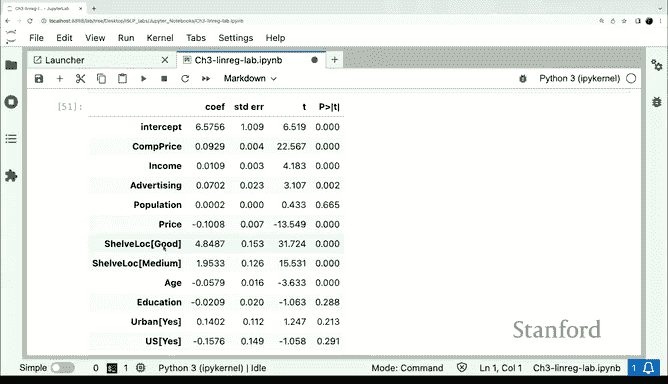

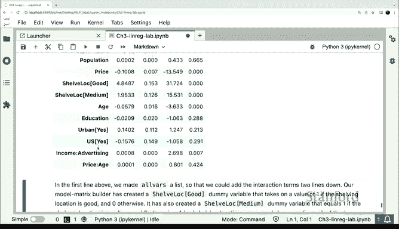

Okay， so that brings us to the the end of the lab on regression and。Next lab is。

We'll see you next week， for classification。

