# 斯坦福大学《统计学习导论2023Python版｜An Introduction to Statistical Learning with Python》中英字幕 - P26：-026-Statistical Learning_ 4.6 Gaussian Discriminant Analysis (One Variable).zh_ - GPT中英字幕课程资源 - BV1u4421A7ZU

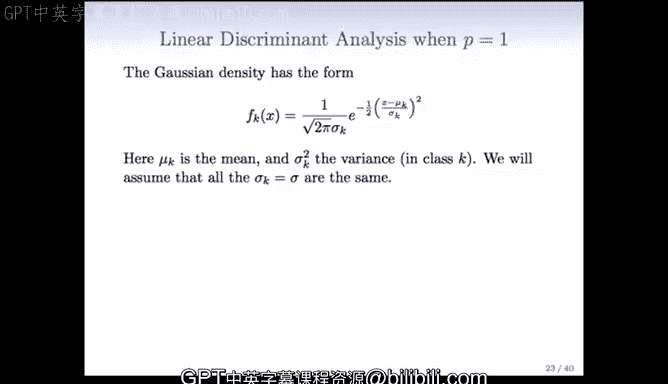

So look at， let's look again in the simple case when we got one variable，1 x。Again。

 we're gonna get a bit more mathy now。This is the form。

 the mathematical form of the Gaussian density function。For class K。When you got a single x。

So there's some constant over。The important part that depends on x is in this exponential form over year。

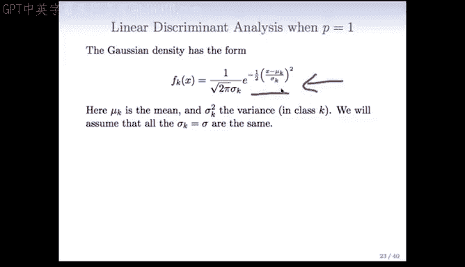

And we see。There's a mu sub K， which is the mean for the observations in class K。

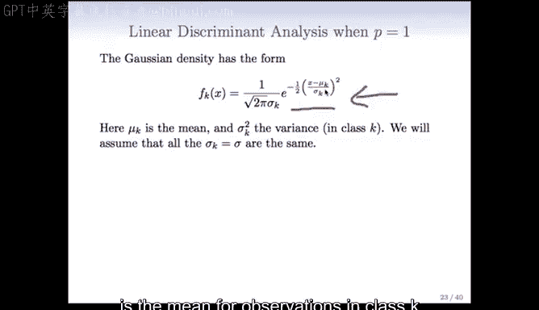

The population， meaning class K and sigma sub K is the variance for that variable in class K。

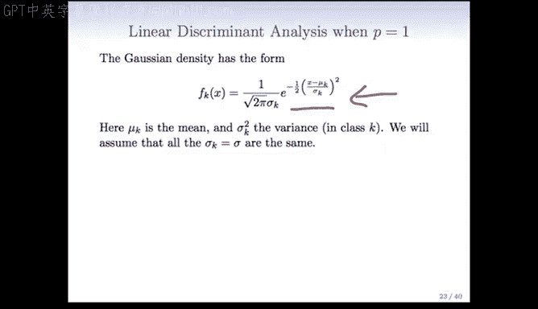

没有。In the first instance， we can assume that。The variance sigma sub K is actually the sigma the same in each of the classes。

Now， that's a convenience。It turns out it's an important convenience。

 And it's going to determine whether the discrimininate function that we get the discriminants analysis gives us linear functions or quadratic functions。

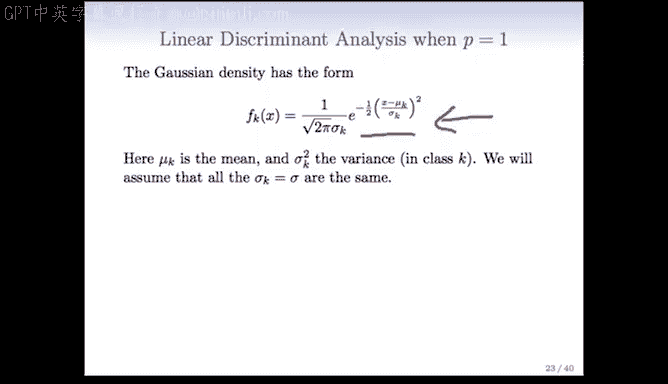

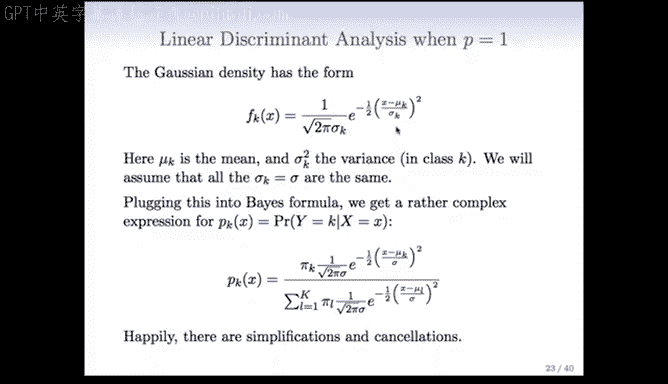

So。If we plug into Bay formula。The the formula we had on two slides back。

 we get a rather complicated expression。

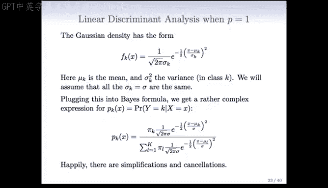

So we've just plugged in the the form of the density in the numerator。

 And there's the sum over the classes in the denominator。

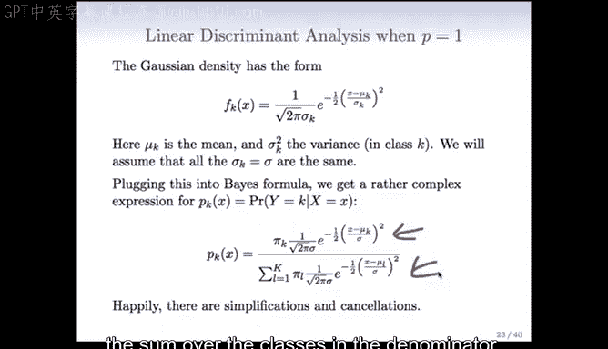

And it looks pretty nasty。Well， luckily there's some simplifications and cancellations。

嗯。Now。We get this because to classify an observation to a class。

 we don't need to necessarily evaluate the probabilities。 We just need to see which is the largest。

So if we take logs。😊，Whenever you see exponentials， the first thing you want to do is take log logs。

And if we discard terms that do not depend on K。Then we。

 so that's amounts to do in a lot of cancellation of things of of。Terms that don't count。

This is equivalent to assign into the class with the largest discriminant score。

And so that complicated expression boils down to a much simpler expression over here。

And notice it involves X。The single variable in this case。

 And then it involves the mean and variance for the， for the distribution， and it involves the prior。

Okay。And importantly， in this case， this is a linear function of x。

 So there's a single coefficient for x。There's a constant。 and then there's a constant term。

 which is consists of these two pieces every year。

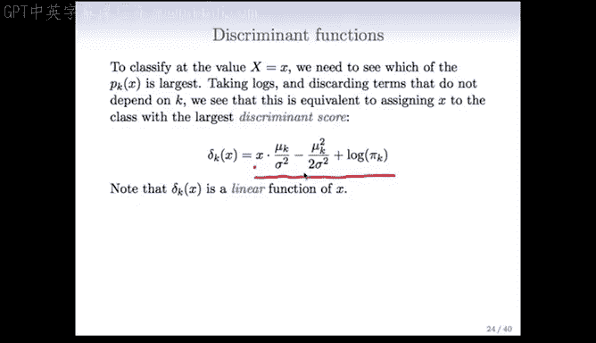

Okay。And so we get one of those functions for each of the classes。If there are two classes。

 you can simplify even further。And let's suppose now that the probability of class 1 is equal to the probability of class 2。

 which is 0。05。

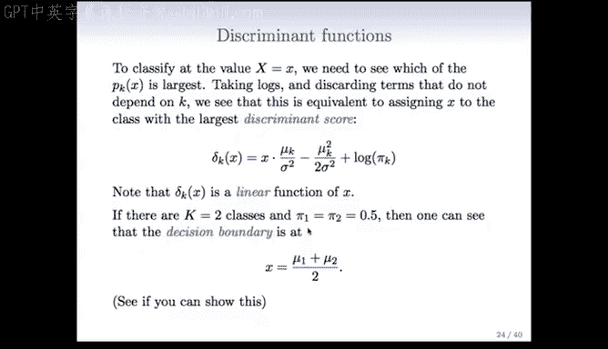

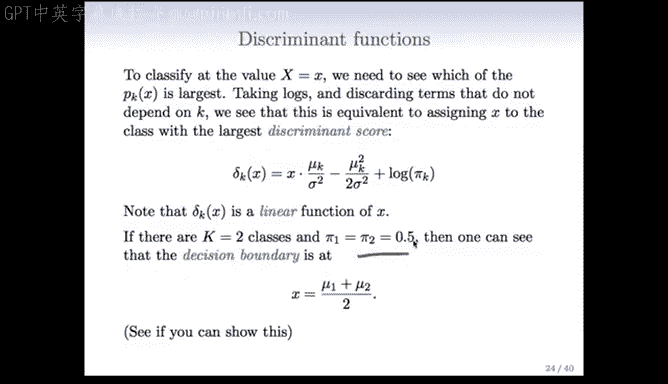

Then you can see in this case that the decision boundary。Is exactly at。

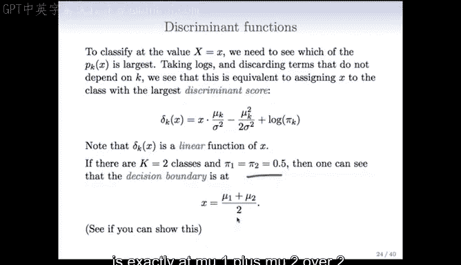

M 1 plus mu to over 2， so。

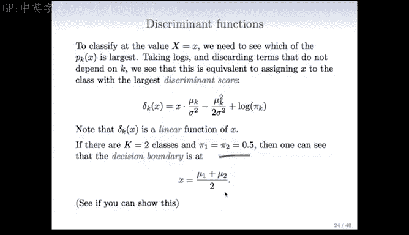

It's back to this picture。嗯。In the previous slide， in this case， the price were equal。

 These are actually two Gaussian distributions。And the decision boundary here is at 0。 In this case。

 the two means were exactly the equal amount on the opposite side of 0。 So the average is at 0。

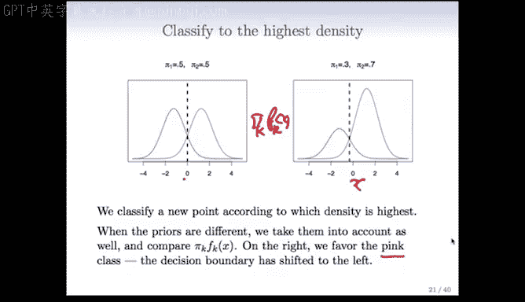

So intuitively， that's， that's the right value for the decision boundary。

 which is the point at which we classify to one class。

 the boundary at which we switch from classify to one class versus the other。

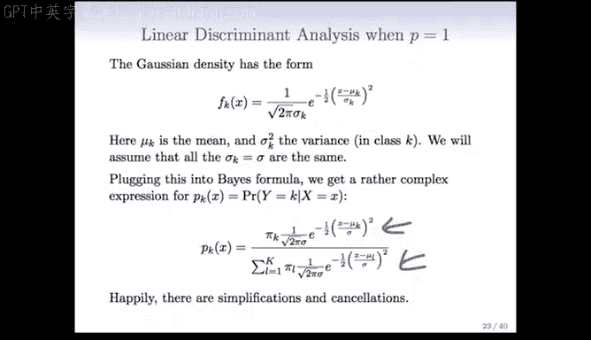

It's not that hard to show。 So see if you can show that。

 you basically use this expression for each of the two classes and look to see when。

 when it's the one's bigger than the other， not that hard to do。 I'm confused。

 There was a square term in the previous expression， and it's gone。 Oh， Rob。

 are you causing trouble here again。

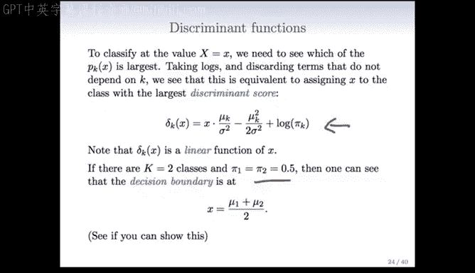

I was hoping to avoid that nasty， but。

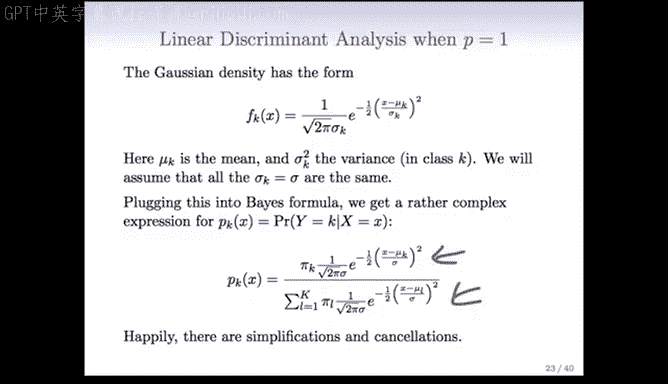

Rob's right。 What， if， if you expand out the square term here， there's going be an x squared。But。

 you know， it's got， there's an x squared in the numerator。

 and there's x squareds in the each of the terms in the denominator。

 And there's no coefficients in front of that x squared that's specific to a class。

 So that's one of the things that cancel out in this ratio。

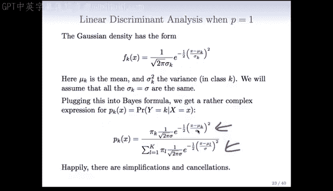

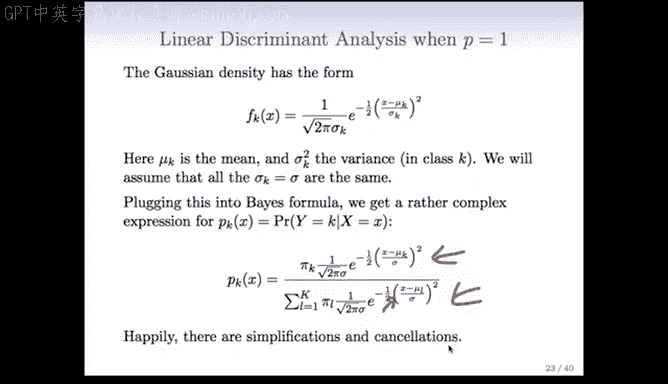

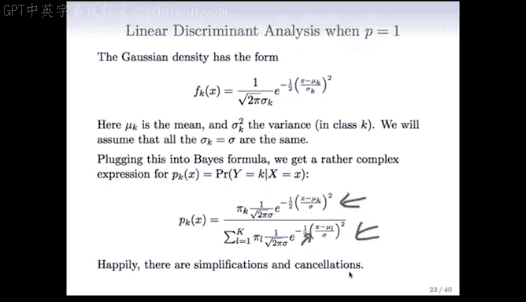

You knew that。Rob knew then。

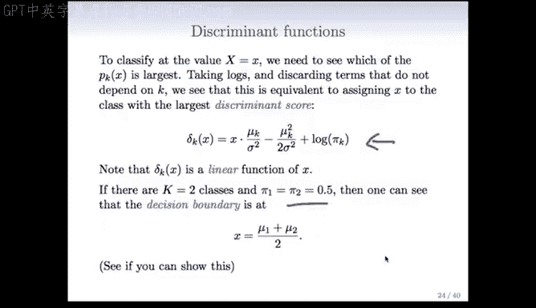

All right。So this is with populations。 What happens if we have data。

 We can't draw nice density functions like we've done over year， but we just estimate them。

 So here's a picture where we've actually got data。

 So we've drawn histograms instead of density functions。

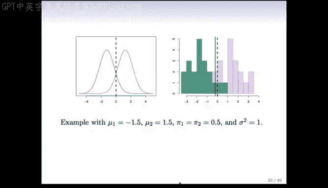

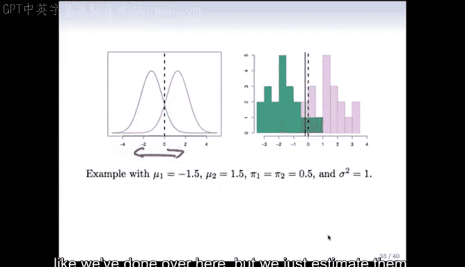

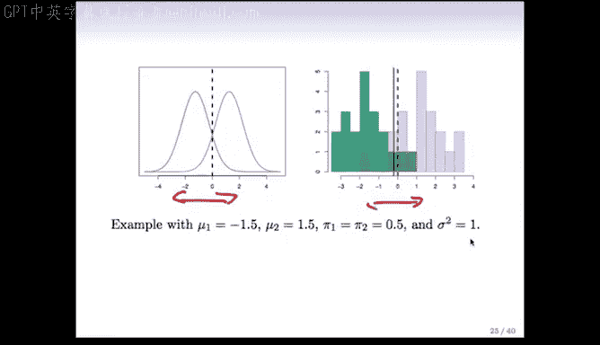

Now， what we do is we actually。

We need to estimate the， for the Gaussian rule， We need to estimate the means in the two populations and the common standard deviation。

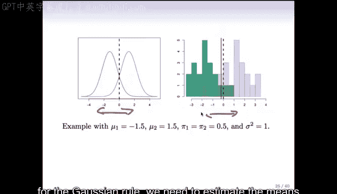

Well， in this case the means。嗯。The true means are。Minus 1。5 and 1。5。

Which means the average mean is 0， and the， the probabilities were 005。

But we don't know these。 So we're gonna estimate them from the。

 from the observed data and then plug them into the rule。

So。This is how we estimate them。 The price we need to estimate。

 So that's just the number in each class divided by the total number。 That's obvious。

 The means in each class， we just compute the sample mean in each of the classes。

 This is a tricky little notation here， This is。1 over N K， that's the number in class K。

 And this is a sum over I such that Y I is equal to K。 So y I is recording the class label。

 So this will just sum those Xs that are in class K。 And clearly。

 that's the right thing to do get the sample mean。The sigma square is a little trickier。We。

 we assume in the， the， the variance is the same in each of the classes。And so， this is a formula。

It's called the pooled variance estimate。So。We subtract from each X the mean for its class。

So this is what we do if we were compute the variance in class K。

But we sum all those square differences。And we sum them over all the classes and then divided by n minus K。

So if， if that doesn't make too， too much sense， another way of writing that is。

 is in this form over year， which says we estimate。

The sample variance separately in each of the classes。

And then we average them using this formula over year。

So this is just like a weight on each of those variances， which。

 and that weights to do with how many observations we in that class。

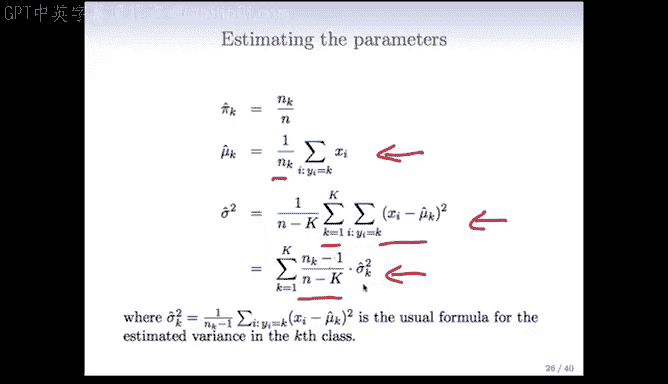

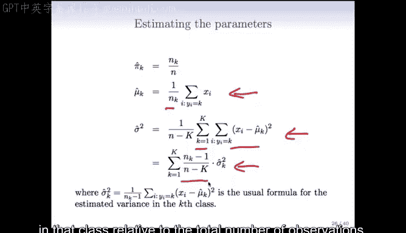

Relative to the total number of observations。And then the -1 and the  K， that's a detailed。

 And it's to do with how many parameters we've estimated for each of these estimates is one parameter。

 It's the mean rocks falling asleep。 too much detail。 way too much detail， okay。

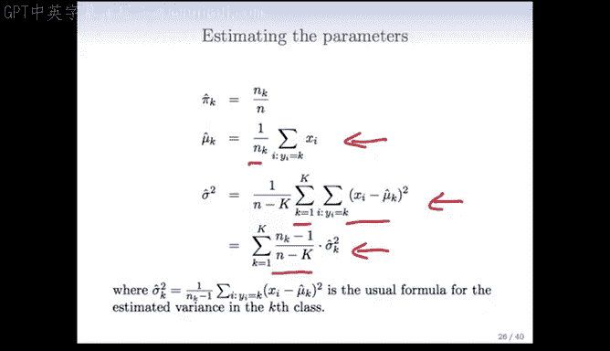

So there we have it， those are the formulas。😊，You plug those back in。 You'll now get estimated。

Decision boundary。 And instead of being exactly 0， it's， in this case。

 it's slightly to the left of 0， but pretty close。

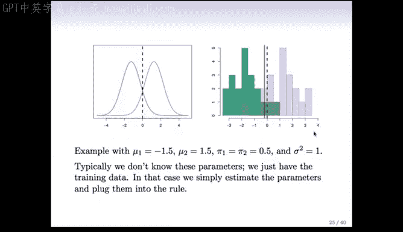

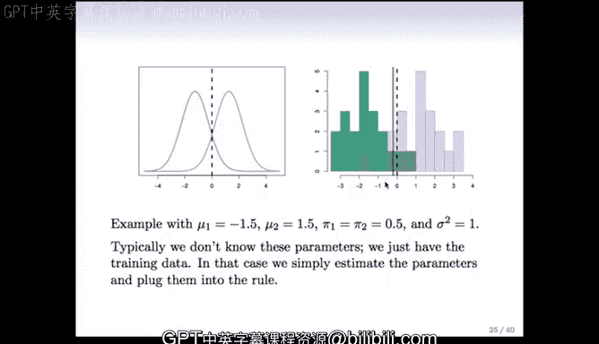