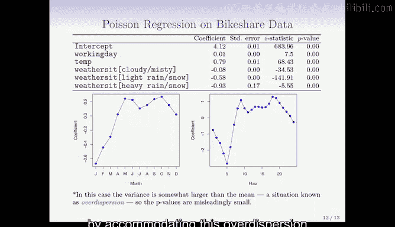

# 斯坦福大学《统计学习导论2023Python版｜An Introduction to Statistical Learning with Python》中英字幕 - P28：-028-Statistical Learning_ 4.8 Generalized Linear Models.zh_en - GPT中英字幕课程资源 - BV1u4421A7ZU

Okay， so the final topic in this add on section is generalized linear models。

 so we've seen that linear regression is used for a quantitative response。

Logistic regression is the counterpart for a binary response and models elogit of the probability as a linear model。

So these are two response types， but others exist， such as non negative responses。

 skewed distributions， and more。So generalized linear models provide a unified framework for dealing with many different response types and so that's what we're going to talk about here we're going to go through a simple example which is going to illustrate an important member of this family which uses Poisson regression and for that we're going to use the bikesha data which is a data set that measures some variables for bike rental company in Washington DC。

So in this case， the response is bikers， which is the number of hourly users in the bikesha program in Washington。

 DC。You've got a bunch of variables， you've got the temperature， whether or not it's a working day。

The weather situation where it's cloudy misty， light rain snow。

 there's a base level for weather which is clear and then two other variables with lots of levels which we haven't put in this kind of an overplot。

 which is the month of the year。And we actually plot in the coefficients just as a function of men。

And the hour of the day is 24 hours of the day， and so we plot each hour as a point here。But ideally。

 these all belong in this table。 We just fit the linear regression model。

 we show the coefficients the standard just the usual stuff。 looks like everything significant。

 It's quite a large data set。And we can see from the month。

Figure that there's more bicycles rented in May and June then during the hot months in DC。

 there's fewer then in the fall more again and of course in the winter very few。

And then hour of the day there's a natural kind of partition as well。

 moreiented at the beginning of the workday at the end of the workday because people use it as a means of public transport and then different amounts during the day there's a lunchtime period as well。

 so that's fine， but the response is the number of hourly users okay。So the number of all users。

 first of all， it's a non negative variable。And yeah， we've shown a picture just of。

The response fight versus hour of the day。And we've put a smooth andline foot through this just so that you can see just for the single variable。

 what the mean looks like as a function of hour of the day。

 And what you see is that when the mean is low，The spread is， is somewhat low。

 but when the mean is higher， the spread seems to get bigger。Right。So for the most part。

 the variance seems to increase with the mean Now when we fit linear regression models。

 we really assuming that the variance of y is constant okay this is just showing one variable。

 but if you fit the full linear model like we did before。

 10% of the linear model predictions are negative。Because there's no constraints on the linear model that the predictions should be positive。

 even though the response is always positive。In the cases like this。

 you might be tempted to rather model the log of the bikers。The counts of bikers。

 but it has its own problems， example predictions on the wrong scale because you really want to make predictions on the bikes number of biker scale。

 not on the log scale。And some of the counts could be zero and so you can't take logs。

So that's not in general a good solution， here's a picture of the log of the bikers and with the same a similar smooth curve put through。

It seems like the variance is more stable on the log scale as the function of the mean。

But there's some weird stuff going on down here when you're taking logs of small counts。

And for the zeros， well， these are logs are those zeros， so these must be the ones。

 but any zero counts were either left out or some fuin had to be done。

So this is where the Poisson model comes in。 So just like we use the binomial model for01 data。

 turns out the poisson regression or the poisson distribution is good for model in counts。

 So for those who are interested， this is the form for the Poisson probability mass function。

So it gives an explicit form for the probability that y equals k。

And it's controlled by parameter lambda， which is the mean count。In the distribution。

And for the Poson， it turns out that the variance is equal to the mean。 So when the mean is higher。

 the variance is higher。 So that's a property of the Poisson distribution。By the way。

 for the binomial distribution。The variance also depends on the mean。If for a binomial distribution。

 if the mean is P。Then the variance is p times 1 minus p。For the Bnoli distribution。

And that tends to be a property of this class of GLMs that we're talking about。

Except for the Gaussian。Okay， so this is just for a single poson distribution。

 but we interested in a poson distribution where the mean changes with the covaris。

 so now instead of just right in lambda， we're going to write lambda as a function of x。

And what we're going to do is we can assume that the log of Lambda。Is a linear function of x。

So just like for the logistic regression， we assume the logit of the probability was a function of x。

Here we assuming the log of the mean is a function of x。

Or you can invert that transformation and says that lambda is E to the linear combination of the coordinates of x。

So you can see that automatically guarantees that the mean is positive。In this case。

We can fit this model and we fit it by maximum likelihood， we're not going to go into the details。

 but we use the poisson as the basis for the fitting。

And we can fit that model and get a summary and just like we did for logistic regression and for linear regression you get a summary that identifies a coefficients for each variable and gets standard errors and P values and so on and so this is very similar you'll see these coefficients are different because these are on the log scale than for the linear model。

😊，But they're going to have the similar message， but the nice thing is that when you fit this Poyson model。

 it takes this change in variance into account when it does a fit in。And again。

 we just show us dot plots。The effects estimated for month and for hour。And if you compare back。

 youll see that is's somewhat similar。It turns out in this case。

 the variance is actually somewhat larger than the mean for the Poisson we assume in the variance is the same as the mean。

 and but this is a well known situation when you fit Poisson data and it's known as over disspersion。

So the P values are misleadingly small in this plot in this table here。

 but you can get corrected P values by accommodating this overdispersion。

 but we don't go into that yet。

So we've covered three generalized linear models in the course， Gaussian binomial and now Poisson。

 so they each have a characteristic link function。This is the transformation of the mean that is represented by a linear model。

And we write it like this Ada as the link function of the mean。

And it's the transformation of the mean that's a linear model。So the link functions for linear。

 logistic and poson regression are for the linear model， it's just the identity link。

It just uses to say they model the mean directly。For logistic regression， it's a Loit link。😊。

Of in logistic regression， the mean for the binomial is the probability。And for Poson。

 it's the log link。And how do you decide which of these models to use？Well。

 it's the nature of the response room so for Person the response are these counts and so we decide that we need a distribution that's suitable for counts。

For binary data， it you know beulli is pretty much only distribution。

 because if it's a quantitative data variable， we will just use Gaussian if it looks like。

 you know if it's got a isosymmetricmetric distribution。

Turns out they also have characteristic variance functions， and we talked about that。

 the variance for the personson is equal to the mean。

 then the models are fit by maximum likelihood and summaries like the ones we showed are produced by the GLM function in R。

And the other GLMs that we haven't talked about include the gamma distribution。Negative binomial。

 which is it' despite the name is actually used in the case of counts， but when you've got extra。

Over dispersion， there's also the inverse Gaussian distribution。

The gamma distribution is often used when you've got positive observations or non negative observations and you've got long tails to the right。

The gammas is often used。And there's more， know so the GLMs are quite a big family。

 we've just told you about the more important ones。

