# 斯坦福大学《统计学习导论2023Python版｜An Introduction to Statistical Learning with Python》中英字幕 - P29：-029-Statistical Learning_ 4.9 Quadratic Discriminant Analysis and Naive Bayes.z - GPT中英字幕课程资源 - BV1u4421A7ZU

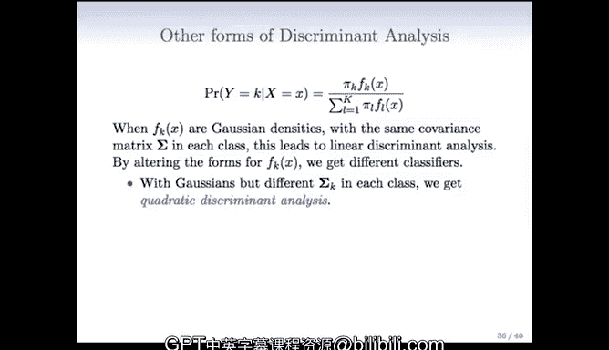

Okay， so that's discriminants analysis when we use Gaussian densities。

 But now the form that we wrote down is quite general。

 and you can use other estimates of densities and plug them into this rule。

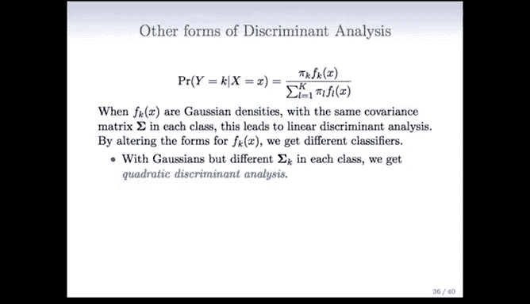

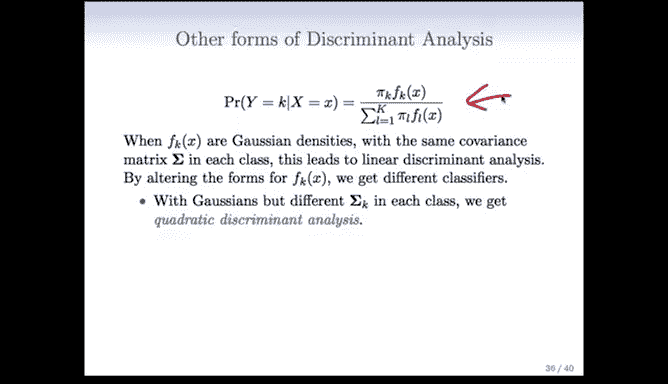

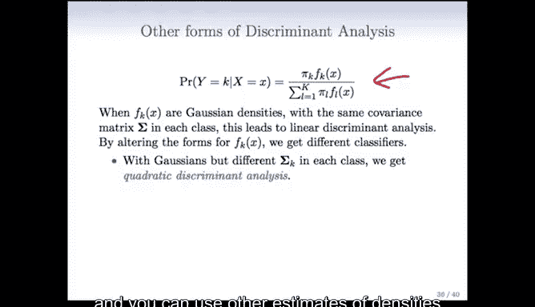

And， and get classification rules。

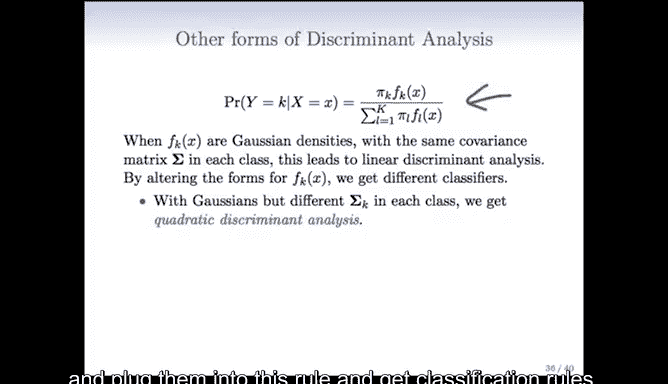

So up to now， we've been using Gaussian densities with the same variance for the。

 for the xs in each class。

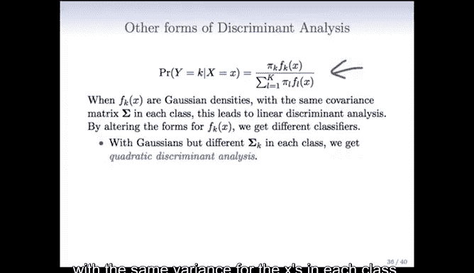

What if the， the variances are different in each class。Well。

 you can plug those forms in and then remember we had that magic cancellation because of the equal variances。

 Well， when the variances are different in each class。😊，There's no the quadratic terms don't cancel。

 And so now your discrimininate functions are going to be quadratic functions of X。

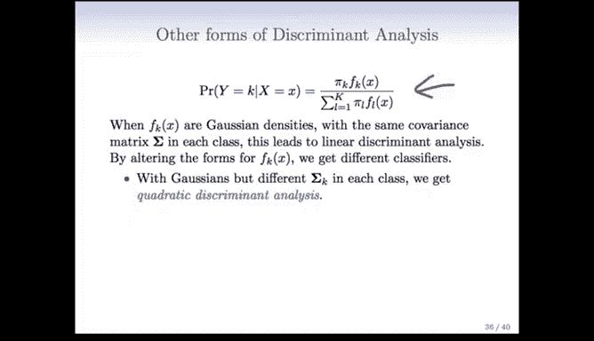

Okay。So that's one form it's called quadratic discriminants analysis。Another thing you can do。Is you。

 and especially this is useful when you have a large number of features， like the 4000。

Also that Rob mentioned when you really wouldn't want to estimate these large variance covariance matrices。

You can assume that in each class， the density factors into a product of densities。That's。

 that's amounts to saying that the variables are conditionally independent in each of the classes。

And if you do that and plug it into this formula here。

You get something known as the Naiveive Bayes Classifier。For linear discriminancy analysis。

 this means that the covariances sigma sub K are diagonal。And。

Instead of estimating the covariance matrix has got， if you got P variables。

 it's got P squared parameters。But if you assume this diagonal that it's diagonal and you need to estimate P parameters again。

 Now， although the assumption seems very crude。 I mean assumption is wrong。

 It na based classifier is actually very useful in high dimensional problems。

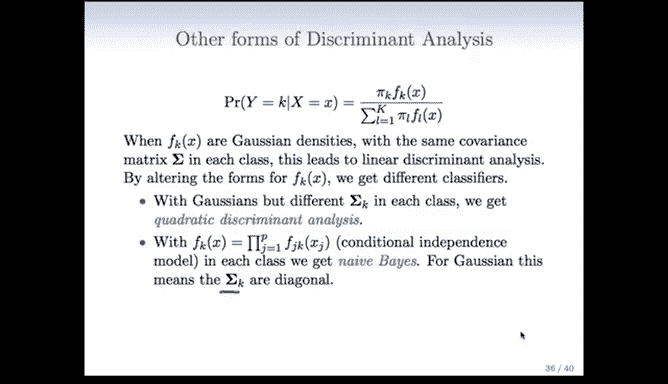

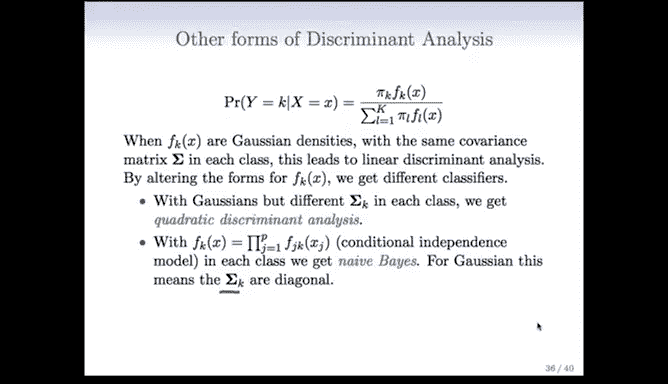

And it's one actually we return to later in different forms， right？

So。In fact， we'd probably think it's always wrong， wouldn't we be wrong， yeah。

And so what happens is， you know， we end up with quite。

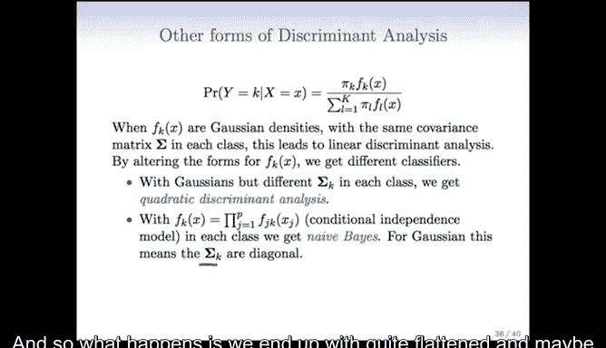

Flattened and maybe biased estimates for the probabilities， but in terms of classification。

 you just need to know which probability is the largest to classify so you can tolerate quite a lot of bias and still get good classification performance。

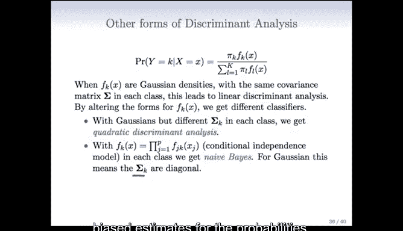

And what you get in return is much reduced variance from having to estimate far fewer parameters。

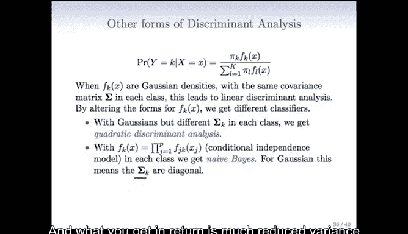

And then there's much more other general forms where we don't assume Gaussian at all。

 we we can estimate the densities used in our favorite density estimation technique and then go and plug them back into this formula and that'll give you a classification rule。

it's a very general approach that can be used。 And， and， and in fact， many of the classifier that we。

 we know we can understand from this point of view。So， yeah， we have it。

 Quadratic discriminant analysis uses a different covariance matrix for each class。

 And so there's no cancellation of the sigma。 So the discriminant functions now have。

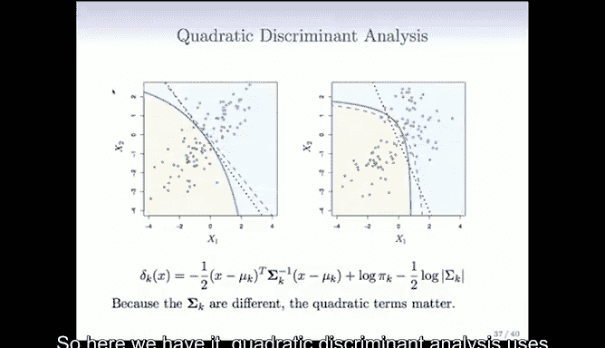

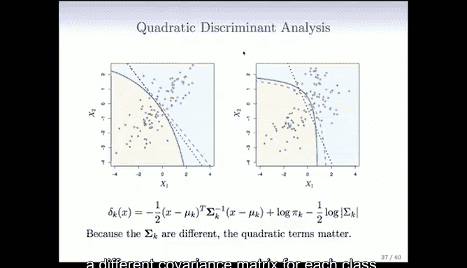

The this distance term that involves sigma sub K， which is for the K class。

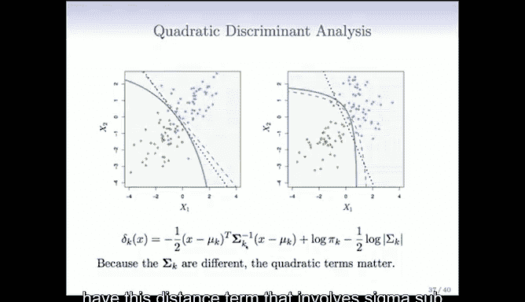

There's a term to do with the the prior probability。

 and there's a determined term that comes from the， the covariance matrix。

And you can see it gives you a curved， discriminant boundary。 And。

 and the quadratic terms matter you because， because they， they're different。

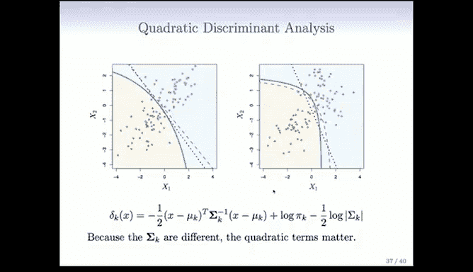

Okay。And so in the left plot here。

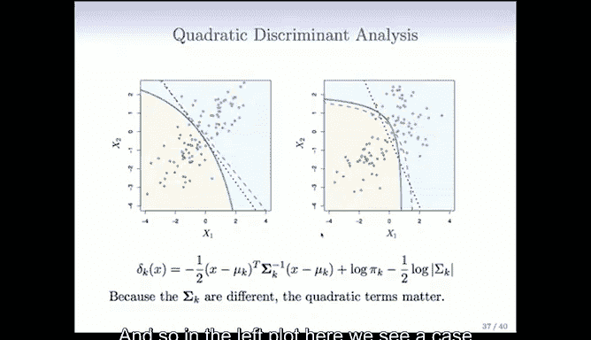

We see a case when the true boundary really should be linear that's the dotted curve and in this case。

 of course linear discriminant analysis does a good job quadratic discriminant analysis curve somewhat and gives a slightly bent boundary but it it won't really affect misclassification performance much in the righthand plot and now this other hand。

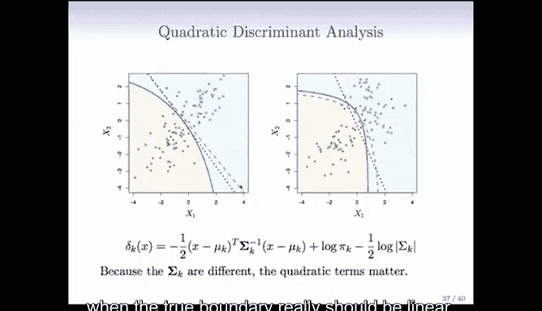

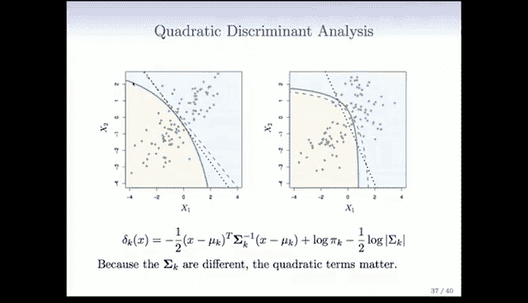

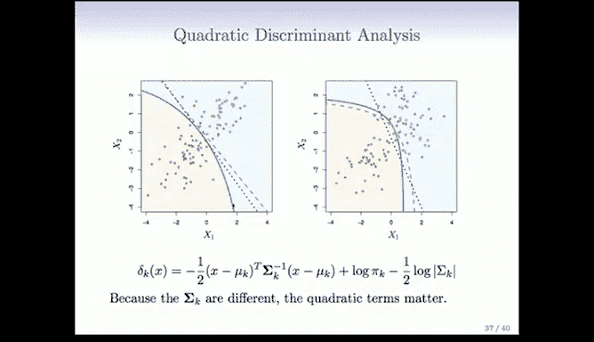

The， the true data came from a situation where the covari answerss were different。The。

 the base decision boundary is。Curved and the quadratic disccrminment analysis pretty much got it。

 whereas linear disccrminants analysis gives you quite a different boundary in that case。

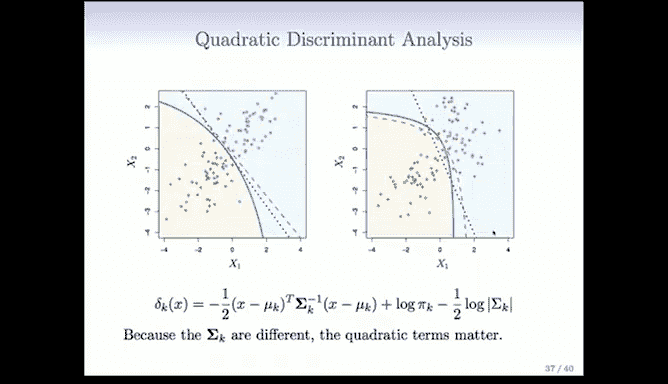

Quratic discriminant analysis is attractive if the number of variables is small， when the features。

 the number of variables or features is large， you've got to estimate these big covariance matrices and things can break down and and even for LDA can break down years where naive Bay becomes attractive。

It makes a much stronger assumption。 It assumes that the covariances in each of the classes。

 although different， are diagonal。And so that's much fewer parameters。

 And now when you look at the discriminant functions。

 because diagonal and Gaussian means that the densities are independent。

 and so we have this product here when we take logs， we get a relatively simple expression。

Which is in each class， there's a contribution of the feature from the the mean for the class scaled by the variance。

 There's a determinant term， and there's a prior term。And so， this is a。

This is the discrimininate function for the Ca class for naive Bay。

 and you compute one of these for each of the classes。 then you classify。

You can use mixed features for naive bay and in that case。

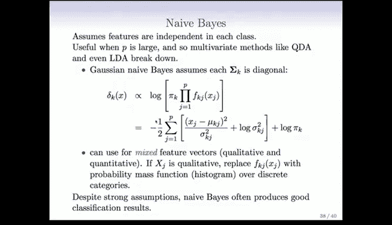

If if what we mean by that is some qualitative and some quantitative features。

 and so for the quantitative ones， we'd use the Gaussian and for the qualitative ones。

 we'd we replace the densities， the Gaussian densities by just histograms or probability mass functions in this case over the discrete categories。

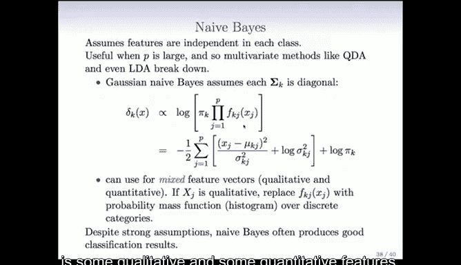

So naive Bayes is very handy from this point of view and even though it has strong assumptions。

 it often produces good classification results because often once again in classification。

 we're mainly concerned about which class has the highest probability and not whether we got the probabilities is exactly right。

Okay， so。We've seen two forms of， of classification。

 logistic regression and linear discriminants analysis。 And we saw its generalizations。嗯。Now。

 it turns out， are they how， How do they differ。it seems they may be similar similarities between the two。

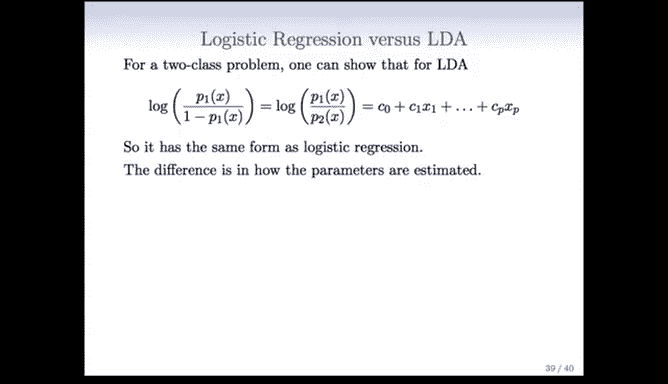

Now， it turns out you can show for linear discriminant analysis。😮，That if you take its。

 we had expression for the probabilities for each of the classes。 So if you have two class。

 we can show that if you take the log odds， just like we did in logistic regression。

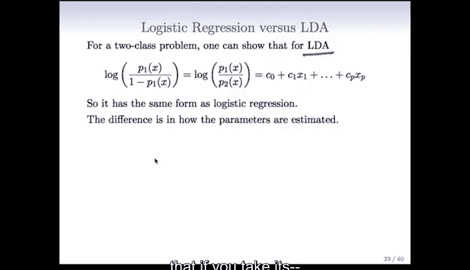

Right， which is the log of the probability for class 1 versus the probability for class 2。

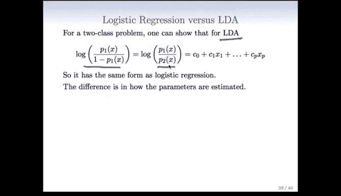

It's a linear function of x。For two classes。So it's got exactly the same form as logistic regression。

So they both give you linear logistic models。So the difference is in how the parameters are estimated。

Logistic regression uses the conditional likelihood based on probability of Y given x。

 Remember it was using the probabilities of a1 or a 0。嗯。Givenive X in each of the classes。

And in machine learning， this is known as discriminative learning。

Using the conditional distribution of Y given X， discriminant analysis。

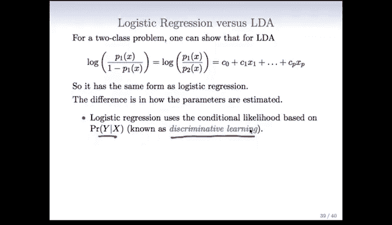

Turns out it's estimating these parameters。Over year， using the full likelihood。

Because it's using the distribution of x is and ys。

Whereas logistic regression was only using the distribution of Ys。

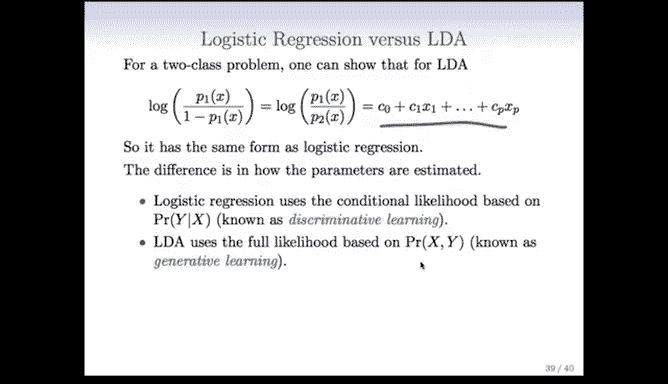

And in that case， it's known as generative learning。

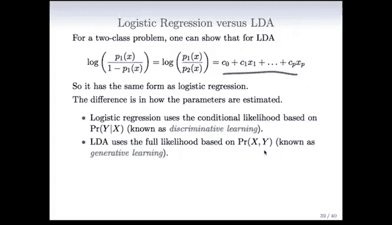

Remember， we modeled the， the， the， the means and variances of x in each of the classes。

 and we model the， the prior probabilities。 So that can be seen as modeling the joint distribution of x and Y。

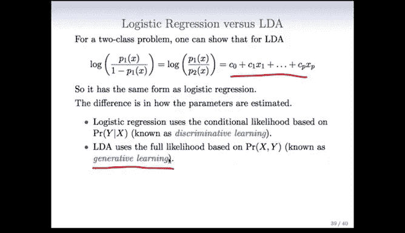

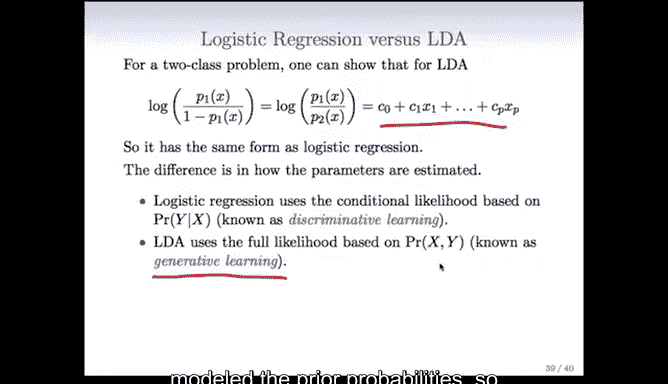

So that's one way of seeing what's different between the two。

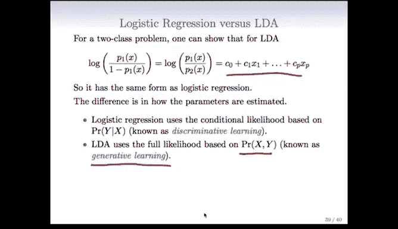

But despite these differences in practice， the results are often very similar。

And you can use one method with the other， and you're going get very similar results。As a footnote。

 logistic regression can also fit quadratic boundaries。

We use quadratic discriminants analysis to get quadratic boundaries。

But we can fit quadratic boundaries by explicitly， including quadratic terms in the model。

Just like we did in linear regression， in logistic regression。

 we can put in X squares and X I times X Js and， and terms like that。

 and just explicitly get a quadratic boundary。Okay， so。That's the end of this section。

 That's an introduction to classification using these two very popular methods。

 And later on in the class， you're going to see that we're going to come back to some of these methods and look at more general versions of them and and and build richer classification rules。

 And importantly， we'll discuss another very popular method called the support vector machine。

 which is another approach to classification。 And by way of coming attractions。

 the next section is going to be on cross foundation and bootstrap。And in that section。

 we will get to meet Brad Efferron， who who's our colleague。And also。

 it was my PhD supervisor many years ago， and it was the person who had invented the bootstrap。

 So he'll tell us a bit about。The bootsstr and how he came about to how he proposed it in his 1980 paper。

 fantastic。