# 斯坦福大学《统计学习导论2023R语言版｜An Introduction to Statistical Learning with R》中英字幕 - P29：-029-Statistical Learning_ 5.3 Cross Validation the wrong and right way.zh_en - GPT中英字幕课程资源 - BV1yU421o7WA

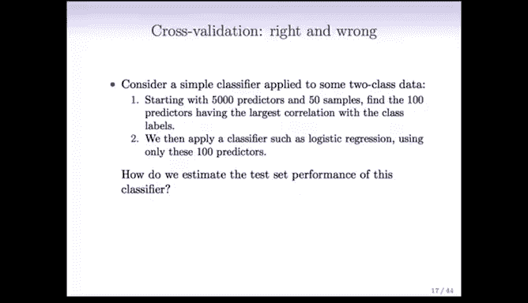

Okay， so we just talked about cross validation， which is an important technique for both regression and classification for getting an idea of test error and for assessing。

How complex a model to fit， for example， how many features to include in a model or the order of a polynomial。

And it's a very important technique， and sometimes with important techniques like this。

 it's a good idea to see how you one might do it wrong。

And this is actually an era that we've seen people a way in which people use cross validation in。

In a wrong fashion which can have actually very serious consequences。

 especially these days where you get very wide data sets and this next example is going to show you such a case so we'll go into detail of how one can do it wrong and how people use it wrong and we'll try to avoid that error and help you to avoid that error so let's think of a simple thought experiment we've got 5000 predictors for example。

 in 50 samples， this is again a more and more calm occurring case where we have more predictors in samples。

And we have two classes we're trying to predict， okay？And suppose we do the following。

 we've built a simple classifier in the following way， first of all we filtered the predictors。

 find that the 100 predictors having the largest correlation on their own with the class labels。

So we're going to cherry pick here， we pick the top 100 predictors， keep them。

 and again they're chosen the basis of their correlation with the class labels on their own。

 and we throw away the remaining 4900 predictors okay。

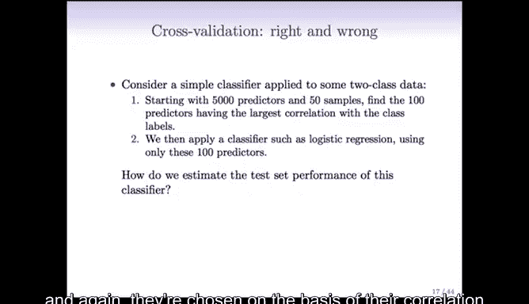

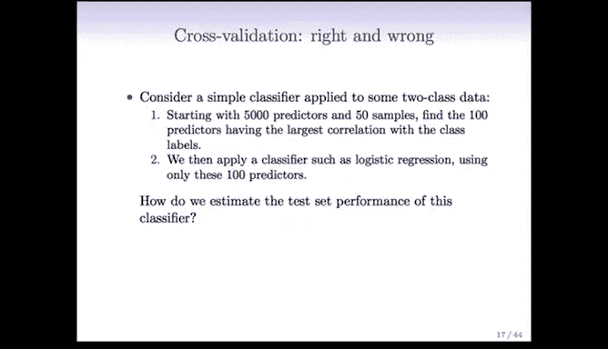

And then we use 100 predictors we use them in a classifier。

 such as a logic model using only of these 100 predictors and we omit the other 4900。

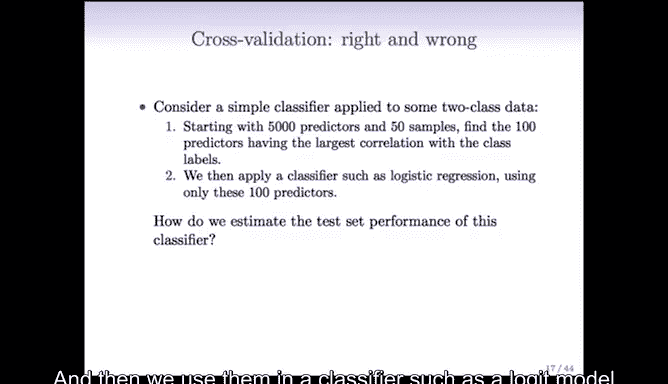

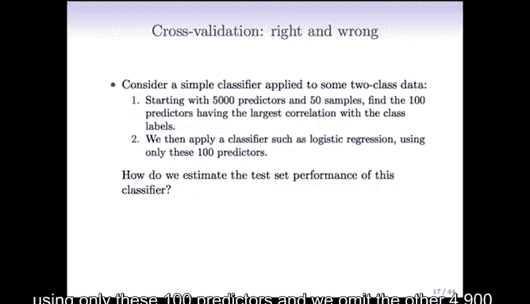

So if that's not unreasonable， we are building a classifier， for example。

 maybe we don't to have to deal with 5，000 predictors， we just want a small number of them。

But the question we address here is， how do we get an idea of the test set error of this classifier cross validation？

Okay， thank you。But how can we- mean what's tempting is to say， well。

 let's just forget the fact that we filtered the predictors in step one。

 that we chose the 100 best among the 5，000。Let's just pretend like we started in step two。

 that we started with the 100 predictors。And that was our data。

 can we apply cross validation in step two， forgetting about step one。

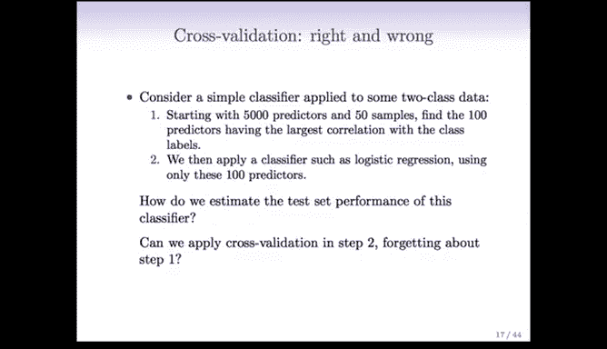

Well， no， this is a serious error。Why is it an error， Well the problem is is that the procedure。

 the classifier has already seen the labels of the training data。

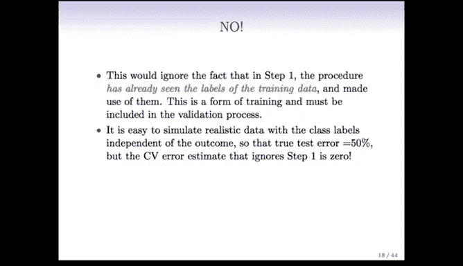

In step one right in choosing。The best 100 predictors。

 it's looked at all the labels of all the samples。So the predictors have already used。

The full set of observations in the fitting when we chose those predictors。

 so that's a form of training。

And we can't ignore it in the validation process。So the。

The point is we're not allowed to just start in step two and ignore the fact that we applied step one。

Why is that？This is something you try yourself。You can simulate data with class labels having no correlation with the outcome so that with equal classes。

 the true test error is 50%。But cross validation， they ignore step one will give you an error rate of zero。

So it's a serious， serious bias。Cross validation telling your classifier is perfect when in fact。

 your classifier is the same as slipping a coin。Okay。Think about why this happens if we。

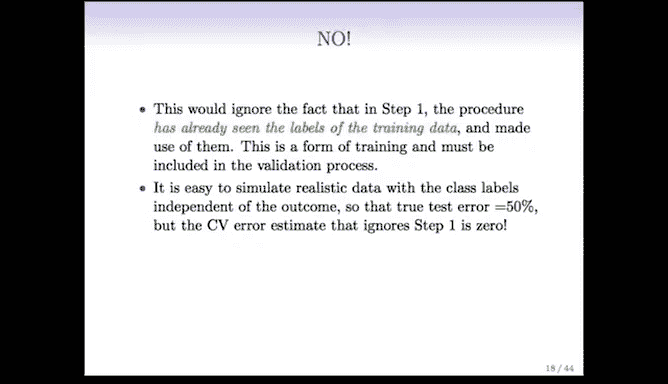

Actually， we make the point more clearly if we increase the 5000 to maybe。

5 million predictors Supp we have 5 million predictors and 50 samples。

 and again there's no correlation in the population between the predictors and the class labels。

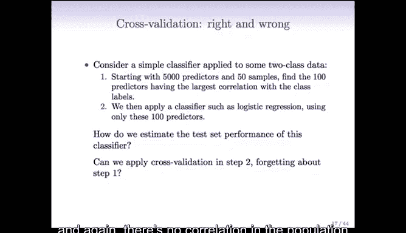

We go ahead and we pick the best 100 among those 5 million predictors。

We're going to find some very good looking predictors， despite the fact in the population。

 no predictor has correlation with the outcome in the data， if we look at the best among 5 million。

 we're going to find some very good predictors that look and the data like they have a lot of power for classifying。

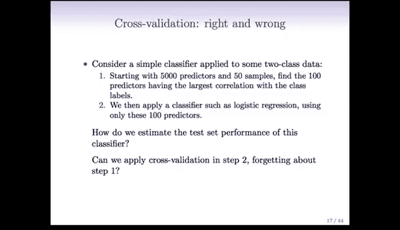

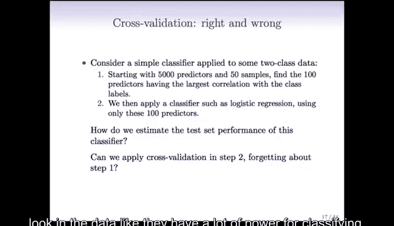

If we then pretend like those were the predictions we started with those 100 cherry picked out of 5 million。

They're going to look very good to cross validation。So we fooled cross validation by。嗯。

Leaving out the first filtering step and giving it a very cherry picked set of predictors in the second set。

This seems like it's you know， it was done on purpose here， but actually in some genomic studies。

 researchers are faced with you know tens of thousands of genes maybe。

 and it's just hard to handle them。 so they do some kind of screening in the beginning just to reduce the number of variables down to a manageable set。

You know， and， you know， and then forget about it afterwards。 But that leads to this kind of bias。

Right， so as I say here， this I think it'ss good to understand this by actually trying this yourself。

 just in R， you've learned some R now， you can simulate a situation just like this where the true test error is 50%。

And you simulate a large number of predictors and apply cross Foundation in step two and you'll see the error is actually very low。

 the CV error is low， and as Trevor mentioned this is not something we've made up。

 this is actually an error which commonly occurs in genomics in published papers in high profile journals。

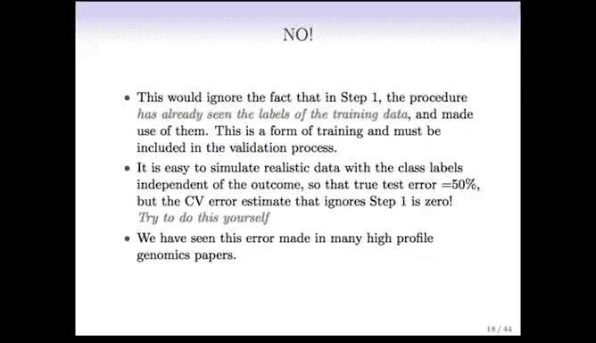

So。We told you the wrong way to do things， we apply cross validation in step two， well。

 the right way is to apply cross validation to both steps。

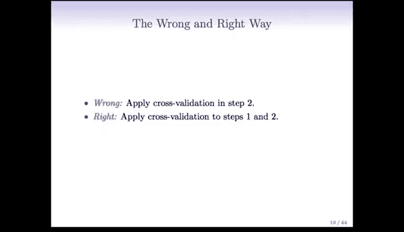

So in this picture。The next few pictures will make this clear。

Here I've got the wrong way I just described。

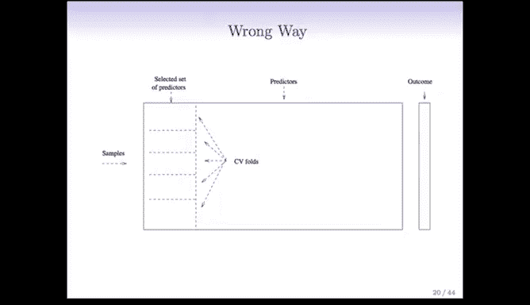

So I've got my samples here and my predictors here。And now。In this in this。

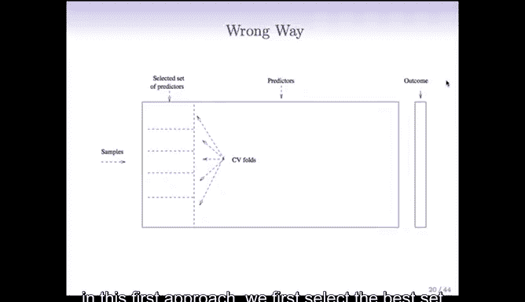

First approach， we first select the best set of predictors based on the correlation with the outcome that's over here。

And we keep these predictors。And throw the rest away。And now in step two。

 we're going to apply cross Foundation， what does that mean we divide the data up into say five parts。

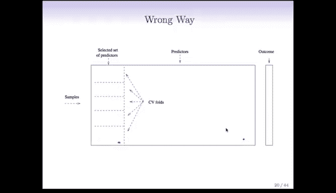

We apply our classifier to four parts and we predict the response in the left out part。So again。

 this is wrong because the filtering step， which selected these predictors has used the response variable for all the samples。

So this is the wrong way to do things。The right way。Is as follows， we first， we define our folds。

 five folds cross validation。 before we do any fitting， we were moved。One of the folds。

 all the data for that fold， the predictors and the response variable。

And now we can do whatever every want on the other four parts。

 we can filter and fit or however we want。

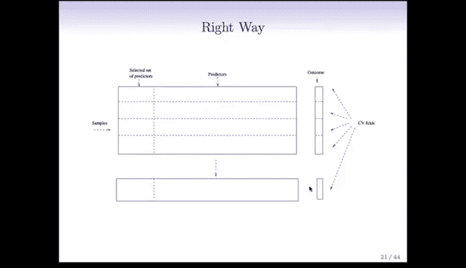

And when we finished our fitting， we then take the model and we predict the response for the left out part。

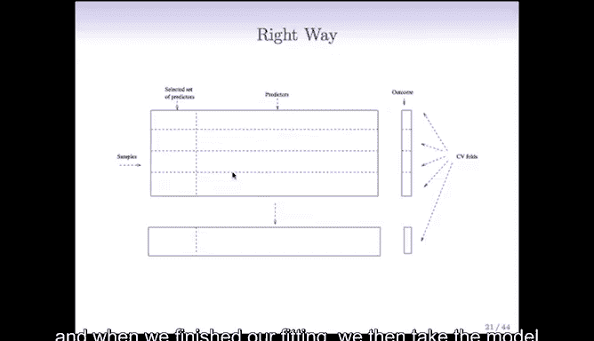

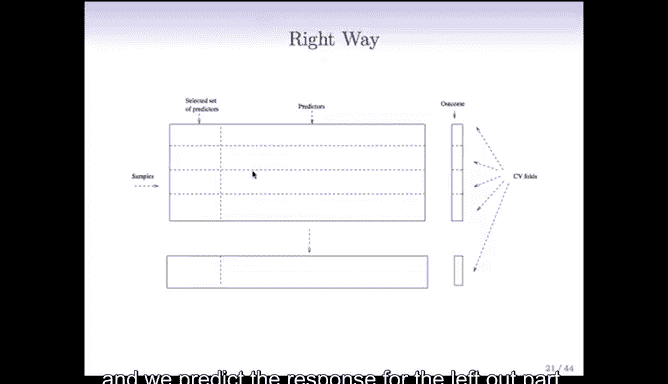

The key point being， though， that we form the folds before we。Filter or do or fit to the data。

In order so that we're applying cross foundation to the entire process， not just the second step。

So that's the right way to do so in each of the four fifth folds。

 we might screen off a different set of predictors each time， and we probably will。

And so that variability is going to get taken into accountant so this wrong way of doing cross foundation is not something that we've made up。

' it's actually something which I mentioned occurs in a lot of published papers and I've actually experienced it a number of times myself。

A few years ago， I was at a PhD oral in engineering here at Stanford。

And a lot of people in engineering are doing statistics as part of their work。

 This particular student was doing a。He was trying to predict heart disease from SNPps。

 SNPps are single base changes in the genome， so basically had a classification problem with。

I think about 100，000 predictors and to class response。he had done something very much like this。

 he had so many predictors he wanted to filter them。

 so he applied a filtering of some sort to the data set。To reduce the 100，000 predictors， I think。

 down to 1，000， and then he fits some sort of a model to the 1。

000 predictors and he got an error rate of about 35%， I think。Which doesn't sound that impressive。

 but for this particular area， it was actually quite a low error rate。嗯。

And during the oral he presented this， and I said actually， I think there's a problem with this。

 and I pointed out the fact that the point you've just seen that he actually had filtered the data。

And oh， sorry I didn't say this give you have detail。

 he had applied cross validation in the second step， so he had filtered the data down to 1。

000 predictors。He applied cross validation and the cross validation error rate was about 35% and he was quite happy and this was part of his presentation and I mentioned。

 well that doesn't look right to me because you，They've done cross validation wrong in the way I just described。

He didn't agree and his supervisor didn't even agree who also I will not name the person wasn't he。

 it wasn't you Well， the supervisor said， well， maybe you're right， but you're really being picky。

 you're splitting hairs hair it's not going to make much difference and I said， well。

 I think it might make a difference， you really have to go back and do it。So a few months later。

 the student knocked at my door， my office paused。He did pass because he had other things in the thesis which were which were reasonable。

 but a few months later he knocked on my door， came to my office。

 said I redid the experiment and the air rates now 50%。

 he was you know quite surprised and a bit upset but basically it was I told you so you know with a large number of predictors。

 if you filtered them you've got to include that in your cross validation and if you don't。

You can incur a serious error in your cross validation estimate。So。That was again。

 it happens and Trevor and I talk whats a lot and other people have written papers about this error。

 but people continue to make this error and cross validation so that's a big heads up and of course another heads up is not to have raw tips on your oral committee okay。

Okay so that completes our discussion across validation。

 we spent quite a bit of time on that topic because it's a very important technique for all of the methods we'll see in this course。

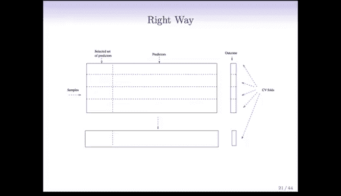

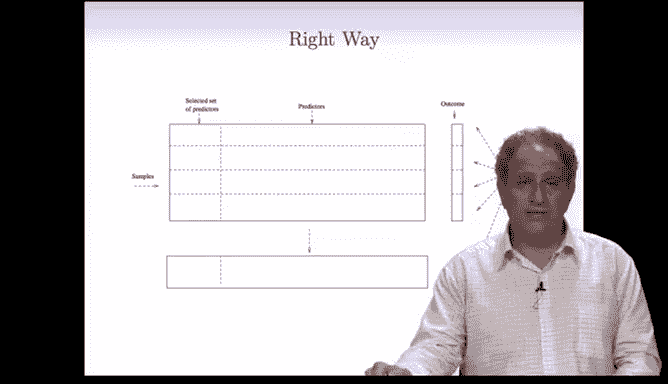

In the next section， we'll talk about a closely related idea， but a different one called the Botrap。

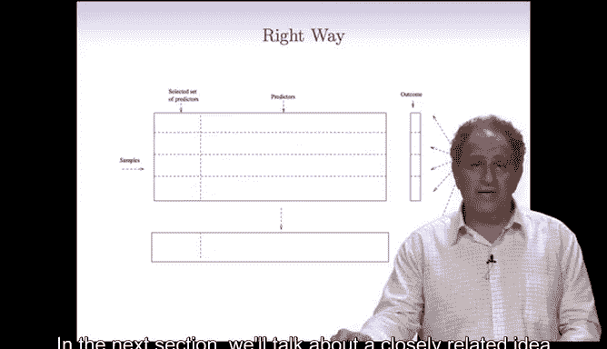