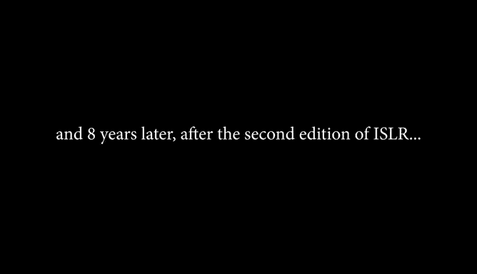
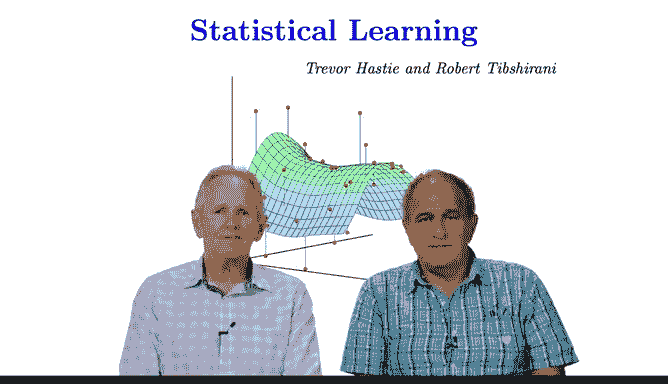

# 斯坦福大学《统计学习导论2023R语言版｜An Introduction to Statistical Learning with R》中英字幕 - P2：-002-Statistical Learning_ 8 Years Later (Second Edition of the Course).zh_en - GPT中英字幕课程资源 - BV1yU421o7WA

Well， here we are again。8 years later。Im Trevor hasty。And this is。My friend。Rob Robob tipipsharani。

Thank you， my old buddy Trevor。man I said you haven't changed one bit， you look great Oh thank you。

 Rob。Well， we're here filming the second edition of our moOC lectures on our course。Intra。duction。

To statistical。Lanning， cis go learning。You can take your costume off now， it's all from okay sorry。

So。Welcome to the second edition of our lectures on Statistic Learning。

 where you have some new lectures to accompany the new edition of our book。

And the lectures will be on deep learning， survival analysis and multiple testing as long as a few other topics in addition you'll notice if you look in the book which is also freely available on our websites and on the book website you'll notice there a few little extra pieces in various chapters so in chapter 4 we have a new section on generalized linear models。

In the unsupervised learning chapter， we have a section on matrix completion。And。

There's one more Bart in the tree the tree chapter。Beesian additive regression models， Bart。

The rest of the course is the same as before， so we haven't reformed those lectures and material is the same。

And of course there's labs for the new material as well。

 so we hope you enjoyed it in addition in the first edition of the course。

 we had interviews with some famous people in our field， well， we have more of those。Right。

 we've added we interview with David Cox on survival analysis。

Jeff Hinton on Deep learning and you' have Benjamini on multiple testing and false discovery rates。

 so we hope you enjoy the second edition of the course。

