# 斯坦福大学《统计学习导论2023Python版｜An Introduction to Statistical Learning with Python》中英字幕 - P30：-030-Statistical Learning_ 4.Py Logistic Regression I 2023.zh_en - GPT中英字幕课程资源 - BV1u4421A7ZU

Welcome back everyone today we'll talk about the lab for Chapt 4。

 which this topic is classification and we'll talk about various classifiers applied to the stock market data。

 and there's a description of the stock market data in this paragraph though if you ever want to read more about any particular data there are some notes on the documentation webp page for the ISLP package you can find a link to that on the Stalearning。

com webpage。Okay， so as in our previous labs， we。Continue the practice of importing all the key parts at the beginning of the lab and some the first chunk here are things we've seen before。

 and then we have some new imports。 The list looks a little bit daunting。

 we won't go through all of them we'll just note that many of these imports are some are from the ILP package and all the rest of these are from the the psyit learnar or SK learn package and these packages both the ISLP and SK learning other packages。

 they turn out to change relative with some frequency and sometimes you'll see that the code written here that we'll go through today。

 there might be a small error and there are ways to track these errors。

 you can go to the forum on the statlearning co webpage and we'll try and address them and update the lab as needed。

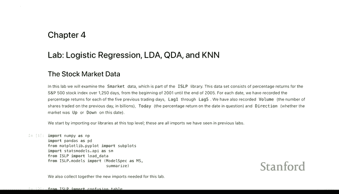

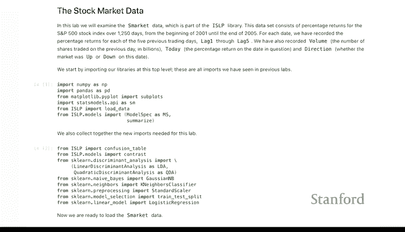

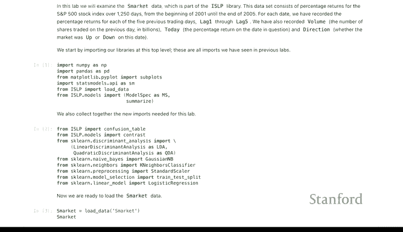

Okay。And we also maintain an era writerer page。And sadly， there's already some writer for this。

 for this book。 And so any a reported will be reported there。

 so you'll you'll be able to see if it's been noted already。 Yes。

 the the good thing about having these labs online is we can update them and keep them running as things change。

Okay， so。As I mentioned， we're going to be using these classifiers from psyAT Learnn and we'll see there's many classifiers。

linearar disc analysis， LDA， QDA， Gaussian naive Bays， and K nearest neighbors。

 and one of the nice things about SK learn is we'll see that besides the name of the classifier。

 a lot of the way we fit the classifiers are almost identical。

 so that's a pattern that will repeat itself in classification and other methods that we'll see later from SK learn。

Okay， let's move on。

So we're going to start by loading our data， the stock market data。

 we're going to try and predict whether the stock price goes up or down。

 that's the direction variable， so that's going to be binary yes or no or up or down， I suppose。

 and then we have some of the laggged returns， these are the first five columns here。

 as well as the volume， some normalized version of the volume traded on that day。

And a little heads up。We're not very good at this。 If we were。

 we probably wouldn't be citizenizz yet。Fair enough， fair enough。 that's true。

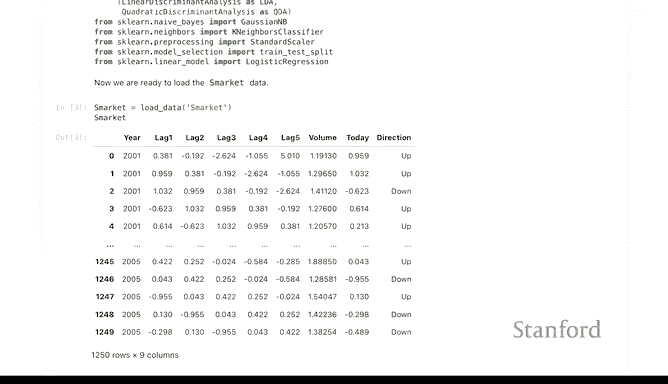

Okay。So。

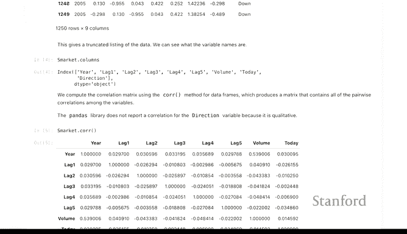

Let's take a look at the correlation matrix of of the data to see if anything pops out at us。

 if it was very easy to predict。Today's price， or which the the。

 the direction really is just whether today is positive or negative。

 It was very easy to predict whether it's positive or negative from the different。

 different variables， we'd expect to maybe see some correlation。 So for the lag variables。

 we see they're all pretty small。 there is a correlation。

There is one correlation in this plot that pops out that is volume in year。

 and so volume is the number of these stocks traded in a given day。

 and we see a positive correlation with the year。So the index year is the index here。

 so we can plot or sorry the day is the index here。 So year is increasing as we go on this x axis。

 And if we plot volume as a function of day essentially， we see that it does tend to rise。

 So what this correlation is telling us is really that。More of these stocks are traded over time。

 okay。

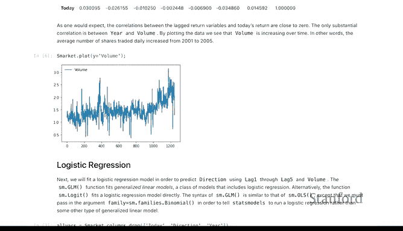

Let's fit our first regression model， logistic regression。So as we've seen in the lectures。

 logistic regression is you know a very standard classifier that's used you know in many different places and is an example of what it's called the generalized linear model So we're using the GLM object from stats models that's what SMM is and we're going to fit a regression model So we saw last class sorry we saw in lab for chapter 3。

 we use the ordinarily squares model this differs we're using the GLM here and one of the things we have to specify as teleot that is logistic regression and that's done by saying that it's a binomial family。

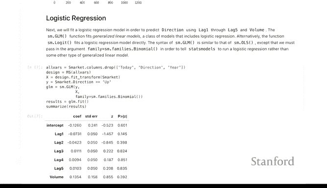

Other than that， fitting this model is a lot like the linear aggression we saw in the lab for chapter  three。

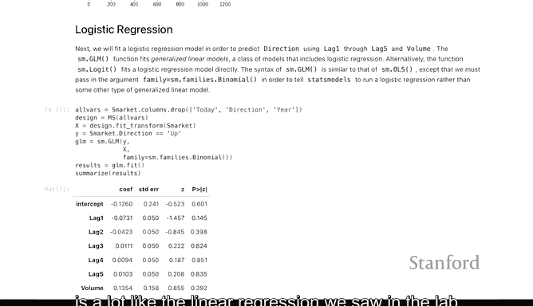

So we can fit the model and then summarize the results。

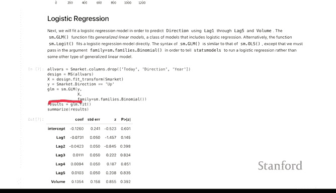

Getting estimates of coefficients for each of the variables and。

Some assessment of whether these variables are significant or not。

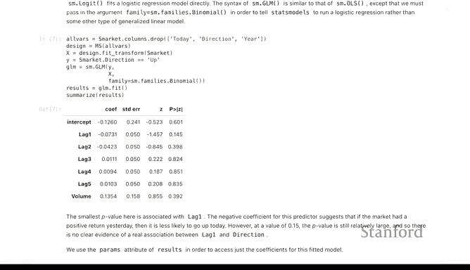

And。Well， as we see， there's not a lot of strong evidence that any of these variables are really predictive of whether the stock will go up or down tomorrow。

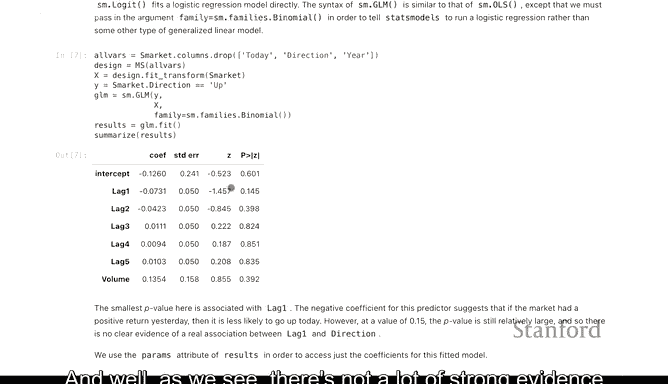

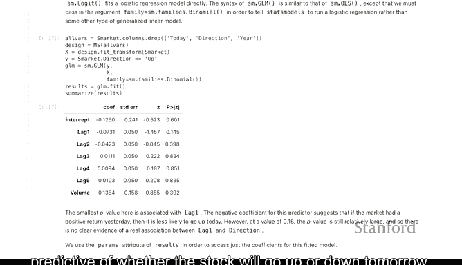

But as Trevor mentioned earlier， this is a very difficult problem if we could predict whether stockck will go up or down based on some observable information in the past。

 we probably would be using that to make some money。

WellIt looks like it's saying if it went up yesterday， it'll go down today。

With the negative coefficient on the leg1。 Yes， though not a very strong one， as we see。

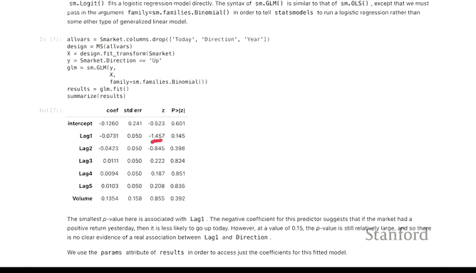

Okay。

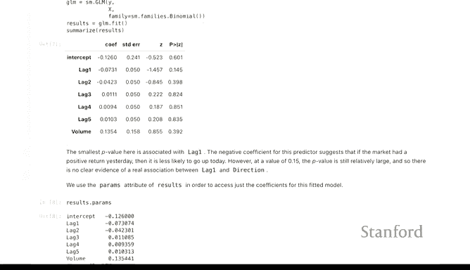

So。We talked in the chapterpt 3， we talked a little bit about the results object that come from the stats models package。

 You can find things like the parameters and associated P values。

 We're going to use it to find the predicted values。

 So these are the since we have a binary regression problem， the predicted values are probabilities。

 So if we look at the predictions these are the first1 probabilities。 So for the first10 outcomes。

 this is the predicted probability that it will go up， I believe is the way this is coded。

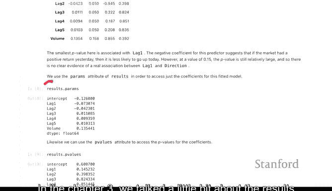

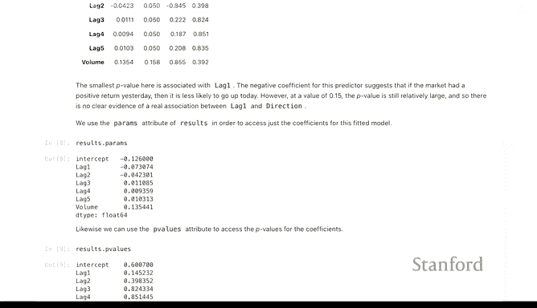

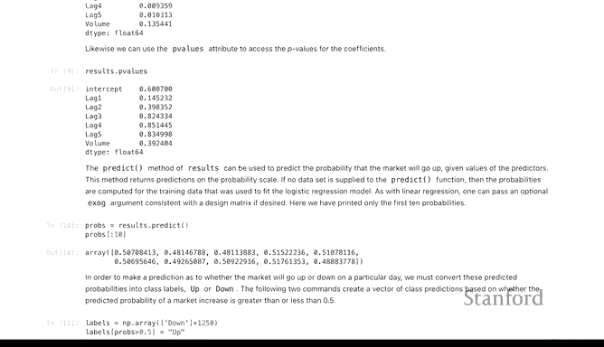

Okay， so now what we're going to do is we're going to assess the accuracy of this classifier。

 so we have the actual labels， that's the direction outcome and we're going to make predicted labels。

 So what we're going to do is find all the probabilities if the probabil is bigger than 5% well label that up。

 Those will be our predicted labels and we'll compare them to to the true labels in this in a confusion matrix。

Like 5 to7。Yes，5， did I say5% Oh 5% that， that is a statistician's tick， I think。

 because of a 5% significance at 50%。 Thank you。

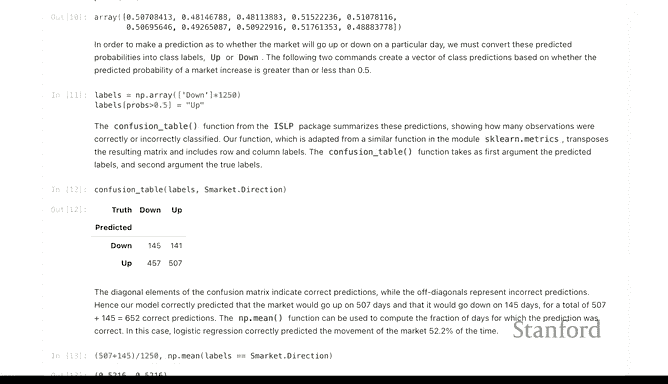

Okay。So we're， we're displaying the results in this confusion matrix。 And this is。

 this is a function we wrote in the ILP package。 There are confusion。

 you know code to make confusion matrix in other places。 So we've just created a function。

 So this aligns with the the way confusion matrices are sort of labeled in the in the， in the book。

 So in the columns， we have the true label and on the rows， we have the predicted label。

 So we can see here。That we had predicted。457 plus 507 to be up and the the actual observed ones were 141 plus 57。

So， you can。Assess the accuracy by looking at， we want the diagonal to be high because that will tell us we have high accuracy。

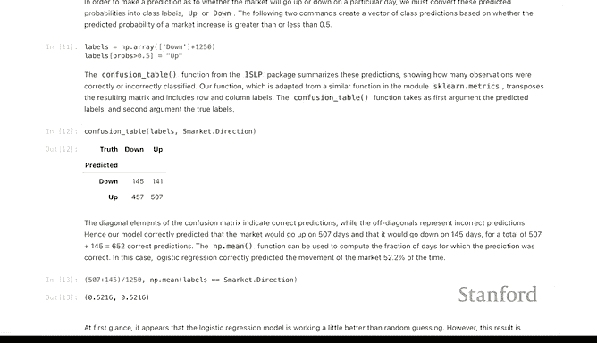

So。The accuracy is going to be the number we got correct。

 that's some of these two divided by the total number of observations， 1250 and about 52%。

 and we can that's the same as if we just average whether the labels are equal to the observed directions。

Okay， so it seems that we're doing not bad here。 We have 52%。 Well， not great。

 but it's slightly bigger than 50%， which is what run of chance would do。 I think in finance。

 this is considered a huge。 Oh， I would think so 2% is probably very good。 Yes。

 because if you put enough money behind 2%， you will do it very well。

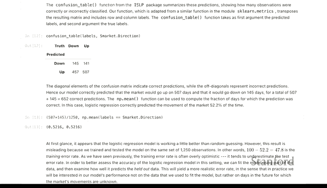

Okay， so what we're going to do is we're going to split the data into test and training as described in the lectures。

Oh， that was training error， right， Jonathan。 Oh， that's right。 Yes， yeah。

 so it's probably optimistic。 exactly。 yes， yes， So to see to get maybe a more honest assessment。

 we're gonna use this split into training and test data。

 So we're gonna And because it's time series data。 We're gonna split you know。

 training will use an earlier period and the test will be a later period。

 So we're gonna take all the observations up to 2005。

 their training set and then everything else is gonna be our test set。

 So we use that we make this binary variable for the training labels and we can we will make two data frames。

 one for the training and one for tests。 and on each of these。

 well fit the logistic regression on the training data frame and。

Evaluate predicted probabilities on the test data frame and reform the confusion matrix。Okay。

So here we're doing essentially what we did above when we used the entire data set for training。

 here we just refit on the training data。

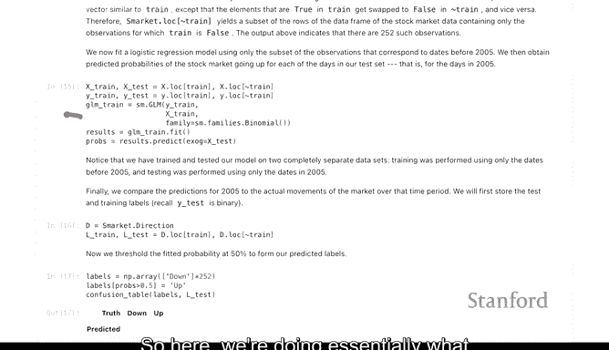

And then， we're gonna。Find predictions on the test data。 So to predict on the test data。

 we have to give a new design matrix。 and that's here represented by this exogenous argument as X test。

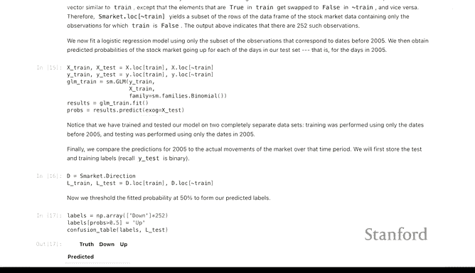

Okay， so we will'll do the same thing to produce labels。

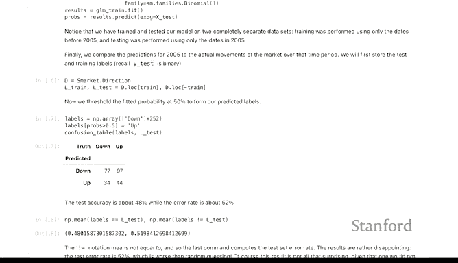

We will。Threshold that 50% of our predicted probabilities or probabilities in the test set。

 and we'll compare them to the test labels。

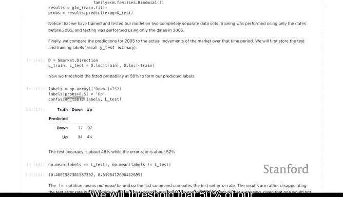

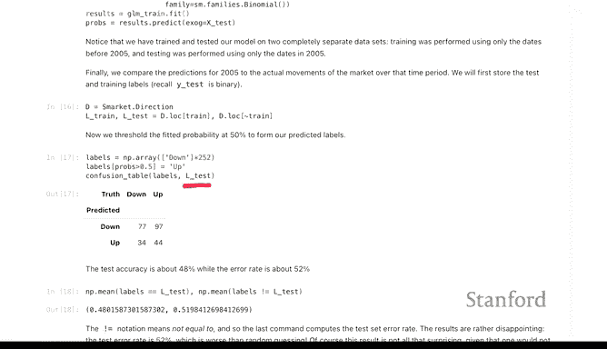

Okay， so now we see the accuracy is about 48%。 and that's unfortunately。

 slightly worse than random chance。 We could just decide to reverse our predictions。

 but this is likely just close。 It's close to random chance and probably just indicatordicative that we don't have much power。

 There's， of course， some variance in this。Okay。

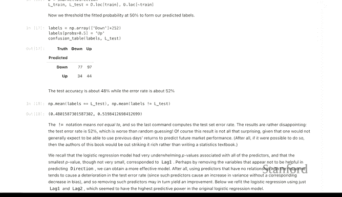

So let's try a slightly simpler model。 So that the model we had just tested had all the five lags as well as volume。

 Let's see if we use a simpler model， if we can do better， perhaps， you know。

 recognizing that maybe we are over optimistic in trying to fit these six variables。

 maybe a simpler model with just two lags will do slightly better。

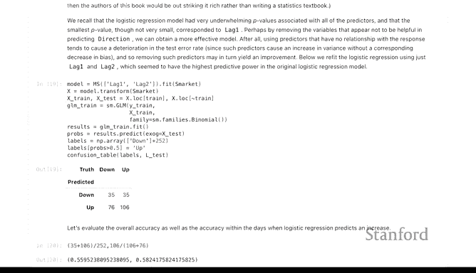

So， this will we。

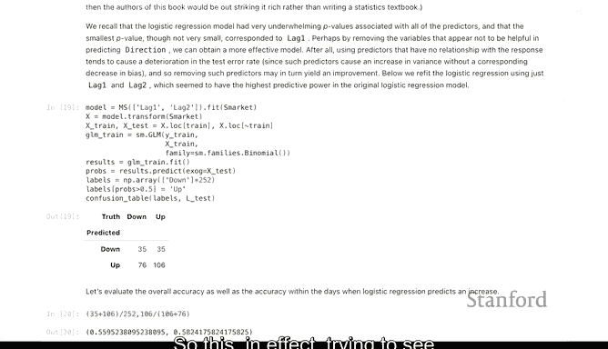

In effect， trying to see whether we can beat the bias variance trade off here by using a simpler model。

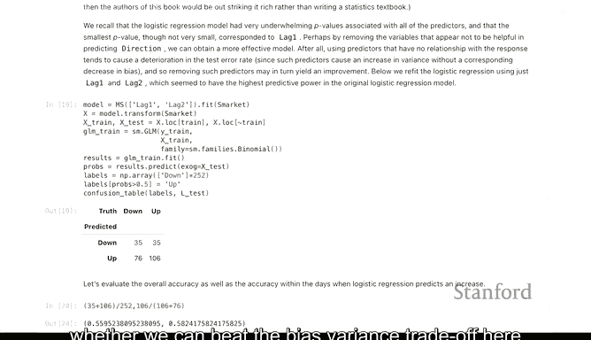

And repeating the same thing， except with just these two features， we now get a。

A test error of about 56%， which is better than randomed trends。

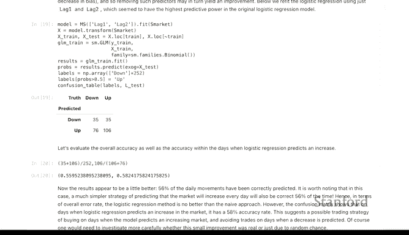

And， you know， so maybe this is a strategy we should trade on， but we'll see。

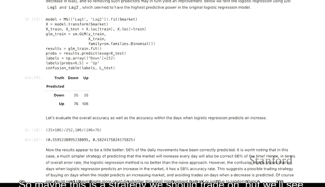

嗯。Okay。

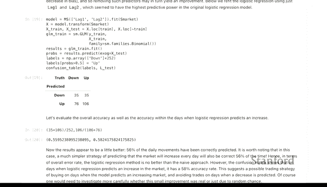

Now， if you want to。Roll forward。To find new predictions， here's a little example。

 if you had observed lags in days that weren't accounted。

 how to find predicted probabilities going forward。

