# 斯坦福大学《统计学习导论2023Python版｜An Introduction to Statistical Learning with Python》中英字幕 - P31：-031-Statistical Learning_ 4.Py Linear Discriminant Analysis (LDA) I 2023.zh_en - GPT中英字幕课程资源 - BV1u4421A7ZU

So after logistic regression， we're going to start talking about which was using stats models。

 We'll start using some of the classifiers from p Psyit learn。

 So the first one we'll fit is this LDA model。So the way PsyitLn works for these prediction problems is there's some object。

 in this case， we've called it LDA that was just a shorthand for linear discrimin analysis。

That sort of tells we don't give any data to the the classifying object here。

 We just give some arguments like in this case， we asked it to store the covariance in case we want to inspect the covariance matrix in LDA。

 but having，Form the estimator this way， we later fit on matrix of features and a response Y。

 and then we can predict on new features or the original features。

So that's the general way that these estimators all work。Okay。So we're， again， going to。啊。

Split into test and training。And so， we'll make our。Are。Training and test sets as follows。

 and we're going to fit on the training data。So Jonathan。

 we're using the same train and test design matrices we had before。

But you just drop in the intercept from the that right。 That's right。 Yeah， yes， yes。

LD will require you to put it into Yes and and I think it will actually complain because the well。

 because the covariance will be zero。 yes， it will have a noninvertible covariance。嗯。Okay。

 so as we saw in the lecture， there are a few different parameters that come from fitting the LDA model。

 One is the the common covariance。 There are within class means that you can find this way。

 There's the label of which class which this just helps。 if down is the first one that tells us that。

Now this is two by two。 we'll have the documentation again。

 as second learn has great documentation will tell us whether the mean。

 the second row is the mean in the class or the second column is the mean of the up if we had used three features。

 we would be able to tell here， because we would have a two by3 or a  three by two matrix。

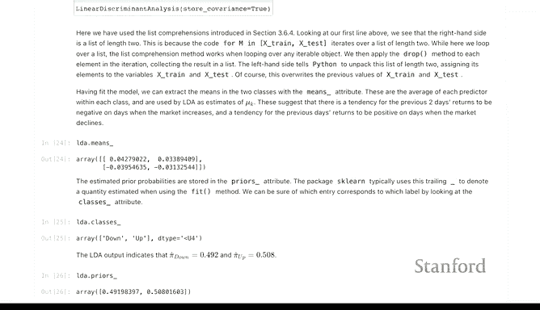

But the documentation will sort it out。My guess is that it goes by row as the or major index。

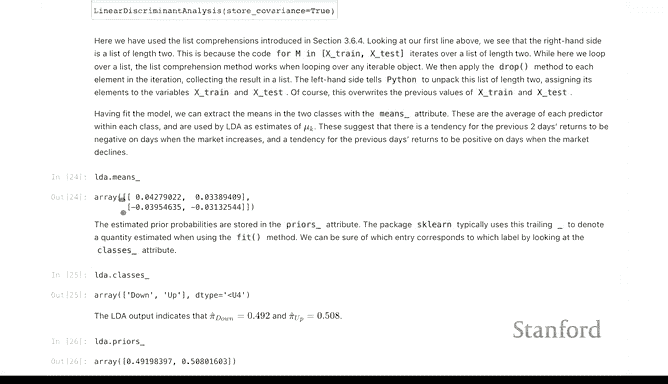

Okay， so these， these quantities are parameters of the。

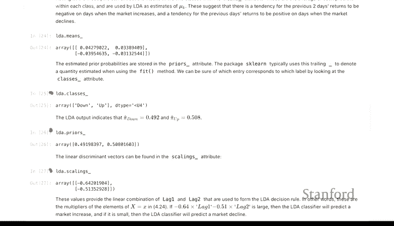

Of the fitted model。 And this scalings matrix here。

 this actually tells you the discriminant function。

 That's what's used to tell to make the prediction between whether you're in the up class or the down class。

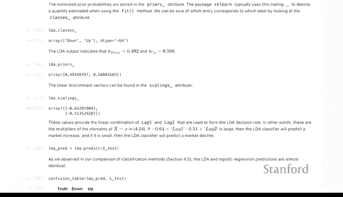

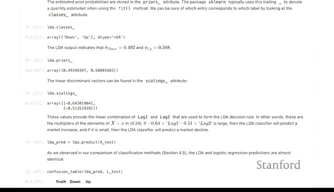

Okay。So we'll want to again， evaluate how well this classifier does on the test data。

 so we'll use now the second method that's commonly used for psychic learn。

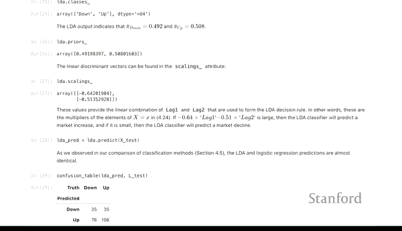

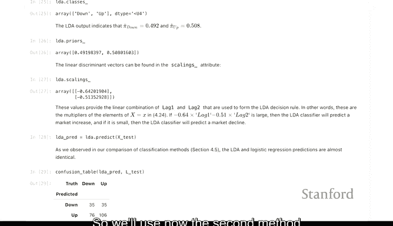

Classifiers， in any case， it's the predict method， having fit on x train and Y train。

 we predict on X test。

And will again form the confusion matrix。Oh。Using the same function， we have the same test labels。

 So we don't。 We haven't printed out the， Well， let's see if we've print it。

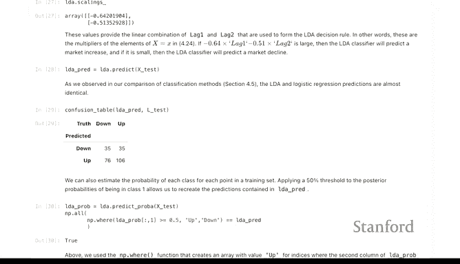

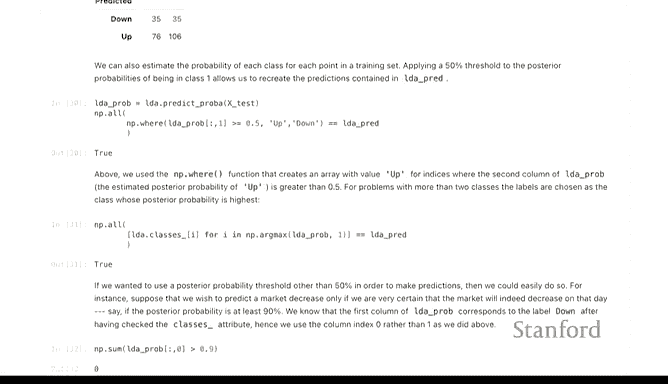

We have not printed out the accuracy。

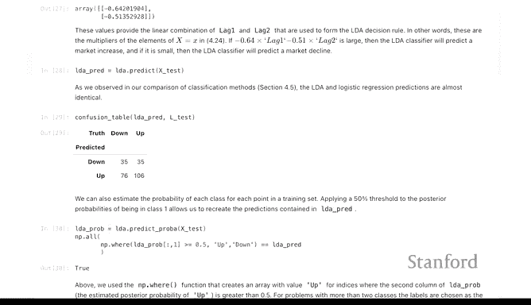

So。Move on。Okay。So。

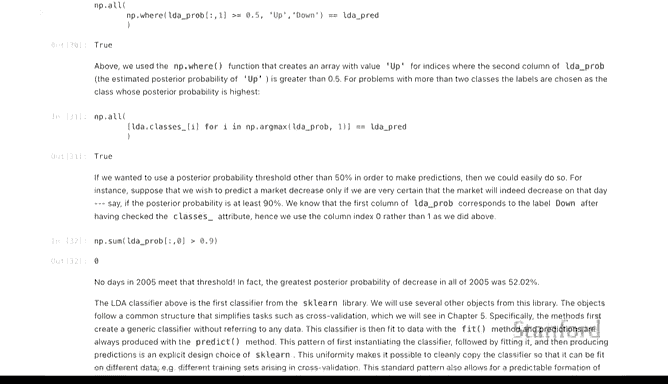

We'll just pause here for a moment to say that most of the time we've we've estimate we've we've assigned points to classes based on thresholdholding。

The probability at 50%。um。Though。Sometimes we might， you know， we might decide to change that。

 and we can easily do that by just。Changing the threshold we apply to these probabilities。

 this LDA probability vector， these are the estimated class probabilities for for the prediction the test data。

 So the first column is the estimated probability of being in the up class and the second column is the estimated probability of being in the down class。

So I if you increase the threshold， youll classify less observations in the up close。 Yes。

 and more in the down class。 That's right。 And it'll change those two off diagonal areas that you have in the confusion matrix。

 Yes， and I， I just， I saw on the text set is actually the first column is the down class。

 So the effect that will be is if we increase the threshold of 90% will just predict fewer in the down and the number in this row will get smaller。

 but hope it's possible that the accuracy will improve。

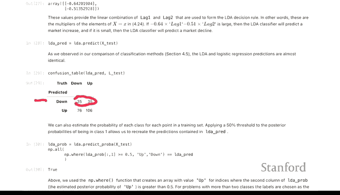

By well， depending on the balance of how many are up and down and the within class accuracy。

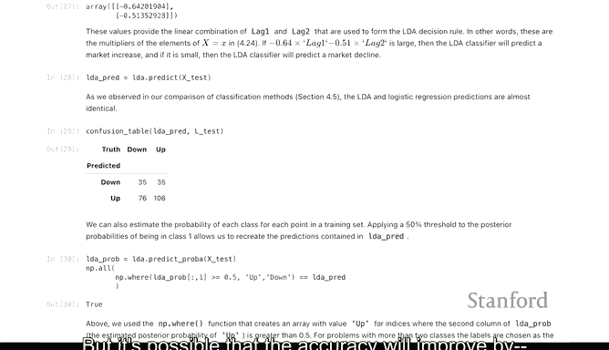

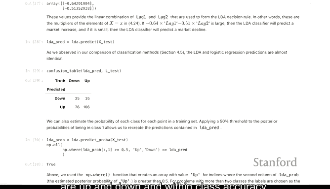

Okay， so let's move on to our， our next classifier。 The next classifier is。

Qudratic discriminment analysis or QDA， and remember that this is very similar to LDA。

 the main difference is that there is a class specific covariance matrix。So in terms of code。

 we're going to fit it as promised it fits almost identical to LDA。

 we have the same training features and the same training labels we'll call the fit method on QDA。

And。This little QDA is a， is an instance of the， the QDA classifier。 And again。

 we've asked to sort the covariances。 So with this， we can， for instance， look at the the within。

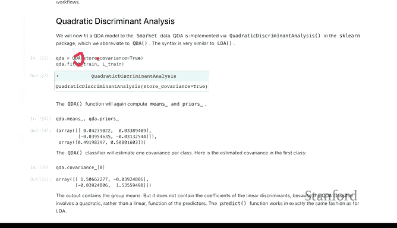

Within the down class covariance， that would be the first covariant entry of the covariance returned。

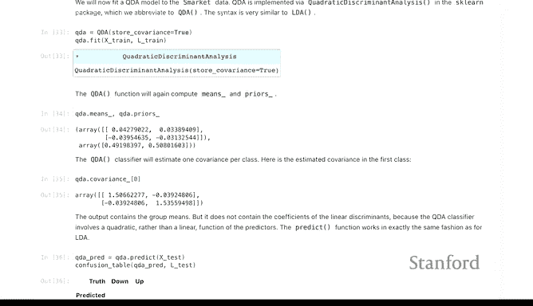

So just to remind you， because in all our separate covariance matrix in in each of the classes， too。

 in this case， the the classification function becomes a quadratic function。 That's right。

 Where by having that convenient assumption that they were the same。

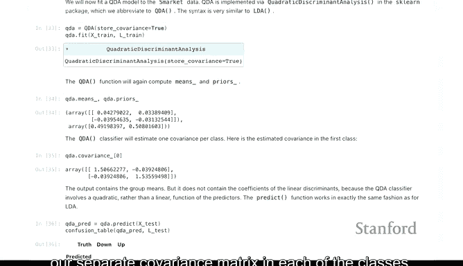

If they were the same， that LED to linear discrimin analysis was a linear function。

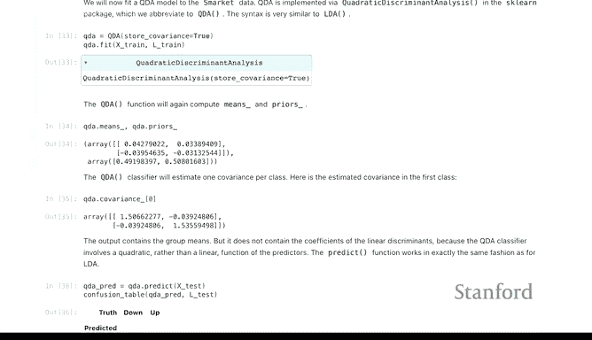

That's right。 So in the the discriminant function in QDA is not described just by the scalings matrix。

 You need both the covariance and the difference in means。 The scalings in the LDA example。

 is essentially the difference in means， well multiplied by the inverse of the covariance matrix。

Okay， so again。In order to evaluate how well this classifier is doing。

 we can we use the predict method on our test label， our test features。

 and then we use the same confusion matrix or the confusion table function to produce the confusion matrix。

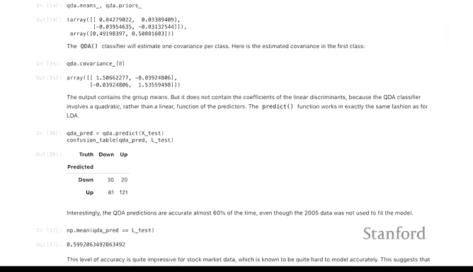

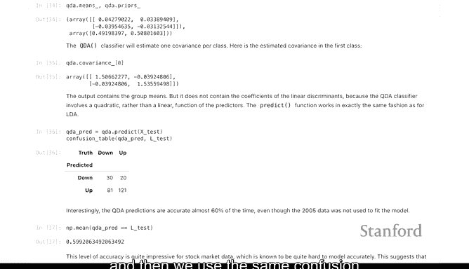

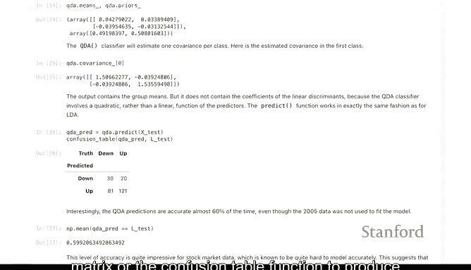

Okay。And so here we see the QDO is about 60% accurate。

 That's even better than I think we had 55% accuracy with the these features and logistic regression。

 So this is actually quite good for for the financial data。Okay。

So hopefully you now see the pattern having seen it twice for two different classifiers。

 does SK learn once you know the pattern， it's quite easy to fit many different classifiers。

 so we have a few more to fit。 one is naive Bays and then we'll wrap up with Ka Neer's neighbors classifier。

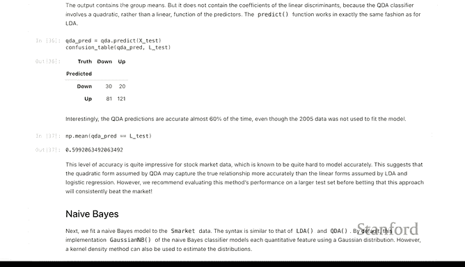

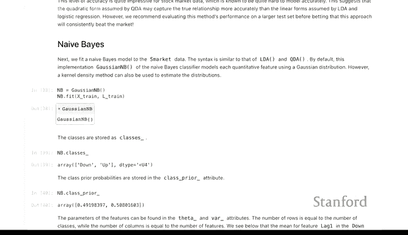

So。

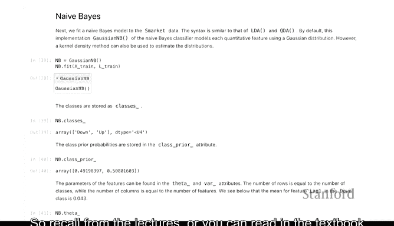

Recall from the lectures or you can read in the textbook that the naive B when you have continuous features。

 naive B is essentially is quite closely related to QDA It is sort of a restricted version of quadratic discriminant analysis in terms of the code again。

 it is fit identicalally to QD and LDA， we call the fit method on our training features and training labels。

 and then we'll evaluate in a similar fashion。

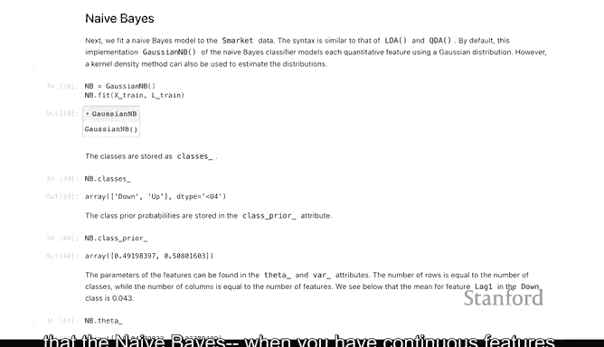

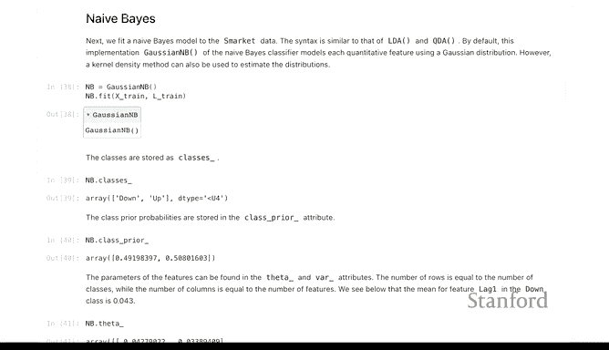

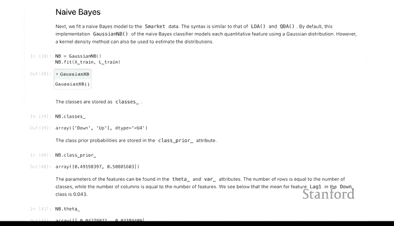

So I mentioned it's quite related to QDA。Essentially。

 it just imposes the constraint that the covariance mat are diagonal for QDA。

 That's basically the difference between naive Bays and QDA。

 So it's a simpler model has fewer parameters than QDA， but otherwise quite similar。

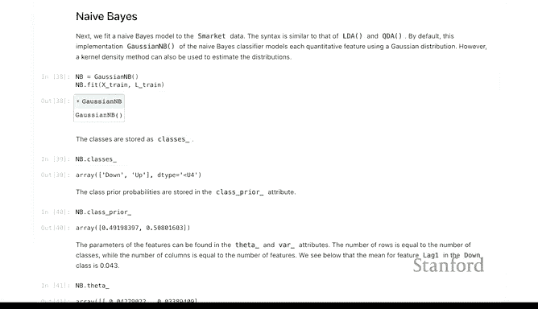

嗯。Okay。So just like QDA and LDA， there are within class parameters that you can。That you can。

Examine as the output of ideal base， for instance。The covariance matrix being diagonal means within class。

 you only have to store the variance of each feature to describe the diagonal matrix rather than the covariance。

 so this variance underscore attribute has the within class covariance matrix the variances of the lag 1 and lag 2 for class0 and class 1 or class down and class up。

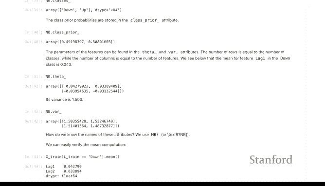

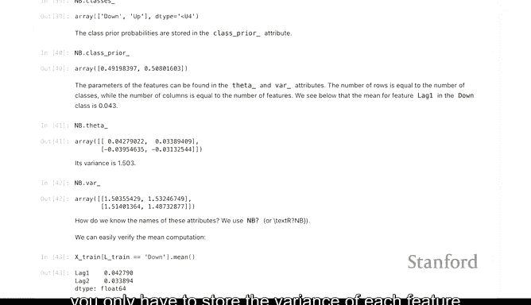

Okay， and if you want to see more about what these attributes are。

 if you look at the help for the naive Bay object， it will describe it will have its docstr that describes what these attributes are。

 and that's similar for the LDA object and the QDA object if you're ever curious about how to find their names。

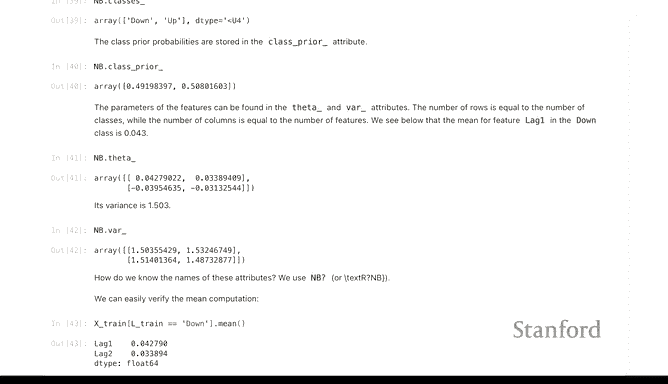

Okay。So let's see how well our naive base predicts。

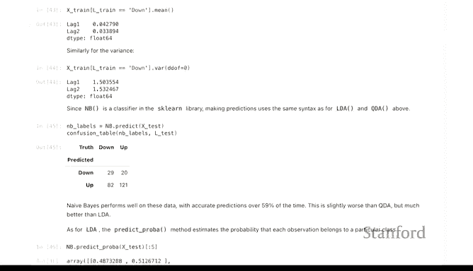

um。Its we form the confusion table of similar fashion， and we get around 59%。Very close to LD。

And they all doing。

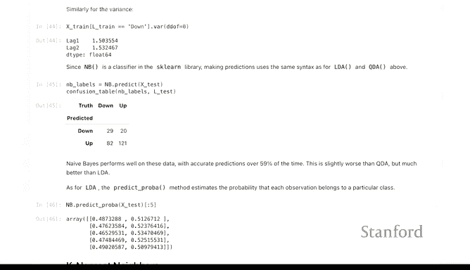

All these discriminant analysis methods are doing reasonably well。

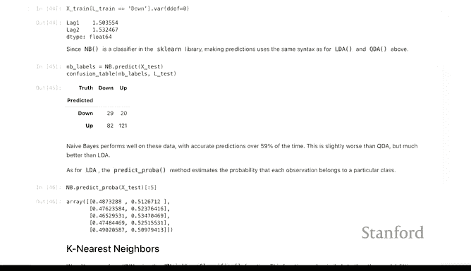

Yeah。Okay。So our next topic will be Can nearest neighbors。

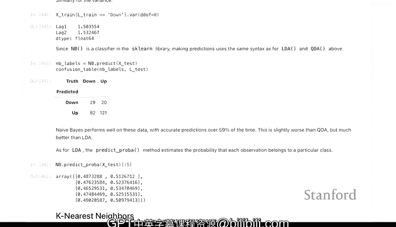

