# 斯坦福大学《统计学习导论2023R语言版｜An Introduction to Statistical Learning with R》中英字幕 - P31：-031-Statistical Learning_ 5.5 More on the Bootstrap.zh_en - GPT中英字幕课程资源 - BV1yU421o7WA

Okay， so we're back。 some more discussions of the bootstrap。

 We saw an example of the bootstrap with the investments。

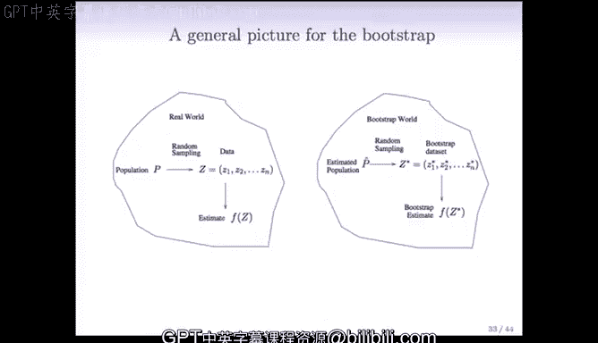

And now in general， we're going to talk about the bootstrap and think about it in more complex situations。

 So here's a schematic， which I think is very useful actually。

 it's due to David Friedman at Berkeley， it's the real world bootstrap worldview of the bootstrap。

So on the the left， we have a cloud and ingredients。We're imagining well there's a population。

The tro of real population that。嗯m。

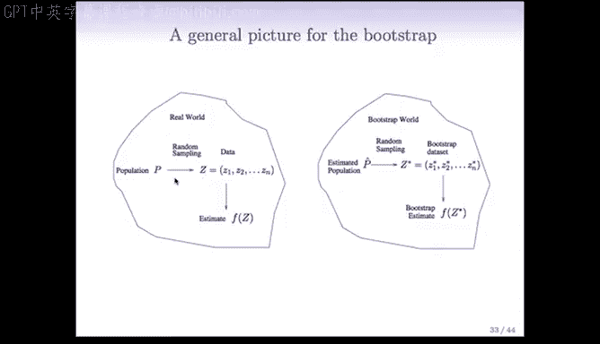

It gives our data， which I'm calling generically Z observation Z1 through ZN。

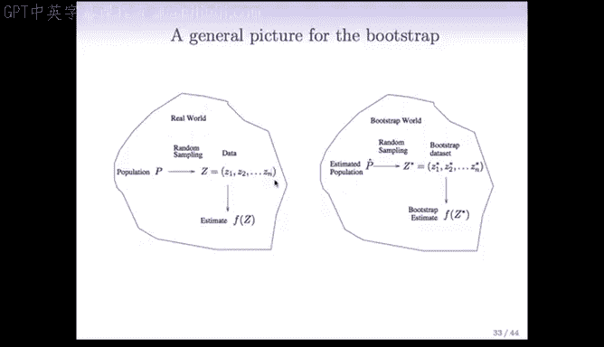

And from these that like had training data right， that such training data， for example。

 in the the investment example we just saw this this training data was a set of。Investments， X， Y。

 X1。Y1，2， x。And whyan。

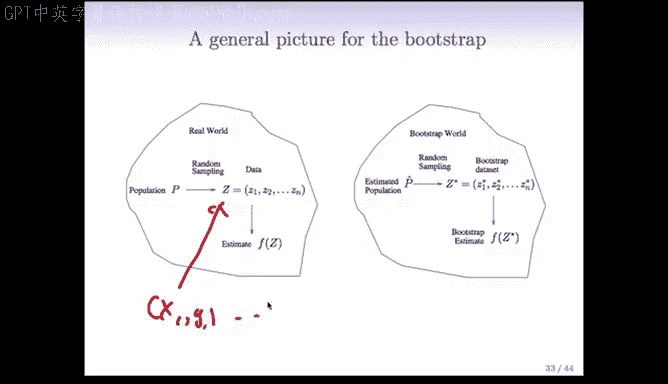

But we'll that going to call each of these pairs a Z， this is Z1 and up through Zn。

We imagined in that situation that we have a training data from a population of investments。

This is in the real world， right we have a training sample。 and from that training sample。

 we derives。A statistic and an estimate in that or a particular case， it was the alpha hat。

Which is the proportion of investments。The optimal proportion investments for。For X。

 So this is a summary in the sense of of what we did in the the investment example for our training data。

And what we wanted to get was an idea of the standard error of alphapha hat。Now。

 and we made the point earlier that ideally， if we had access to the population。

 we could get more training data， we could simply grab more samples of training data from the population。

 more investments。From the possible population investments， you mean like a new sample。

 the same size， exactly a new sample。 and from the new sample， do the same analysis。

 get an estimate alpha hat and do that many times。And we showed how you can do that on the computer in the previous example。

 But we made the point that not often can you actually do that in practice because you don't have access to the population。

 You can't get more training data， typically。 What you have to work with is just your your given training example。

 So the bootstrap， a way of thing of the bootstrap in the abstract is say， well。

 we don't have access to the population， let's replace the population， which we don't have by。He hat。

 which in the Bostrs case， is。It's that the train sample itself。

 is's a population that has put probability1 over n。

And being the sample size on each of the training points。 So it says our guess for the population。

 which we don't have access to， but we have from a training sample。

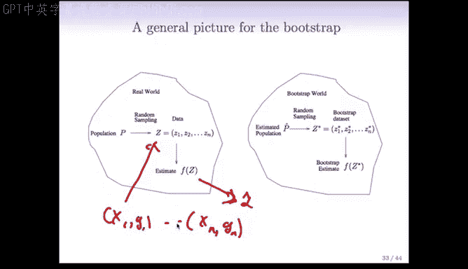

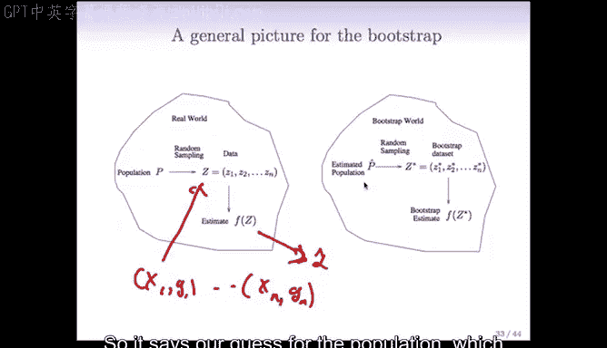

Is if we have no more information。 we're going say with。

 with equal probability that a training point can come from。

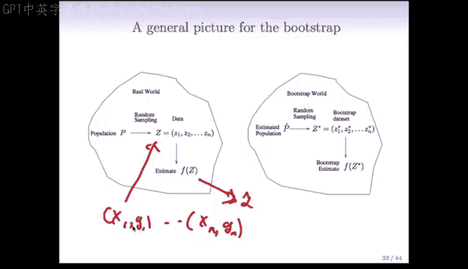

The first point we saw， the second point we saw up to the， the endthrop point we saw。

 So that's we called P hat。

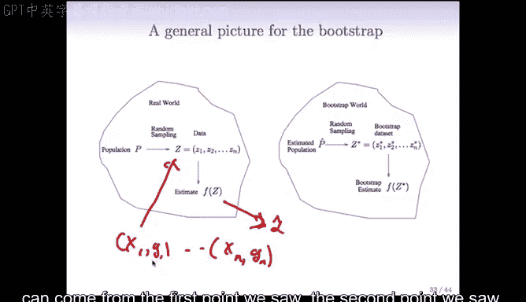

The empirical distribution function。 that's another name for that。Empirical distribution function。

So when you draw from this empirical distribution function。

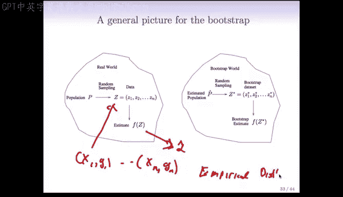

That is sampling with replacement。And that's what the bootsshoprap does， right， the samples。

We saw that we draw samples with her placement from the training sample。

 That's this random sampling here， P hatt giving Z star， this is not the bootstrap sample。

 remember we're going to use a superscript star to indicate a bootstrap sample as distinct st from a training sample which has no superscript。

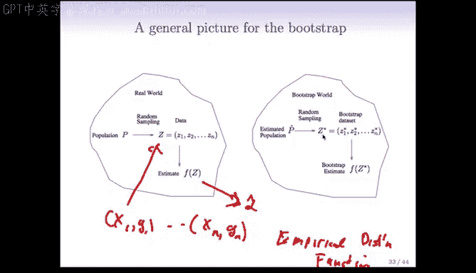

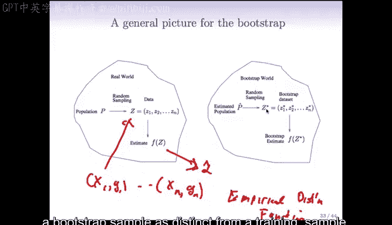

So。This is one bootstrap draw' the sample of size N from our training sample now， a bootstrap sample。

 giving us a bootstrap data。And from that we drive the estimate， again， in this case， it's alpha。

And we call alphapha hat star。So bootsottrap sampling simply repeats this operation a few hundred times say。

 for each time we get a bootstrap sample of size N and we get a bootstrap。

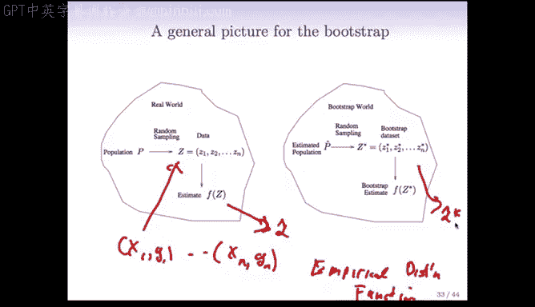

Quantity alphapha hat star。And then the standard error of alphapha hat star are the bootsstrrap estimate of standard error of alphapha hat。

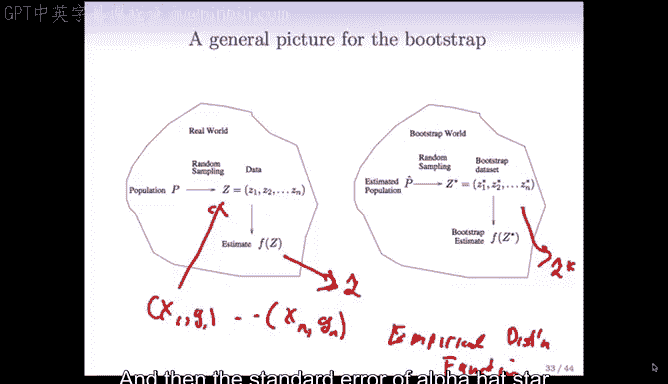

So there's nothing new here， we're simply describing what we already saw in more general terms。

But we can now think about how we carry this out in more complex situations。

So in general， we need to figure out how we can carry out bootsstrrapap sampling。 For example。

 suppose we have a time series。So。Let's draw。The time axis here。And we have a series like。

 for example， stock price。And let's just draw some imaginary。Data。Right。So this is。

Start let's help y1 and this is stock price at time one， stock price at time two， etc cetera。

And we want， for example， to predict the stock price from a given day for a given day from the previous day's stock price。

 So we'll fit a model， a regressional model like we've seen to each each stock price as a function of the previous。

The stock place in the previous day。

Well， that's fine， we can do that， we can do that by least squares。

But now we might imagine doing bootstrap sampling at the way we just described where we sample wither replacement from the data。

 Well one problem with that， that's a significant problem is that the data are not independent。

 right？

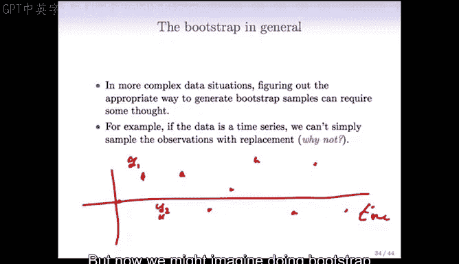

There's correlation in the time series。We expect stock price for a given day to be correlated with the stock price from the previous day。

 a matter of fact， if if trying to predict the stock price from a given day from the previous day。

 we hope there's correlation if they were independent， the prediction wouldn't be very useful。

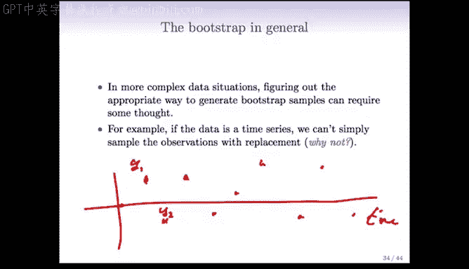

But that， this creates a problem for the bootstrap， because in the previous。

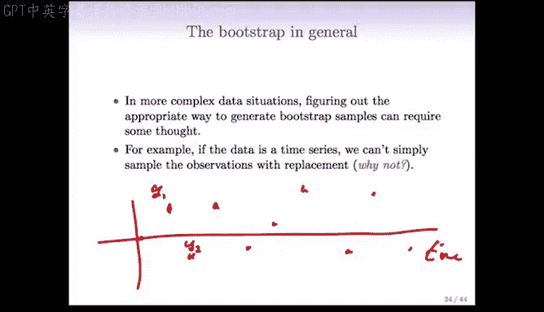

In the schematic。We were。 we were sampling here。 but we assume that the sampling。

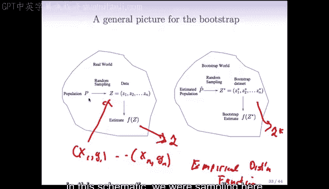

嗯。Was IID from the population。

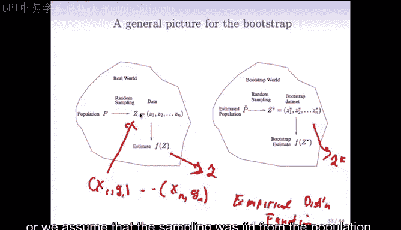

But in this situation， that's not a reasonable assumption because the observations are not independent。

 so in general， when you set up the bootstrap and arrange for the sampling。

 you must figure out what parts of the data are independent， so one thing people do in a time series。

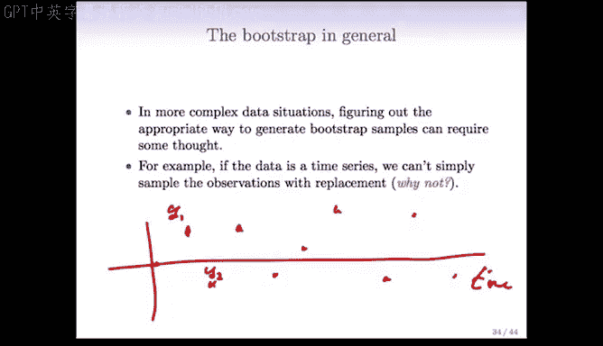

Because the observations are not independent to correlate across time as to use what's called the block Botrap。

The block bootstrap divides the data up into blocks。

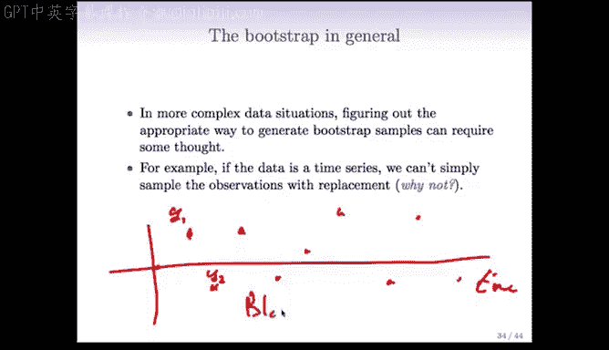

In between blocks， one assumes that things are independent。My spelling is not good。 Okay。

 so for example， if we use a block size of three， we might these be the first block。

 these three observations， these three be the second block， these be the next block。

 and now our sampling units are not the individual observations but the entire blocks so we would sample wither placement from all the blocks。

And then pace them together into a new time series。

Now was this guy's sample payment might become the first block。

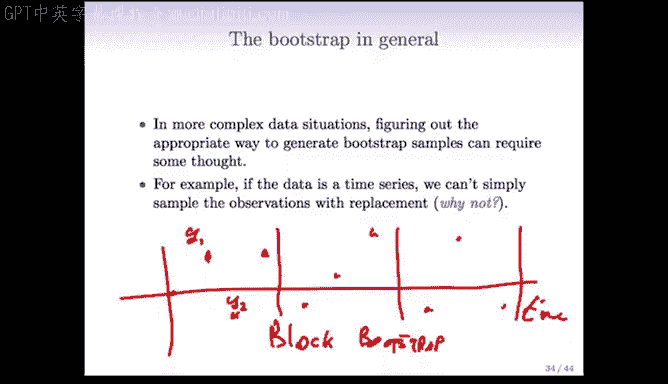

Psych block， et cetera。 And then we pace them together in order。

 and that becomes a bootstrap sample to which we apply the same the estimate， in this case。

 a regression model。 So the point is you have to sample that the things that that are uncorrelated。

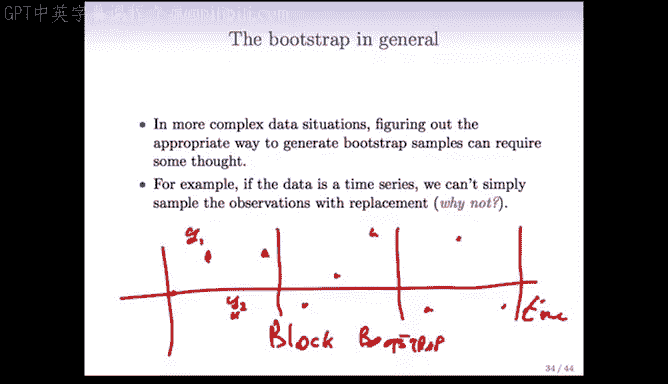

You have to arrange for find the parts the data that are uncorrelated。

And use that as the basis for bootstrap sampling In this case。

 we use a block of size3 under the assumption that beyond a time lag of three。

 things are somewhat uncorrelated， but within a block we expect correlation。

 so we keep the blocks intact， sample them as units。

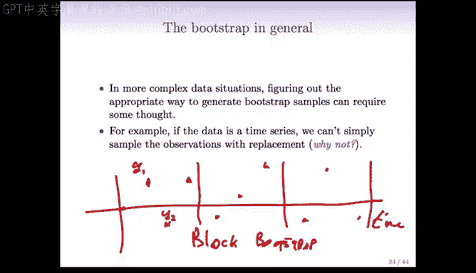

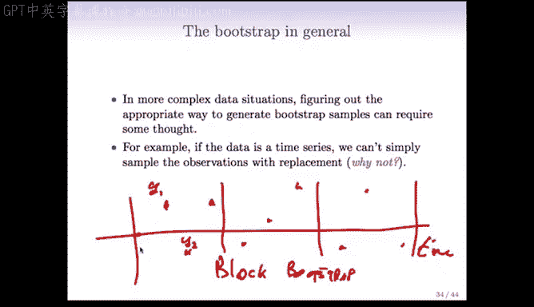

That's called the block Bothtrap。

I say that here， okay。So we talked about the bootstrarap for standard errors and that the main use of the woodstrrap is to estimate the standard errors of an estimate like the alpha hat in our investment example。

Another very common use of the woodt is for a confidence interval。So let's go back to。

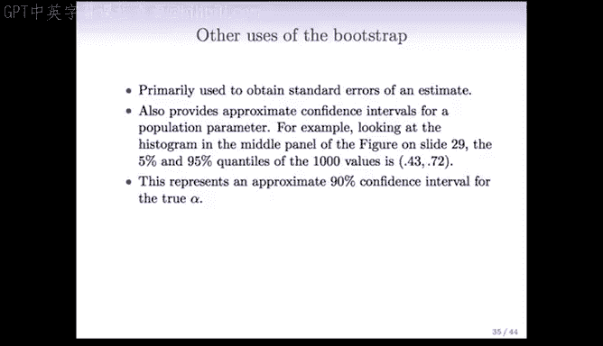

Confiental for a premise。 Go back to slide 29。And remember。

 this is that the histogram we got from the bootsstrroprap for the devise of alpha hat over bootststrrap sampling。

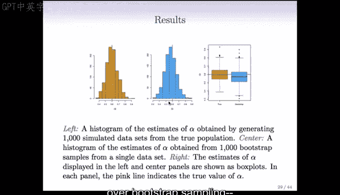

Thousand bootsrap samples。And if you look at this histogram。

 a reasonable way to derive a confidence interval is take the percentiles from this histogram。

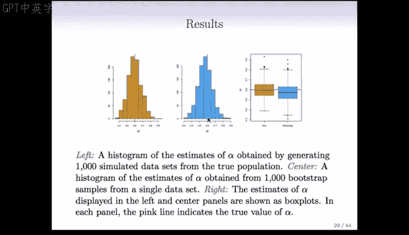

I suppose I want a 0。9 confidence interval。So that it contains a true value with with probably 90%。

 makes sense to grab the fifth and 95th% quantas。 So let's。嗯。Finally。5ive% point of this histogram。

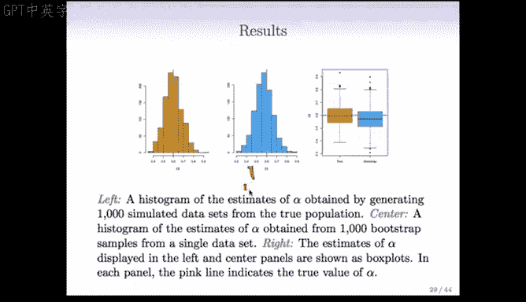

And the 95% point of that history。There's  a thousand00 points here。

 so that actually the 5 percent point would be the 50th biggest and 950th biggest value of alpha。

 I mean smallest than biggest。

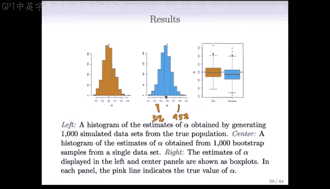

Iit that wrong。 You it wrong sure they understood。 It's like I Okay， so if we do that。

 that is it provides a confidence interval for alpha。 And what do we actually get。

 I've got that back on the slide。

Is that so 0。43 and 0。72。

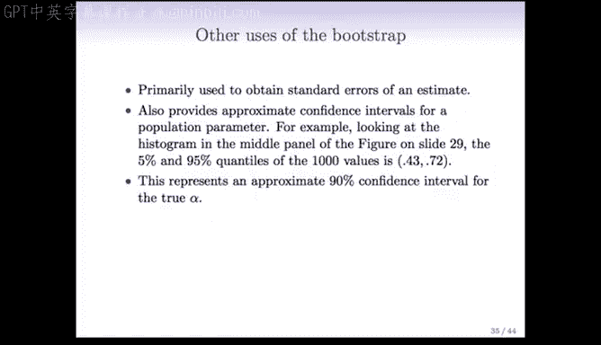

So this is actually an appropriate confidence interval for Al。And remember。

 how to interpret this conference interval all， what this means is that if we were to repeat this experiment from the population many times。

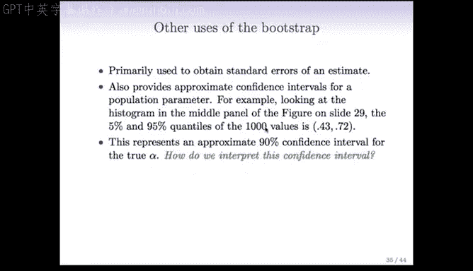

We expect， it would be the case that the conference interval that we obtained would contain the true value of alpha。

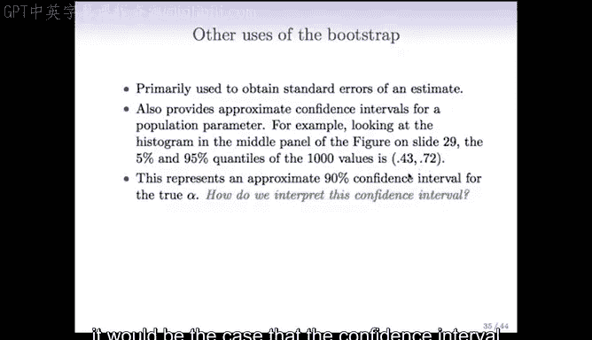

90% of the time， that's what a 90% compible。

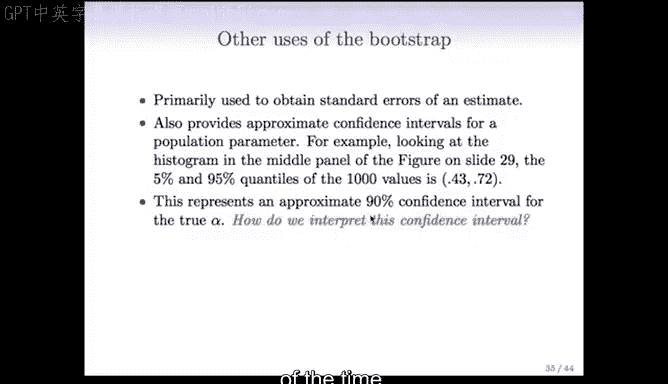

Yes， we talked about that earlier。 This particular way of constructing an interval is called a bootstrap percentile interval。

 And there's actually the entire field of in statistics to do with confidence intervals in the bootstrap。

 And there's many， many， many papers and books that have written about this topic。

 This bootstrap percentile interval is the simplest way of constructing a confidence interval from the bootstrap。

 and it's very useful。You just use the histogram of bootsottrap values themselves and use their percentiles。

So we've talked about the bootstrap let， for standard errors and confidence intervals。

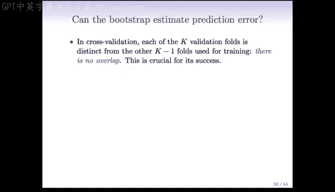

How about。Predictionary， like misclassification error we've seen in the course already。Well。

 the major tool we talked about for that was cross validation。let's think back across validation。

 how it worked。 We have K folds and K fold cross validation。 We divide the data up into K parts。

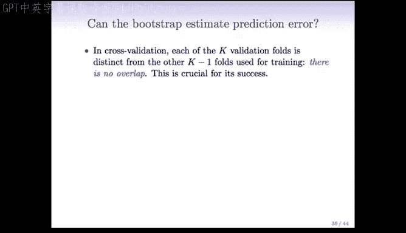

Let's say five and I'll just draw this again。

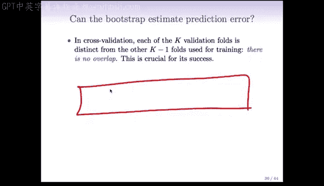

And remember what we did， here's our five parts created at random。

Keyful Cross Foundation is like a member like a five act play of K is5。At one stage of the play。

 these four are the training set， these four parts。And the remaining fifth part。

Is a validations part， said。嗯。And cross validation fits to the four parts， fits a model。

 and then uses that model， to predict the fifth part。 And then， in turn， we then。

This guy gets to play the role of the validation set the next stage and this guy， et cetera。

 and there's just five stages。But a crucial part of cross validation was that when we do one stage like this。

 there's no overlap between the training set and the validation set。

 Now the observations in one do not appear in the other。

And that's important because we're trying to get get an idea of test that error on new data。

So cross validation is taking a piece of data。Separating it out from the training set。

 so that when I fit on this data and predict on this data， this data is a sense new。

 it hasn't been seen by these by the training by the model trained on the first floor。

So there's a separation， a clean separation between training and validation。

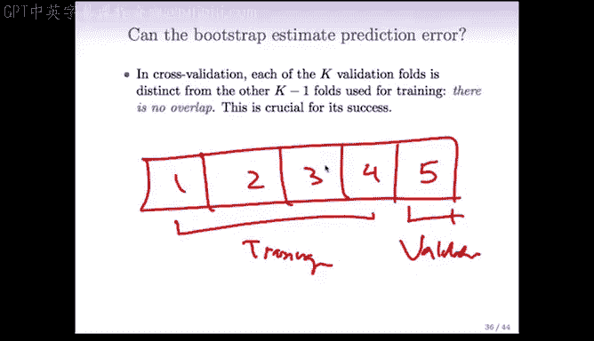

Well， what if we're to try to use the Botrap estimate prediction error？Let's just draw。Again。

 the bootstrap sampling process， here's my training set。

And I'm going to draw samples with placement from the training set， bootsshop samples。

 each one of the same size and a few hundred of them。Well。The first kind of obvious idea is to say。

 well， let's train on a bootstrap data set。Predict the original training set as my validation set。

I do that for each bootstrap sample， each bootstrap sample gets to play the role of the training set to fit。

 and then I'm going to predict my original training sample as my validation set。Well。

 there's a big problem with that。 And the problem is， there's an overlap between the。

Bootrap data sets and the original data set。In particular。

 about two thirds of the original data points appear in each bootsrapap sample。

 and you should think about how to prove this。 It's not hard， but it's it's。

You'll find out that about two3 of these points。So the training set points are in the bootsstrrap sample。

This creates a problem because now when I train here and then I do the prediction of a training set。

Two thirds are the points。嗯m。In this training set have already been seen by the model。

BecauseBecause they're in the bootsottrap data set， so on average。

 this two thirds overlap means that most of the training points are not novel。

So this is a big problem because the。嗯。Prediction error from this process will be biased downward。

 it'll be a lot lower than the actual prediction error because I'm predicting two thirds of the points I'm predicting I've already seen in the bootsottrap data set。

So this is not a good way of estimating predictionary。

 and say that it underestimates a true prediction dictionary quite dramatically。

Now you can think about the other way around you could train on the training set and use the bootstrap samples as the validation sets。

 it's even worse， and you can think about why that is。

 so it's even worse in a sense it's going to be even more biased。

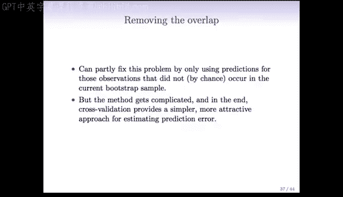

Well， how do you fix this problem？You can fix it by when you train on the Botrap sample and then predict the training sample。

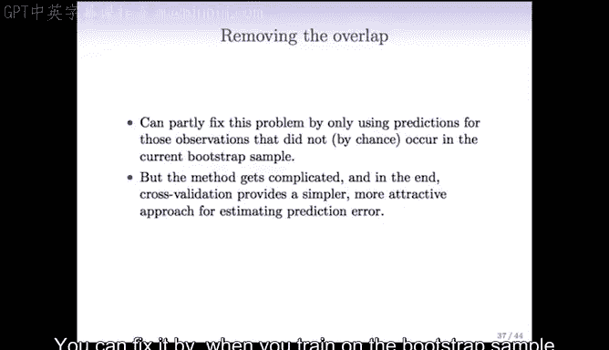

Just recording the predictions for the points that did not occur in the Botrap sample。

 that was the points that are in actually novel points。But then this gets quite complicated。

 And in the end， it's really not worth it。 If you， if you push this idea to its， its conclusion。

 you can get something which is about as good as cross validation。 But it's much more complicated。

 So our view is for。For this particular problem， the cross foundation is。

It's easier and better the thing we recommend。

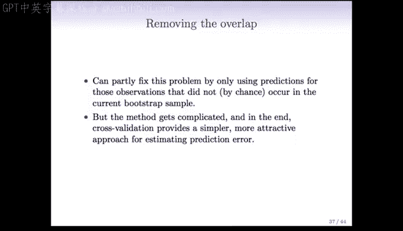

If I can just interrupt Rob that actually brings up an interesting point a lot of the time we have simple methods you know like cross validation and then a new method comes along like using bootsottrap to estimate prediction error and we see it's quite a lot more complicated and you don't get much in return and so our general philosophy is if you can get the job done with a simple method it's far better than using a more complicated method just because it maybe looks sexy or whatever so keep it simple that's the idea。

