# 斯坦福大学《统计学习导论2023Python版｜An Introduction to Statistical Learning with Python》中英字幕 - P32：-032-Statistical Learning_ 4.Py K-Nearest Neighbors (KNN) I 2023.zh_en - GPT中英字幕课程资源 - BV1u4421A7ZU

Okay， the final classification method we we'll talk about in today's lab is Canier neighbors。

 And although a different classifier to LDA and QDA in terms of using SK learn it's quite similar。

 So the difference is really in the actual method we're going to use。

 that's this first class we call from psychic learn。

 it's the Can nearest neighbors class we construct。Classifier using the one nearest neighbor。

The rest of the code where we fit and predict on training， fit on training。

 predict on test is identical and again， compute the confusion matrix。

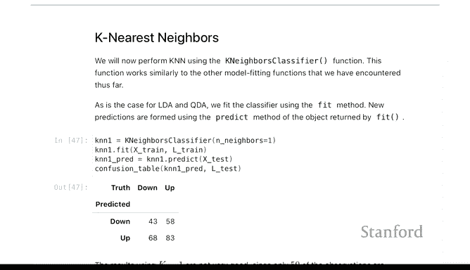

So we see here that using one nearest neighbors， which is going to be a very flexible classifier。

 so like possibly having high variance。It may suffer from overfitting， and indeed。

 the classifier is not very good。 It has about 50% test accuracy as bad as you can get。

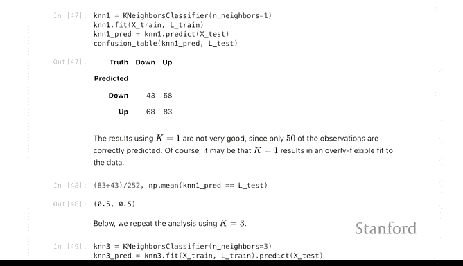

Okay， let's see if we change the number of neighbors。 if we do any better using three neighbors。

 we get about 53%， which is。Better， but not quite as good as the discriminant methods we saw before。

 So these， these k nearest neighborhood methods are extremely adaptive and flexible。

But they can overfit， especially， you know。Small data sets。Yes。

 so it would be nice to be able to choose this using in， in a simple fashion。 that's。

 and that's what we'll do next。

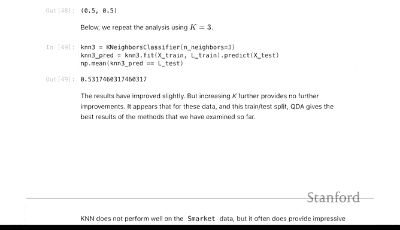

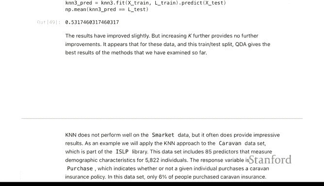

So we're going to use a slightly different data set。

 this is the caravan data set from the ILP package。

 which talks about whether we can predict whether people purchase caravan insurance or not。

And it's noted it's a very imbalanced classification problem because there's only 6% that actually do purchase。

 unlike the stockck market data where the up or down is going to be roughly 50% if it's basically noise。

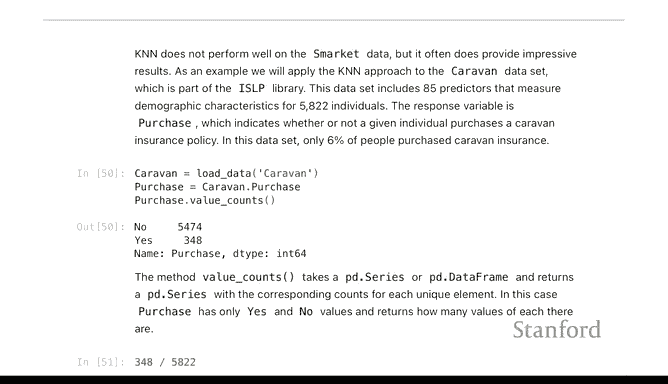

In case you don't know a caravan is a camperan in Australia and New Zealand and South Africa and other colonies。

And I guess it will be an RV in North America。Okay。So。We'll just create， you know。

 we'll use all of the features besides the purchase column to create some features。And now。

Unlike the stock market data where we just had lag1 and lag two is our features。

 it turns out there are many different features in this caravan that are you measured in slightly different units。

 So since the Can nearest neighbors classifier uses distances between points。

 if one variable as much as very different units than another variable。

 it will tend to dominate the distance。 So for that reason we're going to use we're going to standardize the features before classifying。

 So for that we use the a scalar or the standard scalear from psycade learn。

 and this is an example of a transformer。 we saw transformers。

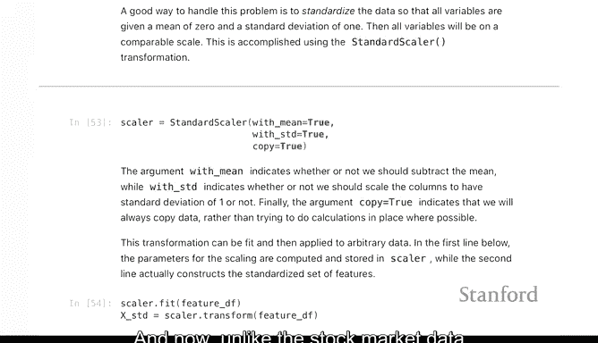

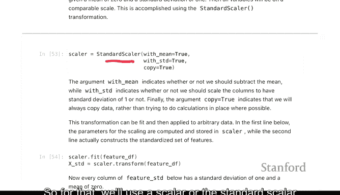

Well in chapter3 in linear regression when we in the model spec。

 that was an example of a transformer。 and if you remember the transformer。

 it's something that we mentioned is used to sort of create derive features from existing features that's a typical application So we apply we call its fit method on a set of features notice there's there's just the set of features in this fit method。

 not a response because it's taking features to create new features and having fit the transformer that finds all the parameters in this case。

 the means and variances need to scale the features to mean zero and variance1。

 and we can apply it to the features we using the transform method。

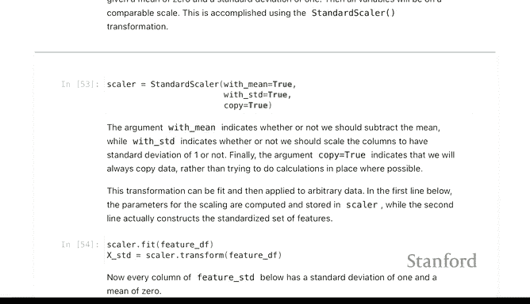

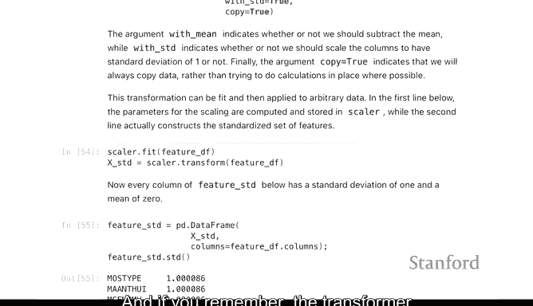

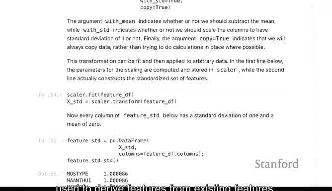

Okay， so we'll use our standardized features for Can years neighbors。

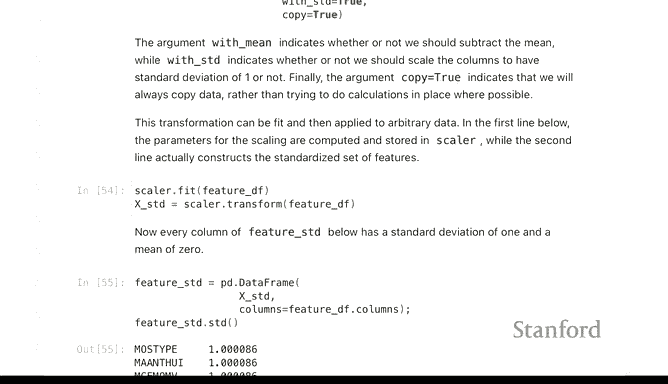

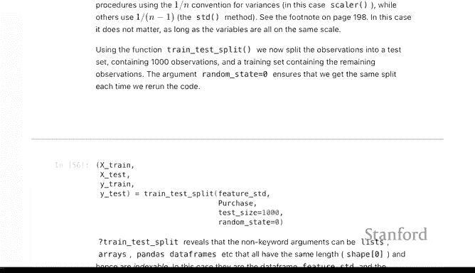

And we'll also do a split into test and training。

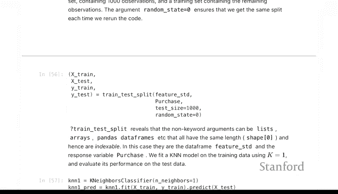

And we'll use the test data to。

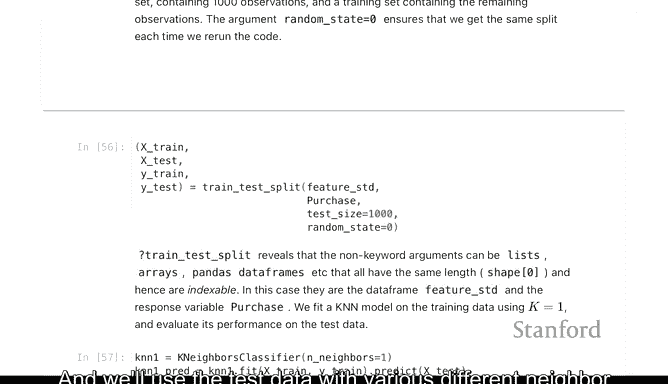

With various different neighbor sizes to try and choose a good number of neighbors。

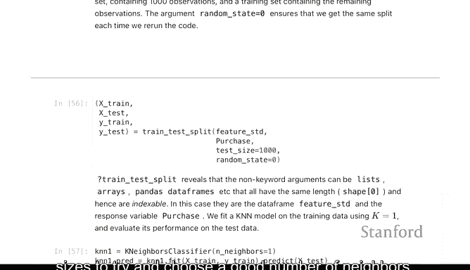

Okay， so this is just like the stock market， Ken your's neighbors example， except， of course。

 we have different data。 This is the caravan data and not the the stock market data。

We see with one one nearest neighbor。It actually， we get about 11% accuracy。Which is， you know。

 better than 6%，6% is what we would get if we had no a reasonable estimate of what we would get if we had no features。

 if we just use an intercept in the model。 So we see some improvement。

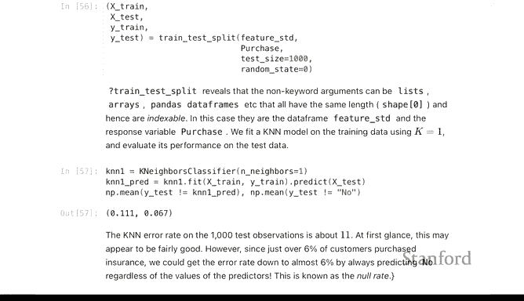

But not always， not a great improvement。Okay。So let's talk about choosing the number of near neighbors。

 this is an example of choosing a tuning parameter for an estimator。

 a common task that we'll see in other examples coming up。So what we're going to do is。

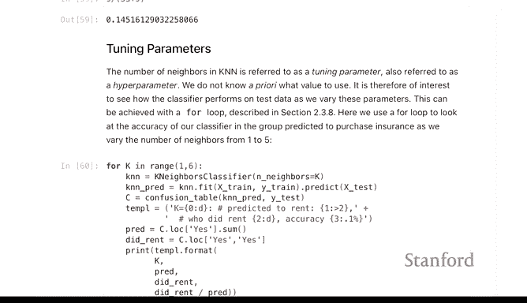

Fit the the Can years neighbor classifier for varying numbers of neighbors。

 And we're going to choose neighbors from Hubury written。We have a four loop。

 and we're going to loop over the the neighbors one to five and just。In case you're。Well。

 that' the range one to six actually really gives us only numbers one to five。That's。

How the range function works。Okay so what we're going to do is we're going to within the for loop。

 do essentially what we had done above， that is we're going to fit on the training data。

 predict on the test data and form the confusion matrix and then we'll compute the accuracy and we're just going to print out with this statement here。

 print out the accuracy as a function of nearest neighbor in later labs we'll make a plot of accuracy or mean squared error as a function of tuning parameter here we're just going to print it out。

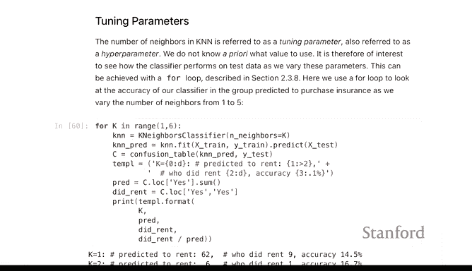

Okay。And so one small thing that you， if you noticed earlier。

 took us three lines to form the confusion matrix。 we avoided a line by。

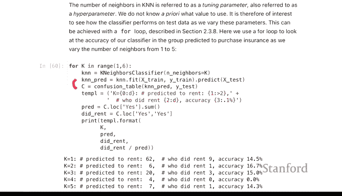

Looking at the fit predictor and directly calling its predict method。

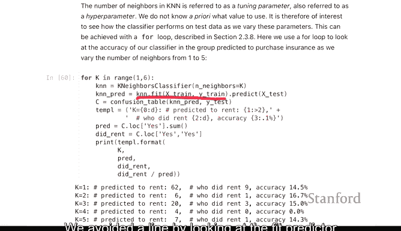

It's only two lines to fit and form the confusion matrix。

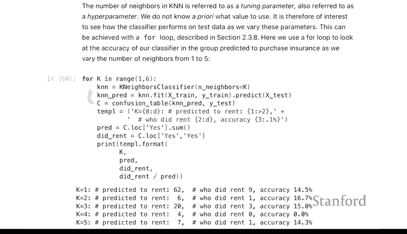

Okay。So， let's see。

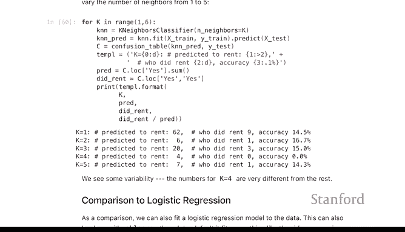

For this test and training split。

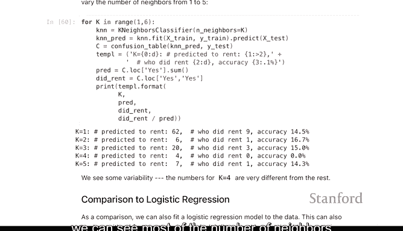

We can see most of the number of neighbors achieve around 14 or 15% accuracy with four neighbors being a kind of anomaly that。

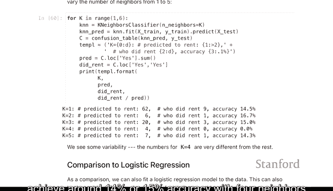

We haven't really investigated， but it is a notable difference between the other ones。

 it only predicted forward rent， you， so。ItIt was strange。

 And you can get this with nearest neighbors because it's a very noisy classifier。

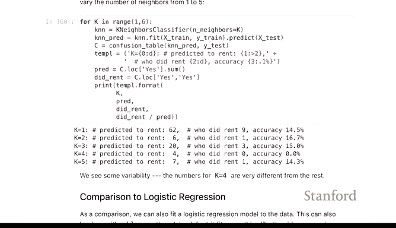

Okay， so that wraps up what we were going to talk about in the lab today there are a few more sections in the lab that we encourage you to go through。

 one， including poisson regression。That we will leave to you to do offline。

