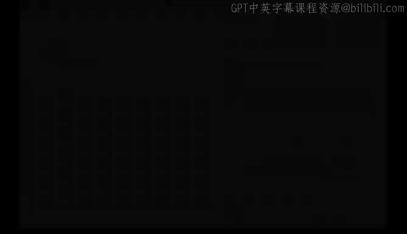
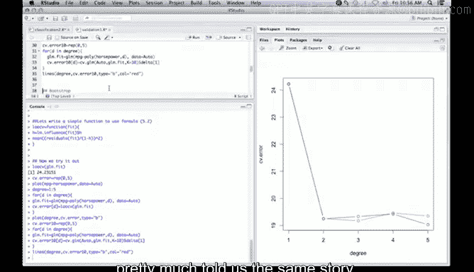

# 斯坦福大学《统计学习导论2023R语言版｜An Introduction to Statistical Learning with R》中英字幕 - P32：-032-Statistical Learning_ 5.R.1 Cross Validation.zh_en - GPT中英字幕课程资源 - BV1yU421o7WA

。Okay， well， we going to have another R session。 This time。

 we're going to look at validation methods， cross validation， and we'll。😊。

We'll start off with leave one out cross validation。

 So we'll go to our studio session and and see what we can do with validation。So。

Here we are first of all， require ISLR there's our data for our session。And this time。

 we require the boot。Package。嗯。And so requires just like。Using library it。

 it will also return a true and false if， if the package doesn't exist。

So let's look at the function CVv。glM。So that's a general cross validation package for GLMs。

And it'll give you some help on that。 And so again。

 it's always useful before you use a package or user a function to look at the help file and make sure you're using it correctly。

Okay。So we're going to use the auto data and in particular， well look at two variables。

 miles per gallon and horsepower， so we'll make a plot of those data。And you know。

 plot takes a formula so you can use a formula in plot and tell it where to evaluate the formula in the dataset auto。

 So we make that plot and we see， as we might expect miles per gallon。

Drops down quite substantially as horsepower increases， okay。And。Now we're going to investigate。

 we're going to use these data set to investigate the cross validation。

So the first thing we'll do is leave one out cross validation。Okay， and so we'll fit a linear model。

And well use GLM to fit this， even though we just fit in a linear model。

 so GLM can fit non linear models as well in particular logistic regression models。

 but it will also fit linear models and so if you don't give the family to GLM by default it just fits a linear model okay。

And then we'll run CVv。glM on that linear model。And。Now， just to remind you， what see what。

Leave one out， cross validation does。It， it fits the model repeatedly。

N times if these n observations， each time it leaves out one observation。

Produces the foot on all the other data。And then makes a prediction at the X value for that observation that you lift out。

Okay。And so CVv。glM。Actually does that by brute force， actually refits the model all those times。

It's a little slow， you may have noticed it took a while before the results came up and eventually it came up and it produced two numbers。

 we see them on the screen here， well it produced quite a lot actually but we just looked at the deelta。

 which is the crossvald prediction error。And even there， it gives two numbers。

 And if you look on the help file， you'll see why the first number is the raw。

Leave one out or Lu cross validation result。And the second one is a bias corrected version of it。

 and the bias correction is to do with the fact that the data set that we train in on is slightly smaller than the one that we actually like to get the error4。

 which is the full data set of size n。Turns out that has more of an effect for Kfold cross validation。

Now， the thing is for leave1 app cross validation and for linear models。

This function doesn't exploit the nice simple formula we saw in in the chapter。

 So let me just remind you what that nice simple formula is。And it goes like follows。We want to。The。

Misclassification error for each observation， Y I。Minus， all right， Y hat I minus I。

So this is what we'd like to compute。And we call that the leave one not misclass。Sorry。

 leave one out Summer squared errors。And this notation here， y hat minus I。

 what it means is just what we said for each observation。The I observation， you leave it out。

You compute the foot using all the other data， and then you make make a prediction at that point。

 So that's what this notation refers to。And we have this really nice formula that says that this is equal to when over n summation。

I'll make this explicit I going from one to n。It's the ordinary residuals。

Which I'll just write is why I hat。Squared， okay， so that。

 these would be the ordinary residuals if you didn't leave the observations out。

 So that that just comes from the least square foot。 But now we have to divide them by。1 minus。H I。

 I squid。And so this is like a magic formula。 The H that we have there。😊，Is。

The diagonal element of the hat matrix。The hat matrix is the operator matrix that produces the least square foot。

 This is also known as a self influence。 It's a measure of how much observation I。

Contributes to its own fit。And you notice what happens if these values HII vary between 0 and 1。

If HI is close to one， in other words， observation， I really contributes a lot to its own foot。

 one minus HII is small， and that will inflate that particular residual。

So this is like a magic formula， it tells you that you can get your cross validated fit by a simple modification of the residuals from the full foot。

 and that's much more efficient and cheaper to compute。😊，Okay， so that's a slight D to it。

 Now we're going to write our own function to do that， okay。And that's Formula 5。2 in in the book。

 So here we write our function， well call it。L， O， O， C V， loose C V takes the foot as an argument。

 and it uses a function called L M dot influence。 And that's a post processor for， for a LM fit。

 and it'll extract。The element H from that， which gives you those diagonal elements。 H I， I， right。

 So we'll put that in a vector H。And then right on the fly。

 well compute that quantity on the right hand side of our panel over there。 First of all。

 the residuals of the fit give you the residuals from the from the full fit。

 So those are the terms in the numerator。And then we divide by 1 minus。By 1 minus H。Squid。

And the residuals of it is a vector， and 1 minus H is a vector， and the divide now does。

Element by element division in that vector。 And we take the whole lot。

 square them and take the mean of that。 And so that's going to be computing this formula over year。

Okay， so that we just build into our function。 and then。And then end of our function。

 And since that was the last quantity computed， that will be what's returned， okay。

So let's see if that works。We'll do CV and lo and behold， very quickly， it produced the 24。

23 that we saw above for the first element of， of， of the results of C V dot GLM。

 So our function works。Okay， great。So now we're going to use it and the way we're going to use it is。

We can have polynomials of different degrees。嗯。To， to our data， remember what the data looked like。

Let's dys go here and plotted again。The data looks very nonlinear。So we've plotted it again。

 and now we're going to fit some polynomials。Of degrees 1 up to 5， right， And so we set ourselves up。

 We've got a vector for collecting the errors， okay。And now we create the variable degree。

 which take values 1，2，5， and then we go in a loop for D in degree。Fit the GLM。

Using a polynomial of that degree。 So we use the poly function。

 the function of horsepower and degree。And then we use our little function to compute the error。

And leave one out cross validation error and put it in in， in our error vector， okay。And look。

 it's finished already。 It's done all of them。 And if we plot this error against degree。We see。

That degree1 does pretty poorly。Deegreee 2 jumps down from 24 down to just above 19。

 and then higher degrees really don't make much difference。

 And we might have guessed that looking at the the plot of the data that a quadratic would。

 would do a good job。Okay， well， that was leave one out cross validation。

 Let's try tenfold cross validation now。 So recall with tenfold cross validation。

You do actually much less work。What you do is you make。You divide the data up into 10 pieces。

And each tenth0 is a test set and the 9/1th acts as a training set。

And so with tenfold cross validation， you only have to fit the model 10 times。With leave1 out。

 you have to， in principle， fit the model n times where ends the number of training points。

Although we did have the shortcut for， for linear regression。

The reason CV do GLM doesn't use that shortcut is it's also set up to work on logistic regressions and other models。

 and there the shortcut doesn't work。Okay， so here we will do tenfold and well again set up a vector to collect our errors。

And the same thing go through the list， we have a loop list of degrees footile model。

 and now we'll actually use the CV。glM function to compute the errors。And so we call C。

 GlM and we tell it K 10。 So that tells the number of folds。Okay。

And that's pretty quick because it's only fit in the model 10 times each time。

 and now we'll include the errors on our plot。We'll colour them in red。

And so we use the function lines。And it's not much different。 So in this case。

 tenfold and leave one out cross validation pretty much told us the same story。

In general， we favor  tenfold cross validation for computing errors。

 it tends to be a more stable measure than leave one out cross validation。

 and for the most time it's cheaper to compute。