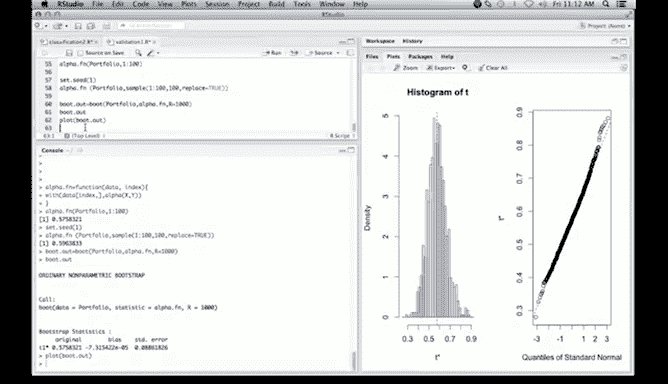

# 斯坦福大学《统计学习导论2023R语言版｜An Introduction to Statistical Learning with R》中英字幕 - P33：-033-Statistical Learning_ 5.R.2 Bootstrap.zh_en - GPT中英字幕课程资源 - BV1yU421o7WA

Okay， now we're going to have an R session to demonstrate the bootstrap。

 The bootstrapap is one of the really powerful tools we have in modern statistics invented by our friend Brad Ephron just across the road from us here。

And what it does is it lets you get it。The sampling distribution of statistics for which it's really hard to develop theoretical versions。

 So the butcher strap gives us a really easy way of， of。

 of doing statistics when the theory is very hard。 And to illustrate it。

 we'll use the example we used in the， in the book in section  5。2。We， we have a a。

 particularly non nonlinear formula for picking an optimal combination of two investments。 Okay。

 so let's have a look at that。Okay， so remember the you had two investments。嗯。X and Y。

And let's say they had risk， which we'll call variance of x and variance of y。

This is a guy who cannot distinguish uppercase and low case letters。And we saw， well。

 we told you that the optimal formula for getting a minimum risk investment。

 if you're going to use alpha of x。And one minus alpha of y is given by the formula。嗯。Variance of。

why。Minus covariance。Of x and y。Divided by。There we go， lowercase A again。Plus。Varianance of y。

-2 times。Covariance of x and y。Okay， so that's a formula。Which， of course。

 if we have data on X and Y， we can just compute those variances and covariances and plug them in and compute value for alpha。

Now， that's fine。 But then you might say， well， what is the sampling variability of alpha。What's。

 what's the standard error of alpha。How variable is it going be well。

That's a nonlinear formula of X and Y。 And you we just wouldn't know our priori how to do that。

This is a case where the bootstrap really helps out。

So well write a function for computing that formula。 It's a simple formula， given two vectors。

 X and y of actual data。We write our function alpha。And inside it， we compute variance of x。

 variances of y， covariance of x and y。 And then we just write out that formula。Okay， and close pers。

 which means that the the functional will return the last line that was evaluated。

 which is actually our alpha， okay。And so now we've got a data portfolio。😊，Which has X and Y in it。

 And we can run alpha。On the X and y in that， in that data frame。 when we do it。

 we see that alpha comes up as 05758。Okay， so。In order to to use a bootstrap function。

 we need to make a little little wrapper that that allows a bootstrap to work。

 And this is this function we'll call alpha dot fn。 And what it does is it takes a data frame。

And an index， which indexes rows of the data frame。And then compute your statistic。 in this case。

 you know， our alpha index for which it wants to compute the variance in this case。

 the standard error。Now， what index does。It's gonna to be an index into the numbers  one to n。 Itll。

Have values of one to n and there'll be n of them and they can be repeats， of course。

 because the bootstrap。 what the bootstrap does is there's a resample of your training observations and some observations can be represented more than once and some not at all and index will say which observations get represented and if they repeated you know that'll。

That'll be fine， because that's what the bootst does。And so what this function does is。

It's just into the function。Okay， it uses， it uses the function width。

Which is very handy function with says takes first argument to data frame and then some commands。

 and it what it says is using the data in the data frame， execute the commands。 So in this case。

 we use width data of index So that gets the right observations for this particular bootstrap sample computeute alpha of x and Y。

 And the main value of width is that you can use the named variables X and Y that are in the data frame。

 very handy。All right， let's see if this works， we'll run our function just once using the original index of the data。

Portfolio 1 to N。 And we see we get the same value as we got before。 So that works。

 And so now we are run the bootst。And since the bootstrap involves random sampling。

 and if we want to get reproducible results， just for purposes of demonstration。

 it's good to set the random number seed。 So there we set seed 1。And now， we run。Alpha dot F N。

 one more time。 but wed take a random sample instead of giving an index1 to n。So。Yeah。

 we've sampled the numbers 1 to 100。Sample of size 100 with replace equals 2。

 This is the kind of thing the bootst is gonna do over and over。 Yeah， we just do it once。 Okay。

 so we get a different value of index。 It's like a bootstap sample of size 1。Well。

 we'll let the bootsottrap do the work for us。And so we call the function boot。

 We give it the data frame portfolio。 We give it our， our little function Al dot F N。

 and we tell it to do 1000 bootts。Look how fast that was。 It's come back already。

If we type Boott out， it gives a little summary of the bootstrap。And。

It tells us our original statistic was 0。575， the estimate。

And it gives us the estimate of bias and standard error。 We were interested in the standard error。

 The bias is negligible。 It's the standard error in this case is 0。08。

And that's computed by the boott。And you can also plot the bootstrap。

 it's nice to see what the distribution looks like。And you get a two panel plot。 One is a histogram。

 and it looks like a pretty nice symmetric distribution。Maybe Gaussian。 and in fact。

 the second plot is a Q Q plot which plots the ordered values against the ordered statistics of a Gaussian。

 and if it lines up on a straight line and like it pretty much does， yeah。

 you may say it looks close to Gaussian， maybe a slightly bigger tail on on the right。

So there's a bootstrap， very handy way of getting very good。

 reliable estimates of standard error for。

For nasty statistics。