# 斯坦福大学《统计学习导论2023R语言版｜An Introduction to Statistical Learning with R》中英字幕 - P34：-034-Statistical Learning_ 6.1 Introduction and Best Subset Selection.zh_en - GPT中英字幕课程资源 - BV1yU421o7WA

So welcome back today we're going to cover model selection and regularization。

 but we have a special guest， my former graduate student Daniela Whitten hi Daniel you Daniella is not University of Washington but maybe when tell students a bit about yourself and I got to be here Yeah well in college I studied math and biology and when I was graduating I knew I wanted to go to grad school in something but I couldn't really decide on one particular thing that I wanted to study for the rest of my life and so I ended up doing a PhD in statistics and I was lucky enough to do it at Stanford with Rob and I graduated in 2010。

 moved up to Seattle and I'm now an assistant professor at the University of Washington in the biostat department there。

And I didn't invite Danieli here just because she's a great student and friend。

 but also she's a co-author of the textbook on this course is based。

 so Danielle and I are going to give today's talk together。

So we're going to talk about model selection and regularization， so let's recall the。

The linear model we've talked about already in the course， we have response variable Y。

 and we're going to model it as a function of some predictors or features， x1 through xp。

 and we've talked about least squares for doing that or earlier in the course。

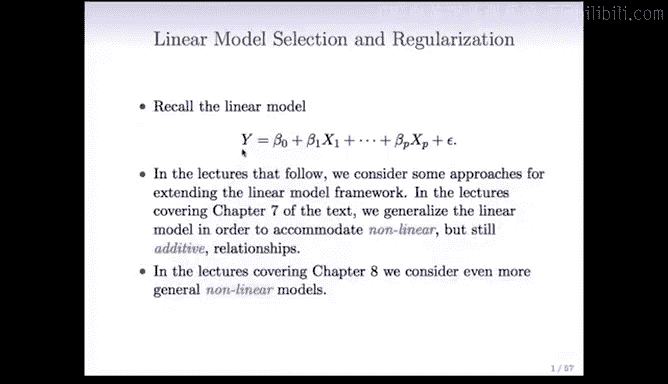

And later on the course， we'll talk about ways of making that model more general。

 making it nonlinear， for example， or we'll have。

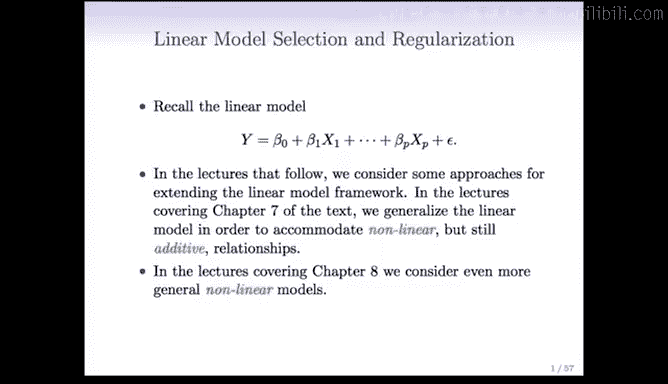

Additive but nonlinear models in the lectures that cover chapter 7 we consider nonlinearar models in chapter 8。

 things like trees and boosting， but today actually we're going to stick to the linear model and talk about a different way of fitting the linear model。

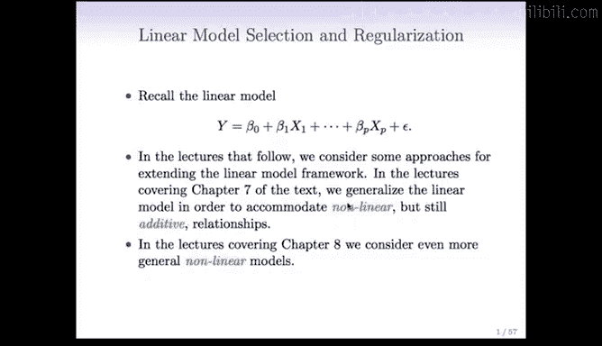

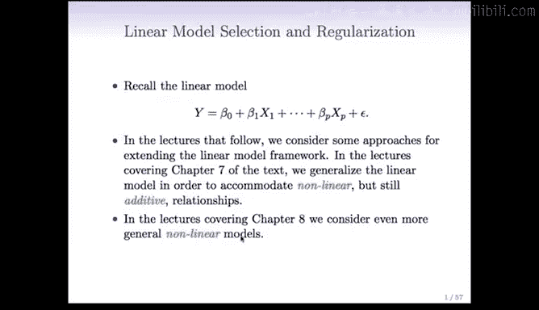

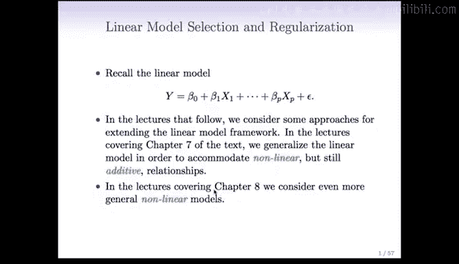

Why， well， because the model， although it's very simple and that's actually been around since probably the 1920s to 1930s。

 is it's a very important model because it's simple， which means it can be interpreted。

 there's a small number of coefficients typically if we have a small number of features that are important。

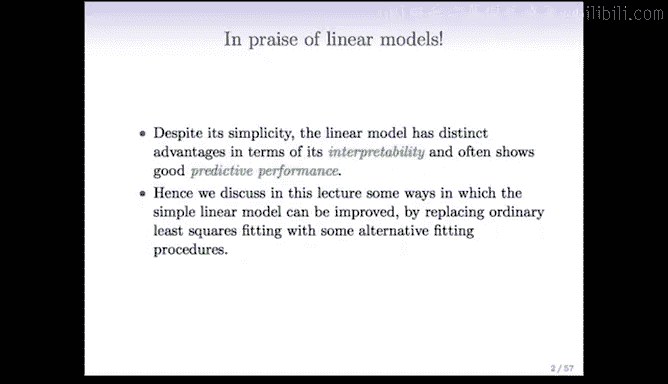

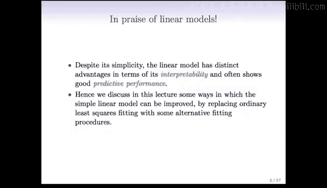

It also it predicts future data quite well in a lot of cases， despite the fact it's simple。

 so we want to talk today about ways of a thing linear model that improving on least squares by selecting or shrinking the coefficients of features to make the model more interpretable and in some cases to predict better。

 so we'll talk about a number of methods of doing that today。

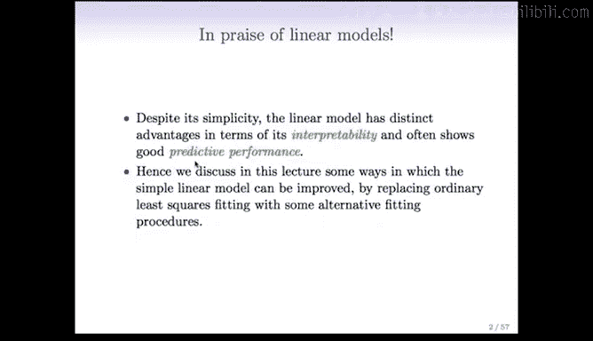

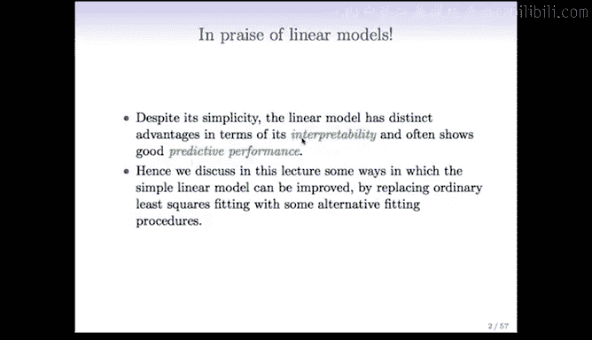

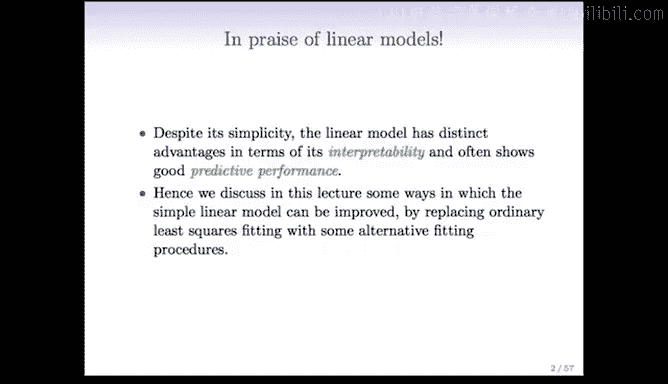

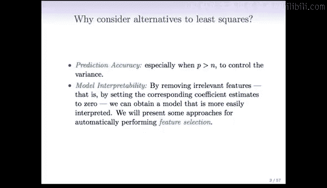

嗯。And I'll just say a little more about the two objectives。

When the number of features is bigger than the number of samples and we've talked about that in the course we' already。

 this is a situation that comes up more and more often these days where we have a lot of features you measure on patients or in business。

 maybe on a stock or。In other situations it's cheap to measure things now and and it's often the case when that P might be much bigger than and the number of samples。

 so in that situation of course we can't use fully squares because the solution is not even defined。

 so somehow we have to reduce the number of features。

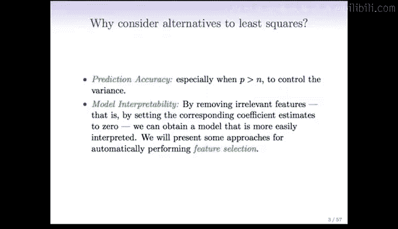

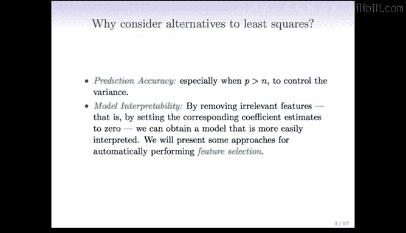

And。

Thus becomes more and more important， not just to obtain a solution。

 but to avoid f the data too hard。 So when we。嗯。

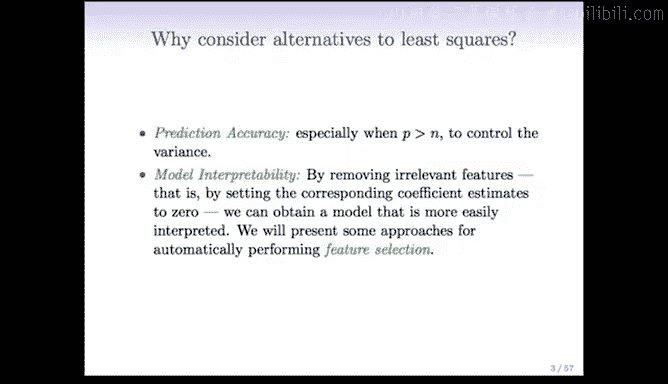

Want to predict better well， we'll shrink or regularize or select features in order to improve the prediction。

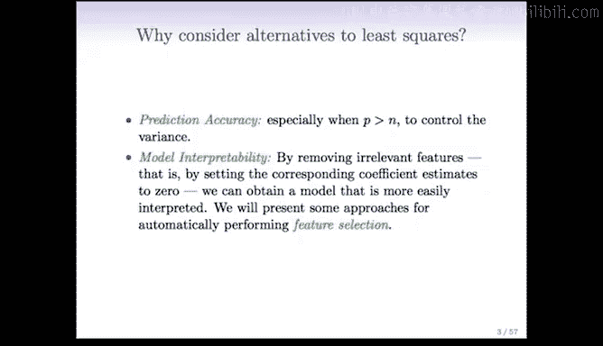

And along the same lines that we have a small number of features。

 the model becomes more interpretable right if， if we hand our collaborator a few hundred features and say these are important。

 that might be hard to interpret。 if we compare them down to the most important5 or 10。

 it becomes it's easier to interpret and from a scientific point of view more useful。 So we call。

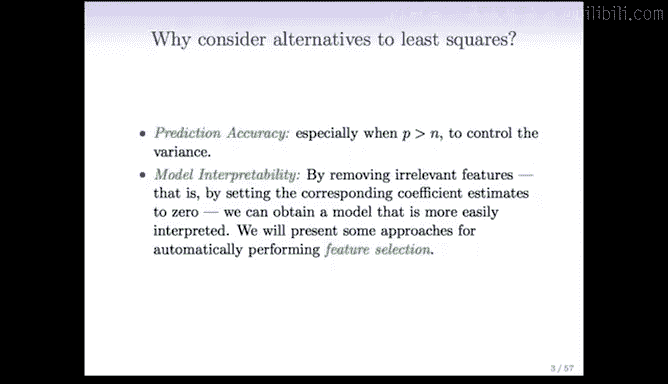

Feature selection is a way of choosing among features to find the ones that are most informative。

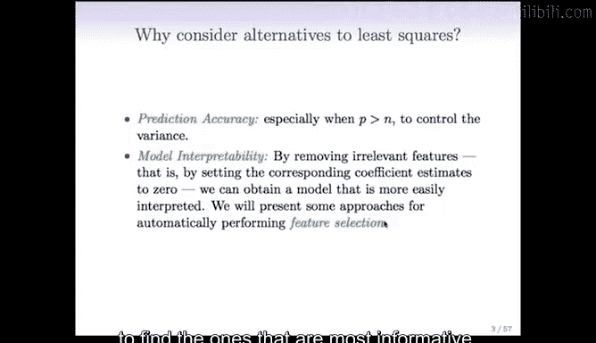

So we'll talk about three classes of techniques in today's lecture。Subset selection。

 where we try to find among the pe predictors， the ones that are the most related to the response。

 and we'll see different flavors of subset selection。

Best subset selection we'll try to look among all possible combinations of features are found that T the ones are the most predictive。

 and then there we'll talk about forward and backward stepwise methods。

 which don't try to find the best among all possible combinations。

 but try to do an intelligent search through the space of models。

 So forward stepwise backward stepwise in all subsets。

 and then some more modern techniques known as shrinkage methods。

In which we don't actually select variables explicitly。

 but rather we put on a penalty to penalize the model for the number of coefficients or the size of coefficients in various ways。

 so we'll talk about Rige regression and the laso in the shrinkage section and finally in the third section。

Dimenssion reduction we'll talk about ways of finding combinations of variables。

Extracting important combinations variables and then using those combinations as the features in regression。

 we'll talk about PCR principal components regression and partial least squares in that。

Those settings， so three different classes of， three classes of methods we'll talk about today。

And one of the things about today's lecture is that we're going to be looking at all of these ideas within the context of linear regression。

 so if you're trying to predict some quantitative response and you want to fit a less flexible but perhaps more predictive and also more interpretable model。

 these are ways that you can shrink in a sense， your usually square solution in order to get better results。

 but these can just as well these concepts can just as well be applied in the context of logistic regression or really your favorite model depending on the data that you have at hand and the type of response that you're trying to predict and so even though linear regression is really what we'll be talking about here。

 these really apply to logistic and other types of models。Okay。

 so Danielle is going to first of all tell us about subset selection。

So best subset selection is a really simple idea and the idea here is suppose that we have access to P predictors。

 but we want to actually have a simpler model that involves only a subset of those P predictors well the natural way to do it is to consider every possible subset of P predictors and to choose the best model out of every single model that just contains some of the predictors。

😊。

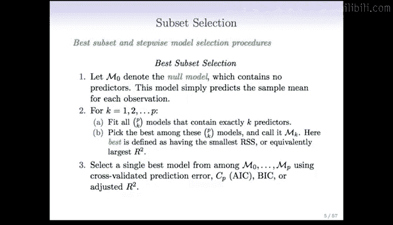

And so the way that we do this is in a very organized way。

 we first create a model that we're going to call M0。

 and M0 is is the nu model that contains no predictors。 It just contains an intercept。

 and we're just going to predict the sample mean for each observation。

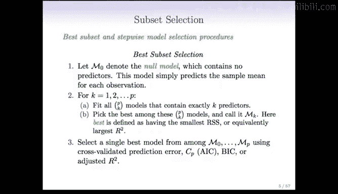

So that's going to give us M0。And now we're gonna， we're going try to create a model called M1。

 And M1 is going to be the best model that contains exactly one predictor。 So in order to get M1。

We need to look at all P models that contain exactly one predictor。

 and we have to find the best among those P models。Next， we want to find a model called M2。

 that's going to be the best model that contains two predictors。

So how many models are there that contain two predictors if we have P predictors in total。

 and the answer is P chooses 2。So if you haven't seen this notation before， this is。

 this notation is written like this。 It's pronounced choose。 So this means P choose 2。

And it's equal to p factorial。Divided by2 factorial times P minus2 factorial。

And that is actually the number of。Possible models that I can get that contain exactly two predictors out of P predictors total。

And so I can consider all P choose two models containing two predictors。

 I'm going to choose the best one， and I'm going to call it M2 and so on。

 I can keep on getting the best model with three predictors。

 four predictors and so on up to the best model with P predictors。

So if I'm choosing the best model out of all models containing three predictors in order to get。

 let's say M3， I can do that in a pretty straightforward way because I can just say that out of all models containing three predictors。

 the best one is the one with the smallest residual sum squares or equivalently the largest r squared。

And so in this way， I get a best model containing 0，1，2 all the way through P predictors。

 I've called them M0 M1M2 all the way through MP。And now I'm on to step 3。 And in this final step。

 all that I need to do is choose the best model out of M0 through MP。And in order to do this。

 actually， this step three is a little bit subtle because we need to be very careful that we choose a model that really has the smallest test error rather than the model that has the smallest training error。

And so there are a number of techniques that we can use to choose a single best model from among M0 to MP。

 and these include prediction error estimated through cross validation。

 as well as some methods that we're going to talk about later in this lecture。

 which you might not have seen before， and these include mallow CPp， Bayesian information criterion。

 and adjusted R squared。So we'll come back to some of those topics in a few minutes。

So here's an example on the credit data set and we saw this data set in one of the earlier chapters。

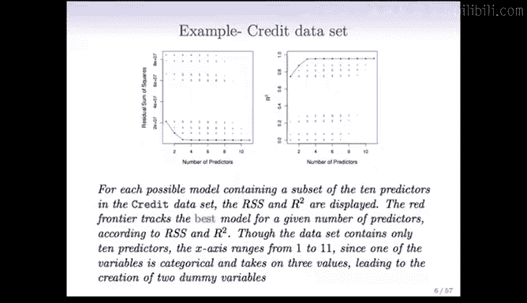

And this is a data set that contains 10 predictors involving things like number of credit cards and credit rating and credit limit。

 and the goal is to predict a quantitative response， which is credit card balance。😊。

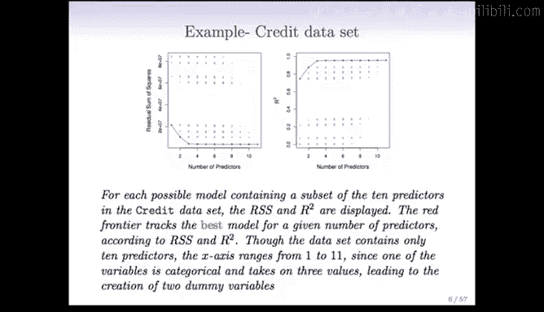

And so what we can do is we can look at every single model。

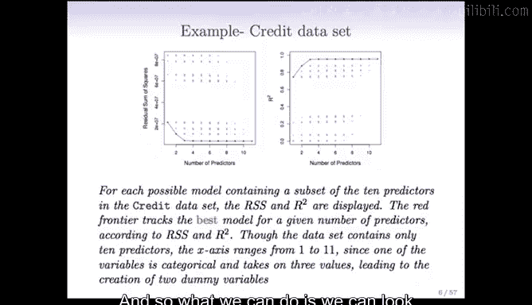

That contains a subset of these 1 predictors。

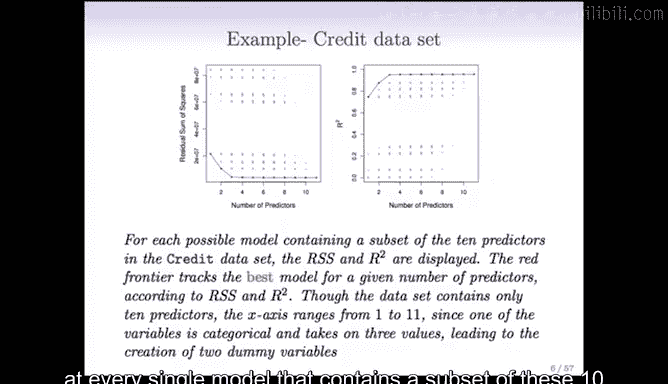

And these models are actually plotted here on the left hand side。

So here， this X axis is the number of predictors。

It actually goes from  one to 11 because one of these predictors is categorical with three levels。

 And so we used a couple of demi variables to encode that。

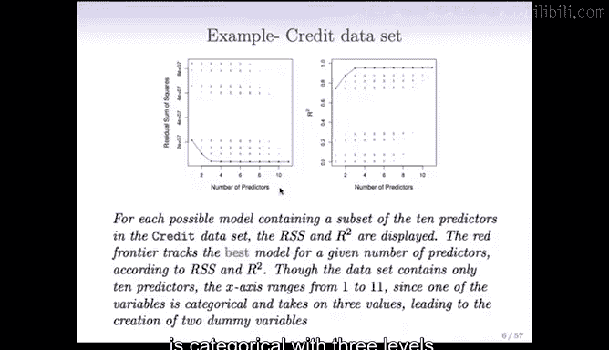

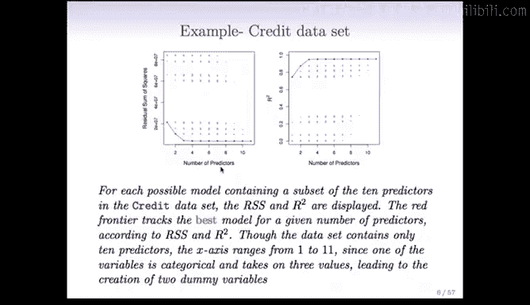

And on the y axis is the residual sum squares for each of the possible models。 So， for instance。

 like this dot right here。

Indicates a model that contains one predictor with a pretty terrible residual sum of squares。

And all the way down here， we've got a model with 11 predictors that has a pretty decent residual sum squares。

 So the reason that there's a lot of dots in this picture is because there's a lot of possible sub modelsels。

 given 10 total predictors。

And in fact， as we're going to see in a couple of minutes， there's two to the 10 submodels。

 So there's actually two to the 10 dots in this picture。

 although some of them are sort of on top of each other。

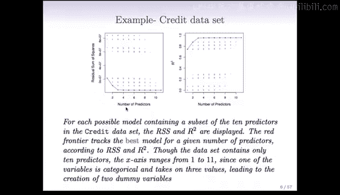

And so this red line here indicates the best model of each size。 So this。

 this red dot right here is M 0。

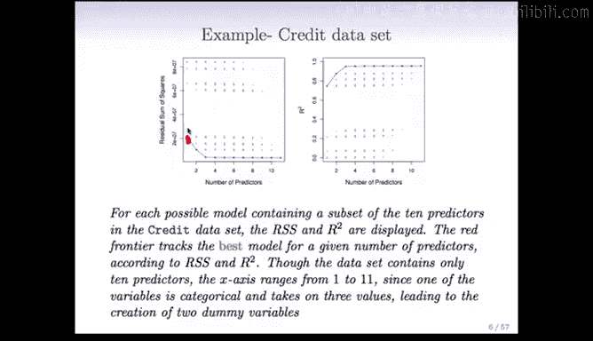

That's， excuse me。 It this is M1。 What I just what I just showed you is M1。

 So that's the best model containing one predictor because that is the smallest residual summa squares。

 This is the best model containing two predictors。 This is M3。

 best model containing three predictors and so on。 So when we perform best subset selection。

 What we really do is we trace out this curve when we get M0 through MP。😊。

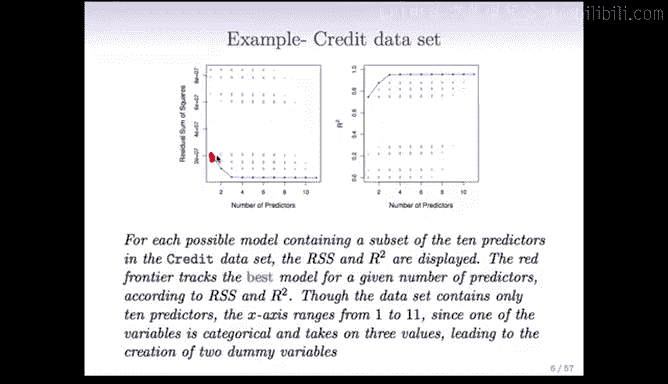

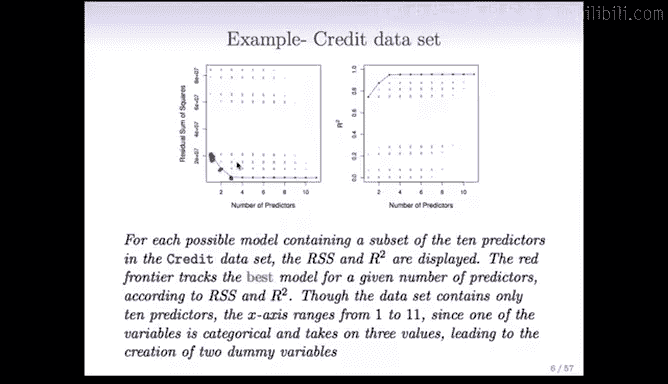

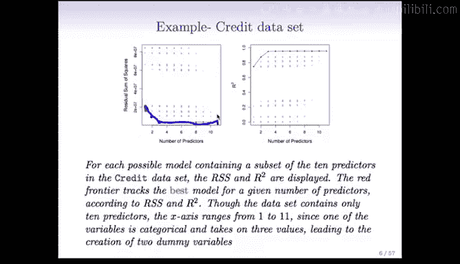

And now we're just going to need to find a way to choose， you know。

 I M 10 better than or worse than M4 and so on。 We're just going to have to choose among that lower frontier。

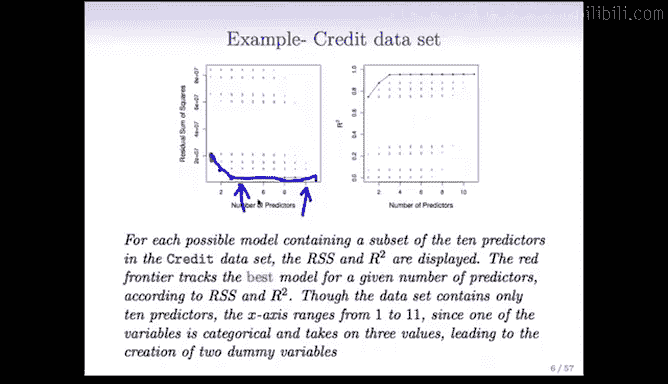

So， so on the left hand side here， we see a number of predictors against residual summa squares。

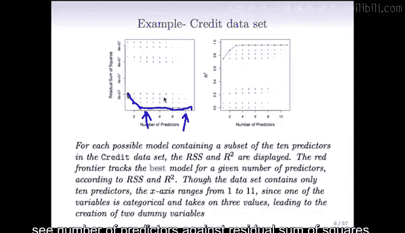

And on the right hand side， we've got a number of predictors against r squared。

And as we saw in chapter 3， R squared just tells you the proportion of variance explained by a linear regression model。

 by a least squares model。 And so once again， we see a whole lot of gray dots indicating every possible。

😊。

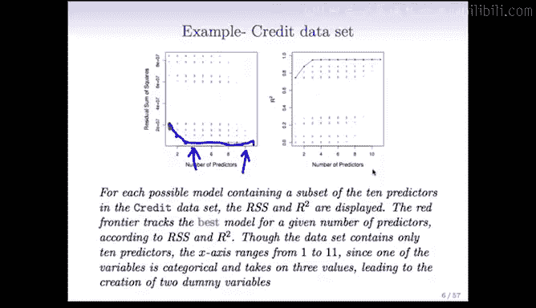

Model containing a subset of these 10 predictors。 and then the red line shows the best model of each size。

 So again， this is the M1 that we saw earlier。 This is M2。

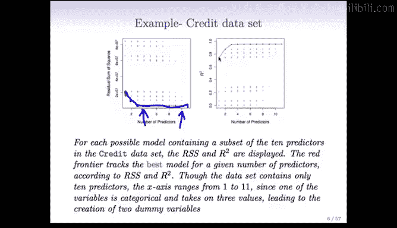

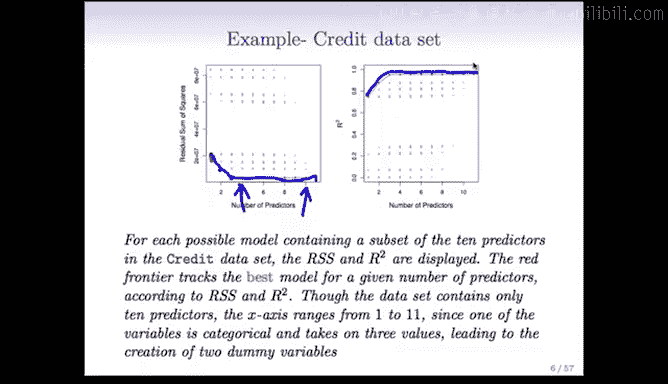

Over here is M10。And what we notice is that as the models get bigger。

 as we look at larger and larger models， the residual sum squares decreases。😊。

And the R squared increases， so。Do we have any idea of why that's happening？

Maybe Rob can tell us。And I can tell you yeah， so it's because as you add a variable。

 things can not get worse。

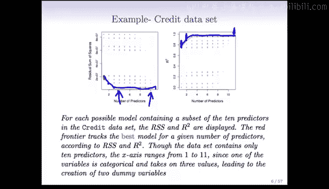

If you have a subset of size3 for example， and you look for the best subset of size4。

 at the very worst you could set the coefficient for the fourth variable to be0 and you do the same as you'll have the same error as for the three variable model so the curve can never it can never get worse。

 it can be flat if you clear the slide here we can see it looks like it's actually flat from both three predictors on。

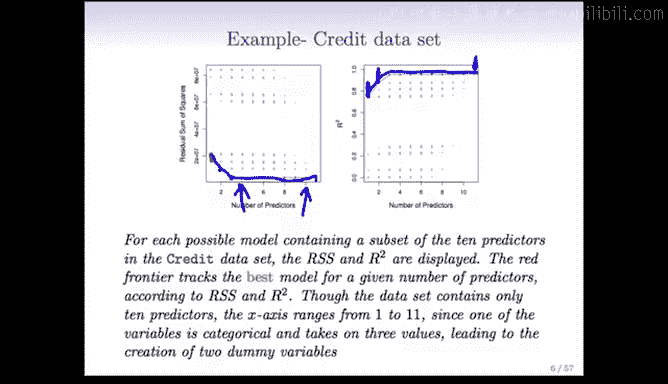

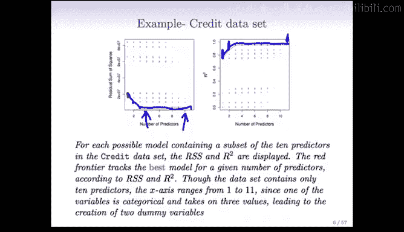

From three about up to 11。But it's certainly it's not going to go up。

 but it can it can be flat as it is in this case but we can't do any worse by adding a predictor and actually what Rob just said relates to the idea that you know remember on the previous slide here in step three when we were talking about best subset selection。

 we had this step and I said that in order to choose among the best model of each size。

 we're going to need to be really careful we're going to have to use cross validationidation or CP BIC adjusted r squared and that really relates to what's going on here because you know if I ask to you。

 hey， what's the best model with eight predictors you'd say， okay。

 here all of the model models with eight predictors and like clearly this is the best one。

 it's got the smallest residual summa squares， there's no argument。

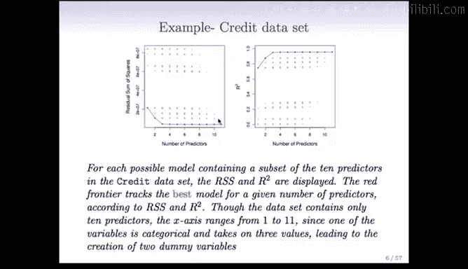

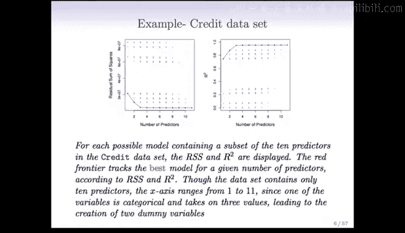

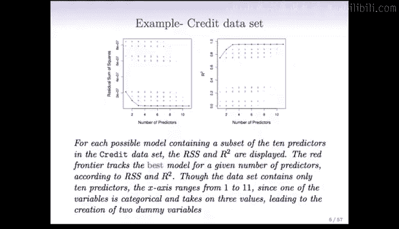

But if I ask you， which is better， this model here。Or this model there。

Suddenly it's not so straightforward because you're kind of comparing apples and oranges。

 you're comparing a model with four predictors to a model with eight predictors。

 you can't just look at which one has a smaller residual summa squares would because of course the one with a predictors is going to have a smaller residual sum squares so in order to really in a meaningful way。

 choose among a set of models with different predictors we're going to have to be careful and we'll talk about that in a few minutes。

😊。

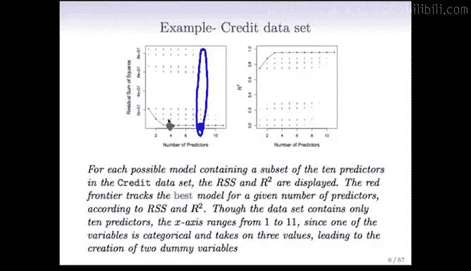

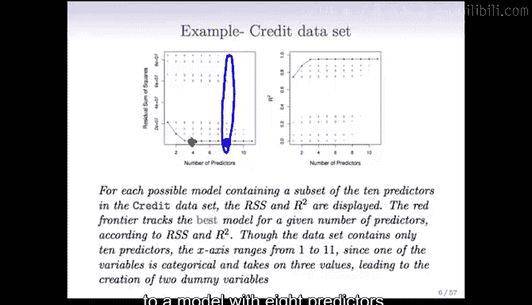

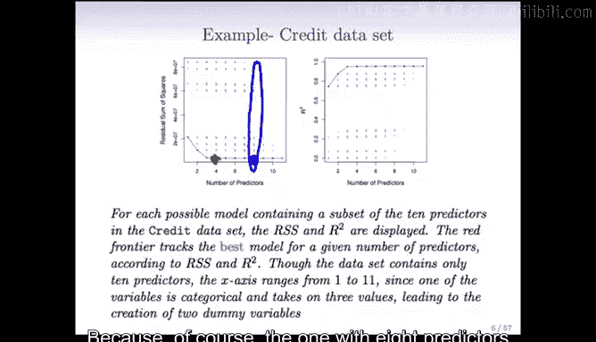

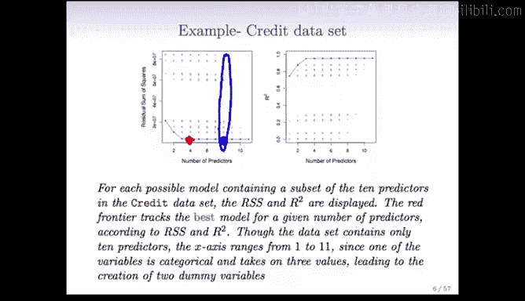