# 斯坦福大学《统计学习导论2023Python版｜An Introduction to Statistical Learning with Python》中英字幕 - P36：-036-Statistical Learning_ 5.4 The Bootstrap.zh_en - GPT中英字幕课程资源 - BV1u4421A7ZU

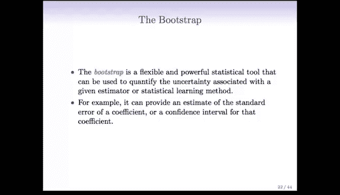

Welcome back in the last section we talked about cross validation。

For the estimation of test error for supervised learning。

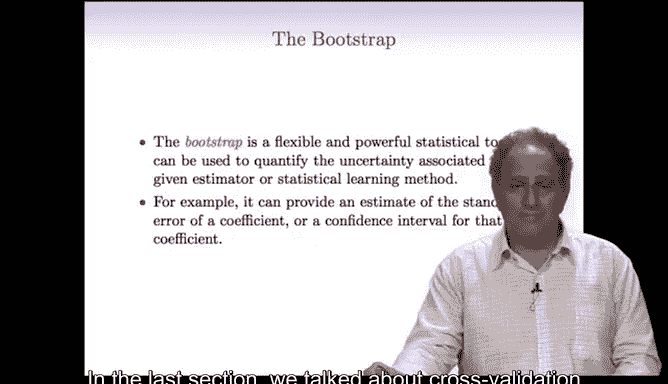

Now we'll talk about a closely related idea called the Boottrap。

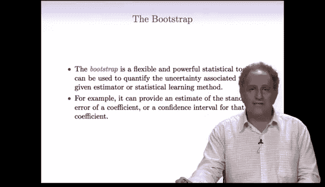

It's a powerful method for assessing uncertainty and estimates， in particular。

 for getting an idea of standard errors of an estimate and getting confidence limits。Wow。

 it sounds like a powerful technique， Rob， are there any good books on the topic？

As a matter of fact， I Rob has got a very famous book with Brad Efron on the bootstrap Oh I've got a actually think of famous。

 my supervisor was Brad Efron who's now our colleague and he's the inventor of the bootsottrap and there's a conversation with Brad in this course which he talks about the how he came to think of the bootstrap The bootsottrap was something he thought of in 1979 and it's become one of the most important techniques and statistics in the last。

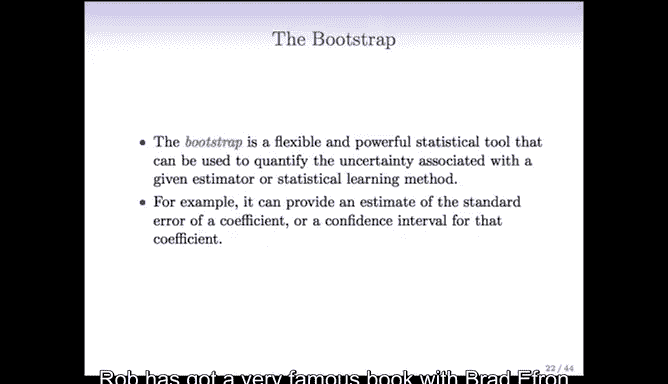

30 years。

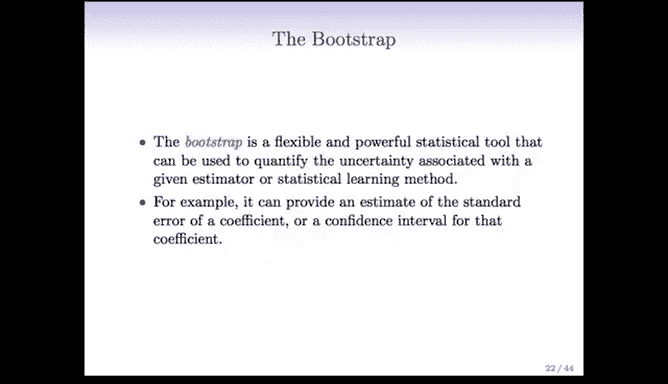

So where does the name come from， well， it's the idea of pulling yourself up by your bootstraps。

 which is from a fabled by Rudolph Eric Rassppe， the Barren Fa。Eventuallyvents of。Baon Munchausen。

 the baron had fallen into the bottom of a deep lake。And couldn't get out。 So he had an idea。

 He thought hed pulled himself up by his bootstraps， his own bootstraps。

 and in the fable he managed to pull himself out of the lake。And saves life。

Thought where the term Boottrapap came from and that's the term we're using here。

It's not the same as the term bootsottrapap that one uses computer science to boot a computer。

 but it's the same idea you're trying to pull yourself up from what you've got。In this case。

 we'll see the bootstrap。And the wood is we're going to use the data itself to try to get more information about our estimator。

So let's。Let's start with a simple example。Suppose we have。WeF sum of money， but we want to invest。

In two assets， the yield returns x and Y。We' X and y are random quantities depending on how the assets do。

 and we want to invest a fraction alpha of our money in X in the remaining1 minus alpha in y。

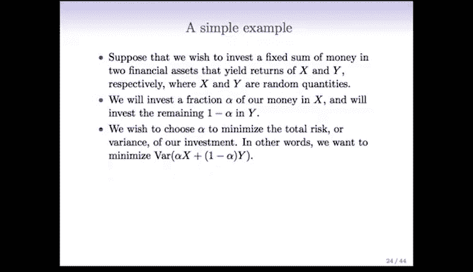

We want to choose the fraction alpha to minimize the total risk or the variance of our investment。

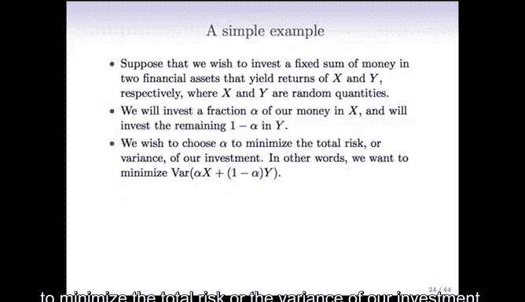

So we have random variables x and y， we want to choose the alpha to minimize the variance of alpha x plus y minus alpha times y。

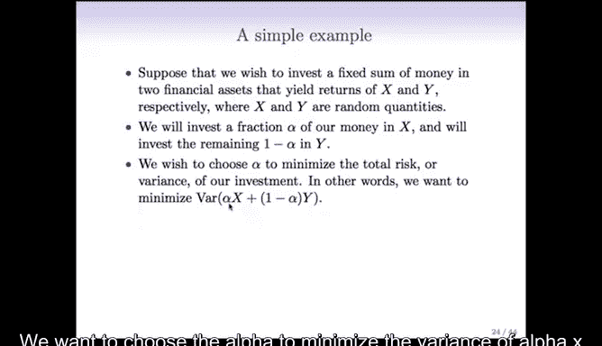

Now in this population model， you can show that the best。

The best fraction alpha is given by this formula。Sigma squared y， that's the variance of y。

 there's a variance of x， this is the covariant between x and y。

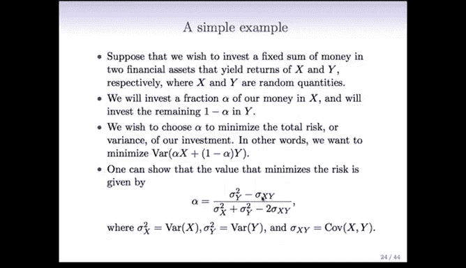

And they're defined here， so in other words， if we know the variances of x。

 the variances of y and their covariance。Then this is the。

The best amount proportion to put into x and the main goes into y to minimize the total variance。

Okay， so those are population quantities Ontario， those are population quantities。

Since the population quantities， they're not known to us。In general。But if we， if we have a。

A data set from the population that we're under study here， we can get an idea of these quantities。

 the variances and the covariances。From the sample values from from the data set and then plug them into the formula to get a。

The alpha hat， which is the proportion that we should invest in X。Okay。So again。

 if we have a sample of x and Y we can。Get the empirical estimates of the variances and covariances。

 plug them in and get an estimate of alpha。

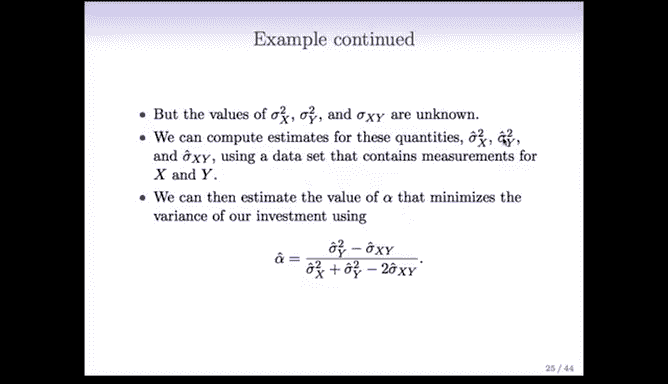

So in this next slide we see we've created a simulated population we've simulated。

Investments X and Y。There's four different simulations here。

 each one containing 100 pairs of X and Y。And for each one， we take that data。

 we compute the variances and covariances， and we plug it into the formula to get an estimate for alpha。

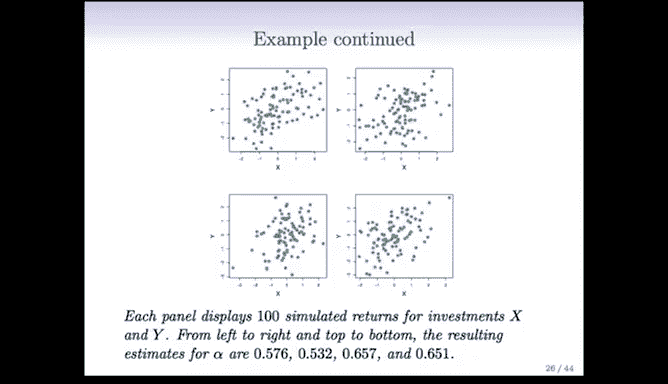

And here we see the four estimates of alpha for the four panels。

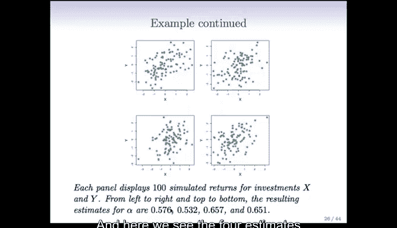

。576， et cetera to 0。651， so they're averaging around 0。6。

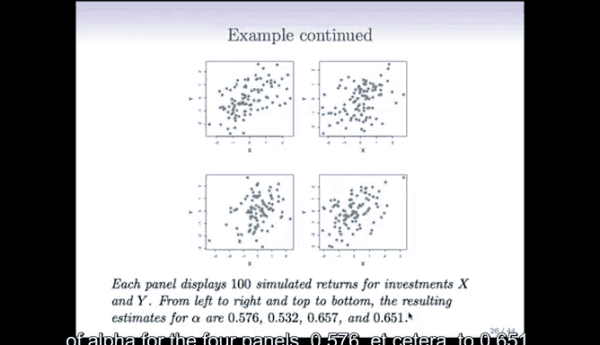

Okay。

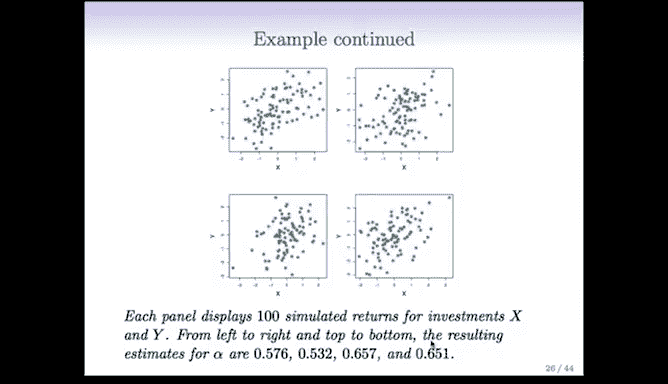

So if we want to get an idea of the standard a deviation of alpha hat。

 we can just repeat this process lots of times， let's say a thousand times。

 so we've got a thousand panels like this， each one gives us an alpha hat from the format on the previous slide。

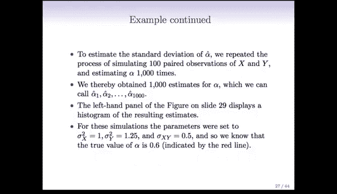

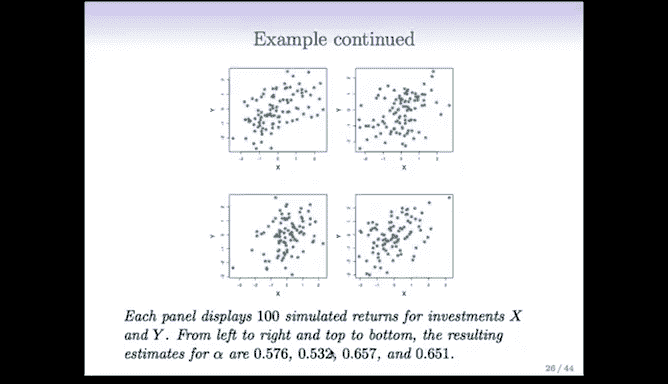

And we do this a thousand times。We take the standard standard error of those。 well。

 actually let's use a thousand times we'll go to the。

Look at the histogram in a couple of slides。This histogram on the left shows the 1，000 values over 1。

000 simulations from this experiment。Each one is a value of alpha hat。And the average around 0。6。

It's called a sampling distribution of that estimator， right。And the true value actually。

 since we know in this case we're playing God， right， we know the true variances and covariances。

 we know the true alpha and it's about 0。6， as I've indicated here the purple line the 0。6。

And the sampling distribution is averaging around 0。6 as we think it should。

An。So。The mean over the 1000 estimate today。

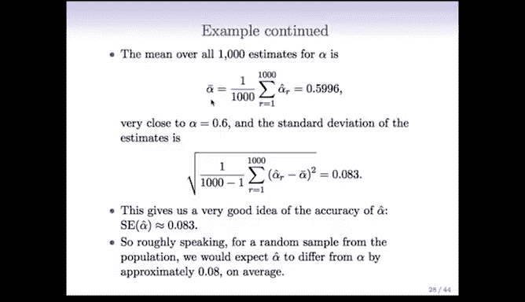

Okay， I should say， yeah I've said this already。Here's the histogram we've seen。For the simulations。

 actually， these were the values of the parameters that we set。

And that implied a true value alpha of 0。6， which was that middle value in the histogram。

 That's a true value of alpha。嗯。

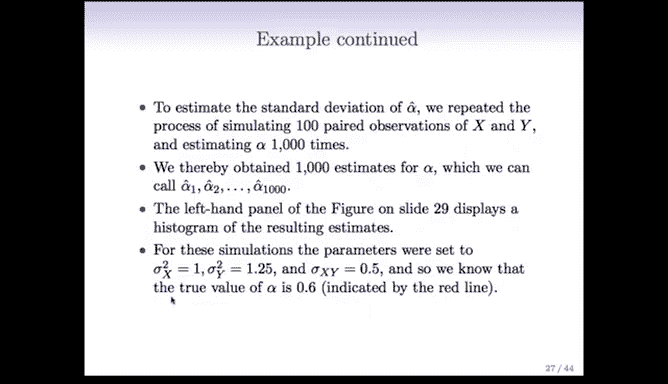

And now。We can also use this histogram to get to the standard deviation of the estimates。

 despite by taking the standard deviation of those 1000 values of alpha hat。

 and here here we've done that。And that's 。08 at3。So the standard error of alpha hats roughly 0。083。

The standard error of an estimator is the standard deviation in that sampling distribution。

 so if you're able to recompute the estimator many， many times from new samples。

 the standard deviation is called the standard error。If we repeat this experiment。

 we expect each time that the on average alpha hat would be about 0。6。

And would vary by a standard deviation of 0。083。

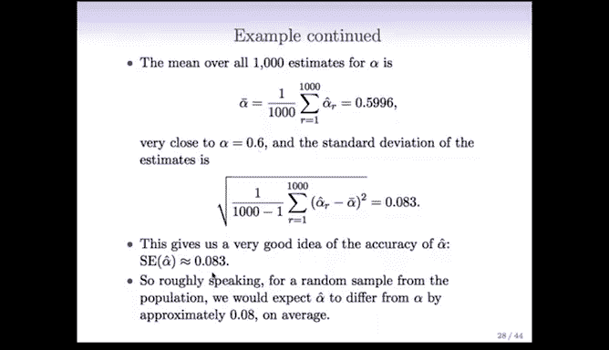

Which we're seeing。In this histogram， right， this averaging about 0。

08 and the standard deviation is it's about 0。08 of this histogram。ok。So that's all fine， except。

We can't actually apply this with real data if we had a sample of investments， x and Y。

 we don't actually have the ability to sample from the population， we don't have the population。

 we have a single sample。So most of statistics， we don't have access to the population。

All we have is a sample。If we had access to the population。

 we actually wouldn't need statistics at all for most of the part。

 we could learn all we wanted to know from the population。In the real world， we have data。

 We don't actually know the populations from which that data arose。

 We have an idea of what it looked might look like， but we we can't generate more data。

So we can't actually。We can't produce the histogram on the left because we don't have the ability to generate more data。

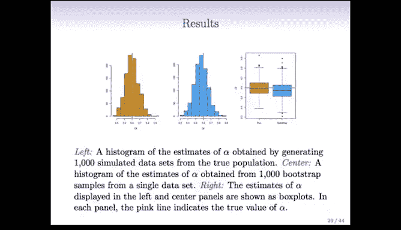

But the bootstrap is going to try， it's going to mimic this process by sampling not from the population。

 but from the data itself。So the data itself is going to act as the population。

So instead of obtaining independent data sets from the population， which we can't do。

Without access the population。We' at a sample from the data itself with replacement。And'll。

Remind you in a minute what that means。But。Basically we're going a sample from the data set itself and then use those samples to get an idea of the variability in the same way that we use the samples from the population。

To produce this histogram。

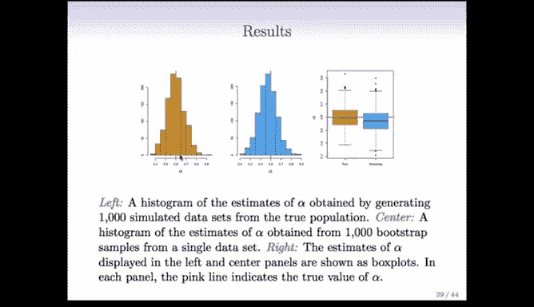

We're going to sample from the data。The data itself is the population。So。Here's an idea of this is。

An illustration of bootstrap sampling， which is sampling with replacement。

I've created a data set here。Just with three observations just so we could draw it on a single slide。

Here's our original data， here's the three observations。And now each of these is a bootstrap sample。

 bootstrap sample is drawn。With replacement of same the same size as the original data so the original data here is about three observations so we're going to draw three observations with replacement。

 what does that mean， it means that the chance of each observation sampled is the same one third but it's done with replacement so imagine you put three balls into a bag。

Say number one， two and three， we put a hand in the bag， we pull out one at random。

 maybe well get number one。That's our first observation， now to get to our second observation。

 we put the ball back in the bag。That's why it's called with replacement。

 And we sample again from all three balls。 So at every stage。

Each ball has the same probability of being sampled and can be sampled more than once at each from stage one to N。

 So here， for example。We've got observations three twice， an observation one once。

 Ob two didn't get sampled at all。In this second bootstrap sample。

 and we're drawing three samples from these three observations， we happen to get two， three， and one。

 so each observation actually occurred once。This next sample， we got observation two twice。

 and then observation one。

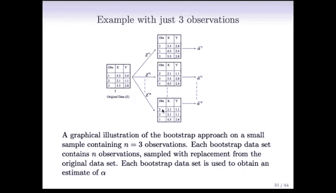

So。Just to summarize， we sampled the same number of observations as our original sample with replacement。

 meaning each observation can appear more than once or maybe not at all。

 depending on what happens as we draw the samples。

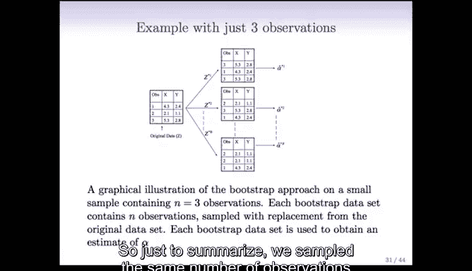

So these are called Botrap samples。Boostrap data sets。And then。D each bootsshop data set。

 we apply the estimator in this case are the alpha。 this is the proportion of。Investment X。

We compute it from this sample， just as we computed it from the original sample。

And we use the standard deviation of these numbers to give us an idea of the standard error。

 the standard deviation of alpha alpha hat。

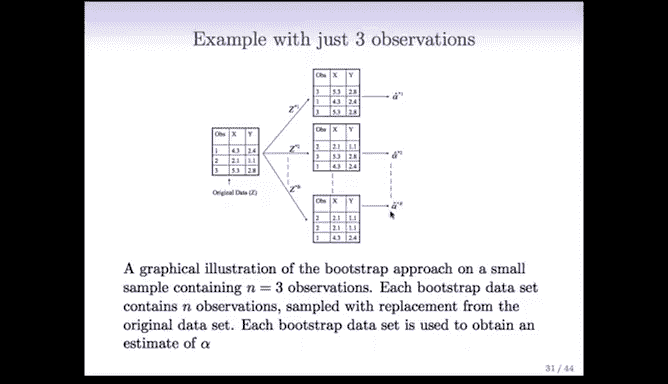

So having drawn 1000 bootstrap samples and got our 100 estimates of alpha hat。

 we can draw the histogram as we did before。 Let's go back to this slide。 So now in back on slide 29。

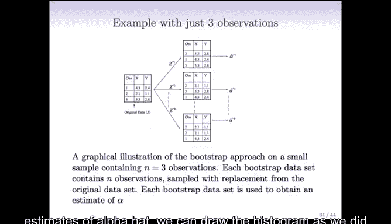

The member on the right， excuse me on the left is the histogram when we sample from the population。

The histogram of alpha had values。We can't sample from the population because we don't have the population。

 so we did bootstrap sampling， we get the histogram in the middle of the blue histogram。

And looks very much like the one on the left。It's averaging around 0。

6 and its variability is about the same as。

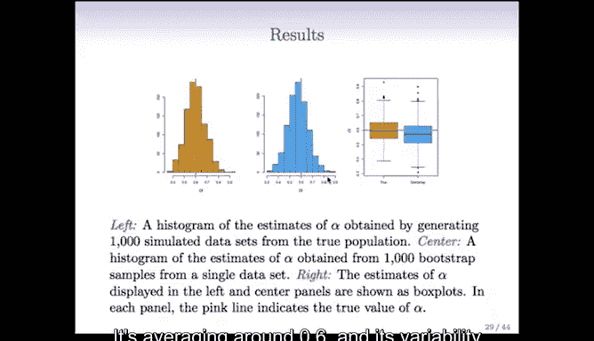

We got some from the population。

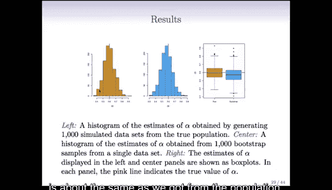

As a matter of fact， well， so over here we've got the。Box plots of the alpha hat values。An。

The true ones from the sample from the population and the bootstrap ones and they're looking pretty similar。

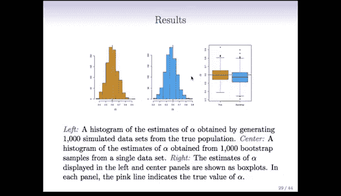

You're averaging around 0。6 although the bootstrap is a little lower。In this case。In general。

 this gives you a pretty good idea of what we would get if we could sample from the population in the standard error estimate。

 let's see that we have that in the next。

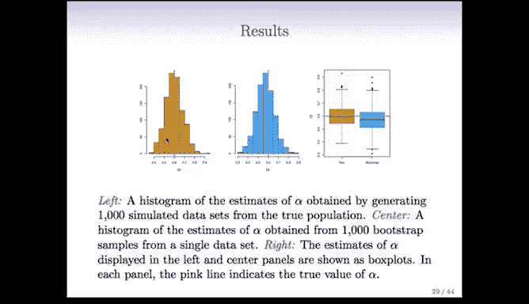

Back here。Yeah， the standard error。Estimate is 0。087。Whi is similar， we got 0。

083 before and we used to sample from the population。

 so the bootsottrap has used the data itself as the population and got us a good estimate of the standard error。

 very similar to the one we'd get if we could sample from the population。

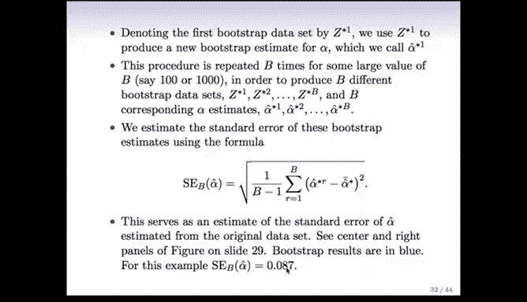

So we've seen some examples of a bootstrap in simple problems in the next section we'll talk about the method of more generality。

