# 斯坦福大学《统计学习导论2023Python版｜An Introduction to Statistical Learning with Python》中英字幕 - P38：-038-Statistical Learning_ 5.Py Cross-Validation I 2023.zh_en - GPT中英字幕课程资源 - BV1u4421A7ZU

Okay， there we in chapterpt 5 and the labs on cross validationation and the bootst。

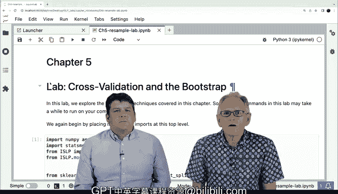

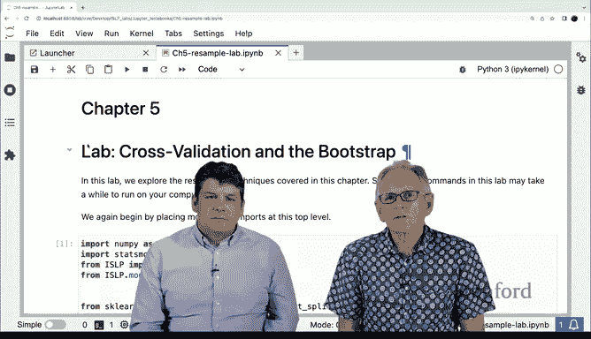

Validating models is really important， where you fit models and。

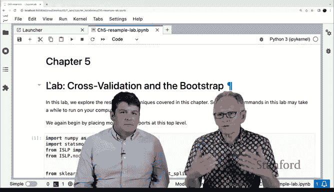

Separate training data。 And then you evaluated on test data or validation data sets that。

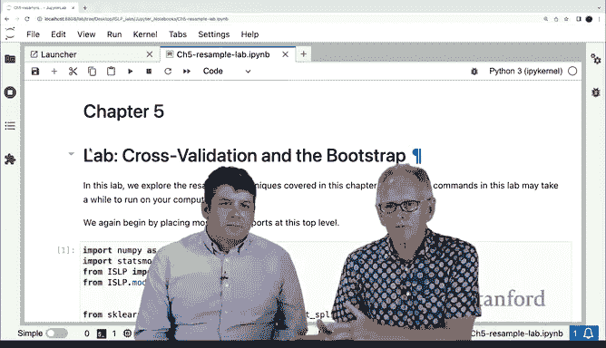

That weren't involved in the training， and Jonathan's going to show us how we do it in the slab。

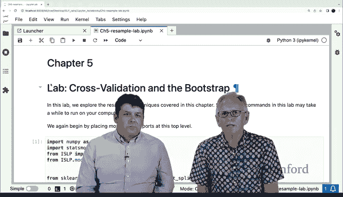

Thanks， Trevor。Yes， so one of the nicere we're gonna be using asyit learn sort of cross validation setup。

 which is one of the nice things about psyit learn is for all of its different models。

 you can crossval them and almost using almost the same code。

 we just have to swap out what the particular estimator is。 So we'll，ll in this in this lab。

 we'll look at cross validating least squares regression。

So we're going to compare that with the train test split that we saw in chapter4 for classification。

As well， so those'll be the two things to look at。

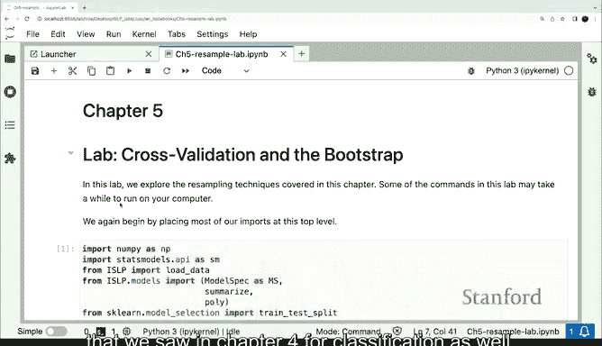

There are a few new imports， so。

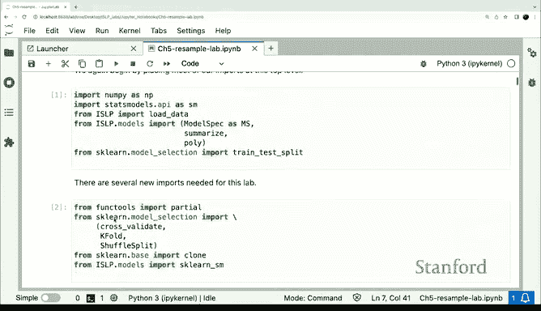

Key imports to look at are this kfold import that's going to be how we implement kfold cross validation。

 The crossval function is that what actually will be used to cross validate the estimator least squares regression and one small new import from ISLP the orin least squares regression we saw in chapter 3。

 was actually from stats models， which is not part of psychic learn。

 So there's a little wrapper here。 So we can cross validate the stats models using the same the psyic learn sort of sort of formalism。

 And as in previous labs we' put all the imports right at the beginning。

 So it's very clear what's needed to do the lab。 Yes。

 that's sort of best practices felt in Pthon because well。

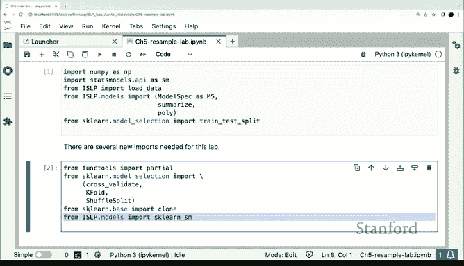

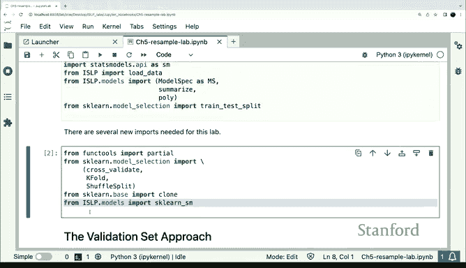

Okay， so we know what is in the name space when we start， okay， so let's run these cells。

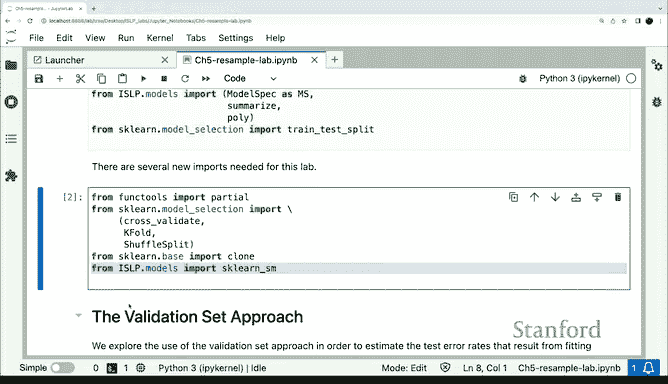

You we have to run them to run the code。

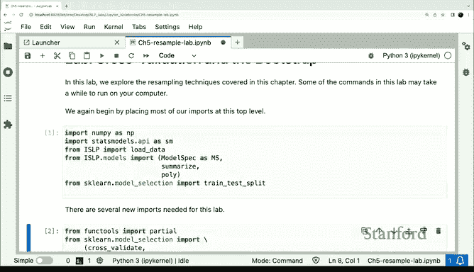

Okay， so we use we're going to use the function train test split that we saw in chapterpt 4 to split our。

 in this case， the auto data set where we try and predict。

Miles per gallon as a function of different features of the car。

 we're going to split the data set of size 392， we're going to split into two equal data sets of size 196。

And we'll do as we did in chapter  four， we're going to fit the least square regression on the training data。

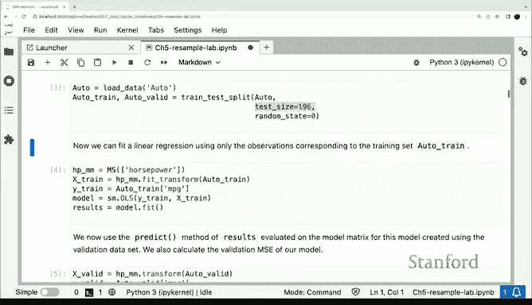

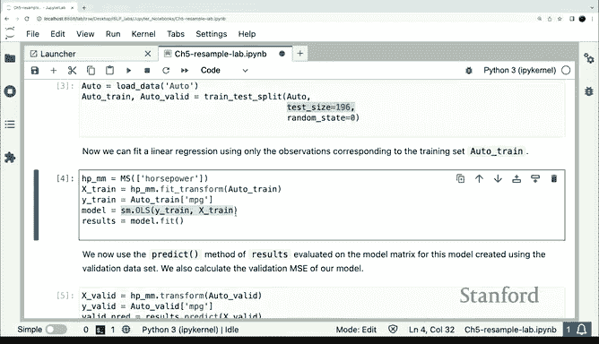

嗯。And then we're going to evaluate the mean squared error on the validation or the test data set。

 So this HMM， that's our model spec or model matrix。Constructor。

 and it will construct the design matrix for the validation。

 This is the response for the validation or test data。And we're just gonna find the predicted values。

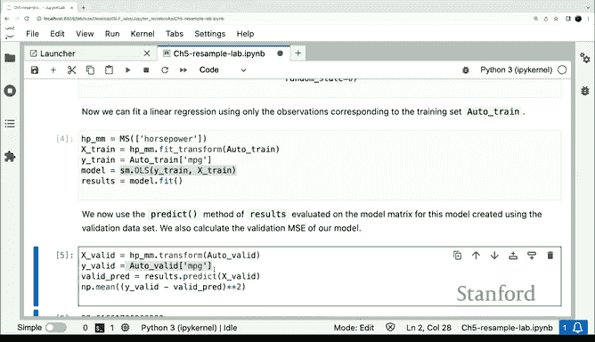

And compute the MC。

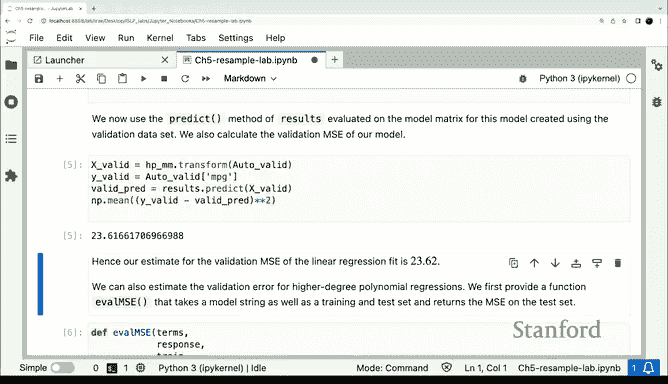

So our。estimate estimate me is 23。62。

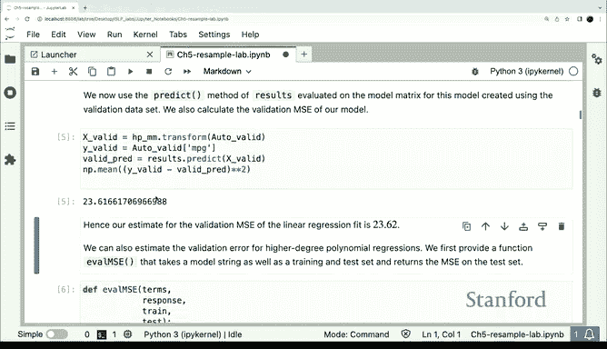

So we might this was just using horsepower as a linear term。

 we might want to use something like the train test split to pick an order of polynomial。

 like in the classification chapter。We use it to compare different different models。

 but here we have the model is the order of the polynomial， so we're going to。

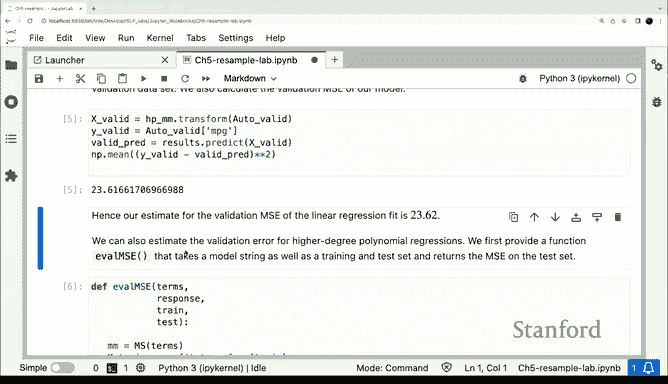

Make a little loop in order to compute the MSC for a few different orders of polynomial。

 So here's a little helper function to help us。

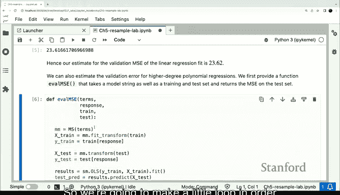

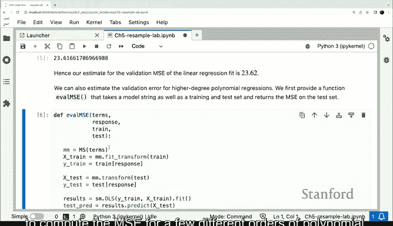

Encapsulate what we did above for the train and test split that we'll use。

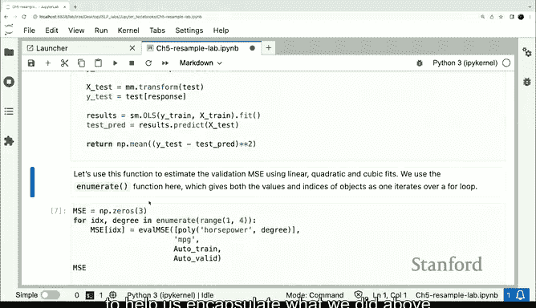

To evaluate in a for loop。This is the first example in the lab we've seen of a for loop。

 we're going to construct our model spec on different polynomials different degrees of horsepower。

 and we're going to store the results in the MSC vector。Okay。

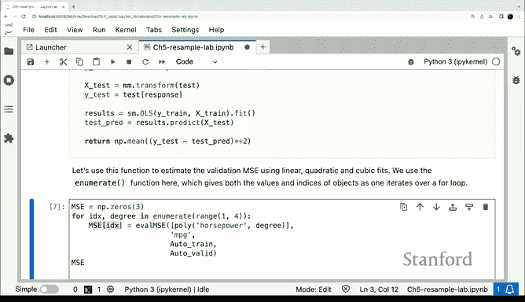

So we see for the linear effect23 and we see a pretty big improvement going to quadratic and less improvement going going further。

 So there's really not much of a gain。 It seems to be going from quadratic to cuic。

 looks like it's a loss。 Yes， in this case。 Yes， and of course。

 there's no guarantee that on the test data， it would be an improvement， but on the training data。

 of course， we know it's an improvement。

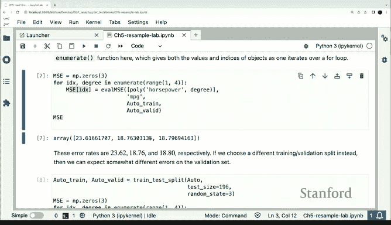

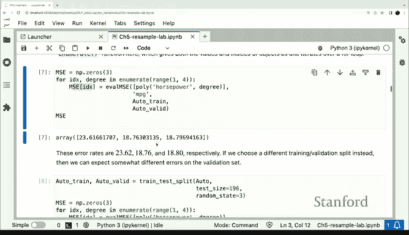

So this is on the validation data。Yes， this is we've trained on the training data using the same split for every degree and then evaluated on the validation data。

 Okay and of course， for different splits， we chose one split into 5050。

 There's many different splits into 5050。 We might get slightly different answers。

 So we're going to change the random seed above above the random seed was0。

 I think doesn't really matter what it is。 Here's a different one and we'll rerun the same code and we see we get qualitatively similar results of course。

 but the numbers are different。 the linear1 as N MSE of 20。7 instead of 23。6 or so。

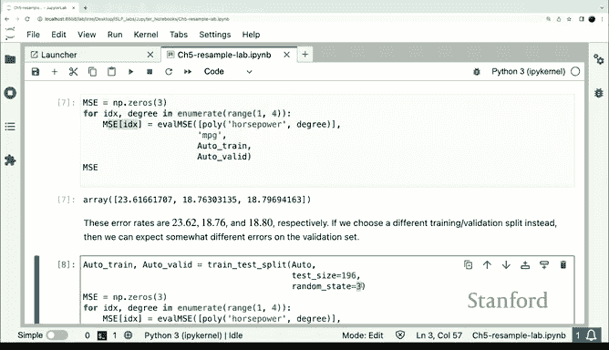

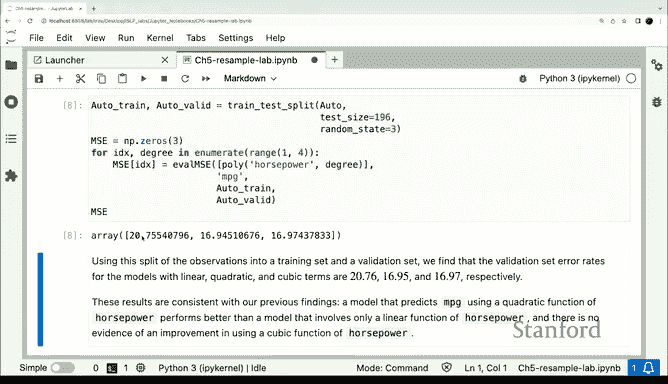

Okay，That that variability we saw in in the。In test train split is related to the actual splitting into the two houses。

 And there's some randomness involved in that。 And also， Jonathan， we split our data set。

 which isn't that big to start with into two pieces。

 And so now we got half the data is used for training and half for testing doesn't seem a good use of。

Of the data。And so you're going to tell us about cross validation and you can do it more efficiently。

And get bigger training data sets in the process。 Yes， that's right for every split into 5050。

 the actual estimator has half the data set to work with。And cross validation is a method。

 For instance， leaf one out cross validation， every estimator there has。

391 data points instead of 196。 So the estimators are better。

 And then's a slightly different estimator because it's trained out more data， but it also。

It also reduces some of the variability you see in split to split in class validation because it uses every data point gets treated as a test or point。

Okay。As I mentioned above， Psychit Learnn has a very nice way to cross validate many。

 many different estimators， that's this cross validate function。Okay。

 so let's just look at our first example of cross validation。

 we're going to cross validateate in the regression model with just a linear effect for horsepower。

 so this SKLn underscore SM is a wrapper that takes a method from a fitting method from stats models in this case。

 ordinarily squares and a way a design or a model spec and creates something that PsyitLn is familiar with and that psyitL can use for cross validation。

So the main function in this chunk here is this cross validate function here。

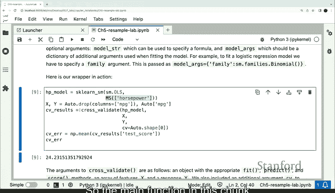

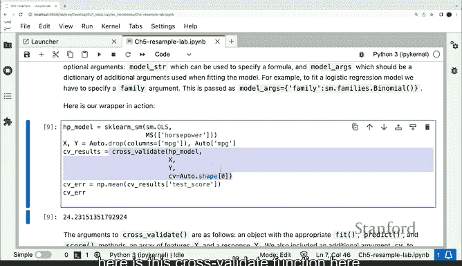

So it takes this is an estimator that psyic learnn is aware of。A set of features and a response。

 And then an argument about how to do cross validation here。 And here。

 I've given it the number of rows in auto dot shape。 So this is enfold cross validation。

 also called leave one out cross validation。 Oh， so auto dot shape  0 is the number of rows。

 That's right。 Yes， And so if C equals n means you're going to have。Leaad one out cross validation。

 That's one cross validation。 Yes， that's right。 So this， this model。

 H model will be fit n times each time with n -1 data points， okay。

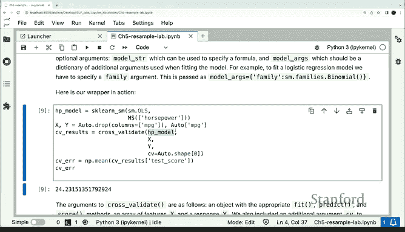

So it's pretty quick。Yes computed up pretty fast these days。

So if we wanted to change this to tenfold cross validation。

 one of the nice things about SK Learn is we just changed the method of this argument we passed to cross validation。

 so let's skip down to that。

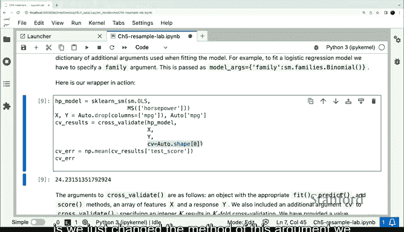

嗯。So this one here is ten0fold cross validation。So。We're gonna to。This object here， CV。

 I've called it， it's going to be kfold with 10 splits。The shuffle equals 2 and random s equals 0。

 that's just to make sure that it's a random one without these。

 it just takes breaks it into 10 regulatory space but that's neither here and nor there， really。Okay。

 so。So now when we pass this C argument to cross Val， it will only do。

Fit 10 models each time with a roughly， you know，90% of 392 or whatever that is， you know。

 roughly 350 data points。And one of the other thing we've done here is we made a for loop to cross validate for every different power up to fifth order powers of horsepower。

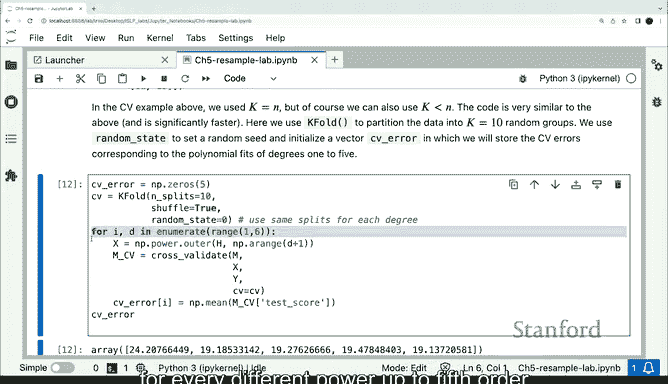

啊。What's happened is I've skipped ahead without running all the code necessary。

 so let me just run all the code up to here。

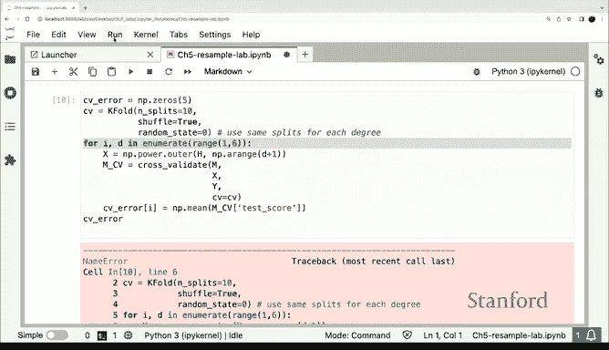

And run that again。 Okay， so now we get as a function of the。The degree。

 we have this cross validation estimate。 And note these are pretty similar to what we had for the test and spray test and train split。

 but。And the same pattern of no improvement going beyond quadratic for the degree of the polynomial。

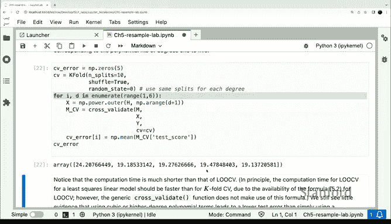

Okay， so you can also do test and train similarly with cross validation using this thing called this instead of Kfold distinct called strel split。

 but we'll leave that for you to do offline。

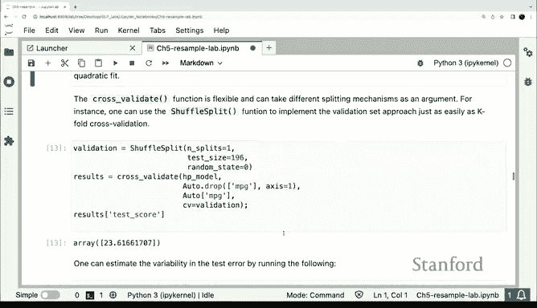

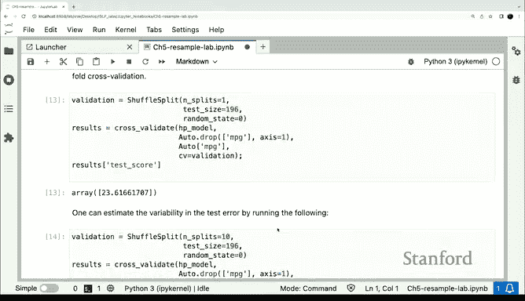

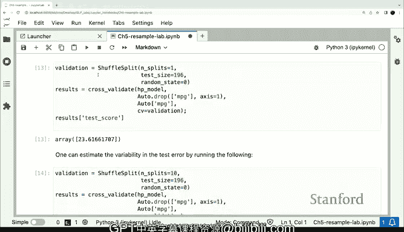

