# 斯坦福大学《统计学习导论2023Python版｜An Introduction to Statistical Learning with Python》中英字幕 - P39：-039-Statistical Learning_ 5.Py Bootstrap I 2023.zh_en - GPT中英字幕课程资源 - BV1u4421A7ZU

In this section， we're going to talk about the bootstap。

 which is similar in some ways to cross validation， but a more general procedure。

 and we're going to show how to use a bootstrap to measure the variance of a complicated statistic。

Okay，Yes， so the example we're going to follow is covered in the in the text that it's an investment problem where we're trying to decide the optimal investment into two assets It minimizes the variance。

 So that's obviously some function of the variance and covariance of the the asset。

 So we're going have a statistic that is look back at we won't do it now。

 But look back in the book at equation 5。7 and you'll see there's this。Formula。

 which is a ratio of some variance terms to some covariance terms。 And in general。

 finding the variance of such a。The function will be， you know， we don't have any nice。

 closed forming expressions。 And that's an ideal job for the bootst。 Yes， or you know。

 it used to be for graduate students。 But no it's better for the better。

 better for the boost attitude to do。Okay， so so as Jevor mentioned。

 we're gonna we have to compute the covariances of different assets。 So here's a little function。

We're going to give the bootstrap。A data frame。 And from this data frame。

 it will compute the covariance of x and Y。 And this formula here is that formula 5。7 in code form。

 let's say。Okay， so the way the bootsshop will work is， of course， we give random。

Samples with replacement from the data frame。 So this index argument is going to be。

 you know a list of different integers to sample or different indexes。

 elements of the data frame And for every different index we'll compute the statistic and the bootstrap collects these and we can use the sample standard deviation of those estimates as an estimate of the variance of the estimate the originalestimator。

 That's so you'll recall from reading the book and the section on bootstrap that we do this over and over again。

 we sample the rows of the of the data frame with replacement。Of size n the total sample size many。

 many times， and each time we compute the statistic on this resampled data frame。And， and。From that。

 we get the。The， the， the variance of the statistic。 Yeah food variance。 So let's just。

 let's just check what， you know， when we compute the statistic on the full data。

 it's our point estimate is 0。58 or so。 and like to know how variable that is， of course。Okay， so。

What we you know for a given sample with replacement from the rows of the data matrix。

 we'll get a new value of that statistic。

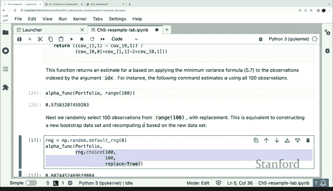

0。61 in this case， of course。Every time we change the sample of rows。

 we'll get a different estimate and the standard error of those estimates is the bootstrap standard error。

 So let's write a little function here， we've written a little function to do that that for us。

 there are some packages in Python for the bootstrap。

 but our examples are simple enough here that we use that as an example to write a function to do it ourselves。

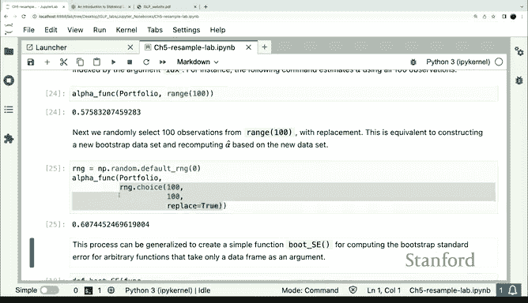

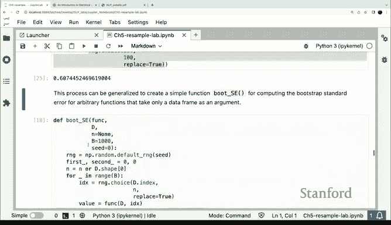

Okay， so this boot SE function， it will take an estimator like that alpha funk estimator。

 I think is what it's called， it' will take a data set and we'll apply the estimator to the data set and different indices。

 collect all of these and then compute the standard error。

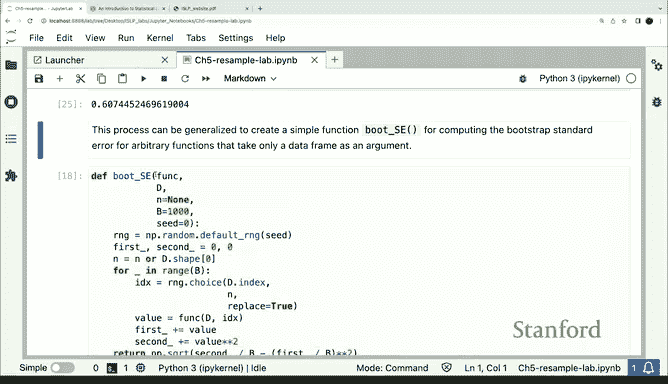

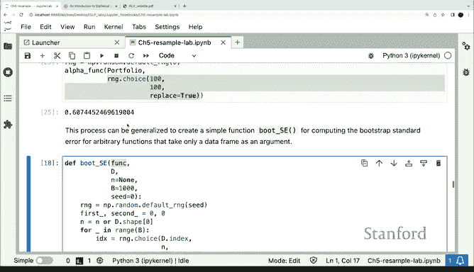

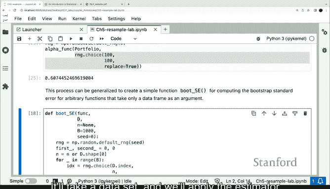

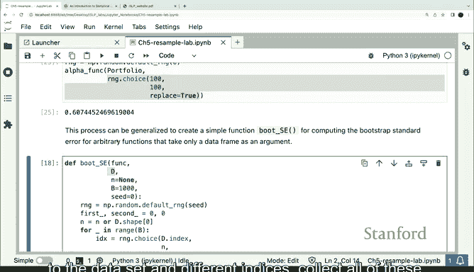

So if we go through this code， you can see that's what's going on here。

 Let's not let's not go on go through each line of these。 Again， you'll notice we've。

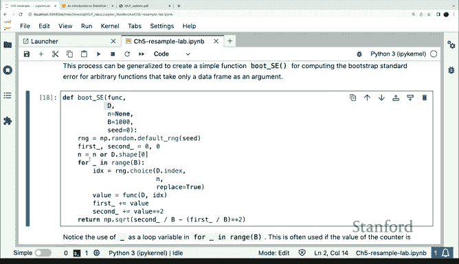

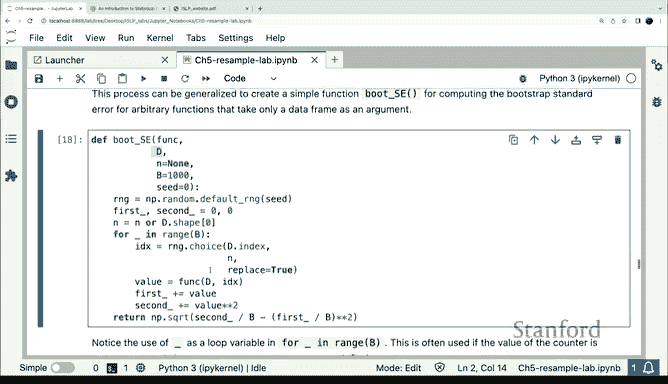

Stored the seed。 So our results are reproducible， but。

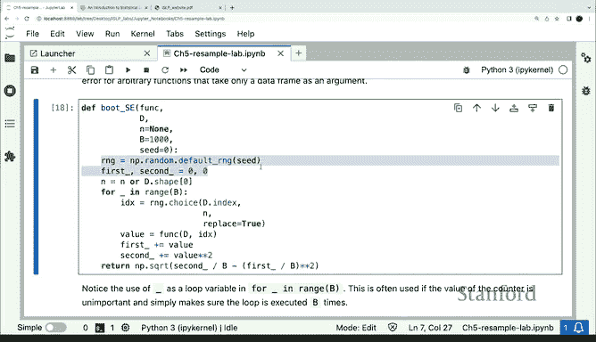

Okay， let's just run this on our example。

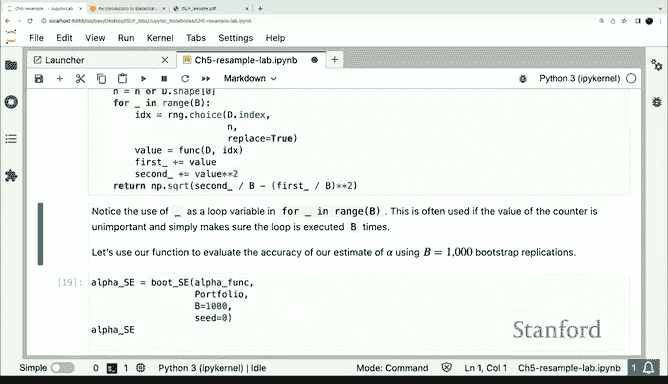

So we give the boot SE our point estimator， the actual and。The data set。

 And we asked for 1 thousand samples。

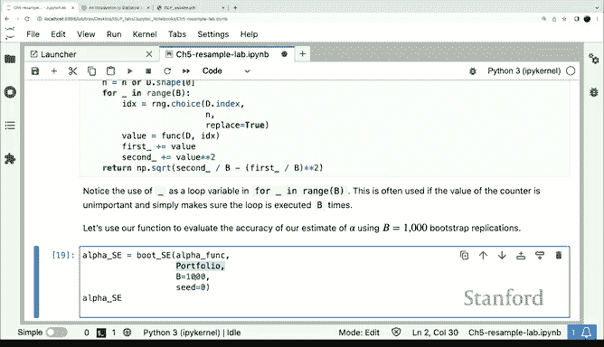

And it tells us the standard error， the bootsap standard error is about 0。09。

So if we wanted a confidence interval for the the true optimal alpha， it would be 0。

58 plus or minus twice0。09 would be a pretty good confidence interval。 And that was really quick。

 Did 1000。

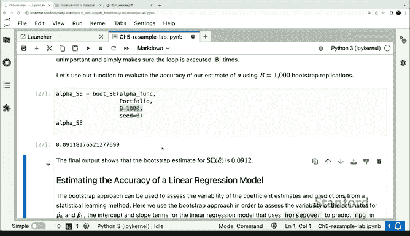

， it's a very simple function Yes， yes。

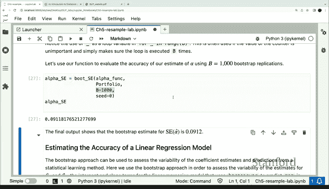

嗯。Alright。 So the rest of the lab here， we have an example of how to do bootsshop for linear regression。

 It follows a similar formula to above。 But the difference is that this。

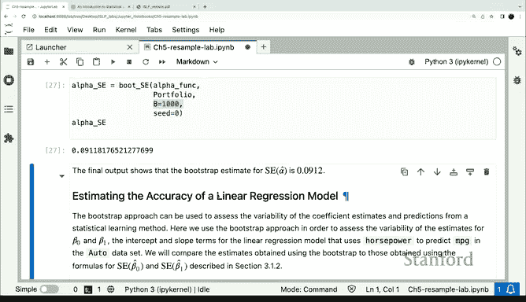

Function here is just a little more complicated。 It's a function that fits a regression model to a data frame in a set of indices。

 But other than that， it will follow this exact same。

 We'll use this boot essay to complete the standard error。 and we'll leave you that to do offline。

 and the bootsshop is really useful。The idea is that it's， it's a straightforward method to， to use。

 but it can work on fairly complicated functions， And you can get the standard error of these functions。

 Yes， I like to call it auto magical。 Auto magical。 or auto magic I it automatic。

 because it's just magical。 And as you know， the bootsottrap was invented by professor Brad Ephron。

 whos a professor in our department， is now Meritus， but he invented the bootsottrap。

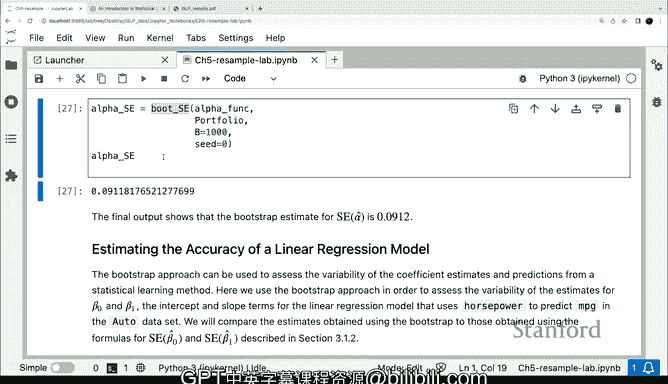

