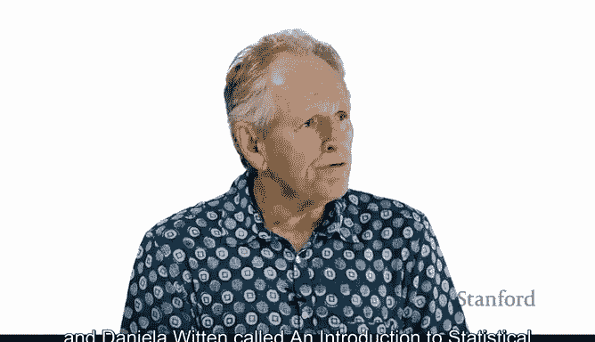
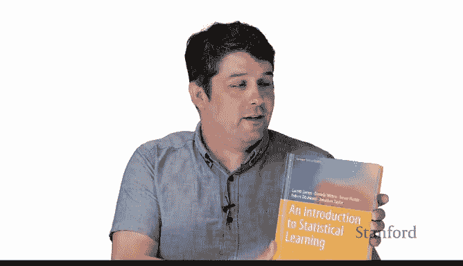

# 斯坦福大学《统计学习导论2023Python版｜An Introduction to Statistical Learning with Python》中英字幕 - P3：-003-Statistical Learning I Introducing Jonathan - Third Edition of the Course I - GPT中英字幕课程资源 - BV1u4421A7ZU

Unlike your new haircut drum makes you look years younger。 Trevor。

 I think you need a better put on your glasses。😊，Welcome Jonathan Taylor to this statisticalt learning team。

The statistical Learn edX course was developed by Rob Tipsrai myself in 2014。

 with an updated edition in 2021。The course explains the concept of statistical learning。

 and it is based on our book co authorored with Gareth James and Daniela Whitten called an Introduction to Statistical Learning with App in R。

The second edition was published in 2021。Here we present a new course。

 statistical learning with Python， along with our new coauthor and Python expert， Jonathan Taylor。

Thank you， Jaor。The course is based on our new book on introduction to statistical learning with applications in Python In the course and in the book。

 all the labs at the end of each chapter are implemented in Python。

 We provide Jupiter Python notebooks， as well as a Python package ISLP。

 The package contains all the dataset sets used in the book。

 along with many new and useful tools for statistical modelling。

はい。Wsers， Jonathan， I'm so excited about this book。of wowsers， That's a bit sus Trevor。

 I think that goes back to the 80s。😊，Of。You're right。Eat。Great to have you on board， Jonathan。

Jonathan is an early Python adopter and has made many contributions to the community。

Like the earlier book， the PDF of this book is available for free from the Stat Learning website。

 along with Python resources。 We hope you enjoyed the class。

