# 斯坦福大学《统计学习导论2023R语言版｜An Introduction to Statistical Learning with R》中英字幕 - P40：-040-Statistical Learning_ 6.7 The Lasso.zh_en - GPT中英字幕课程资源 - BV1yU421o7WA

。嗯。And we just said this that when drawback of ridge regression。

 it doesn't actually select variables and set things to zero， as you said。

 in situations like that previous picture。Where things are small。

 it be nice if they could just say these are 0。 We can forget about them。

So the Laso is a more recent technique for shrinking coefficients and regression。

 it looks very much like Ri regression， but with one change。

 so here's the lastO criterion again we have the RSS。As before。Now we have a penalty。

 whereas before the penalty was the sum of the squares of the coefficients。

 it's the sum of the apps who values the coefficients。

So it's a shrinkage towards zero using an absolute value rather than aem of squares。

And this is called an L1 penalty in by analogy to the L2 penalty， the L1 penalty is just。

To some of the absolute values。It's a norm， but it's called the L1 norm rather than the L2 norm。

So what's the effect of changing this from a square to an absolute value。

 it's actually a small change， but it's quite important。嗯。Turns out that。The lasso。

 like the ridge shrinks toward zero。But it has the effect of actually setting variables。

 the coefficients of variables exactly equal to zero when lambda is large enough。So it's neat。

 it shrinks， but also it does subset selection in a similar way to best subset selection。

 so it'll set coefficients to zero exactly if that feature is not important and Lada is large enough。

So we say that this's a term for this it's called sparsity。

 so the last I use was called sparse models。Models which only involve a subset of the variables。

And again， it's a function of this tuning parameter lambda。

 which as in rigid graph we have to choose somehow。And well do so by cross validation。So wow。

 the lastza seems like a really good idea， so clever I wonder who came up with it Rob thanks so Danielle was trying to embarrass me。

 this so this is actually a paper that I wrote in 1996 and it's become at the time actually it was published and didn't get a lot of attention but。

In the last about 10 years or so it's become a very hot topic both in statistics and computer science and other areas。

 and it's been a lot of work in sparsity in general， not just in regression。

 but the use of L1 pens in a lot of different areas。

 I think one reason for it's popularity now is computation。This computation is actually。

 this is what's called a convex optimization， so that's good news and there's a lot of work in convex optimization。

 especially in the last 10 or so years and along with sort of the progress in conVvex optimization and fast computation。

 fast computers，People can solve this problem now a Laso for very large values of P&N。

And this has actually just been a fun thing that I've even seen like when I started grad school。

 you know there was like one approach that sadtisticians were using to fit this model and this was a famous paper that had just come out when I started and it was written by Rob and Trevor and a few other people at Stanford and statistics and then a new paper came out with a better idea and then 20 more papers came out with better ideas for how to fit this model and this has suddenly become something that anyone can solve on their laptop no matter how big your data is basically。

 and so it's just become an incredibly useful tool in a way that it even wasn't when I started grad school so we'll talk about GLMNe which is in our library which we use a lot in this book and in the book in the course and will show you how you can solve a problem like solve the lastso using GLMnet in R。

Again， where the numbers of variables might be in the tens of thousands， you can solve it in。

On a standard desktop computer in less than a minute。

 so we'll talk about the computation later on in the course。

But let's foresee what it looks like in the same example now， so again， the credit data set。

Andre plotting。The standardized coefficients is a function of lambda for the last so。Again。

 we haven't talked about how to choose Lada， and that's going to be important。

 we use cross foundation， but let's for now look at the solutions as a function of Lada for all values of lambda。

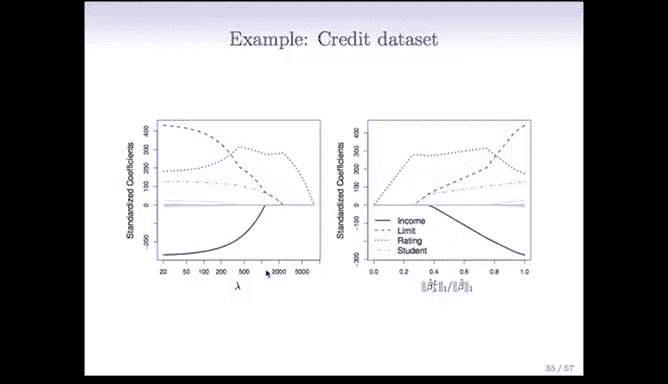

And now you can see， again， when lambda is small。

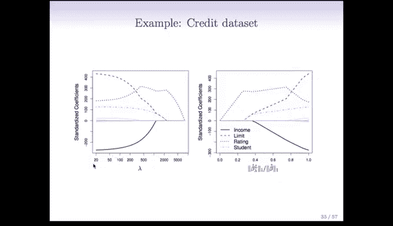

We get essentially the full least squares estimates。 Well lamb to 0， we get exactly least squares。

 If I had plotted this all the way to the left。And I was an increased lambda would get shrinkage。

As we for Rige regression， but something special happens at this point， for example， here。

Beyond this point， all these gray variables are exactly the coefficients are exactly zero。

Whereas for this regression， they were small， but they weren't zero。

 so it's actually we can tell it tells us。You can throw away all these variables at this point。

 and just retain。These three， the blue， red and orange。Similar。

 this plot shows you the sampling thing in the other direction。

So it's a combination of both shrinkage and selection of variables。

And so one thing that's worth mentioning is that in a lot of applications。

 selecting variables is actually really important because， you know， let's say I'm working with。😊。

A doctor who wants to come up with a really good way to test for some particular disease and he might start out by getting 30。

000 gene expression measurements for patients with this type of disease。

 so he starts out that with P equals 30，000 and he wants to find a really great model that can be used to test for this disease but when push comes to shove and he's actually going to use this test in the clinic。

 he doesn't want to test that involves all 30，000 genes because a test like that would be too expensive it just wouldn't be feasible to actually use but if he can get a test that works really well that only involves six or eight or 25 genes that could be a real breakthrough in testing for this disease and so just from a practical perspective the Laso is just hugely useful because it allows us to efficiently find these types of sparse models that involves just a really small subset of the features be a personal sales salesman。

Doing a good job， but seriously I mean and Danielle is right and I myself I use alaso in schools and projects here at the medical school。

 and it's very satisfying you to apply it and to see it helping scientists to find the signal in their data and come up with interpretable subsets among their。

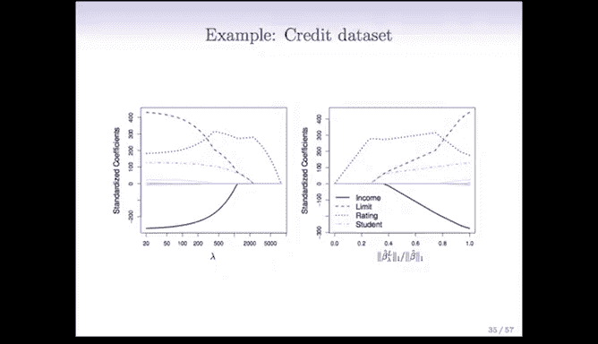

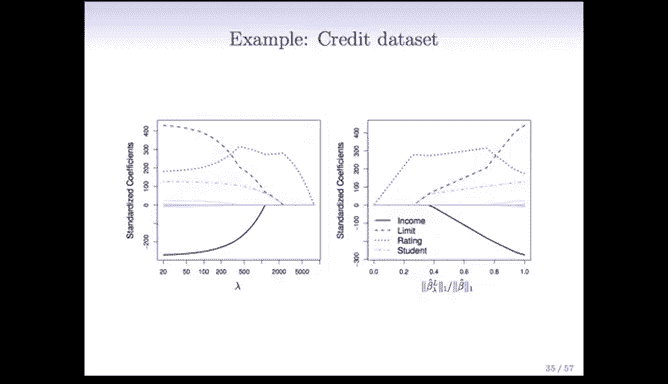

The thousands of features they present to me。So。At this point it might seem like like magic。

 why is it that this using absolute value penalty gives us the sparsity property。

 why do we get exactly zero and I'm going to show you that in the picture， so let's think about that。

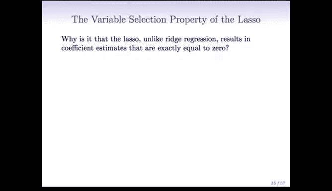

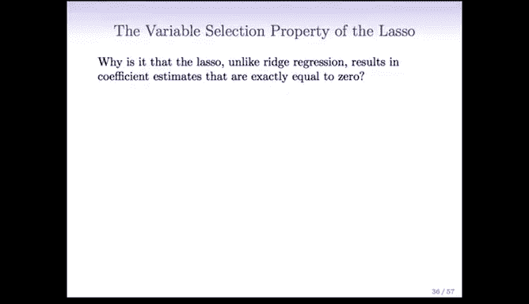

First of all， we can formulate the problem in an equivalent way rather than putting a penalty。

Then before I had the RSS plus lambda times the some the absolute values。

An equivalent way to say the Laso is to pose the LaO problems to say minimize the RSS。

With a constraint。A budget on the total L1 norm of the coefficients。

So this is an equivalent problem in the sense that if you give me a budget S。

 there's a Lada in the previous formulation that corresponds to the same problem and vice versa。

And by the way， if that looks like a total mystery。

 if you can reach back to your distant or not so distant past。

 if you ever took AP calculus and you saw LaGrange multipliers in high school。

 this is really something that you might have truly seen in high school calculus a long time ago but for simpler types of problems and this is just a more complex application of that same idea in a way that its bound form is to me more intuitive than the Lagrange form because it's think of it this way。

 suppose that you do fully squared and you get a certain answer and I tell you and let's suppose that sum of the absolute values your coefficient is10。

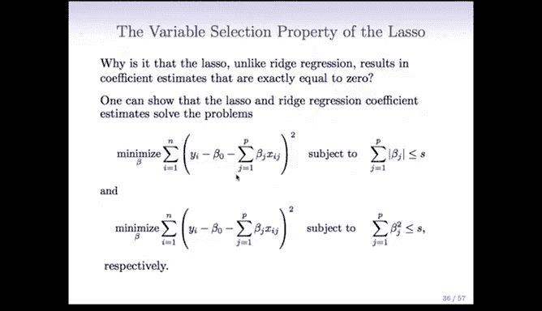

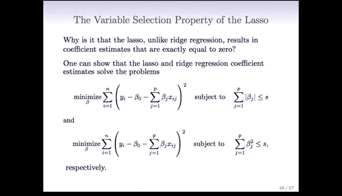

So you give me an answer and I say，  well actually。I want want to make your budget smaller。

 you've spent too much coefficient。 So rather than 10， I want to give you a budget of maybe five。

So now I ask you to solve the same problem but you're not allowed to use the coefficients as large as you want the total budget you have is five and that's the bound here。

 So the lastso is giving you a budget on the total L norm you can spend and within that budget you have to fit as well as possible and as that budget gets smaller and smaller the coefficients gets smaller and smaller if the budget is zero the coefficients have to be0。

If the budget is large enough， you're free to use fully squares， but in between。

 the budget's going to trade off。

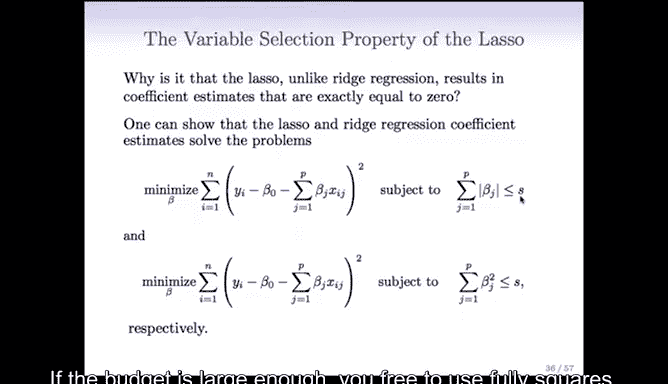

The size the coefficients where they fit。

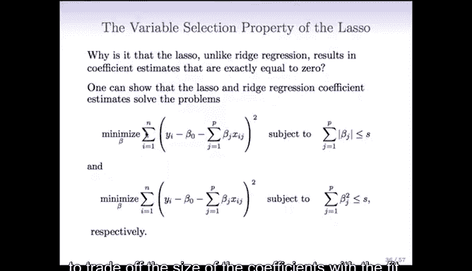

So I think it's quite an intuitive way of looking at these problems。For richge regression。

 you get exactly the same analogy， but now the budget is in terms of the sum of squares。 So， again。

 this is equivalent to the。

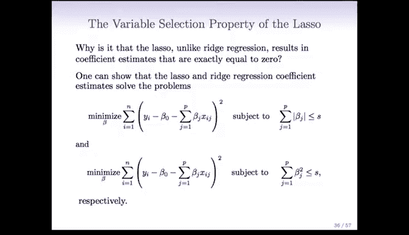

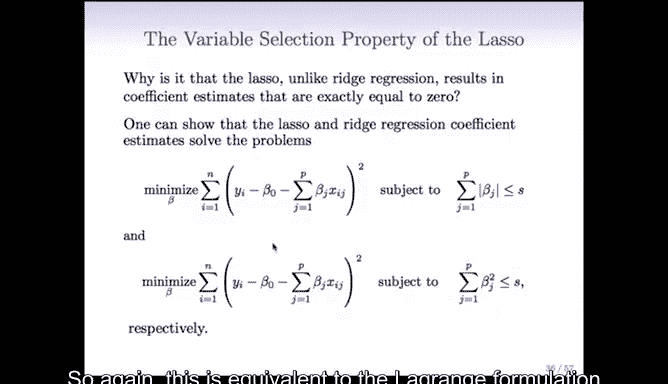

The Lagrange formulation for Rirgress we saw earlier。

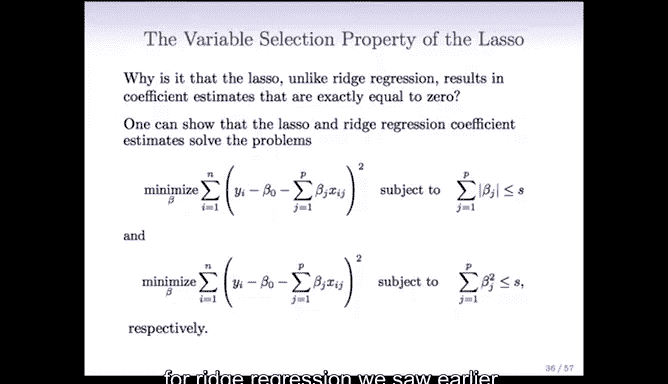

But the reason we all want to bring this up is this following picture， which。Helps to explain why。

The lasso gives sparsity， so on the right is Rige regression。

And on the left is the Laso this's a bit more mathy than most things in this course。

 but hang in there and I think if you do there'll be some payoffs。This picture is Rige regression。

 So what's going on here。 this， first of all， P is 2。 So there's two coefficients。

And I've indicated here the fully squares estimate， so if there was no penalty。

 I just did least squares on the two variables， I'll call the solution beta hat。

 and that's this point。And now the sums of squares。In the RSS。The contours of that function。

It's lowest here because that's the least squares estimate， but now as I move away。

 if I think of this as maybe a serial bowl and I slice a serial bowl， here are the contours。

 so here's the value which RSS is a bigger value。 This next contour is a higher contour of RSS。

 So these are the contours of RSS as I move away from the minimum。

And。😔，This is the constraint region， remember in Ri regression and this formulation here says you have a budget。

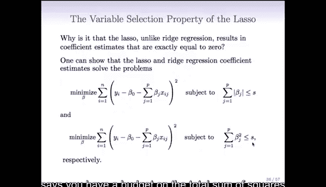

On the total sum squares of the be。So the budget is the。The radius of a circle， right？

IHere I have a fixed budget。In words， the ridge problem says。

 finally the first place these contours hit the constraint region。

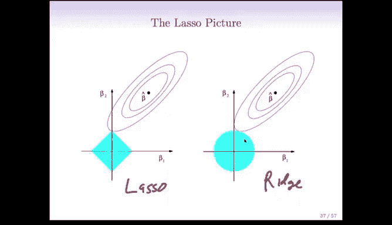

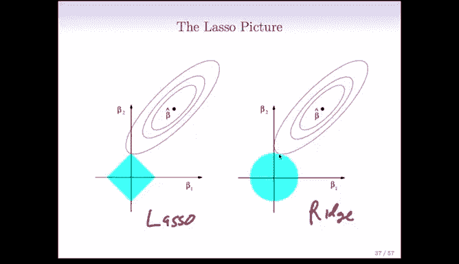

In other words， find the smallest Rs you can get。

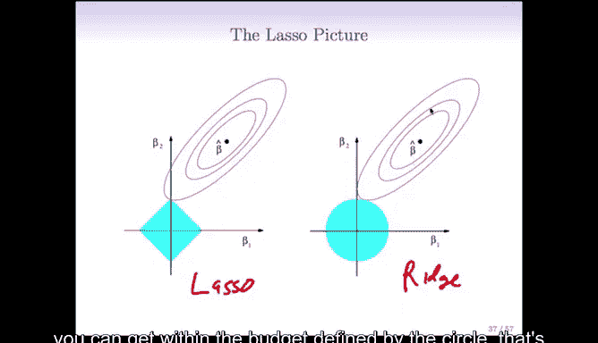

Am。Within the budget defined by this circle。

That's Rige regression。 And the solution in this picture is right here。

So this is the ridge estimates for this budget and the data。

 this particular data and the data is determine the shape of these contours and the location of betahat。

So。Riddge regressionrationion says finally the first place the conrontours hit this constraining region。

 it's this solution， and you can see because the constraint region， the sum of squares is a circle。

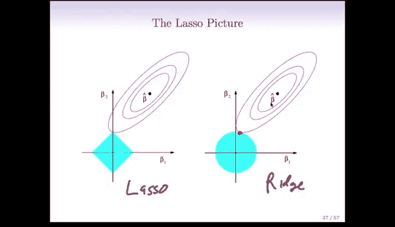

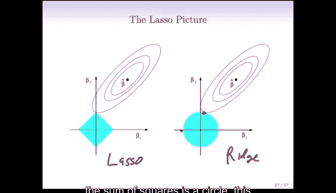

This is where the sum of squares of。Beta 1 and beta 2 is less than a budget。 It's a circle， right。

 And unless you're very lucky that you're not going to hit exactly at a place where。

One or the other is zero。Now let's move over to the Laso， same picture， least squares。

 same thing the sum of squares function is the same， all the same up here。

 but the constraint region is now the sum of the absolute values。

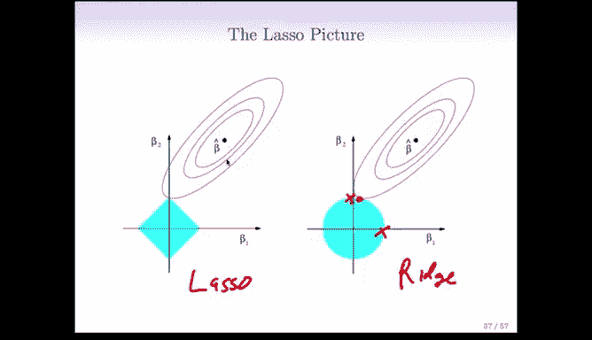

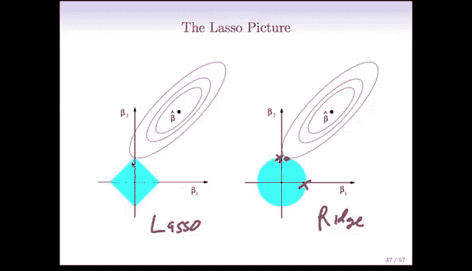

So rather than a circle， it's a diamond。A diamond has corners。So in this picture。

 I've hit this corner and now I get a place where beta is beta 1 hat is 0。

 so here's the lastso estimate。

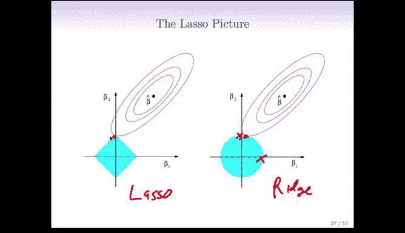

So I was to summarize the absolute values give you a constraint region that has sharp corners and high dimensions you have。

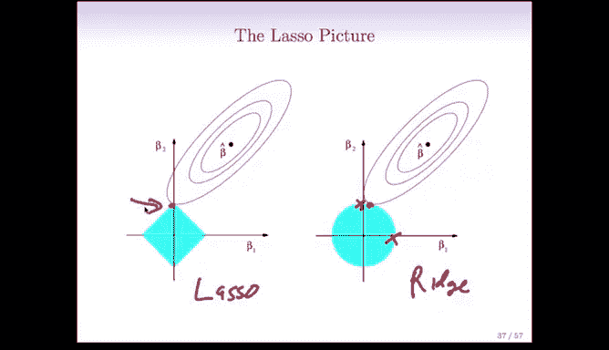

Edges and corners。And along an edge or corner， if you hit there， you get a zero。

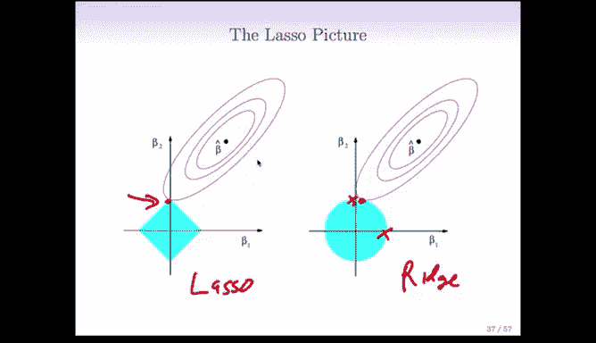

So。This is geometrically why you get sparsity in the Lasso。

So here's， oh， sorry。Here's our case， first of all the returning example where we had 50。

 let's was it 45 variables and they all had nonze coefficients。So now I'm looking at。Comparing。

The Lasso to Ridge。So on the left picture， for the last so we see the bias variance and mean square error as a function of lambda。

And the right， we've superimposed the biased variance and musical error of ridger with a broken line and the lasal。

And we can see that overall。 So again， the solid line here for mean square air is the last so。

 the broken line is ridge。They're very similar ridges a little better， perhaps，'t。

We don't do much better。 We don't do better at all with the lastso here。

 And the reason is is that we've got the the true model is not sparse。

 The true model actually involves。45 variables， all of which have been given non zero coefficients in the population。

So it's not surprising that we don't do better than Ridge in this case and one thing we should mention is on this right hand panel the x axis is something we haven't seen before。

 which is the r squared on the training data and the reason we have that x axis is because in this figure on the right hand side we're plotting both ridge regression and the Laso so it wouldn't make sense to know show rid regression and the Laso with lambda on the x axis because the lambda means two different things for those two models so when we look at r squared on the training data on the x axis that's kind of a universally sensible thing to measure regardless of what the type of model is。

You must have drawn this picture in a book Yeah， I made this picture it's a thank you， yeah。Okay。

 I would have noticed that detail otherwise， okay。Now， here's a situation where we do。

 we do perform better with the Laso。 And this is a case where now in the population。

 only two of the preors have nonzero coefficients。 So the previous situation was。

Was dense or non sparse。 This situation is sparse。 there's only two predictors in the true model that are nonze coefficients。

And now we can see what happens well。The lastso mean square error here is minimized for quite a large value of lambda。

Because it wants to make the model sparse as it needs to， there's only two non zero coefficients。

And now when we compare the La Otra Rige。Remember， Rige is the broken line。

And the last so is a solid line。You can see we do quite a bit。 here's the Laso mean square error。

 and there's ridge。Is here。You can see we're doing quite a bit better using the Laso in this situation and again it's not surprising。

 the true model is sparse， so it pays to use a technique which encourages sparse models coming out of its estimation whereas。

With Ridgege you don't get a sparse model， we get a dense model。So in conclusion。

 comparing these two techniques， as is usually the case in most things in statistics and science in general。

There's no rule that there's no simple rule that means that you always use one technique over another。

 it depends， you always hear that from staisticians， it depends。It depends on the situation。

In this particular case。If the true model is quite dense。

 most predictors are not have non-zero coefficients， we expect to do better with ridge。

 If the true model is quite sparse， only a few coefficients have neurons are non-ze。

 then the lastso can be expected to do better。 Of course。

 we don't know that usually we hope actually that things are sparse because life is simpler then。

 but going into a data analysis。 we have no idea whether the true number of coefficients。

 No-zero coefficients is large or small。

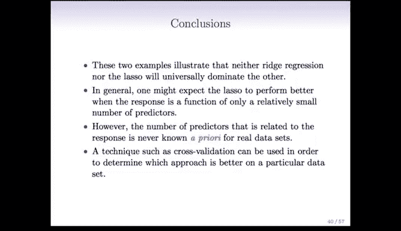

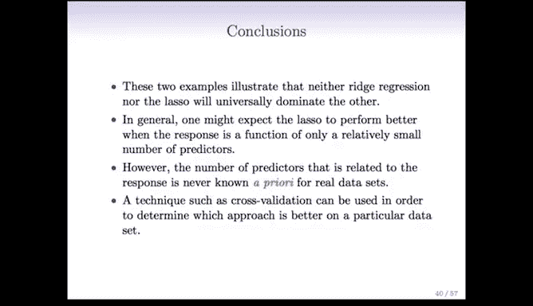

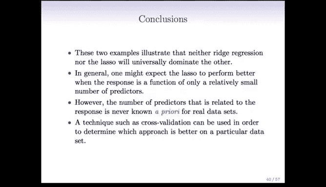

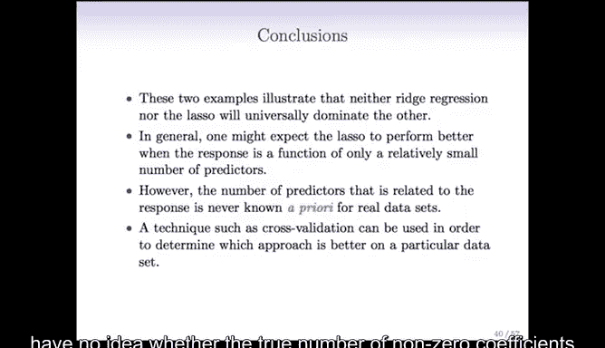

So we have we use。It's typically good to apply both methods and use cross validation to determine the best model coming out of each method。

 and then compare the cross validated error for the two methods。

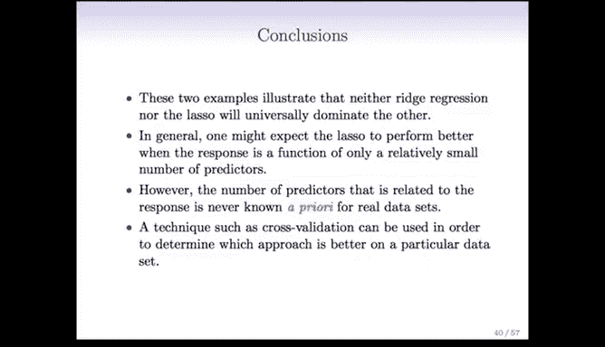

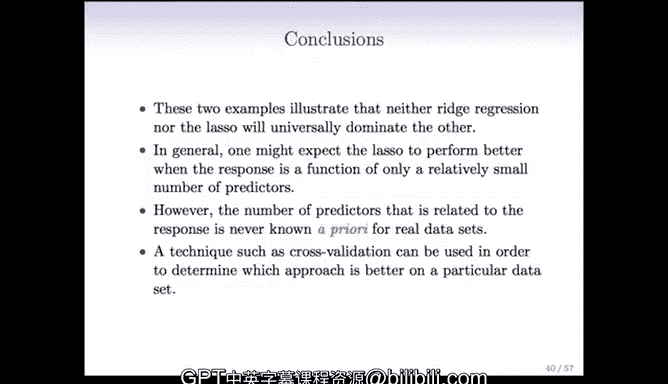