# 斯坦福大学《统计学习导论2023Python版｜An Introduction to Statistical Learning with Python》中英字幕 - P42：-042-Statistical Learning_ 6.3 Backward stepwise selection.zh_en - GPT中英字幕课程资源 - BV1u4421A7ZU

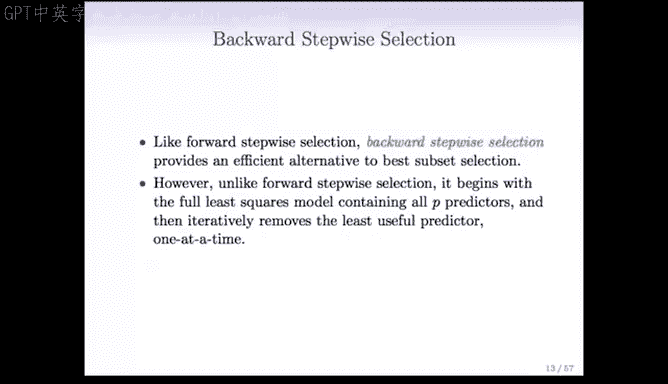

。So that's forward stepwise selection and now we're briefly going to talk about backward stepwise and backward stepwise is once again just like For it's an efficient alternative to best subset selection。

 but it actually is exactly the opposite of forward Stepwise so remember in forward Stepwise we built the model M0 and then we added a feature to get M1 and added a feature to get M2。

And in contrast for backward stepwise， we're going to start with MP。

Whi is the model containing P predictors， and we're going to remove predictors one at a time。

 one at a time until we get to M0， which is the model with just an intercept。

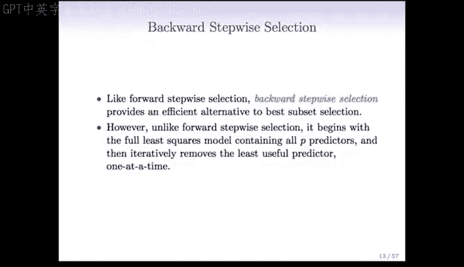

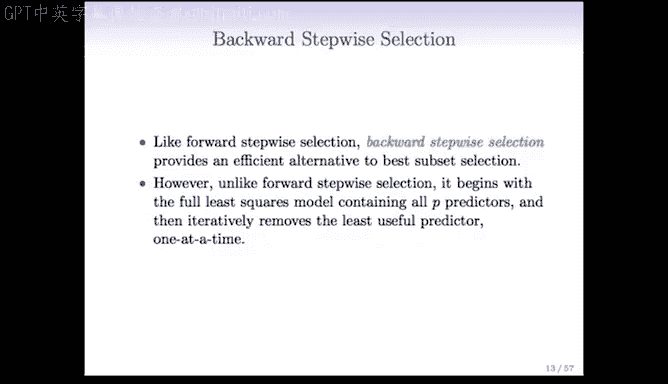

So in a little more detail， we start with MP， which is just the regular least squares model if you just didn't do any feature selection and you just wanted to use all of your predictors。

And then we're going to take that model MP and we're going to consider removing predictors one at a time。

 excuse me we're going to consider removing each of the P predictors and we're going to see which predictor is the least useful to us。

 which predictor can we remove that's going to have the smallest effect on either RS as or R squared。

So we're going to remove the least useful predictor and that'll give us the model MP minus1。

And then we're going to take MP minus1 and we're going to again ask which predictor is the least useful。

 which one can we remove in order to have the least detrimental effect on our model fit。

 and we're going to keep doing this until we make it down to the model with just one predictor M1 and finally to the model with no predictors。

 which is M0。

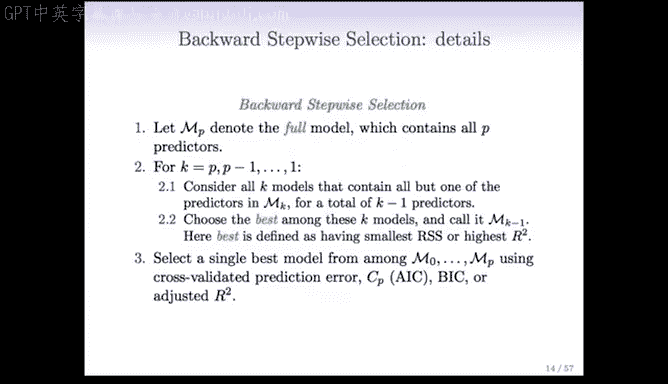

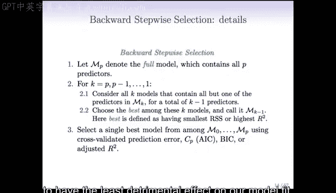

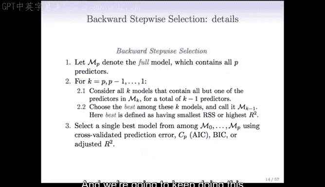

So that's once again going to give us a set of models from M0 to MP。

And we're going to choose among them using once again， cross validation， AIC， BIC。

 or adjusted r squared。

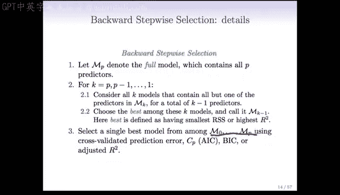

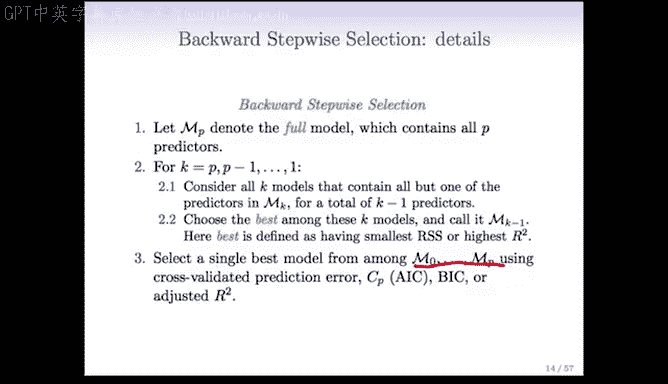

So just as was the case for forward stepwise selection。

 backward stepwise considers around p squared models instead of two to the p。

 so it's a fantastic computational alternative to。

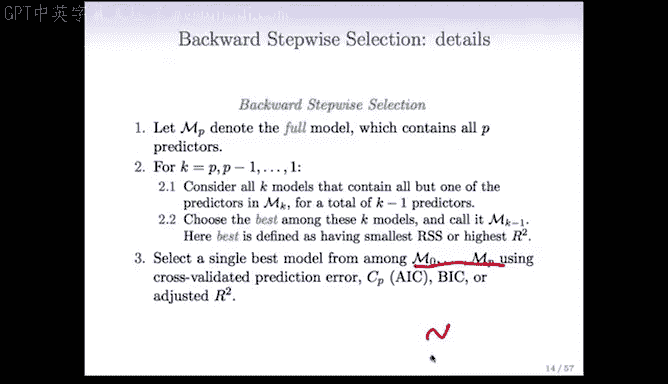

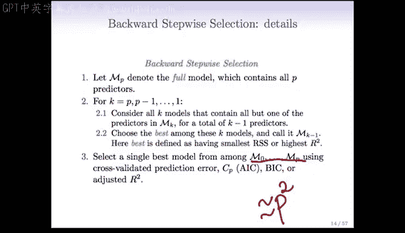

To best offset selection， especially when P is moderate or large。

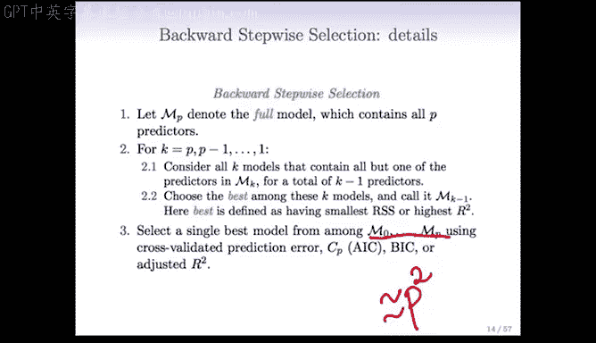

And actually the exact number of models that backward selection considers。

 you know I've been saying it's around p squared， it's actually more like p squared over two that's the exact formula and that's a good thing to work out at home so you know think about it。

 why is it that if you do forward stepwise selection or backward stepwise selection you're actually considering。

😊，This number of models。So just like forward stepwise selection。

 backward stepwise is not guaranteed to give us the best model containing a particular subset of the P predictors。

 so it was that same picture that Rob through a few minutes ago where we saw that forward stepwise for any given model size might give a larger RSS or equivalently a smaller r squared than best subset。

So similarly， backwards stepwise might not give quite as good of a model in terms of RSS or R squared。

But that can still be okay and in the long run it could give us better results on a test set。

 not to mention it's more computationally efficient。So one major difference。

 as we mentioned between backward and forward step wise is that with backward step wise。

 we start with a model containing all of the predictors。So in order to be able to do that。

 we need to be in a situation where we have more observations than variables。Because remember。

 we can do least squares regression when n is greater than p， but if p is greater than n。

 we cannot fit a least squares model， it's not even defined。

So we can only do backward selection when n is greater than P。And in contrast。

 we can do forward stepwise， whether n is less than p or n is greater than P。hoops。

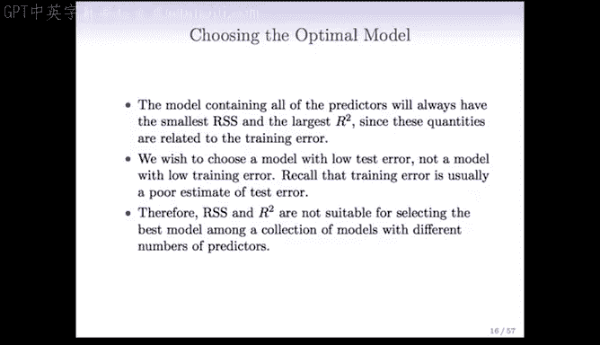

So。We mentioned that。

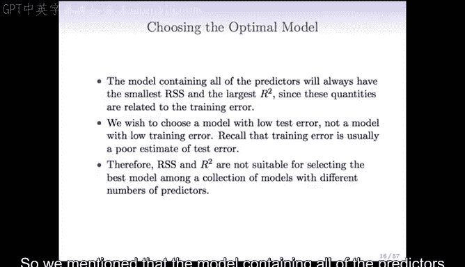

The model containing all of the predictors is always going to have a smaller r squared。

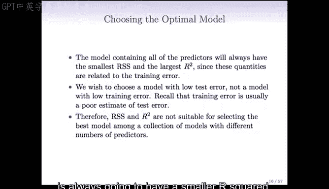

Excus me， the model containing all of the predictors is always going to have a smaller RSS and a larger R squared than any other model because these quantities are really related to the training error。

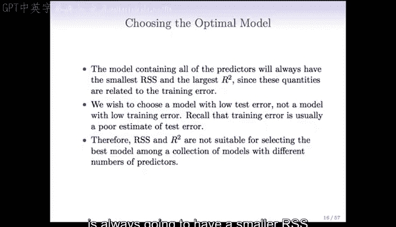

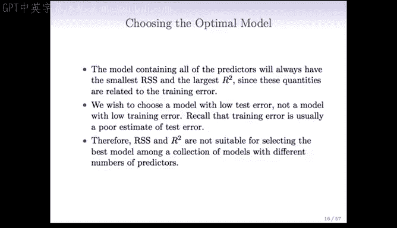

So again， this is the picture that Rob drew。

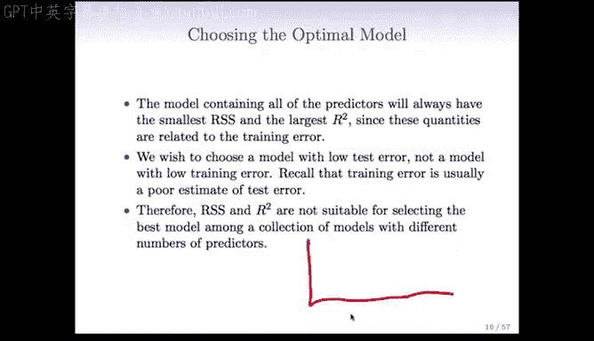

But if I think about fitting a model with a number of predictors on the Y axis。

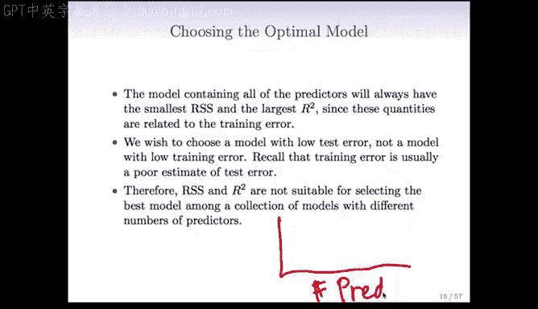

And RSS on the。If I think about fitting a model with number of predictors on the x axis and RSS on the Y axis。

 this is going to be monotone decreasing。And similarly。

If I think about a picture with number of predictors on the x axis and r squared on the y axis。

 it's going to be monotone increasing。So remember when we do best subset or forward or backward stepwise。

 we end up with these models M0 through MP。I cannot just choose among them using R squared or using RSS because I'll always choose the biggest model。

 and again， that just boils down to the fact that these quantities are just based on the training error。

But I want to model with low test error because I wanted to do well on future observations that I haven't seen。

You know， patients who haven't walked into the clinic yet for whom I'm going to want to predict some sort of response。

And unfortunately， just choosing a model with the best training error isn't going to give me a model that has a low test error because in general。

 training error is a really bad predictor of test error， a really bad estimate of test error。

And so RSS and R squared just are not suitable for the task of choosing among models with different numbers of predictors。

