# 斯坦福大学《统计学习导论2023Python版｜An Introduction to Statistical Learning with Python》中英字幕 - P43：-043-Statistical Learning_ 6.4 Estimating test error.zh_en - GPT中英字幕课程资源 - BV1u4421A7ZU

。So what I need is actually a way to estimate the test error。For each of these models。

 M0 M1 M2 all the way through MP so that I can choose among them。And basically。

 in order to estimate the test error， I have two approaches。

And one approach is that I can indirectly estimate the test error by somehow computing the training error and then adjusting it。

And the idea behind this adjustment is that if I can somehow adjust the training error to account for the bias due to overfitting。

Then that can give me。An estimate of。Test error that's again based on the training error。

 but somehow looks more like a test error。And the alternative approach is that I can try to directly estimate the test error。

 and I can do that using some of the approaches that are in chapter five of this book。

And those involve either cross validation or a validation set approach。

 and so that's a really direct approach to estimating the test error where I fit models on part of the data and then I evaluate them on a holdout set。

So we're now going to talk about both of these approaches。

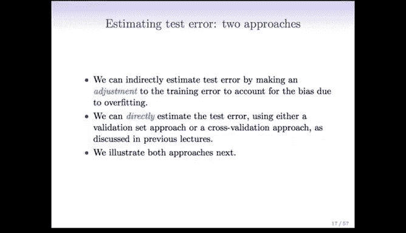

。So CP， AIC， BIC， and adjusted R squared all adjust the training error in order to give us an estimate of the test error。

And they all can be used to select among models with different numbers of variables。

So we're now going to look at a figure showing us CP。

 BIC and adjusted R squared for the best model of each size that we get using best subset selection on the credit data。

 so we're first going to look at this figure and then we'll talk about how these quantities are defined。

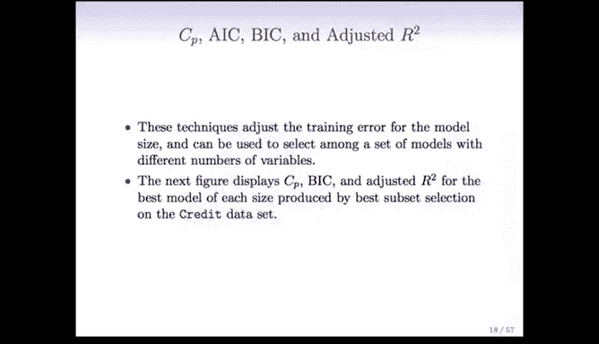

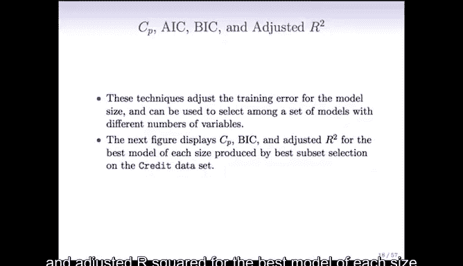

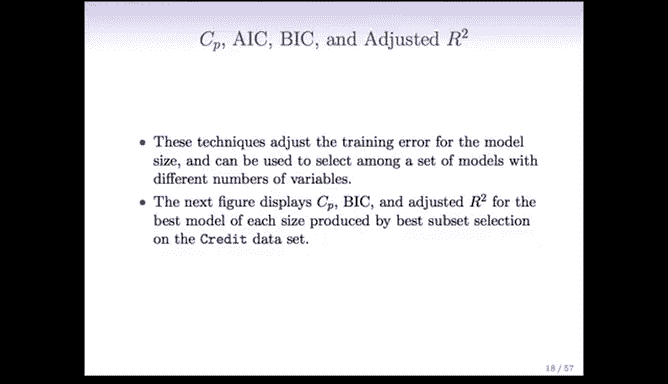

So again， this is on the credit data example。And on the X axis here。

 we have the number of predictors in each of these figures。And on the Y axis， we have CP。BIC。

 which stands for Bayesian Information Criiterion。And adjusted r squared。 and again。

 we'll define all three of these quantities in a minute。 but the idea is roughly speaking。

 we want these quantities to be small， so we prefer a model in which CP。

 B IC and are as small as possible。 and actually I misspoke we want adjusted r squared to be as large as possible。

So if I look at the shape of this curve， I can see that CP is minimized。😊。

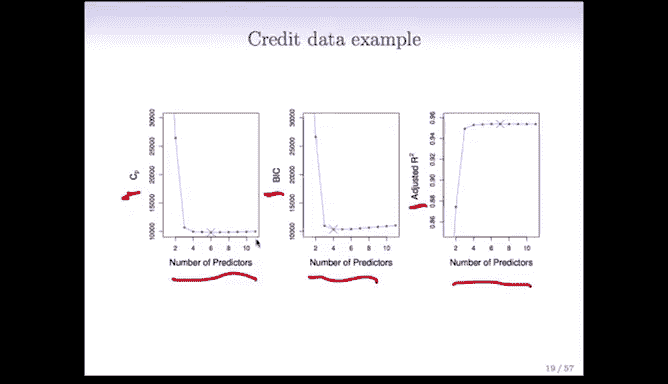

When we look at the model with six predictors。

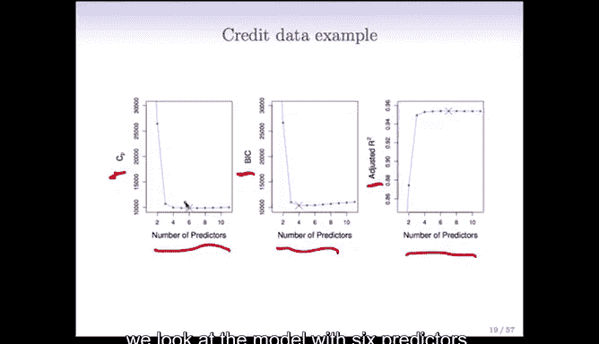

VIC is smallest when we look at the model with four predictors。

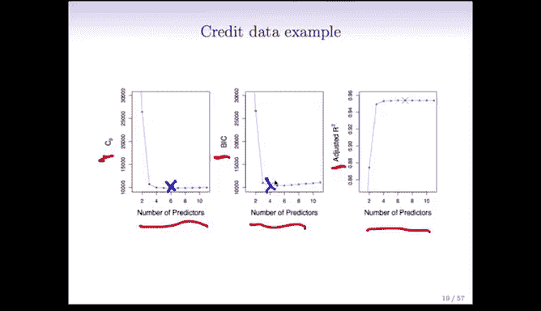

And adjusted r squared to smallest when we look at a model with six predictors again。

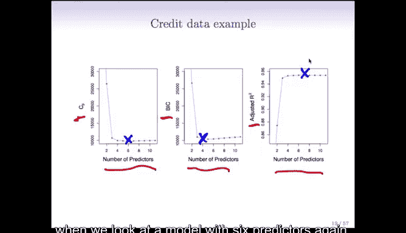

So that suggests that we should use somewhere between four and six predictors。

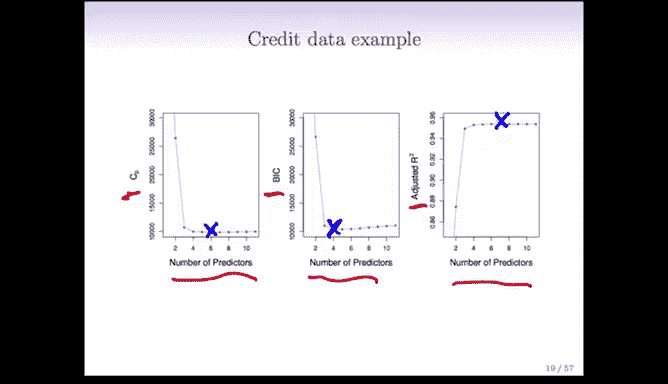

And actually， if we look at these figures a little more closely。

 we can see that basically these curves are more or less flat after we get to around three or four predictors。

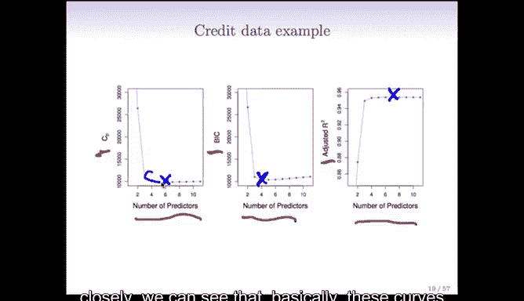

And so on the basis of these figures， I would say， I really don't think we need more than three or max4 predictors to do a good prediction on this credit data。

So， you know， and I've scribbled all over the slot whoops have something on this picture it's hard to see here。

 but actually the curve is going upright as we go to the right despite the fact it's flat That's right likeS exactly it's a little hard to see but this is slightly increasing at smallest with four predictors and then it goes up a little bit but you know I don't really think that there's compelling evidence here that four is really better than three or better than five so if it were me you know I think simpler is always better so I'd probably choose a model with you know three predictors maximum four predictors agree。

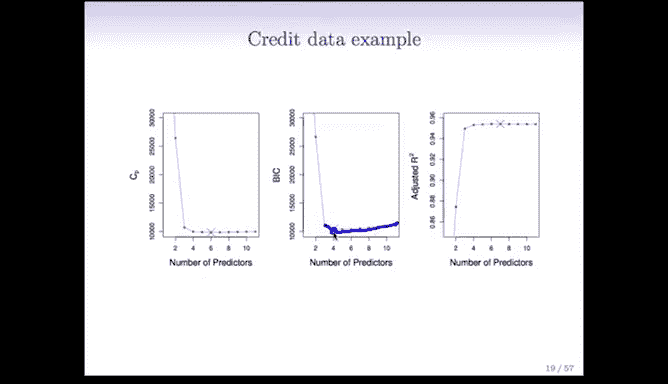

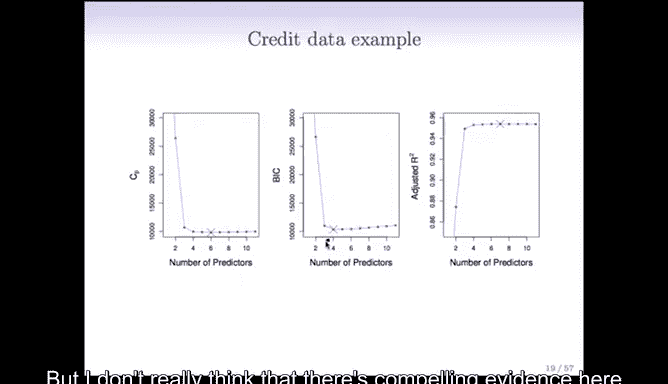

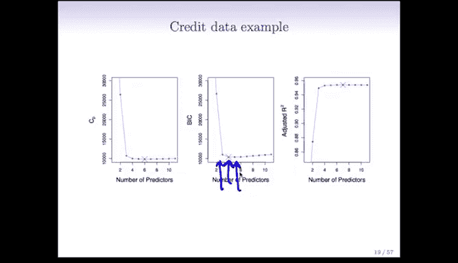

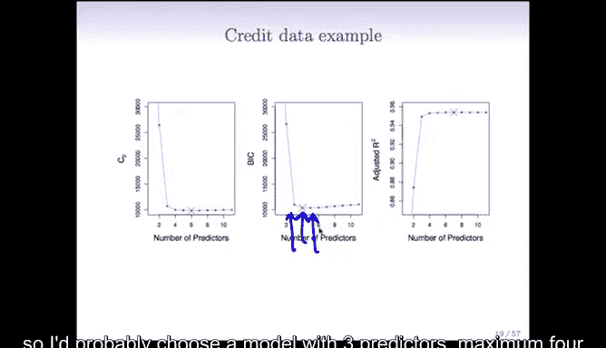

Great， so now we're going to talk about MalOCP， and once again this is an adjustment to the training R squared。

 the training RSS that gives us an estimate for the test RSS， and it's defined in this formula。

 so let's say we're looking at a model with D predictors。😊。

So then we're going to calculate the RSS for that model with D predictors。

 and we're going to add to the RSS2 times D。Where again。

 these the number of predictctors times sigma hat squared。

 where sigma hat squared is an estimate of the variance associated with each error epsilon in the linear model。

😊。

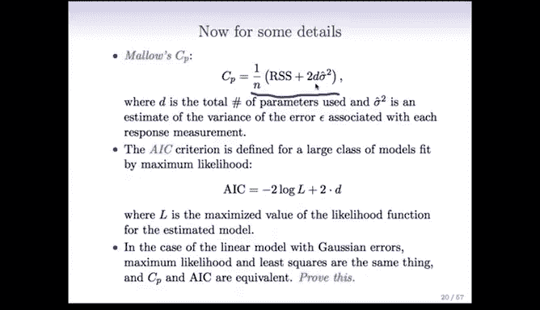

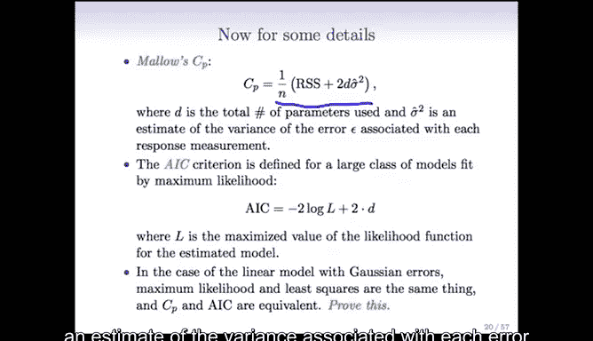

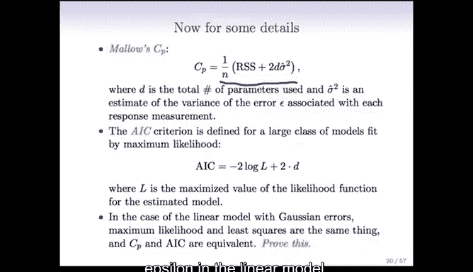

And so the idea is we can calculate CP for those models M0。

 M1 M2 through MP that we were looking at a few minutes ago。

And we can just choose the model with the smallest CP。So like if we're looking at the model M3。

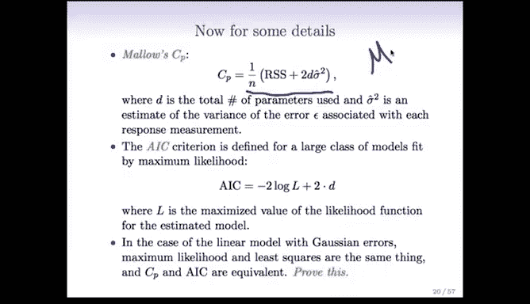

Then that model contains three predictors in an intercept， so that model has d equals 4。

And we can calculate the RSS for the Model M3， and we just calculate sigma hat squared。

 There's a formula for that。It gives us a CP。And out of all these models m0 to MP。

 we're just going to choose the one for which the CP is smallest because that's the one that we believe is going to have the smallest tests at RSS just to clarify a bit about the Sigma hat squared。

 first of all， if P is bigger than N we're going to have a problem right because。

Well typically sigma hat squared， the same values， the same estimates is used for all models being compared。

 so usually what I do is you fit the full model， all P predictors and you take the mean square residual for that model to give a sigma hat squared。

So that's the way you do it， and of course， that's going to create a problem in P bigger than N because that full model was not defined and the error will be zero。

So already we see that CP is restricted to cases where you've got n bigger than P。That's right。

And even a P is close to N， you're going to have a problem because you're asking the sigma squared might be。

Far too low。So that's Mallow CP， and then another very closely related idea is called the AIC criterion。

 so the AIC stands for a kiki information criterion。

 Akeki was the name of the guy who came up with this idea。😊。

And the way that this is defined is negative 2 log L plus 2 times d。

 where D is once again the number of predictors in the model that I'm looking at。

 so for M3 d equals4。And now capital L here is the maximize value of the likelihood function for the estimated model。

So this looks a little bit complicated， and in fact。

 it's written in this very general way because AIC is a quantity that we can calculate from many different model types。

 not just linear models， but also logistic regression and so on。

But it turns out that in the case of a linear model。😊，Negative 2 log L。

Is just equal to RSS over sigma hat squared。So if you look at that and you plug in RSS over sigma hat squared for negative 2 log L。

 then what you realize is that AIC。And mallow CP are actually proportional to each other。

And since we're just going to choose the model for which。CP is smallest。

 that's equivalent to choosing the model for which AIC is smallest。

So AIC and CP are actually really the same thing for linear models， but for other types of models。

 these things are not the same and AIC is a good approach。So we've talked about CP and AIC。

And another very related idea here is the BIC， where B stands for Bayesian so this is the Bayesian information criterion。

 and it's like the AIC and this MallowCP， but it comes from sort of a Bayesian argument。😊。

And once again， we've got a very similar formula， we calculate the residual sum of squares。

And then we add an adjustment term， which is the log of the number of observations， times D。

 which is once again the number of predictors in the model I'm looking at， so like M3。

 since it has three predictors in an intercept， M3 has d equals 4。

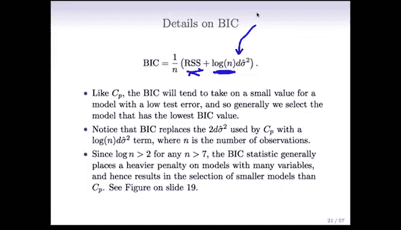

And once again， sigma hat squared is an estimate of the error of variance。

 which may or may not be available depending on whether n is greater than p or less than p。😊。

And so once again with BIC， we're estimating the test set RSS。

or rather the average tests at RSS across the observations。

 and so we want it to be as small as possible， so we're going to choose the model with the smallest BIC。

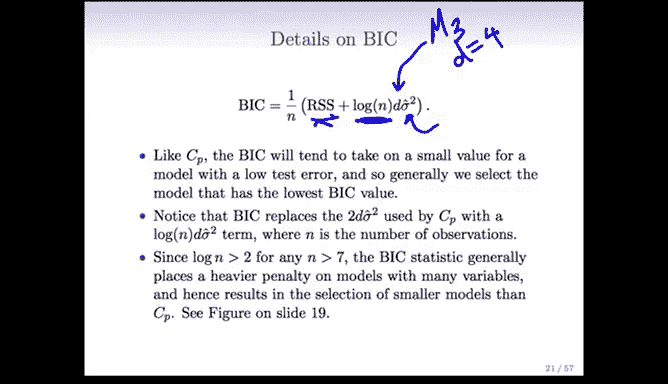

So what's the difference between BIC and AIC Well， remember AIC， it had it looked just like this。

 but in AIC， this term was actually 2D sigma hat squared， right？😊。

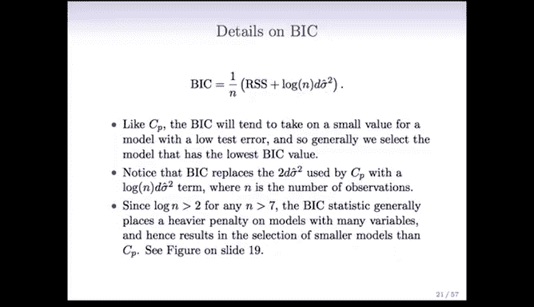

So the only difference between AIC and BIC is the choice of log n versus 2。VIC has this log in here。

And。And AIC has it too。And so in general。If n is greater than7。Then log n is greater than2。

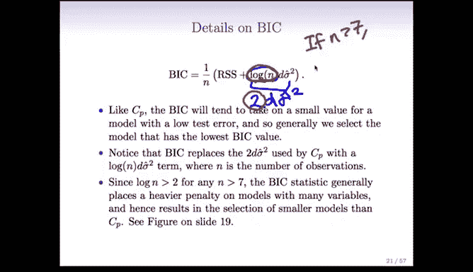

And so what that means is that if you have more than seven observations in your data。

 BIC is going to put more of a penalty on a large model， and in other words。

 BIC is going to tend to choose smaller models than AIC is。

So BIC is going to give you the selection of models that have fewer variables than either CP or AIC。

So we see that these three ideas， BICC， CP， and AIC are really almost identical。

 they just have slightly different formulas。They all we want to minimize them。

 and they all require an estimate。First Sigma had squared， which again， is not available necessarily。

If it's only going to be available if n is greater than P。

So the last of these approaches that I'm going to talk about that sort of indirectly adjusts the training error to get an estimate of the test error is the adjusted R squared。

And so we saw in chapter 3 the idea of the r squared。 And remember。

 R squared was defined just as a little refresher。R squared is defined as1 minus the residual summa squared。

Divided by the total summa squares。Where。In case we need a reminder。

 the total sum of squares is just the。S of Y I minus y bar squared。 So Y bar is the average response。

 Y I is the Ih response。 And we're just taking the sum of those squared values。

And so this was the r squared and as we know， a big r squared indicates a model that really fits the data well。

 but unfortunately models by you can't compare models of different sizes by just taking the one with the biggest r squared because you can't compare the r squared of a model with three variables to the r squared of a model with eight variables。

 for instance。So the adjusted r squared tries to fix this。

 and the way that it does that is that it makes you pay a price for having a large model。

 so the idea is adjusted r squared adjusts the r squared so that the values that you get are comparable even if the numbers of predictors are different。

😊，So the way that it does this is by adding a denominator。To the。To RSS and to T S S in this ratio。

 So so instead of just taking one minus RSS over TSS， we take1 minus RSS over n minus d minus-1。

Divided by TSS over n minus1。Where again， D is the number of variables in the model that we're considering。

And so basically the idea here。Is that when D is large， this denominator is really large。

 and so you're dividing the RSS by a really big number and you're going to end up with a smaller r squared。

So what's happening is that we're going to pay a price for having a large model in the adjusted r squared。

Unlike the classical r squared， where we pay no price for having a large model with a lot of features。

So the adjusted r squared， we want it to be large if it's large。

 then that indicates a model that really fits the data well。And again。

 the idea is that adjusted r squared is something that we can actually compare in a meaningful way regardless of the number of predictors in the model Some just notice looks like it doesn't require an estimate if Sigma squared。

 that's good and you can also apply it when p' is bigger than N Yeah， that's right。

 so that's a really nice advantage of RSS as Rob said。

 we don't need to estimate Sigma squared which can be a problem and in principle we can apply it when P is larger than n。

So we want a large value of adjusted r squared。😊，And and so the adjusted r squared in practice people really like it。

 it tends to work really well so some statisticians don't like it as much as CPAIC and BIC and the reason is because it sort of works well empirically but some statisticians feel that it doesn't kind of have the theoretical backing of some other approaches。

 what do you think of that Rob？that's true there is a bias in our field towards things which have more theory behind them and I guess this example of that but one nice thing about adjusted R squared is like if you're working with someone who's not a statistician like scientists who aren't statisticians are really familiar with squared and so from when to understand R squared adjusting r squared is just a really small one off and it's kind of easier to explain to someone in a certain sense then AICCP or BIC and so that's one really nice thing about it but adjusted R squared you can't really generalize to other types of models so if you have like logistic regression you can't do this so you'll see in the next section we' talk about crossfo which is our favorite method。

which you can generalitalize and one major advantages is you don't need to know D。

 so the D in this method in adjusted R squared and CP and AIC is a number of parameters。

 but some methods like Rige regression and the Lasso， which we'll also talk about，Again。

 in a few minutes the value of D is not even known so we can't apply any of these methods but cross validation can still be applied Yeah。

 that's true so like in this whole discussion I've been talking about least squares models and then I've been occasionally mentioning logistic regression but I could have some totally crazy model that I come up with that like is like something that nobody's ever seen before and it would be totally hopeless to apply an AIC type of idea to it or an adjusted our squared type of idea but I can always perform cross validation or the validation set approach no matter how wacky my model is and that's actually a really nice thing about those two approaches。

