# 斯坦福大学《统计学习导论2023R语言版｜An Introduction to Statistical Learning with R》中英字幕 - P43：-043-Statistical Learning_ 6.10 Principal Components Regression and Partial Leas - GPT中英字幕课程资源 - BV1yU421o7WA

。So by far， the most famous dimension reduction approach is principal components regression。

And principal components regression involves。A two step procedure in step one。

 we find what are called principal components of the data matrix X。

And we're going to cover principal components in detail in chapter 10 of the textbook。

 and so I'm not going to cover that in great detail here。So in step one。

 we get principal components and then in step two， we're just going to perform least squares regression using those principal components as predictors。

So basically， principal components are an interesting idea。

 and the first principle component is just the linear combination of the variables that has the highest variance。

The second principle component is the linear combination that has the largest variance。

Out of all linear combinations that are totally unrelated to the linear combination that we just got。

And so on and so the principal components give us linear combinations or dimensions of the data that are really high in variances and that are uncorrelated to the ones that we previously got。

And so the idea is that if you give me a data with 35 variables。

 I can compute a few principal components and those might capture most of the variation in the data。

 but in a very succinct way， involving just a few new variables，1 through Z3A or Z1 through Z4。

So here's an example of principal components analysis on a very simple data set that we saw in chapter three already。

And so what we're showing here is a plot where the X axis shows population and the Y axis shows ad spending for 100 different cities。

And so those are these purple dots and so this is a simple data set with just p equals two variables and so I can say all right。

 what's the linear combination of these variables that has the most variance or equivalently what's the direction along which this data varies the most and so we can see that the direction in which the data varies the most。

 actually falls along this green line this is really the direction with variation in the data and so that's actually the first principal component direction。

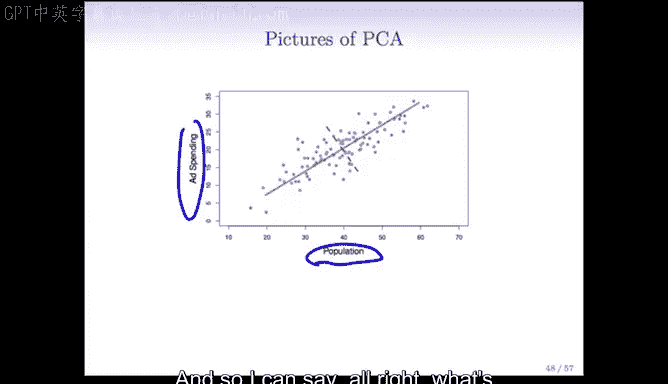

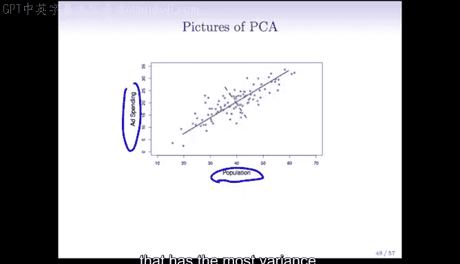

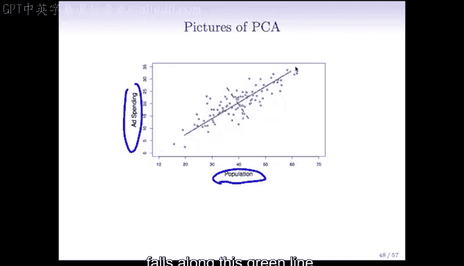

And then if we say， hey， what's the direction along which the data varies the most out of all directions that are uncorrelated with that first direction。

 that's this blue dashed line here。And so that's the second principle component in this data so in this example P equals two and there's only two principal components。

 but in general in a data set with lots of variables if P is large。

 there's a lot of principal components and we can look at the first one or the second one or the third or the fourth。

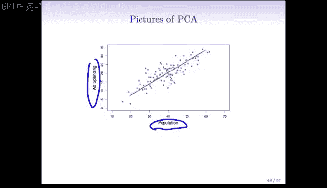

And so on。So here's sort of a zoom in a little bit on what's happening here。

 and the idea is in this on the left hand side here。

 we just have about 20 locations shown as purple circles。

And the reason that this green line here is the first principle component is because it's the direction along which the data varies the most。

 It's the line such that。

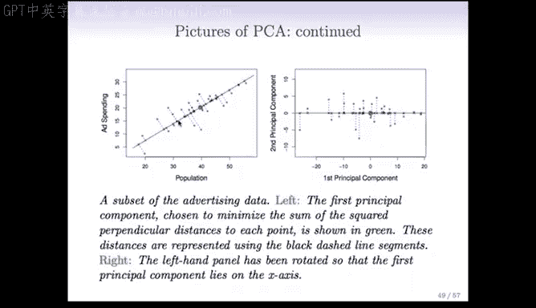

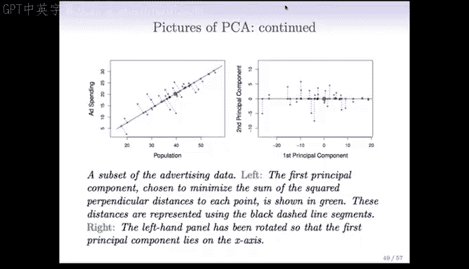

That。😡。

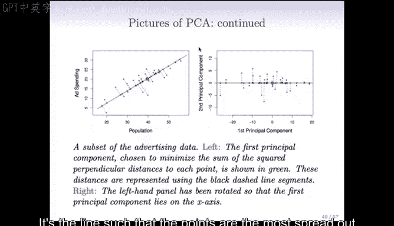

TheThe points are the most spread out possible along the line。 if I drop each point to oops。

If I drop each of these locations down to the line。

 then this sum of square distances is really as large as possible。

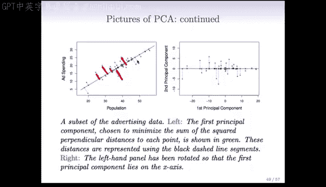

And so all these little red lines indicate the distance from a location to the principal component line it's actually as small as possible oops yeah this is the I misspoke this green line is the principal component and it's the direction along which the data varies the most and it's also the direction along which the distances from the purple points to the green line which I'm showing in red is as small as possible and on the right hand side here I'm really seeing the same picture again but now it's been rotated so that that principal component line is horizontal just to make it a little easier to see。

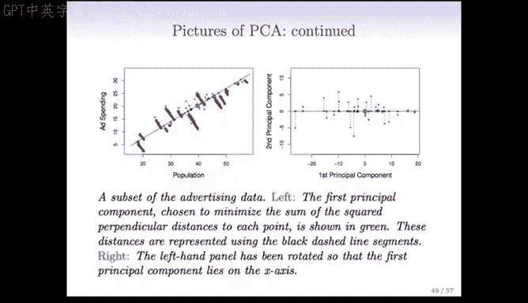

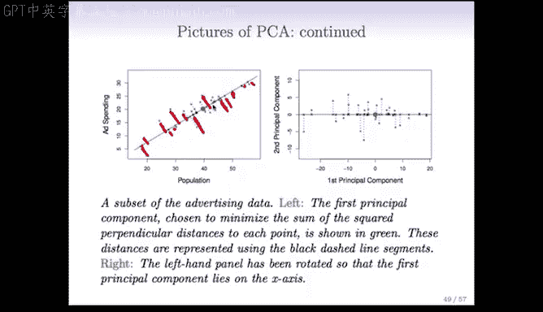

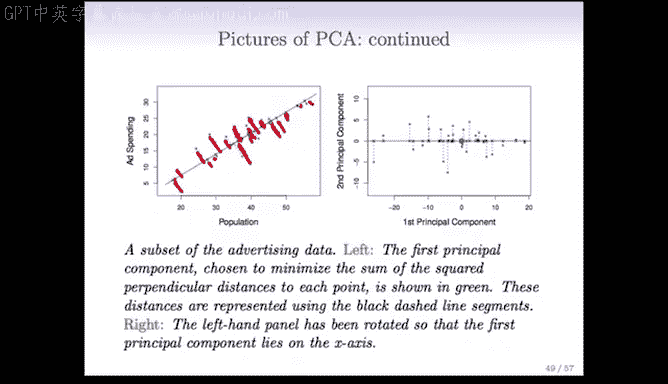

So if I want to understand these principal components better。

 I can actually plot each principal component， so each linear combination of the variables that I got on the X axis and I can plot it against population and against ad spending。

And what I can see is that the first principal component is really highly correlated with population and highly correlated with ad spending。

And so what that means is that I'm really summarizing the data very well if instead of using those original two variables。

 population and ad spending， I instead use just the first principal component。

So that kind of suggests the idea， hey， if I want to predict some response like sales。

 instead of using population and ad spending to predict sales。

 I can just use the first principle component， I can just treat that as a predictor in a model。

 fit the model using league squares， and I bet those results are going to be pretty good。😊。

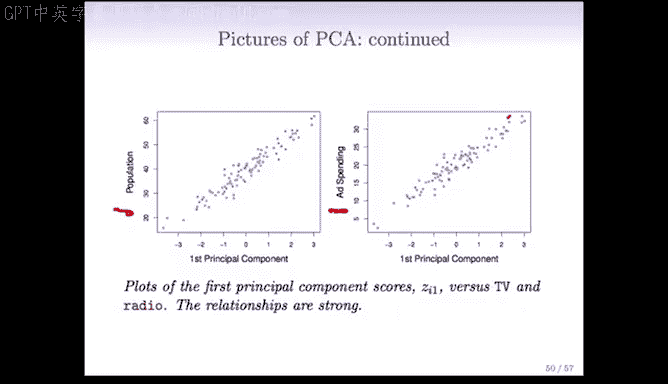

So now this figure is just like the previous one。But instead of showing the first principal component on the X axis。

 it's showing the second principle component against again。

 population and a spending and we can see that there's very little relationship between population and the second principal component and between a spending and the second principal component。

 so that suggests that really the first principal component here does a great job of summarizing the data in this case that's happened because population and ad spending are really correlated with each other and so one new variable which is the first principal component can really summarize both of those two variables very well。

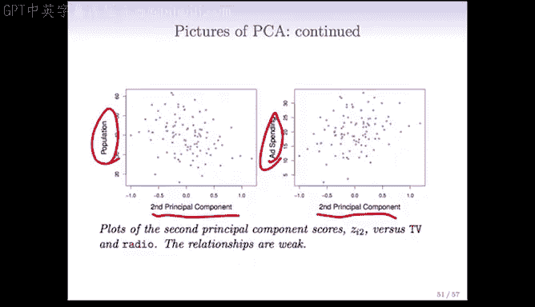

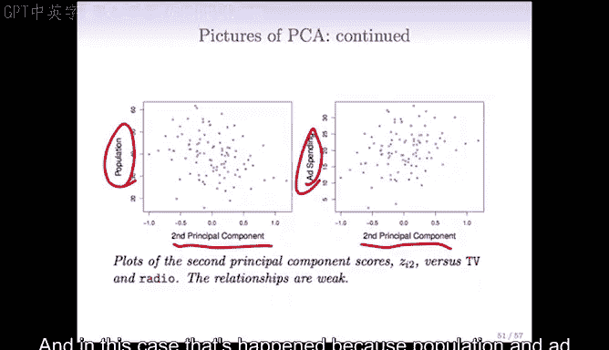

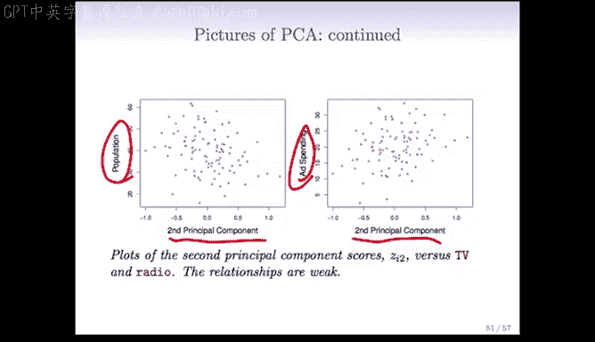

So the idea is I take my data， I get the first couple principal components as many as I want。

 and I use those as predictors in a regression model that I fit using least squares。😊。

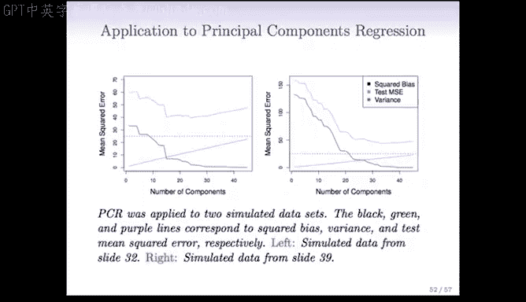

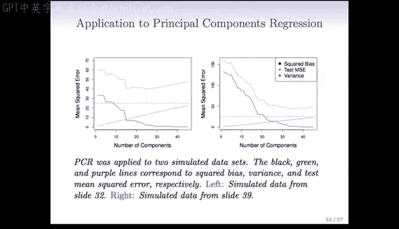

And that can actually， in a lot of settings， give really nice results。

So here's an example on a simulated data set。where I have a bunch of observations and I perform principal components regression regression with various numbers of principal components。

 so like over here I have one principal component all the way through to around 45 principal components in this example。

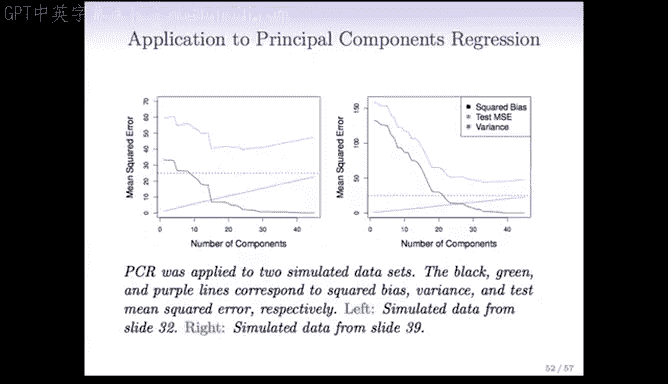

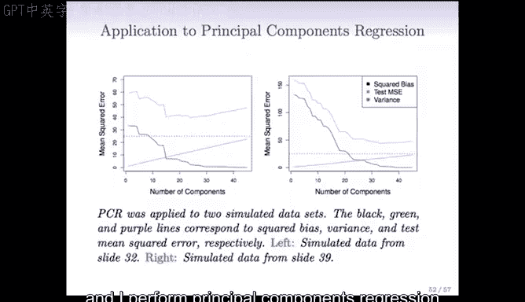

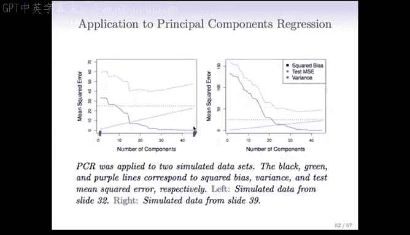

And so what I'm plotting here is the bias shown in black oops。This is the bias。

This is the variance in green， and this is the mean squared error。

And so as I get more and more components in my model， as I use more and more principal components。

 I'm going to get less and less bias because I'm going to be fitting a more and more complex mile。

 but I'm going to pay a price in that my variance is going to increase as the number of components increases。

😊。

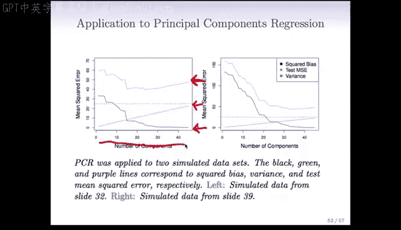

And remember， the mean squared error is just the squared bias plus the variance。

 so my mean squared error， which is shown here in purple。

 has sort of approximately that u shape that we've been talking about。

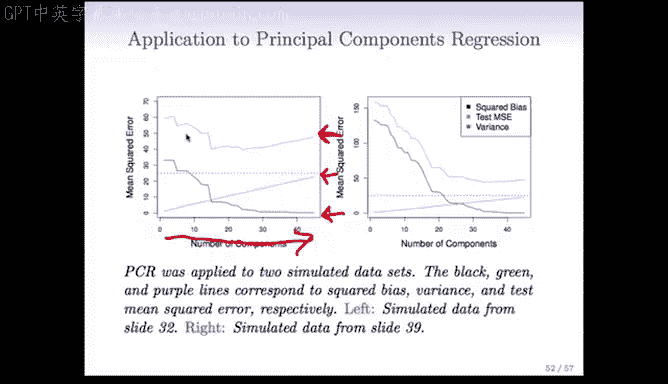

And I can see that my mean squared error is really smallest for a model with around 18 principal components。

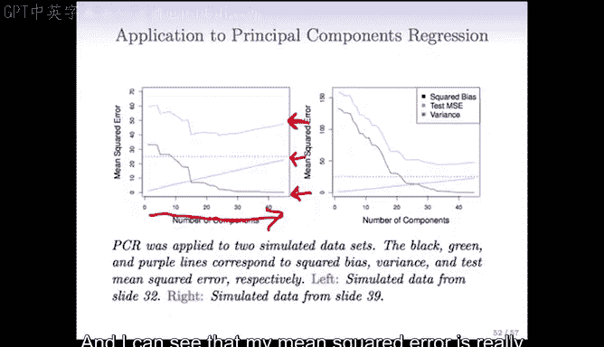

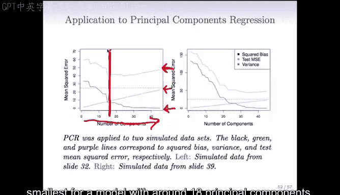

So using principal components regression with 18 predictors works really well here。

In this example over here， the situation is a little bit different。

 now my mean squared error once again decreases as I add more components。

 but it doesn't really increase again， it's pretty flat from around here outwards。

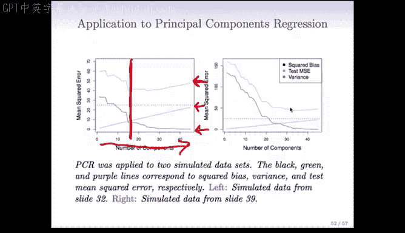

So any of these models looks around the same in terms of chestamine squared error。

 and since I always prefer the simplest model possible in this context I might choose maybe this model with around 25 components so the idea is to summarize summarize the features by the principal components which are the combinations with highest variance。

 right？

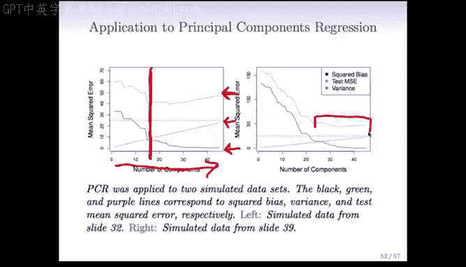

I guess why is that a good idea or could it be a bad idea？

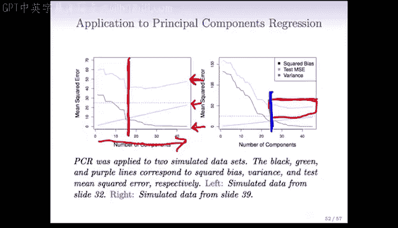

Yeah， so that's a good question and one thing that we notice here is that when I compute those principal components。

 I'm not actually looking at the response， I'm literally just looking at my predictors， my x's。

 and I'm looking for a linear combination of them that has high variance。

 and it's kind of making this assumption that a linear combination of the predictors that has high variance is probably going to be associated with the response。

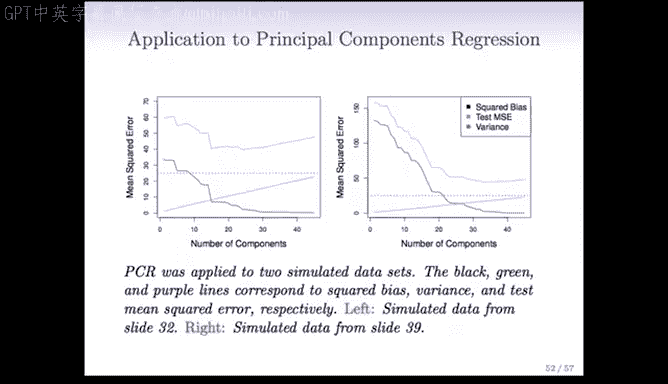

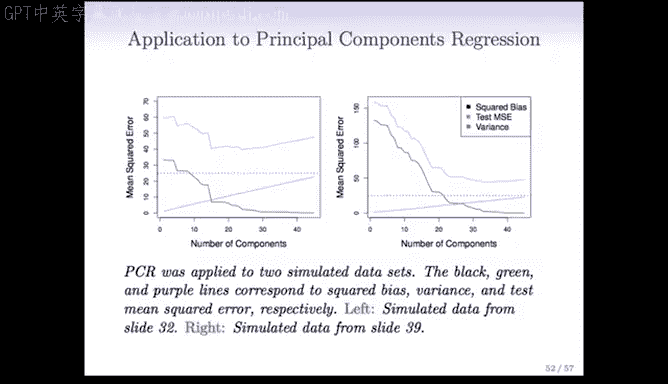

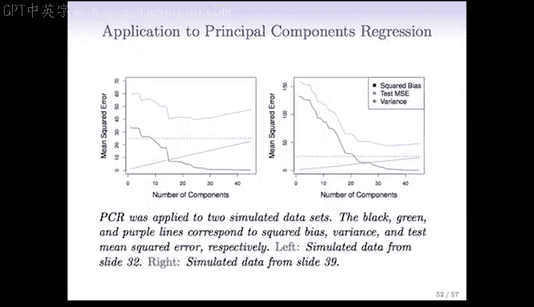

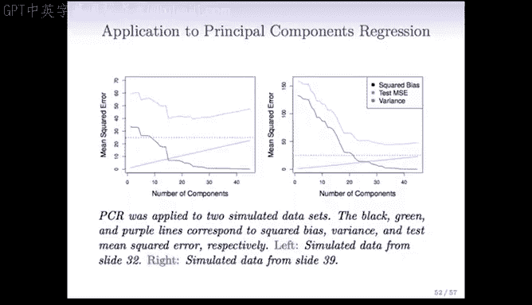

And that's kind of a hunch that we often have as statisticians it's an assumption that we often make。

 but really there's no reason that that has to be the case and in fact it might not be well let let me just just draw a picture talk about that a bit more looking for some space Okay so if we think of our。

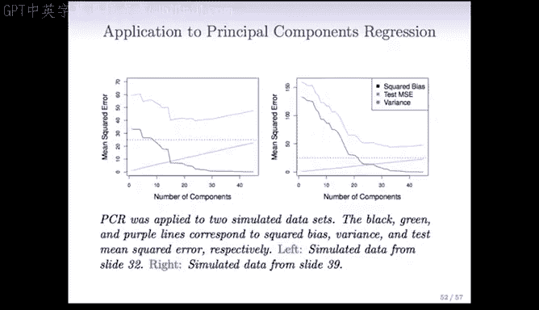

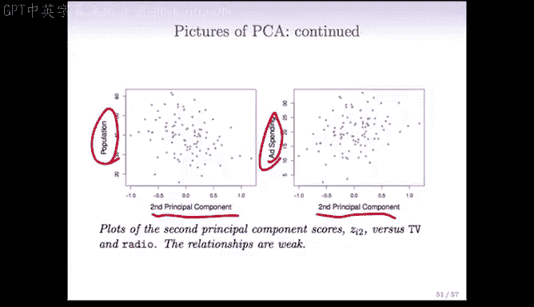

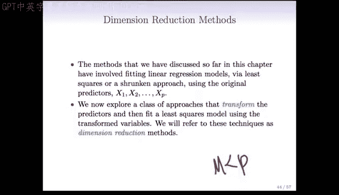

I have a plot here says say there's two variables， right？

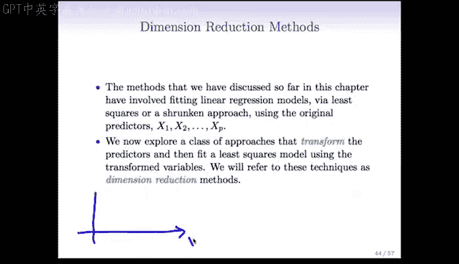

Here's my scatter plot of points in the first principal opponent's direction。

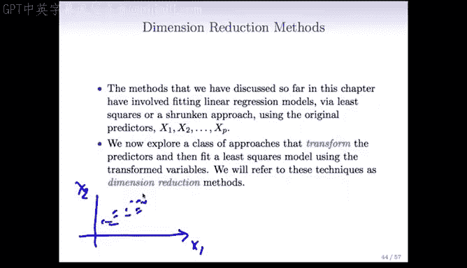

Where's going to be。A this。

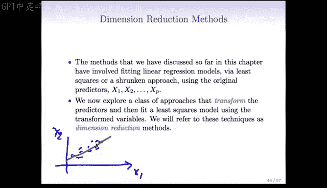

It on this red line right that's the first principal component， so as Daniella said。

 if we summarize these two variables by the principal component。

 we're really assuming that this direction of variation is the important one。

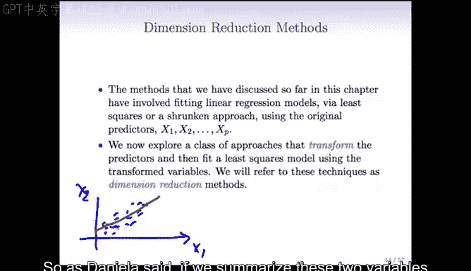

So if we think of why coming out out of the slide， we're really assuming that the regression plane varies along the red line and doesn't vary in the orthogonal direction right because if we choose one component。

 we're going to ignore the second direction。

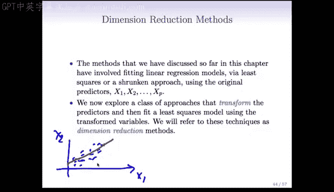

Is that a good assumption。 Well， it's not always going to be the case。

 but it tends to be quite reasonable because one way to think about it is if this is observational data。

 the fact that we've measured the variables at all probably means that could be they're likely to be important。

 we measure things in experiment to predict something。

 things we measure we're more likely to measure things which are important。

 So things that matter are probably going to vary in the direction of the response。 not always。

 but it's a good hunch that all else equal， let's look in the direction variation of the predictors to find the places where the response is most likely to vary。

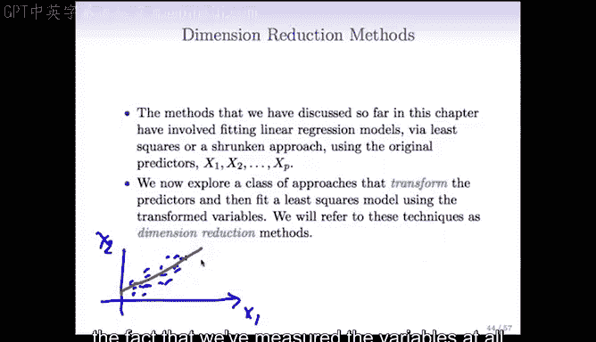

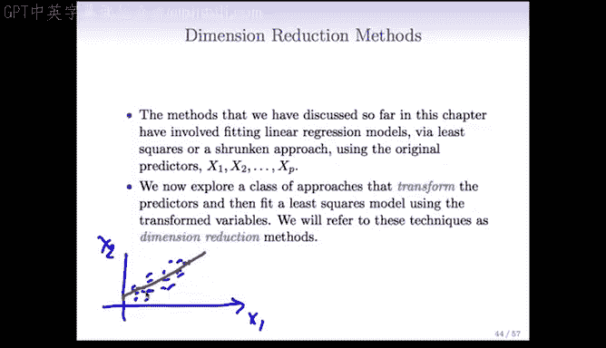

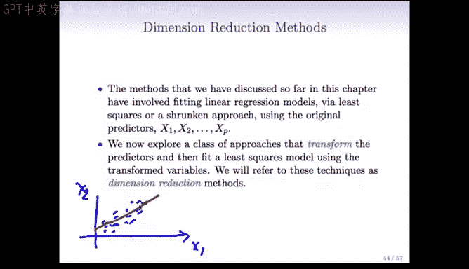

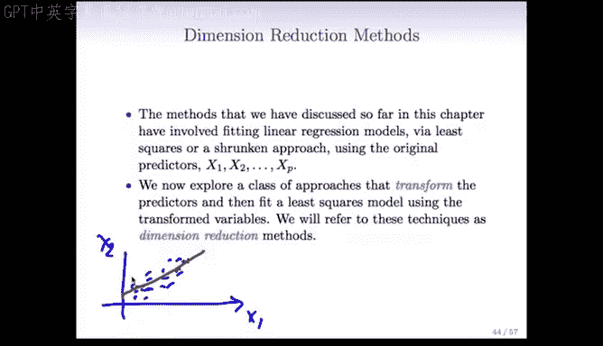

Okay， so let's go back to。Are we talking about the number of directions， okay？

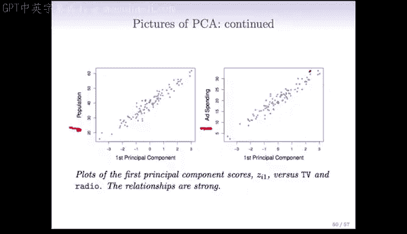

Yeah， so when we perform principal components regression。

 we need to somehow select the number of directions M and we just saw that you know the test mean squared error。

 we want it to be as small as possible， so we've got to estimate the test means squared error and by now you've probably seen that Rob and I really prefer cross validationation over any other approach。

 so we would select we would suggest using cross validationidation in order to choose the number of principal component directions that you want to use。

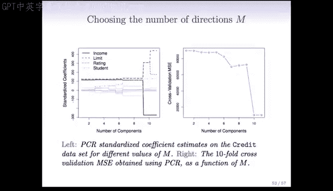

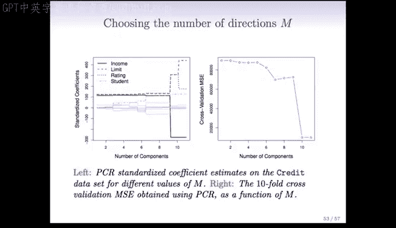

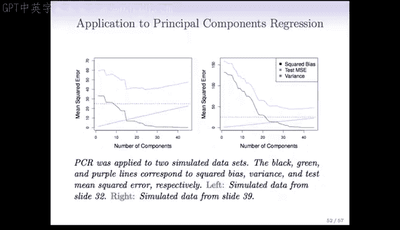

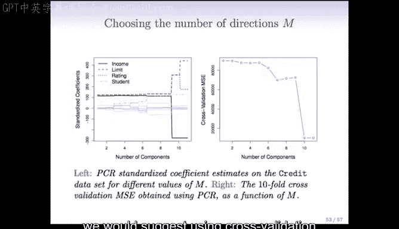

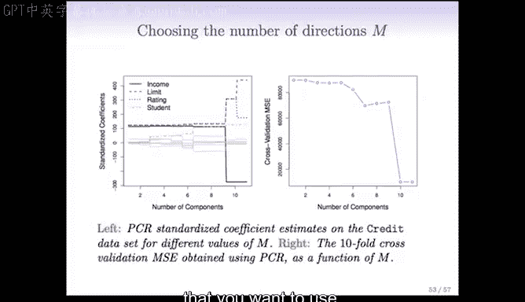

So here that's what we did on the credit data。

So on the left hand side， we can just see the results of just performing just plain principal components regression on the data。

 so like for instance， if we want to look at the principal components regression model with six principal components。

 so m equals 6。

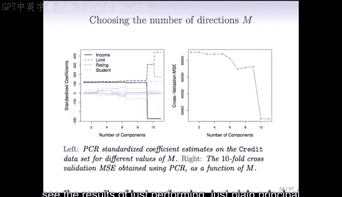

That's this blue line， and so we can see that like you know a few of these coefficients are non zero and then a few others are basically zero。

Over here we've got 11 components， and that's actually the full least squares model because when m equals P。

 you've just got regular least squares on the original data。

嗯。

And we can on the right hand side see for each of those same models。

 we can see the cross validated mean squared error， so this is an estimate of the test error。

And here we actually see something that's pretty disappointing remember we like to pick a model for which the mean squared error is as small as possible and so here the mean squared error is really as small as possible when we have a model with 10 or 11 components and remember when M equals 11 that is just going to be regular least squares on the original data so basically principal components regression just tells us when you choose the number of components by cross validation on this particular data it tells us to just forget it and just do least squares on the original data。

So this is sort of disappointing， it means that principal components regression doesn't give us any gains over just plain Lee squares that you guys saw in chapter  three。

But this is also something that happens on a lot of contexts， you can try to beat least squares。

 but it might not work on a particular data set。

So as Rob mentioned， with principal component regression。

 we're just coming up with these new transform variables。

 which were the principal components just in a totally unsupervised way。

 we're just looking at the x variables and we're just going to cross our fingers that the directions on which the x variables really vary a lot。

 are the same directions in which。The variables are correlated with the response why。

 but if we don't want to just have to keep our fingers crossed and hope for the best。

 we can instead perform what's called partial least squares。

And partially squares is just like principal components regression。

 but it selects these new predictors z1 through Zm。😊，In a supervised way。

It's going to choose Z1 through Z that are linear accommodation combinations with the original features。

 that are directions along which the original features vary a lot。

But there are also directions that are related to why。

So instead of just looking for a direction on which x varies。

 we're going to look for a direction on which x varies。That also has to be related to the response。

And so the goal here is to be able to more effectively predict the response because we explicitly think about the response when we're choosing these new features。

 Z1 through ZM。So the idea behind partial squares is。

I we get the first direction of partial least squares by doing a regression of y onto x1 that gives us phi11。

 we do a regression of y onto x2 that gives us phi12， and so on。

 until we do a regression of y onto Xp and that gives us phi1p。And so in fact。

 the first principal component direction1， the first partially squares direction that we get。

 Z1 is really proportional to the correlation between y and the data matrix x。

So that's how we get C1， and then we get the other partial least squares directions just by sort of iterating this procedure。

And so in principle， Pa least squares seems like it should be a huge gain over principal components regression because we're choosing those z's in such a clever way that actually involves looking at the response。

 which seems like it can only help us。But in practice。

 we have found that partial squares often does not give us a huge gain over principal components regression it's very similar to Rige regression and PCR principal components regression。

 so although some people do like partially squares I've never found it very useful and found that Rige and。

Princ components regression is work as well and is simpler both simpler and actually one thing that's interesting is Rob mentioned Rige regression and it might seem like you know going back Rige regression is really different from principal components regression and partial least squares。

 but it turns out that mathematically these ideas are all very closely related and principal components regression for example。

 is kind of just a discrete version of Rige regression。

 Rige regression is kind of continuously shrinking variables whereas principal components is doing it in a more choppy sort of way exactly。

So we've covered a lot today。And now you've seen a lot of different model selection methods。

Wwhich are really useful in settings where you might have a lot of observations。

 but you have a lot of variables， so you know if someone comes to you with some data with a million observations and four variables。

 then do least squares， knock yourself out or even use some of the approaches that you're going to see in chapter78 and 9 which are even more flexible and more complex alternatives to least squares but if someone comes to you with data with know 400 observations and 300 variables or even 30。

000 variables you're going to need ways to simplify the problem and to fit really simple models that are even simpler than what least squares is going to give you and those are really some of the ideas that we covered today。

So this is a really exciting topic and a lot of modern statistical research really focuses on how we can improve prediction in settings like the ones we covered today where we just want a simple model that's simpler than least squares because the least squares fit is really going to overfit the data。

