# 斯坦福大学《统计学习导论2023Python版｜An Introduction to Statistical Learning with Python》中英字幕 - P45：-045-Statistical Learning_ 6.6 Shrinkage methods and ridge regression.zh_en - GPT中英字幕课程资源 - BV1u4421A7ZU

So welcome back， so we've talked about a For stepwise selection and backward stepwise in all subsets as well as some techniques for choosing the model size。

All those methods fit by least squares， so whenever we consider model a subset。

 we always fit the coefficients by least squares。 Now we're going to talk about a different method called shrinkage。

Namely two techniques， Ri regressionion and lasso。And as we'll see that these methods do not use fully squares to fit。

 but rather different criterion that has a penalty that will shrink the coefficients towards typically zero。

And we'll see these methods are very powerful， in particular they can be applied to very large data sets like the kind that we see more and more often these days。

 where the number of variables might be in the thousands or even millions。So。

And one thing that's worth mentioning is that like Ri regression Lasso and shrinkage methods like this are a really contemporary area of research right now。

 I mean there's papers every day written by statisticians about variants of these methods and how to improve them in that sort of thing as opposed to some of the other things that we've covered so far in this course where you know the ideas have been around for 30 40 years although actually Ridge regression I think was invented in the 70s but it is true that it wasn't very popular for many。

 many years is only sort of with the advent of fast computation in the last 10 years that have become very popular along with the LaSsso so。

Some of these methods are old， some are new， but they're really quite hot now in their applications。

So Rige regression， well let's first of all， just remind ourselves what least squares is。

The training error。嗯。So RSS， or training error is the sum squares deviation between y and the predictions。

So when you do these squares， we simply find the coefficients that make this as small as possible。

Now。With rich regression， we're going to do something a little bit different。

 We're going to use training error RS。 we're going to add a penalty to that， namely。

A tuning parameter， which we'll choose in some way， and you'll as you can guess。

 it we by cross validation， times the sum of the squares of the coefficients。

So we're going to try to make this total quantity small。

 which means we're going to try to make the fit good by making the RSS small。

 but at the same time we're going to have something which is going to push as the other direction。

 this is going to penalize coefficients which get too large right the bigger the more non-zero a coefficient is the larger this is。

 so we're going to pay a price for being non-zero。It we' pay a bigger price that the larger the coefficients are。

So it's basically fit versus the size of the coefficients。

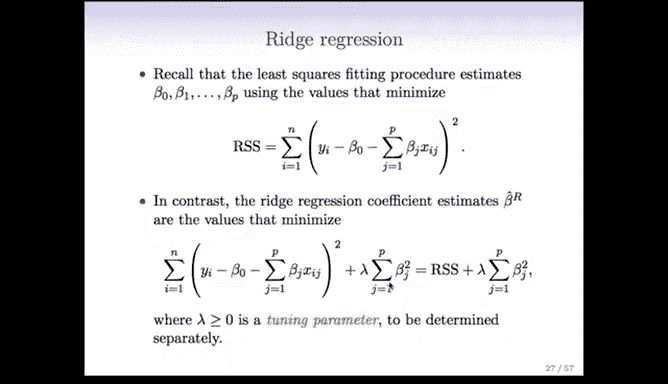

And that apparently is called a shrinkage。A shrinkage penalty because it's going to encourage。

The parameters to be shrunk toward zero。And the amount by which they're encouraged to be0 it will be determined by this tuning parameter lambda。

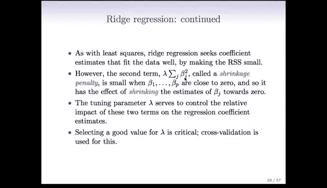

If lambda 0， let's go back to this if lambda 0， of course， we're just doing least squares。

 right because this term will be0。

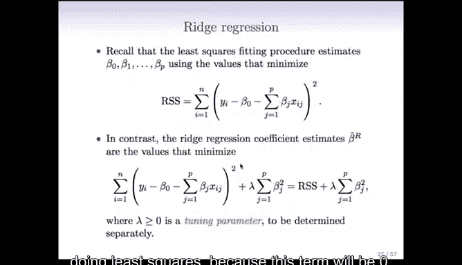

But the larger lambmbda is。This tuning parameter， the more and more of a price will pay for making these coefficients on zero。

 If you make Lambda extremely large， then at some point。

 the coefficients are going to be very close to 0 because they'll have to be close to0 to make this this term small enough。

 right， no matter how good they help to fit。 we're going to pay a large price in。In pen in。

In the penalty term。

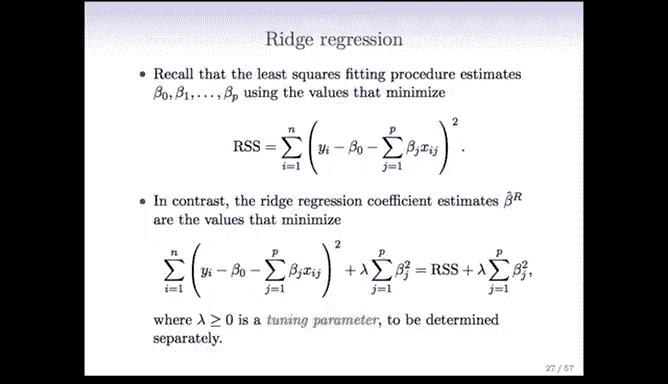

So in other words， this term has the effect of shrinking the coefficients towards zero and y zero while  zero is a natural value。

 remember 0， of course， if a coefficient is zero， the feature is not appearing in the model。So。

If you're going to shrink towards some value， a zero is a natural place to shrink towards。

And the attorney parameter。The side swinging parameter。

 it trades off the fit versus the size of the coefficients。

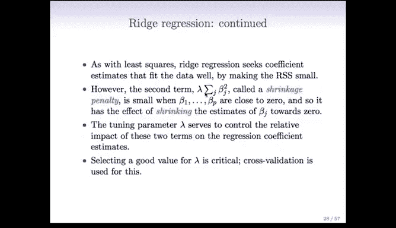

So as you can imagine， choosing a good value Lada for the fingerprint of Lada is critical and cross validation is what we're going to use for this。

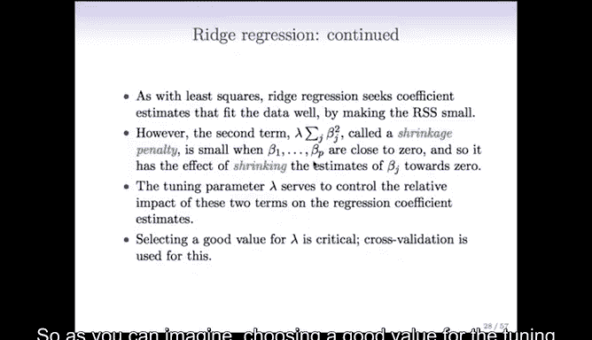

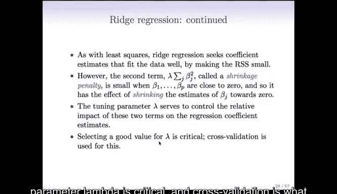

So let's see。What happens for the credit data？Well， let me just go back here。

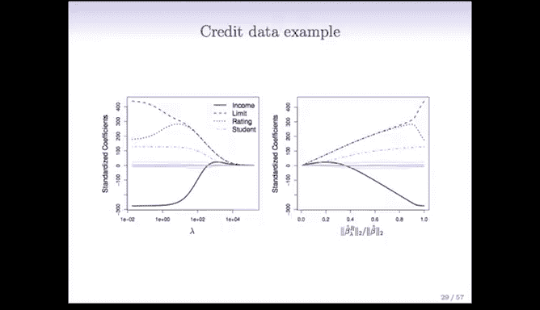

If we think of this for a fixed value of Lada， we have to have to find the smallest value of this criterion。

 and again， it's just an optimization problem with actually a very simple solution。

And there are computer programs for doing that。 So I've used such a program。

 and we'll talk in actually in the our session about。

And R function rooting Ri regression。 But let's see what it looks like in this example in the credit example。

 So here he plotted the coefficients。Standardized coefficients versus Lambda。For the credit data。

 And let's see what happens。 Well， first of all， the on the left hand side。Lambda is close to zero。

 so there's almost no constraint in the coefficients。

 so here we're pretty much getting the full least squares estimates。And now as Lada gets larger。

 it's pushing the coefficients toward zero because we're paying more and more of a price for being nonze。

In the extreme over here were lambdas that maybe more than 10，000。

The local coefficients are all essentially zero。In between。

 they're shrunken towards 0 as lambda gets larger， although not not uniformly so。

 right like this the rating variable。actually gets bigger for a while and then shrinks back down to zero。

And I remember when I was a student seeing this figure again and again actually was in a class that Rob was teaching and being totally confused for like three lectures。

 so I just want to spare everyone this confusion in case anyone shares the confusion I had so like if we look here this red line indicates the spot at which lambmbda equals 100 and at that spot。

 the income coefficient takes on a value of like negative 100。

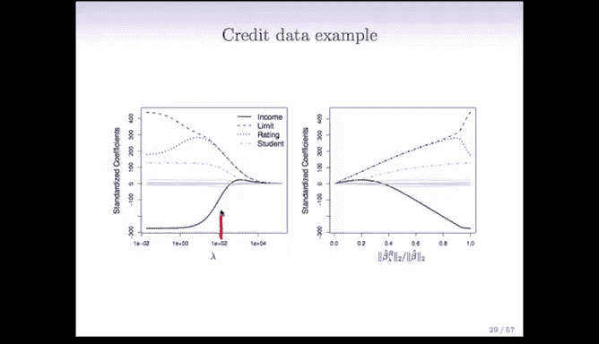

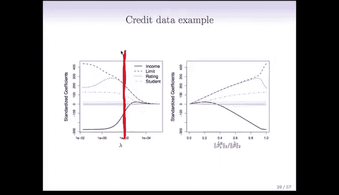

These other six coefficients here are all around zero， student takes on a value of around 100。

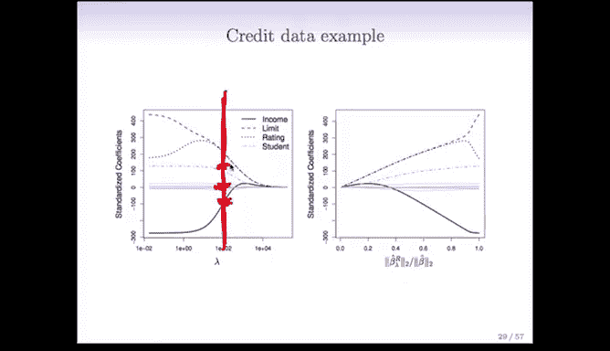

Limit and rating take on values of around 250， and so the point is what we're plotting here is a ton of different models for a huge grid of lambda values and you just need to choose a value of lambda and then look at that vertical cross section。

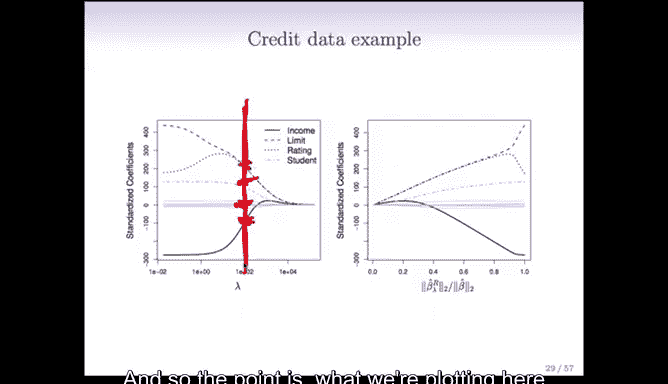

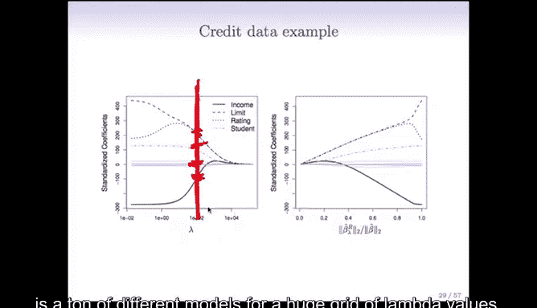

Good， and so as Danielle said if we chose the V of lambmbda， about was that 100？

Then it would seems like it chooses about three non zero coefficients， the black。

 the blue and the red oh maybe four。 and then these guys here are basically essentially zero。

 the gray ones。 So they're not quite zero， but they're small right exactly So an equivalent picture on there right now we've plotted the。

The standard is coefficients as a function of the L2 norm， the sums of the squares。

 the square root of the sum of the squares of the coefficients divided by that。

The L2 norm of the fully square coefficient。 So Rob， what's the L2 norm okay？The L2 norm。

 so the L2 normta of the vector beta 1 through beta P。It's written this way。So the L2 norm。

 So it's the square root of the sum。A be during squared。 so this is the。That's the L2 norm。

 and so it sentences。So。That's it。We see here when the L2 norm is 0。

 So when the coefficients are all 0， the L2 norm is 0， that corresponds to the。

The right side of this picture， so the lamb is very large here。

It's large enough that it's driven the L2 normal down almost to zero。

 so the coefficients are basically zero。And then on the right， lambda is very small。

And we get the full squares estimates。And in between， we get again a shrunken coefficient。

 So these two pixel are really the same， but they've been flipped from left to right。

And the the x axisxes are parameterized in a different way so Rob why does this x axis on the right hand side go from zero to one why does it end at one Oh because we just we plotted this it ends at one because we're plotting as a function of this standardized L2 norm so at the right hand side。

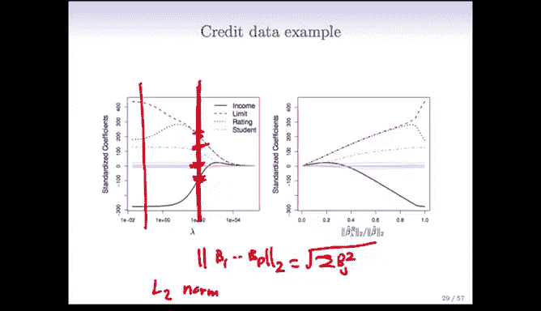

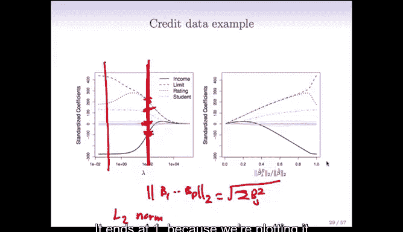

we have the full least squares estimates， so these numerator demeter are the same right so on the right hand side here on this right hand plot。

 lambda is zero and so your rid regression estimate is the same as your least squares estimate and so that ratio is just one。

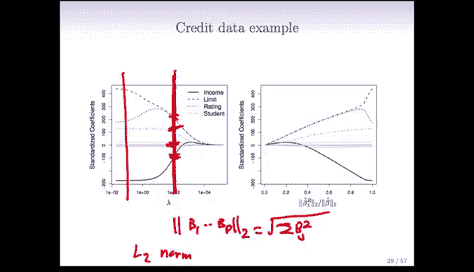

Exactly， okay。I think we've。I actually just said all this。Thanks for the questions from Daniela。

Right， so there's the L2 norm defined， I wrote it in the previous slide。

 and that's what was used for the poly axisxi。

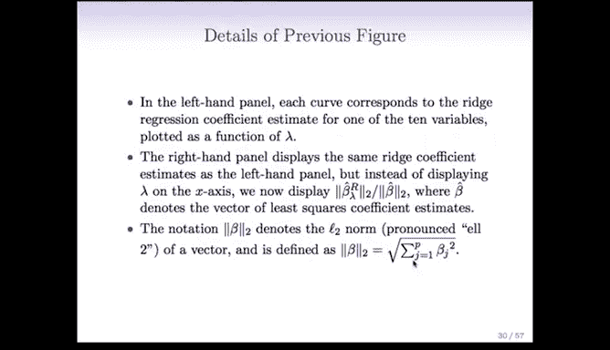

One important point with Rige regression is that it matters whether you scale the variables or not now just to remind you if you do do standard deviation squares。

 sustainability standardity squares is what's called scale variant。

 if I multiply a feature by constant， it's not going to matter because I can divide the coefficient by the same constant and I get the same answer。

In least squares， the scaling of the variable doesn't matter。

 so whether I measure a length in feet or inches is not going to matter because the coefficient can just account for the change in units。

But it's a little bit subtle here now for ridge regression and penalized methods like wage regression。

 the scaling does matter in an important way。And that's because we go back to the definition of Ri regression。

Right。These coefficients are all put in a penalty together and they're。There's a sum of squares。

 So if I change the units of one variable， it's going to change the scale of the coefficients。

If I change the units of one variable， the coefficient has to change to try to accommodate for that change。

 but it's competing against the coefficients for other features。

Because they're all put together in a penalty in a sum the the。

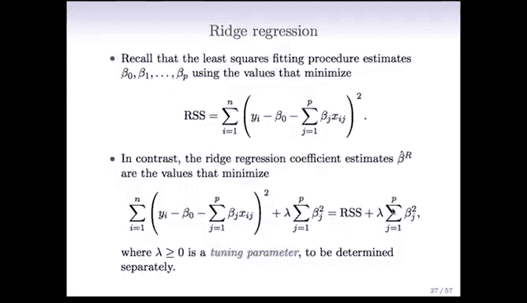

The scale of the features matters。And as a result。

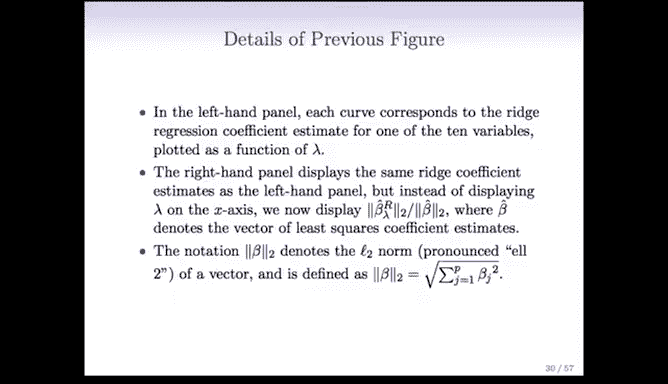

It's important to standardize the predictors in in regression before applying wage regression。

 So in most cases。Before you do a rigid regression， you want to standardize the variables。

 What does that mean to standardize the variables while you take the。The variable are feature。

 and you divide it by the standard deviation of that feature over all the observations。

And now the standard deviation of this guy is one。And you do that for each feature。

That makes the features comparable and makes their coefficients comparable。

So let's see an example of Ri regression compared to least squares。

 here's a simulated example with 50 observations and 45 predictors in which all the predictors have been given nonzero coefficients。

So we see the on the left， we see the。The bias in black。

 the variance in green and the test air in purple for rigidge regressionrationion is a function of lambda。

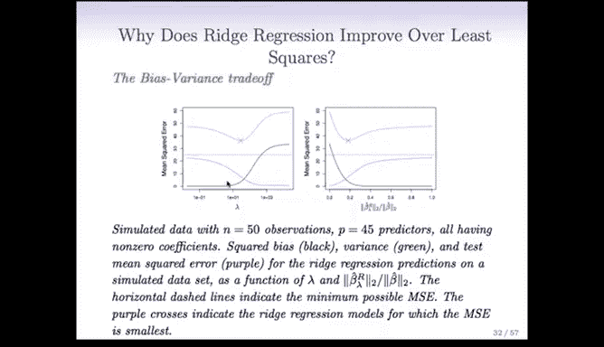

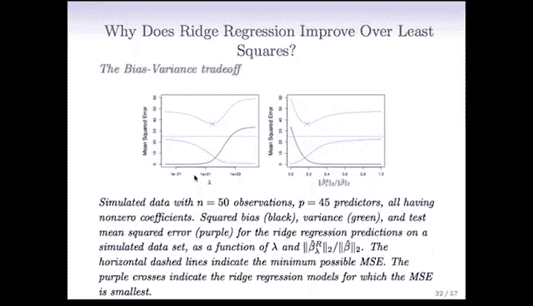

And the same thing on the right as a function of the standardized coefficients of the sorry of the。

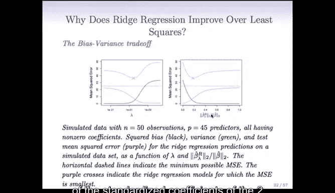

Of the two norm。Of the rid regression divided by the twoome of fully squares。 So again。

 these are the same pictures essentially， but the x axis have been changed。

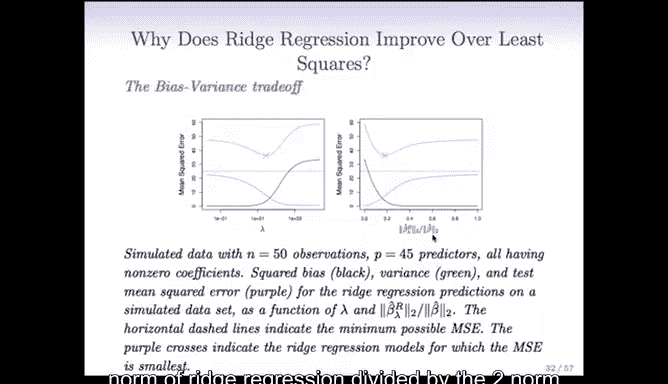

Let's look over here， we can see that。A。What happens while the？The bias， as we move。

 so fully squares is over here on the left， lambda is close to  zero。As we as we make lambda larger。

 the bias is pretty much unchanged， but the variance drops。

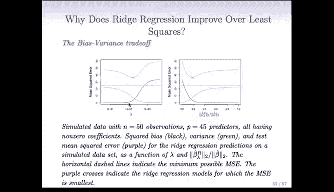

So rigid regression by shrinking the coefficient towards zero controls the variance。

 it doesn't allow the coefficient to be too big。

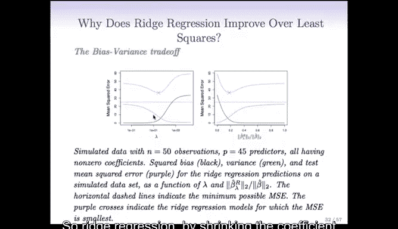

And it gets rewarded because the mean square error， which is the sum of these two， goes down。

So here's the， here's the place where the mean square is minimized。

 and it's lower than that for than the fully squared estimate。 So in this example。

 Rige regressionion has improved the error， the mean square error of。

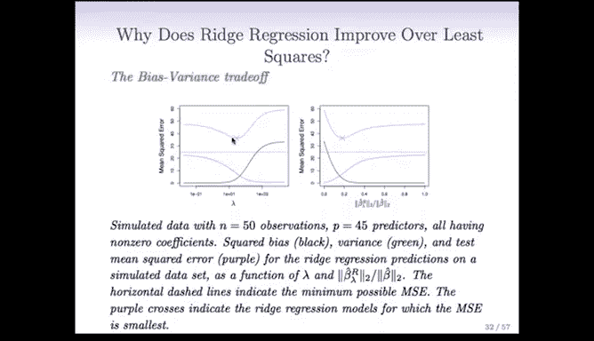

Fully squares by shrinking the coefficients。By a certain amount and we see the same thing in this picture and actually this u shaped curve that we see for the the means square error in this figure in purple comes up again and again where when we're considering a bunch of different models that sort of have different levels of flexibility or complexity there's usually some sweet spot in the middle that has the smallest test error and that's really what we're going for so that's what's marked as an X in these two figures。

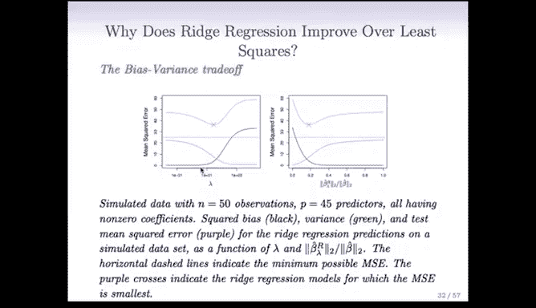

So I want to go back to this picture of Ridge， let me clear the。

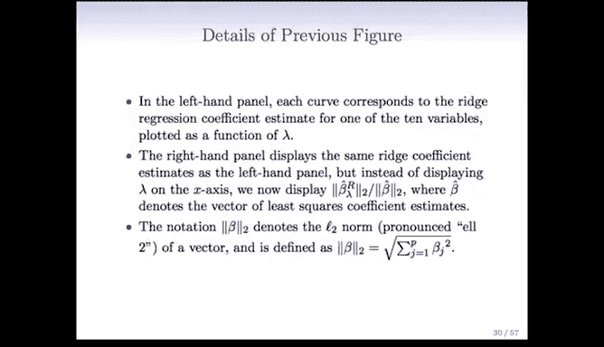

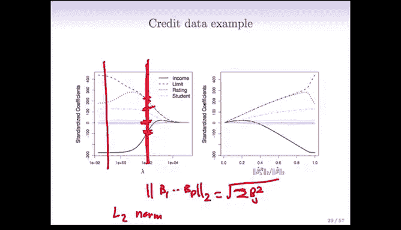

And one thing you might have noticed here， I we mentioned is that the coefficients are never exactly zero。

 They're close to zero。 like here， these gray guys are all closer， but they。

They're never exactly zero。 matter of fact， you can show mathematically that they're unless you're extremely lucky。

 you're not going get a coefficient exactly of 0。 So read regression shrinks things in a continuous way towards 0。

 but doesn't actually select variables by setting a coefficient equal to 0 exactly。

 But it seems like a pity in this example， right because all those gray variables are so tiny。

 it would just be more convenient if they were0 right， which is a great setup for the next method。😊。

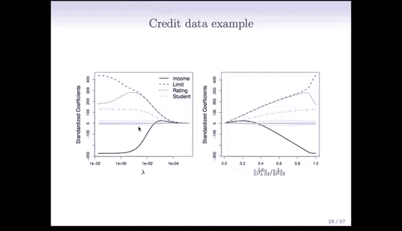

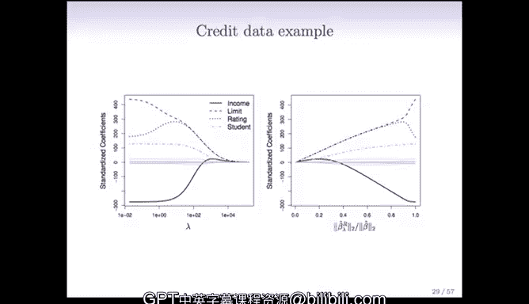

Call the Lasso。