# 斯坦福大学《统计学习导论2023R语言版｜An Introduction to Statistical Learning with R》中英字幕 - P45：-045-Statistical Learning_ 6.R.2 Forward Stepwise Regression.zh_en - GPT中英字幕课程资源 - BV1yU421o7WA

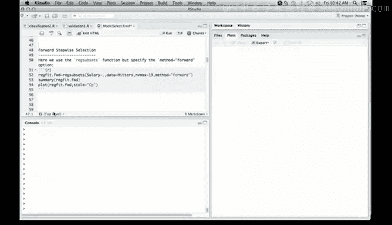

Okay， well， we're going to carry on with our our model selection session。

 We've done best subset selection。 Now we're going to do forward stepwise selection。

 So best subset is， is quite aggressive， looking at all possible subsets。

 Forward stepwise is a greedy algorithm at each time it includes the next best variable。

 but it keeps。😊。

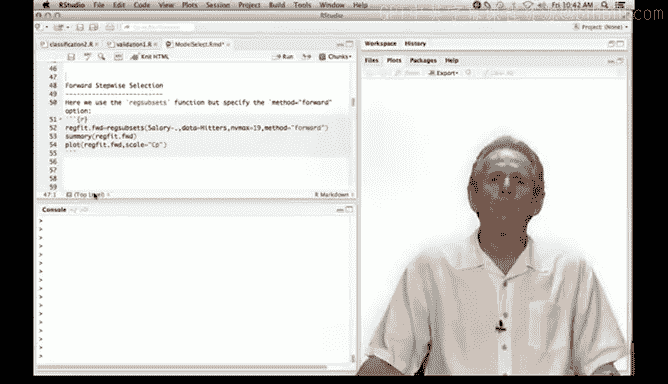

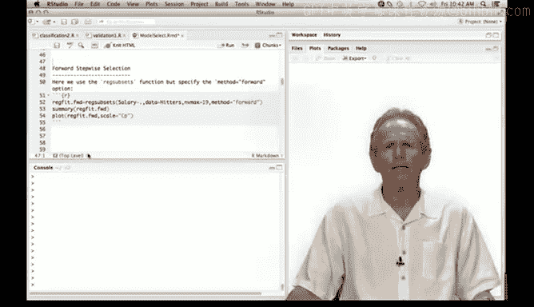

It produces a nested sequence， so it's a much less adventurous search it keeps a nested sequence of models each time you just add the variable that improves the fit the most。

So we also back using our markdown formatting and so well continue with that。

 so let's have a look at the screen。

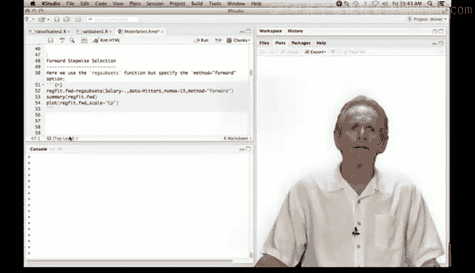

And we got our heading full stepwise selection and we' back using rank subsets and it's the same function that did best subsets。

 but yeah we tell it method equals forward and we also want the number of variables to use a full number of variables which is 19。

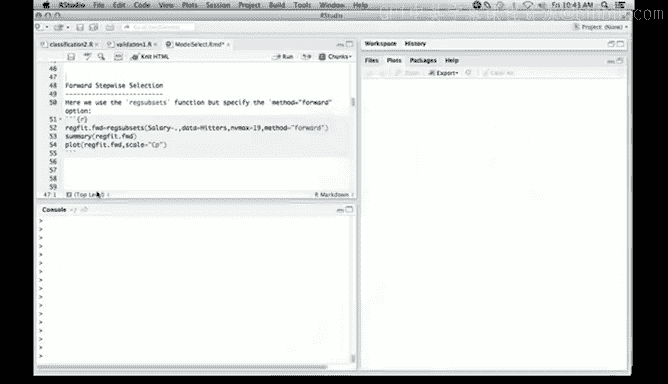

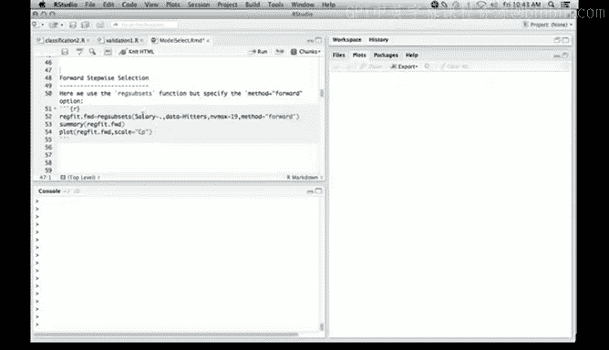

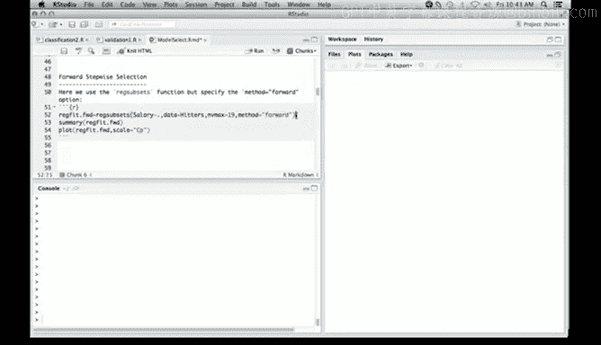

And so that's really fast as well。 And there's a summary for that， just as it was for the。

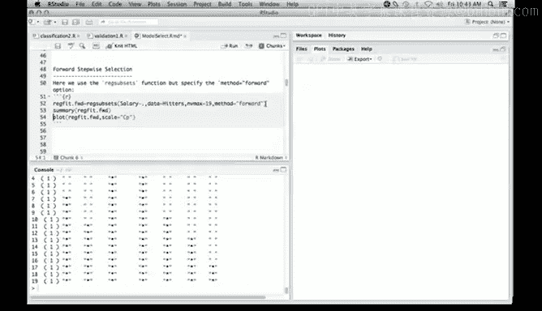

There's subsets。 And now this， this one， if you look through the models that were selected。

 you'll find that they exactly nested。 So each new model includes all the ones variables that were before plus one new one。

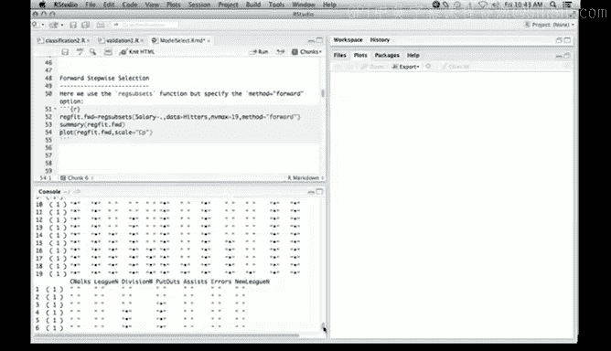

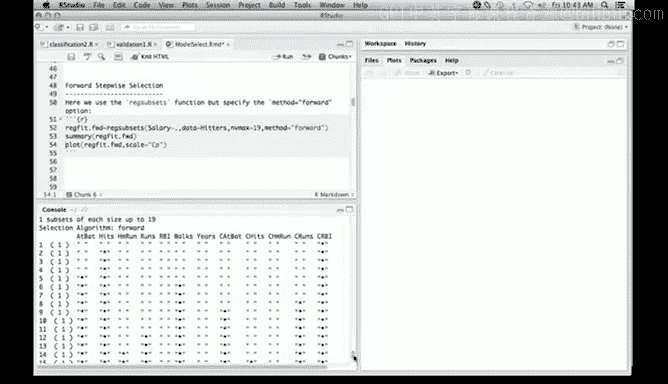

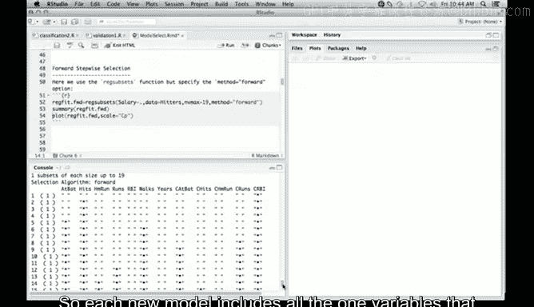

AndSo if you study that。

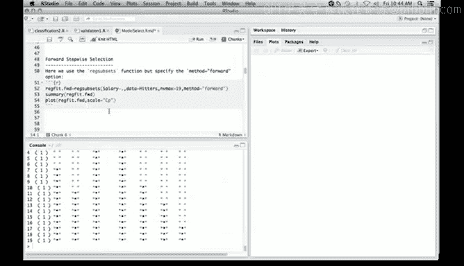

You'll， you'll discover that。And we can plot the C statistic。

I be your pardon we' make the plot for this model， the schematic plot plot like we did before。

And it looks very similar to what we saw for big best subsets。Different in some places。

 but the same kind of structure near the good end， which is the low CP end where there's a consistent group of variables that are in a little bit of fluctuation down at this end over here。

In terms of which of those variables saying。Okay。So。

We've got best subset and For stepwise and we can select the models using CP。

 there's also adjusted R squared and B IC， but here we're going to actually use a validation set。

So what we're going to do is were gonna pick。A subset of the observations and put them aside and use them as a validation set and the other as a training data set。

So let's see how we might do that。And this is a little different to the way we do it in the book。

 And so first of all， we see the dimension of hitters。 there's 2，63 rows。

So we're going to roughly go for two thirds training and one third test。

And approximately two thirds training is 180 observations。 And so that's what we'll do。

 And just for reproducibility， well set the random number seed and you can set it to any number。

 We set it to one， doesn't matter。Well， it does matter， but you know， for our purposes。

 we're not particular。嗯。Okay， so here we go。Is a commander， first， first all， inside， sequence 2。

63 creates。SEQ 263， it just creates the numbers 1，2，3，4 up to 263。 so it's a shortcut for doing that。

Okay， and here we're using the sample command。 so we're going to sample from that sequence。

 we're going to take a sample of size 180 and we're going to say replace equals false。

 So this will sample 180 indexes of observations okay。And let's just look at them。 Well。

 there they are。 There's a and 80 numbers chosen at random from the sequence 1 to 2，63。

So those were going to use that set of index， those rows we're going to use for our fitting。

So Refoot。 forwardward now we run Re subs again。And everything's the same as before。

Except now we tell it to use the data frame hitters， but indexed by the rows。In train， Okay。

 And so that'll use this subset of， of， of data。Okay。So。That's fit the model。 Now we're gonna。

Work out the validation errors on the remainder of the data。

So we know there's 19 subset models because there're 19 variables。

 So we'll set up a vector having 19 slots。And。We will make a X matrix corresponding to a validation data set。

So here we use the model matrix， course we want to use the formula that we used in building the model。

 which was salary twiddle dot， which means model ce as a function of all the other variables in in the hit's data frame。

 but ce is a response。And so we put that formula， we give that as an argument to model matrix。

And we tell it that the data should use is hitters。But now， rather than indexing by train。

 we index by minus train， which is a really nice device in R for excluding the observations index by train。

 So that just leaves the remainder。😊，So that's a negative index it。Okay， so we build that。The test。

Modttle matrix。And now we're going to make our predictions for each model。

 So we're going to loop for I equals 1 to 19。We use the coefficient function to extract the coefficients for the model of size Id equals I。

 So the I is going to index the size。And we go in a loop and do it for each size。And。Now。

 the unfortunate thing， there's not a predict method for re subsets， which would have been handy。

 So we basically got to do it all ourselves。And so the coefficient vector that comes back。

 if we look at it， well， we count't it because we're in a loop。

 it's just got the subset of variables that are used in that model。

 and so to get the right elements of x of x test， we have to index the names of that index。

 the columns by the names that are on the coefficient vector right so that's one way of doing that。

So that's the subset of columns of x test that correspond to the variables that are in this。

Current coefficient vector。 And then we do a matrix multiplly by the coefficient vector。

So it's little bit。Of a loaded line。And， and then having got the predictions。

 So that gives the predictions。 and then。We。Compute the mean squared error。

 So there's the hitters's dollar salary， minus train， minus the predictions。

 square it and take the mean and put that in validation errors。 And that's the end of our loop。Okay。

 so that worked pretty quickly。 and then we plot， we're going to plot the root mean squared error。

 So we plot that。In a plot。 And there we have it。 So that's a validation error。

It's slightly jumpy which is which is okay。 I mean this is these are data， there's only， you know。

 there's less than 90 observations in the validation set， so there's going to be a bit of noise。嗯。

But there seems to be a minimum yearre around 5。 The 10 that we chose before is a little bit higher than the minimum。

We may as well put the residual summer squares for the model on the same plot。

So notice we we remove the first one。 This corresponds to the null model。

 which was not included in in our validation plot here。

And so there's the residual summer squares and notice， of course， as it must do。

 the residual this is the root mean residual summer squares。It's monotone decreasing as it has to be。

 because for its stepwise each time includes a variable that improves the foot the most。

And so therefore， by definition， it's got to improve the residual summer squares on the training data。

 okay。And we may as well annotate our plot with a legend， it's very easy to do。

 we tell the legend command to put the legend in the top right corner。

 we give it the legend and a few more details， we tell it well let's just do it and see it and you see in the command how we achieved that。

I use PCH clotin character 19 quite often， it gives you a solid dot。

 which is often nicer to visualize on the screen， especially if you're doing it in color。And。

So this was a little tedious， we had to write our own basically method。

 we had to write code for doing the prediction。We're going to make predictions from Re's subsets model in the future。

We're going to end this session by actually just writing a function for doing that。

 And we often do this in in in our， you know， when we find ourselves repeating code that's tedious。

 we write a little function to do it for ourselves。

 So we write this is actually writing a method for predict for a rank subset object。

 So predict or drag subsets。And。We give it。Argument object that's going to be the R subset object that we want to predict from。

 We give it new data and Id， which is going to be the I of the model。It's slightly technical。

 but not too hard to understand Rick subset objects got a call， a component called a call。

 and that's the call that was used to create it。And。Part of the call is the formula。

 and so we can extract that formula through this little incantation year。

And then using the formula we make a model matrix from it the way much like we did before。

 then we extract the coefficient and do the matrix multiply and so we put that all together in a function which we'll just enter into our session now and so now that functions is defined and it'll be ready for us to use in the next session where we're going to actually use cross validation。

