# 斯坦福大学《统计学习导论2023Python版｜An Introduction to Statistical Learning with Python》中英字幕 - P47：-047-Statistical Learning_ 6.8 Tuning parameter selection.zh_en - GPT中英字幕课程资源 - BV1u4421A7ZU

。So let's talk a bit about。It'slect the tuning parameter for Rige regressionion in the Lassso。

First point is that's important。 the Lada very strongly determines the solution over a broad spectrum。

 lambda zero， we get fully squares， there's no regularization。When labs infinity。

 we get a zero solution in both cases。Choosing Lambda is extremely important and cross validation is the way is a good technique for doing that。

 Note also that we couldn't use the other methods because the D isn't known。

 What other methods am I talking about， CP and AIC and B IC。

They all require a number of parameters D。And it's not clear what D is now。

 that's actually something interesting to think about。

 I've well suppose Ive I've done a Ri regression with I started with the 45 variables like in the credit data。

I use a certain Lada。Let's go back to that。Just so I can point at something in example。嗯。

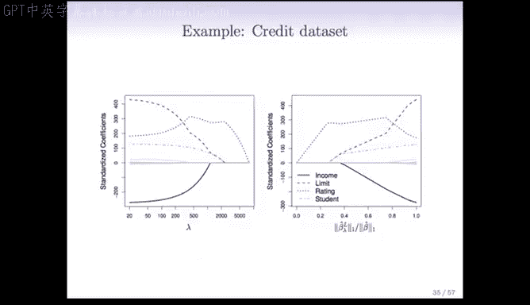

Here's our rich example， suppose I decide to use the lambda。

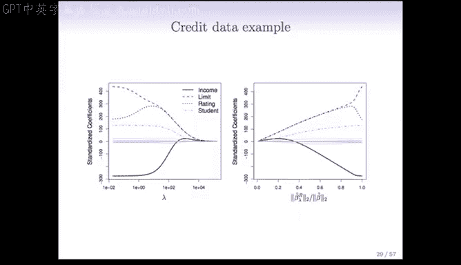

Of， of 100， right and。

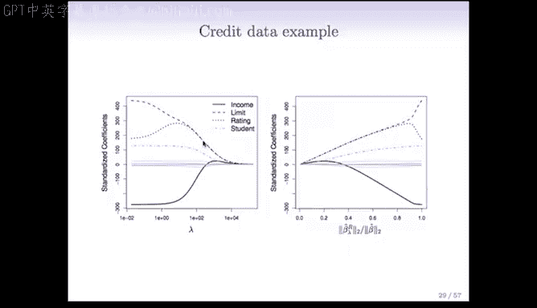

I'm here and ask you， well what's the D for that model， How many parameters have I fit？ Well。

 if I count the number of parameters， the number of nonzero coefficients。

 it's still that the full number 11。

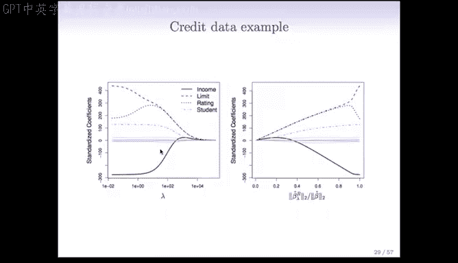

Because none of the coefficients are zero， so in a sense。All of my variables are still there。

 so my my D the number parameters is still is still P11， but that doesn't somehow seem right。

 right because I've shrunk in the coefficient， so they're not fully。

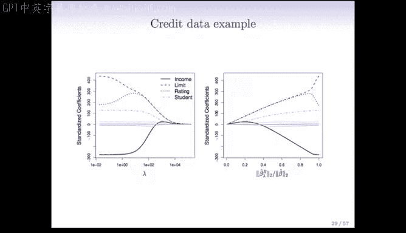

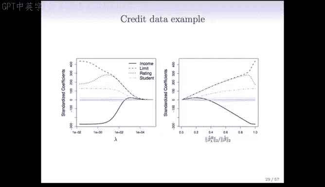

The number of degrees of freedom isn't as large。

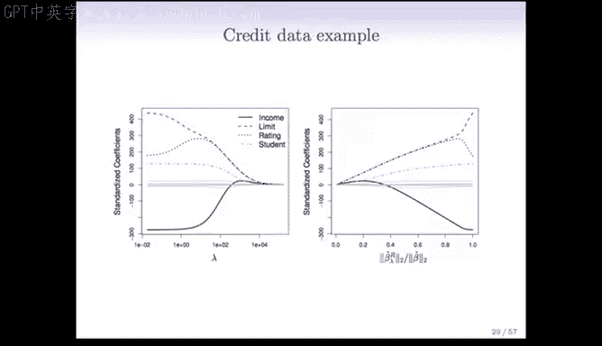

So there's a bit of a subtle point here that the number of parameters is not just。

How many parameters I've used， but how I fit them so with Ri regressionion and Lasso。

 the shrinkage actually affects the very idea of what we mean by number of parameters。

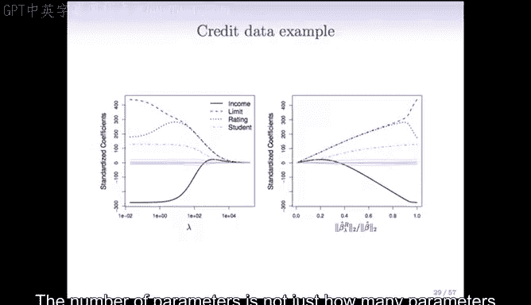

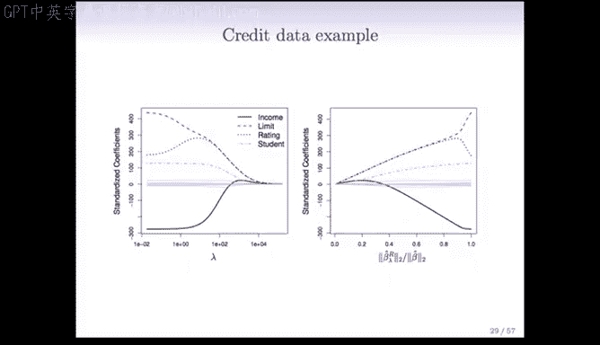

So that was a long way of saying that。For selecting the。嗯。20 parameter for Ri Grasen and Lasso。

 it's really important to use a method that doesn't require the value of D because it's hard to know what D is。

So cross validation fits the bill perfectly。We do exactly what we did for the other methods for for subset selection。

 for example， we divide the data up into K parts。We fit the model the say k equals 10。

You fit the model on nine parts。Say we apply rich regression for a whole range of lambdas。

For the nine parts， and then we record the error on the 10th part。

We do that in turn for all 10 parts playing the role of the validation set。

And then we add up all the errorss together and we get a cross validation curve as a function of Lada。

Same for the lastso， so conceptually iss exactly the same as we。

crossfl exactly the same as we applied it end for other methods。

So let's see what it looks like here for。For Ri regression。

Here's the result of cross validation。um。

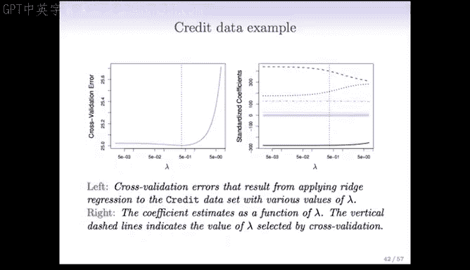

I'm not sure if was either five or  ten fold we can check。

Here's cross foundation as a function of Lada。

Again， remember lambda equals small means essentially the least squares model。

 full least squares over here。And lambda equals large means the coefficient have been driven to 0。

 So this is the cross foundation error as a function。

Of Lambda， and the minimum is occurring。Around here， around 。05。

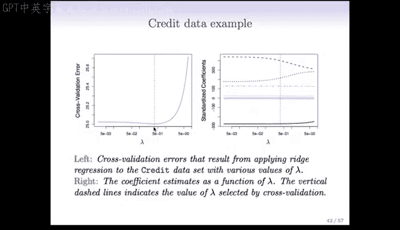

Heres here's the same same thing now， but well you plot it as a function of lambdaly standardized coefficient。

 so this is。

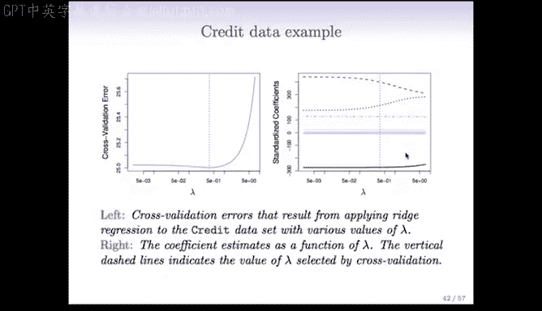

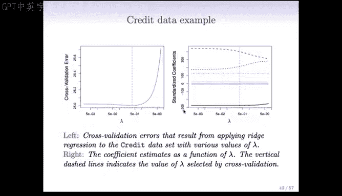

Here are the coefficients for each of the predictors。They profiles。

 and we see how they vary as a function of Lada。

So again， over here this fully squares。And here they've been， as they move to the right。

 they're shrunken。

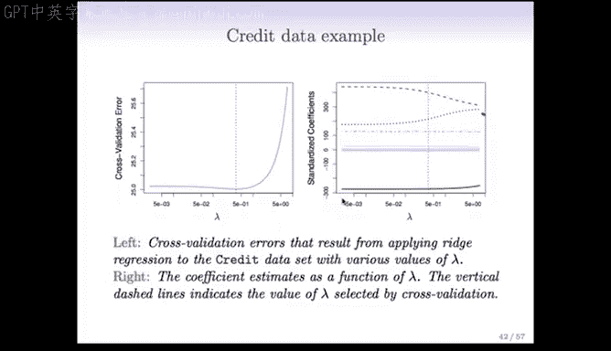

And at the minimum value of the curve， this broken line， we get。

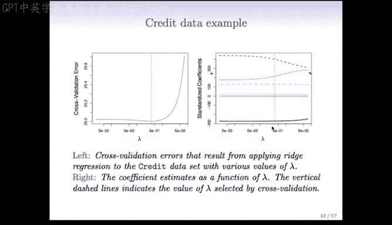

A bunch of guys， which were essentially zero。

But not exactly zero because this is ragging at Laso。

 and then here are the coefficients for the three active variables。

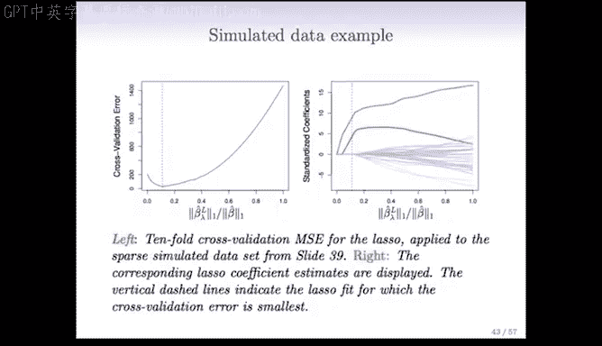

嗯。And here's for the， this is our， this is the。

Simulated data with n equals 50， I think there were two or three truly non zero coefficients in the population。

For the last so， this is now the result of cross validation。

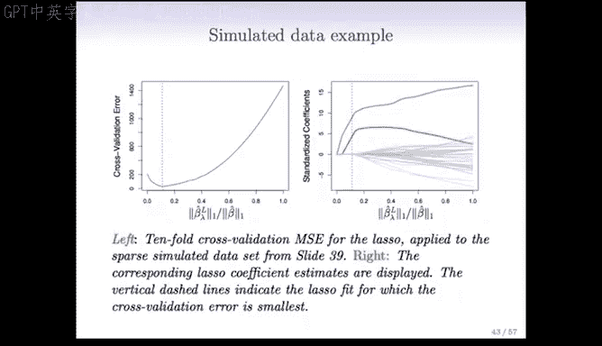

We applied the cross validation error versus the L1 norm of the Laso solution divided by the L1 norm of the Foli square solution。

 This just to give you a convenient way of scaling the x axis so that it goes from 0 to 1 right the fo squares estimates。

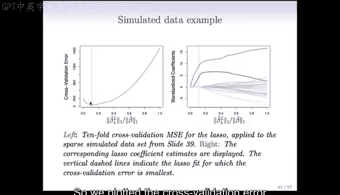

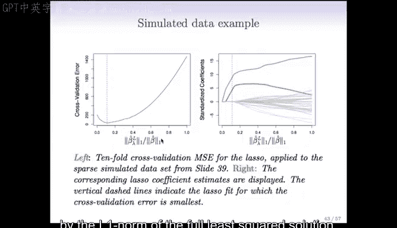

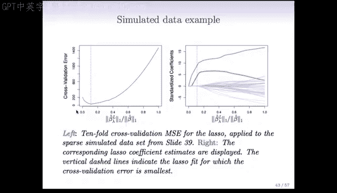

ItGives a value of one。

And the0 estimates of 0 give you a value of 0。 And in between。

 we have the the intermediate laso solutions。 So here its cross the validation curve。 Again。

 it's got that you shape that that Daniella mentioned before。 And its minimum as is it around。

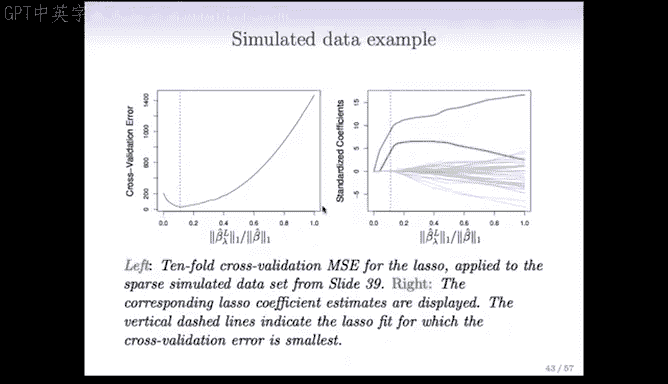

Here about0。1。

Which is quite severe shrinkage which is good here right because we know that the true model has only three nonzero coefficients and I think it's actually two even better okay two nonze coefficients and very good because here we seem to picked up exactly two nonzero coefficients the green and the red and the rest are exactly zero。

 so it's in this。

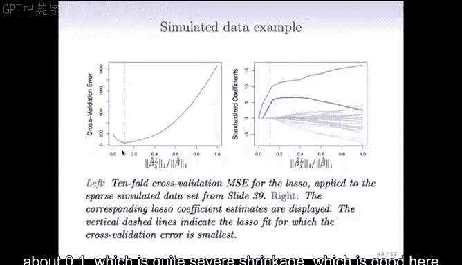

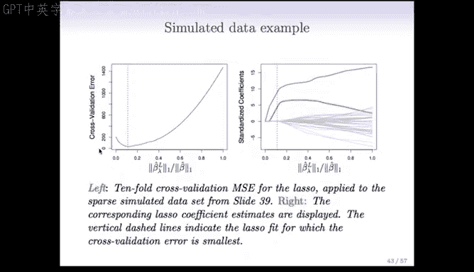

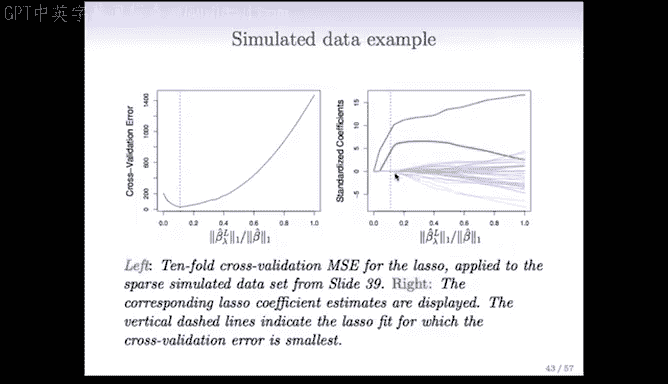

Made up example， it's done exactly the right thing。

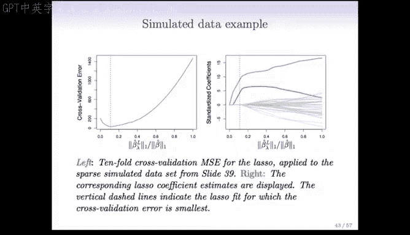

Correct two nonze features and set everything else exactly equal to zero。

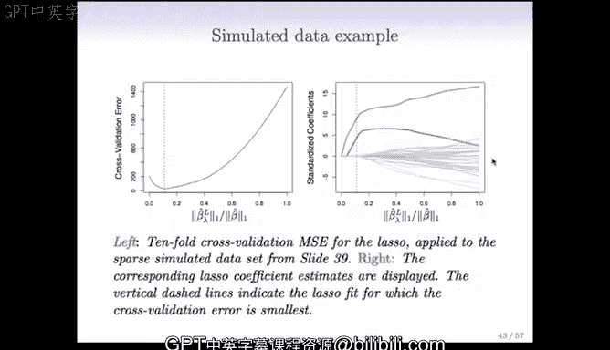