# 斯坦福大学《统计学习导论2023R语言版｜An Introduction to Statistical Learning with R》中英字幕 - P47：-047-Statistical Learning_ 6.R.4 Ridge Regression and Lasso.zh_en - GPT中英字幕课程资源 - BV1yU421o7WA

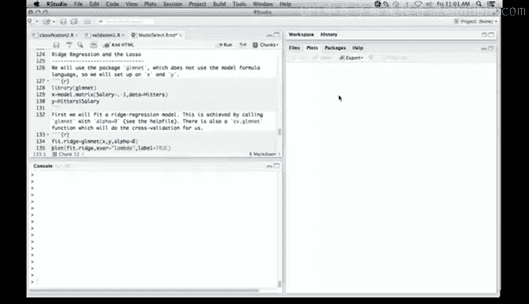

Okay， so yeah we're going to do our final session in the model selection。

Chapter and we can look at Ri regression and Leu and once again we using in our R markdown in our studio that will help us create a nice document at the end of the session and as as we've seen it's just as simple as having a script。

 but it's better because you get nice annotation at the end of the day。

So let's have a look at the screen and。See ourhi， we got Ri regression in the lau。

And for this we're going to use the package Gmnet Glimnet' is a package that I actually manage on Crran and it's been created by myself。

 Jerome Friedman and Rob Tipssrani for fitting lasu models。

 ridge models and a whole class of models in between elastic net which we won't cover in this class and for a lot of different loss functions so we can do logistic regressions。

 ordinary regressions and a variety of other models we'll be using ordinary regression yet yeah。

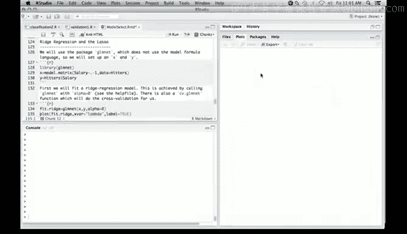

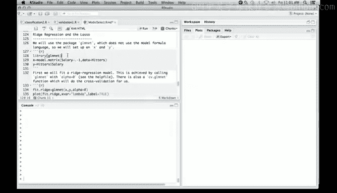

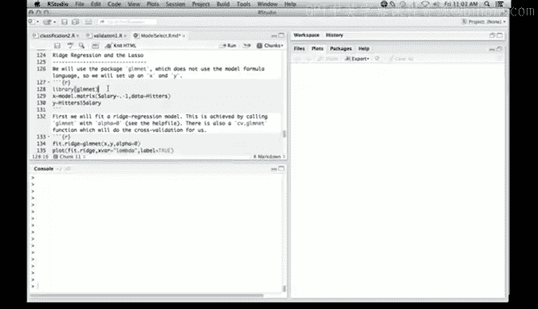

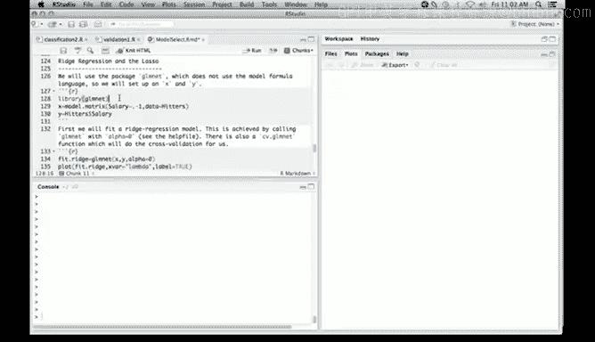

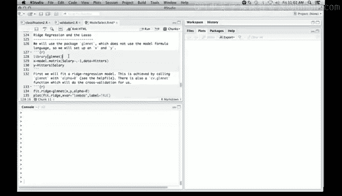

So we will run library Gmnet。

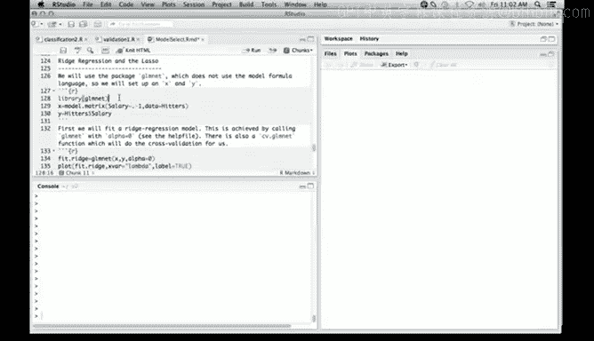

And。Glimnet doesn't use a formula language， so we're required to give it a matrix X of predictors and and the response vector in this case。

 So we create those。

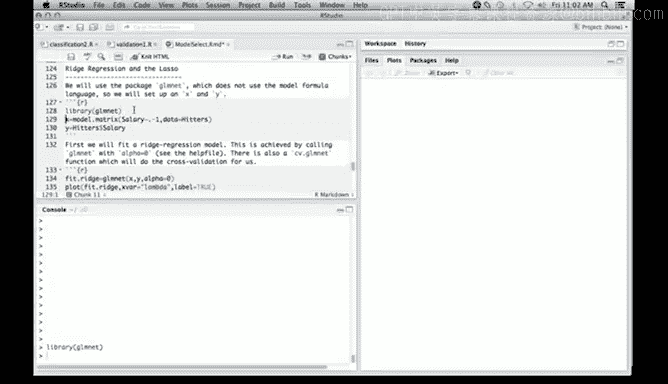

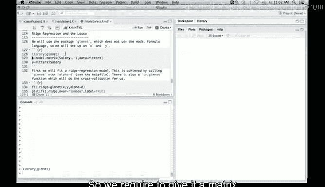

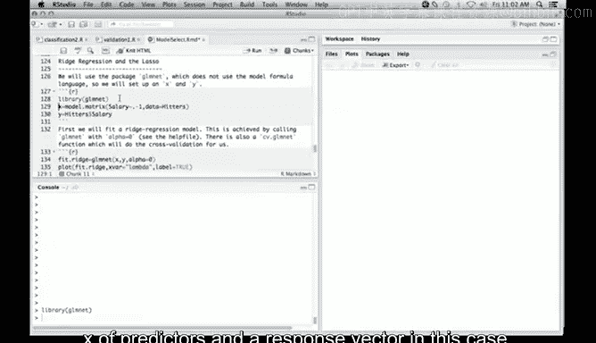

By using methods by which by this time， we know how So we make an x and a y。

 which is the the predictor matrix and the response。

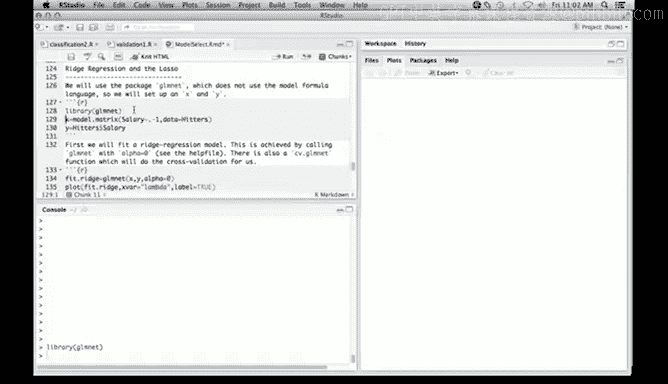

And we'll first fit a ridge regression model， so Klimnet's got an alpha argument and alpha equals 1 is less Su and alpha equals0 is riddge and if you look on the help file you'll see instructions and how to on some of the other arguments。

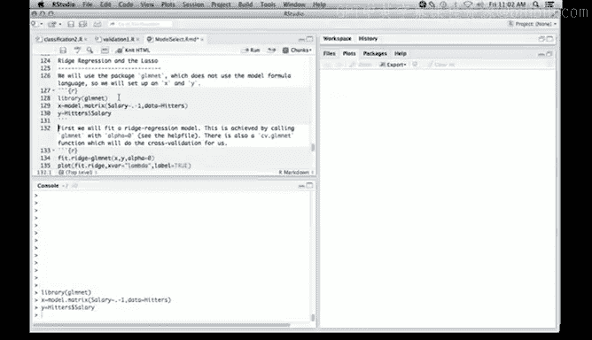

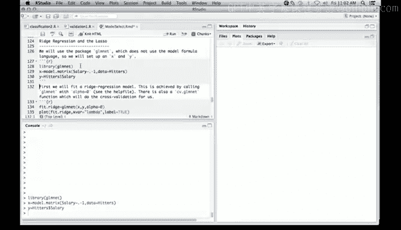

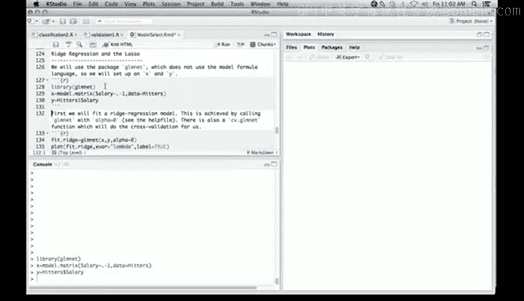

And for alphas in between 0 and1， you get what's called elastic net models。

 which are in between Ri and less Su。 But for for us now， we'll just focus on alpha equals 0。

 which is ridge。

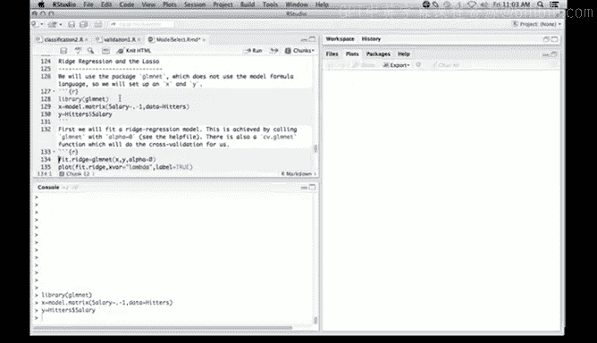

And so。We do that， and it comes back very quickly。 Li it's extremely fast。

 and this isn't a big data set。 So it's especially fast。

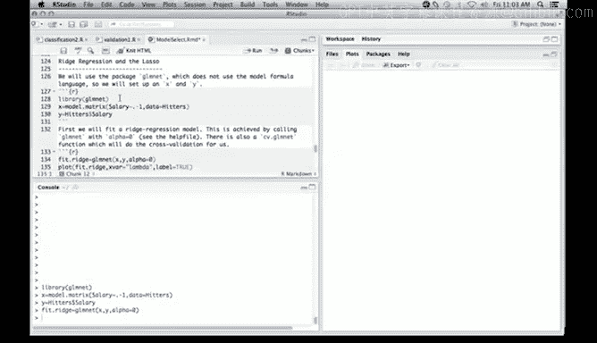

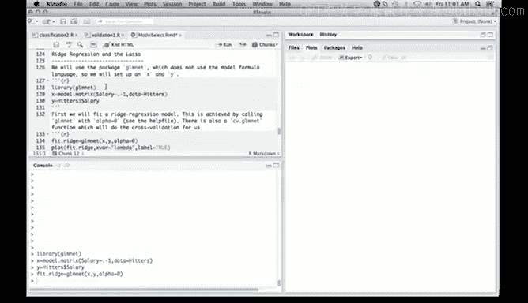

Let's use a plot method for a gliminate object。

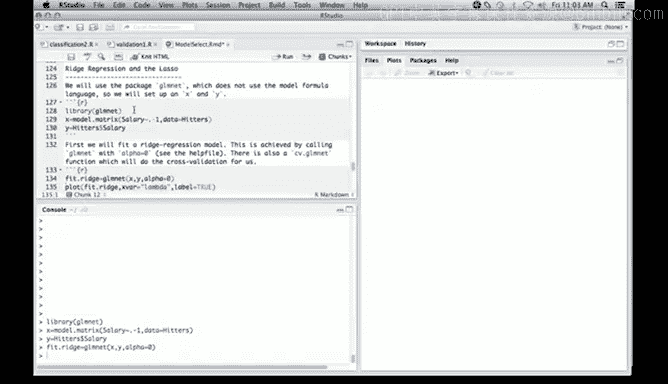

And this is kind of interesting。 it makes a plot。

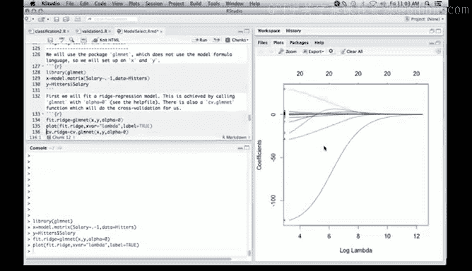

嗯。As a function of log of Lada。

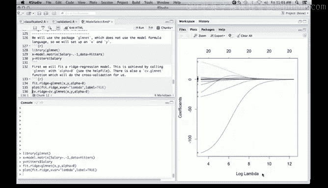

And what it's plotting are the coefficients。So if you go back to the lectures on Rige regression and Lassu。

 you'll see that the models are penalized according Rige regressions penalized by the summer squares of the coefficients。

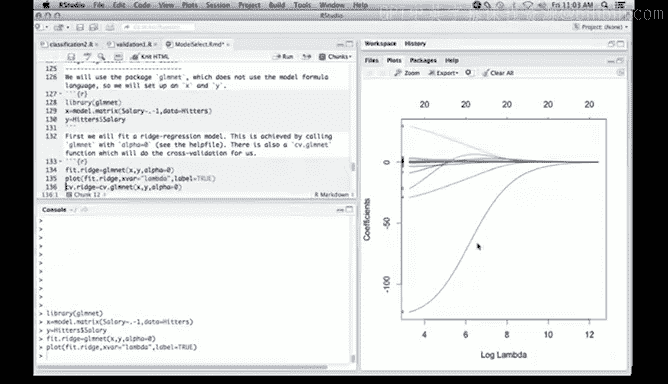

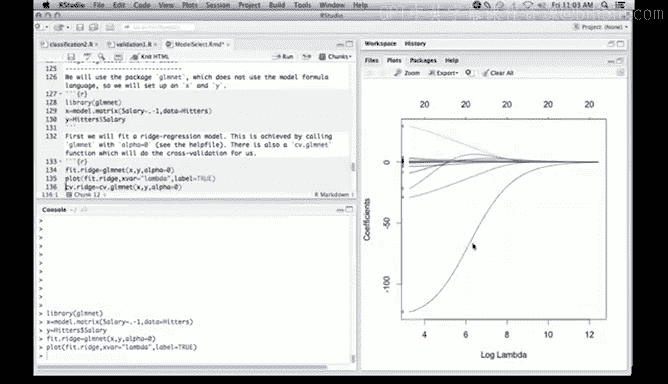

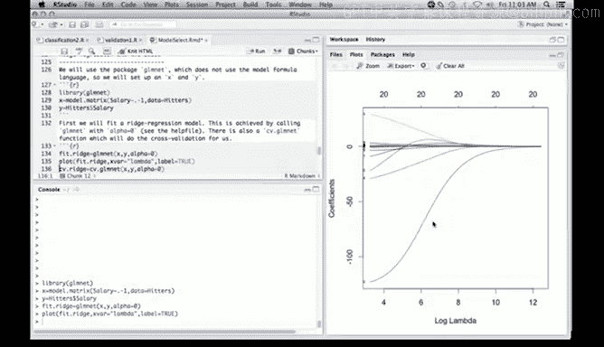

So penalties put on the sum of squares of the coefficients。

 And that's controlled by a parameter lambda。

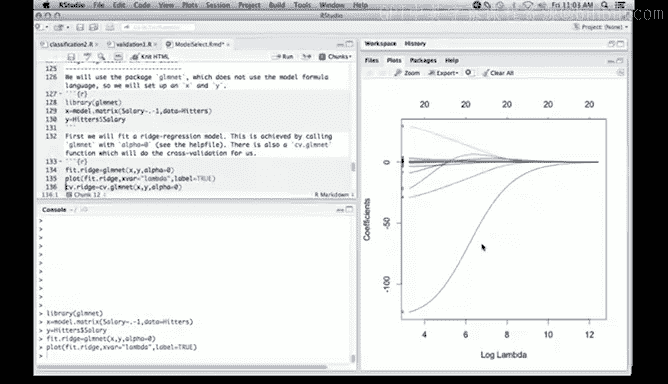

So， the criterion for。

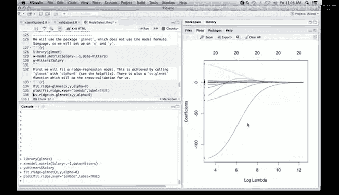

For Rige regression。Is。

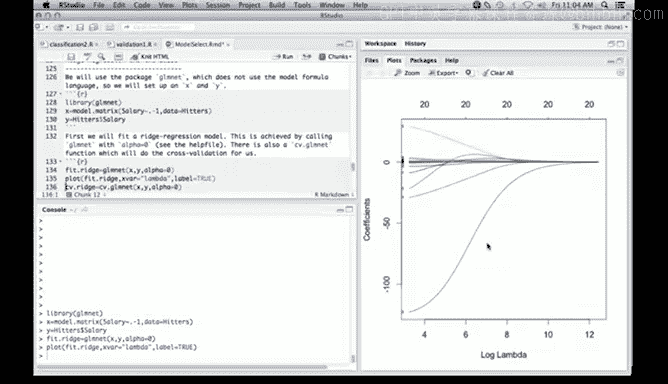

Resid your sum of squares， which is the usual for linear regression。Plus， lambda times the summation。

J equals 1 to p of beta J squared。So it's trying to minimize the residual summer squares。But。

It's been modified by a penalty on the summer squares of the coefficients。So if lambda is big。

 you're going to want the summer squares of the coefficients to be small。

 So that'll shrink the coefficients towards 0。And as Lada gets very big。

 the coefficients will all be0。And so what Gliminate does is that it actually develops a whole path of models on a grid of values of lambda。

 quite a5， about 100 values of lambda。And so we see here on the log scale when log of lambda is 12。

All the coefficients are essentially zero。Then as we relax Lada。

 the coefficients grow away from 0 in a nice， smooth way。And。And they get。

The sum squares of the coefficients is getting bigger and bigger。

Until we reach a point where lambdas are effectively zero and the coefficients are unregularized。

 and so these would be the coefficients that you get from an ordinary least square foot。

Of these variables。 So gl lit will create the whole path of variables。

So unlike subset and forward stepwise regression， which controls the complexity of a model by restricting the number of variables。

 rich regression keeps all the variables in and shrinks the coefficients towards zero。Okay。So。

It gives a whole path。 We need to。

Pick a value along the path， and Linet's got a built in function called C V dot Linet that'll do cross validation for you K fold cross validation。

 And so we'll run C V dot Ridge。 It stand by default 10fold cross validation。

 and then we can do a plot。 There's a plot method for that and gives you a nice plot of the cross validated mean squared error。

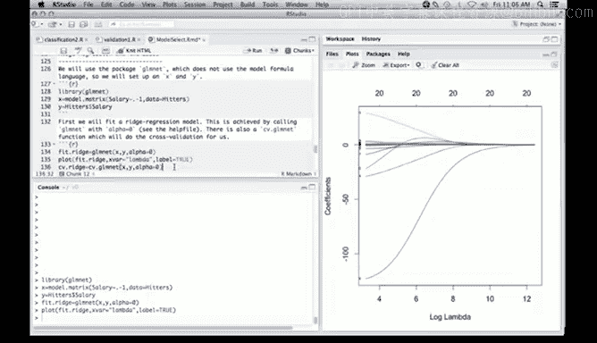

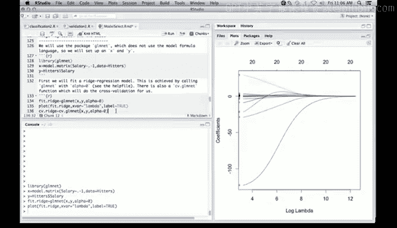

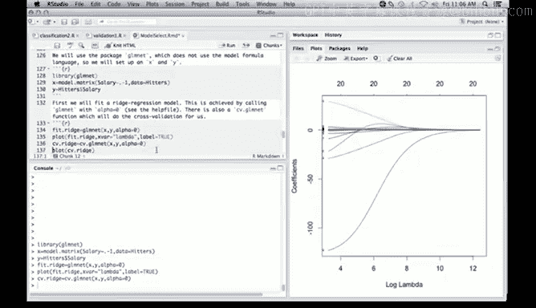

And there it goes， and you see it dips down。In the beginning the meanquad area is very high the coefficients are restricted to be too small。

 and then at some point it kind of levels off， this seems to indicate that the full model is doing a good job。

There's two vertical line here， the one is at the minimum and the other vertical line is at one standard error of of the minimum within one standard error。

 so it's a slightly more restricted model that does almost as well as a minimum and sometimes we'll go for that。

And at the top here it's indicating that at all stages， there's all 20 variables in the model。

 so that's our 19 variables plus the intercept。So that's re regression using glmni。

Let's use a lasu model。 Now， if you recall， the lasu was。Was similar to Ri regression。

 The only thing that was different was the penalty。So， let's get the pin on you。So for lessu。

 we minimize the residual sum squares plus lambda。And it's a very subtle change。

We've got J equals 12 p。 instead of the sum squares of the coefficients。

 we penalize the absolute values of the coefficients。

It's also controlling the size of the coefficients。

And it seems like absolute value and some squares would be rather similar。

 but the laus's got a somewhat magical quality and by penalizing the absolute values。

 that's actually going to restrict some of the coefficients to be exactly zero。Okay， so。哦 we got得。

Get back to our controller。 So let's run that again。 It fits the whole path。

And when we make the plot against the log of Lada， indeed， what you see is that。

Initially all the coefficients are zero and then the first coefficient seems to be a purple。

 there's a pair of them there and then the blue one's been zero up to this point then it jumps in。

 then this red one jumps in so you see the coefficients jump in having been zero for a length of the path。

And at the top of the plot， we actually see as a function of Lada as well。

 how many nonze variables are in the model。So as we saw in the lectures。

 Lau is doing shrinkage and variable selection。When we fit the lassux using Gmnet。

 we didn't tell it alpha because the default for alpha is one， which gives you the lasu。

We plotted the laux against x v equals lambda。 If you look at the help file for the plot。

 you'll see that there's various choices。 and one of them is a really interesting choice。

And its deviance。 And what it means is。percentage of div explained or percentage of in case of regression。

 your sum squares explained， which is the R squared。 So if we make that plot。

It's changed the orientation。 And at the bottom of year， we it says fraction of Dance explains。

 So that's like the R squared。

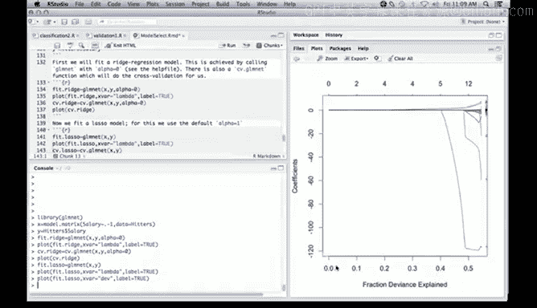

Right， and。What do you find out， is that。A lot of the R squared was explained for quite heavily shrunk coefficients and towards the end。

 with a relatively small increase in R squared from between 0。4 and 0。5。

 the coefficients grow very large。 and so this may be an indication that at the end of the path is overfitting。

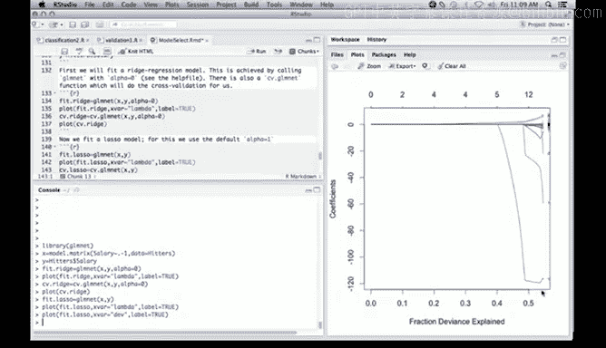

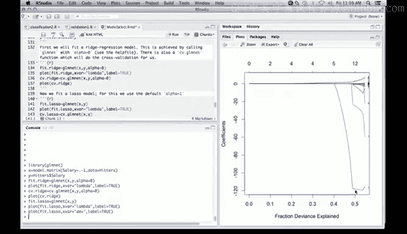

So these different ways of plotting the coefficients。

Give you different information about the coefficients。And about the nature of the path。

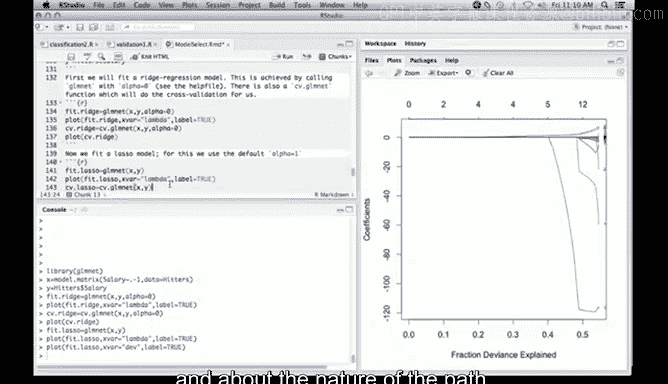

We can use cross validation again。

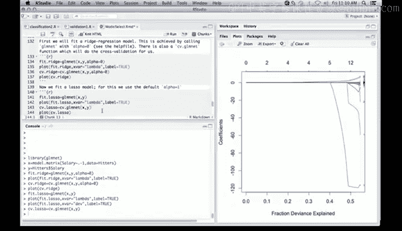

And， and plotted and see years cross validation for the laux。And it's telling us that the best model。

The minimum cross validation areas is at for size 15。And within one standard error。

 we have a model of size about six。Right， and somewhat flat in between。And。

And so we may make our choice based on that。 There's a coefficient function extractive that works on a cross validation object。

And it remember the， the。The foot dot lasu will have the whole path of coefficient， said Scott。

Roughly 100 coefficient vector， depending on each value indexed by different values of lambda。

But if we extract the coefficient from the C object。

 it'll pick the coefficient vector corresponding to the best model， which in this。In this case was。

 was the the model of size。嗯。Well， let's see what size 1，2，3，4，5。 So I， I guess it's。

 it's picked the model。It's picked this model over year。

So it's within one standard error of the minimum。So it's err on the more parsimonious side。

 We know that the， the cross validation error is measured with， with some variance。 and。

 and so that's， that's the the model that's actually chosen。All right。🤧嗯。We'll end the session by。

Using our earlier validation training division。 So use a validation set to， to select the。

The lesssu model。And that's also easy to do。 So we've still got our variable train hanging around index variable。

 So we'll fit the the path of lasoo models using x train and Y train。And。

You can do a summary of the foot。 It actually tells us。The summary of of a glimminate fit。

For each of the models in the path， it gives you the degrees of freedom。

 which is the number of nonzero coefficients。The percentage variance explained。

 which is like R squared for generalized linear models。

 but this case it's squared error lossso that's just R squared on the squared error loss scale。

And the lambda value that corresponded to that， that fit。

And it actually tries to fit100 values of Lada， but if it reaches a point where nothing much is changing。

 like you can see， nothing much is changing here， it stops。

Because it's not really making any progress。 So as Lambdas getting smaller。

 the models really not changing。 It's pretty much at this。At the。

The ordinary squares fit the un penalized model。Okay。

So now we can make predictions on our left out data， so that's indexes x by minus train。

 which like we did before。And if we do dim of predict iss 83。Observations in the validation set。

And we've got 89 values of lambda， so there's going to be 89 different columns in this prediction matrix。

In' an interesting。Little command here。 we we， we want to compute our summer squared errors。Well。

 y minus strain is a vector of length 83。But bread is a matrix83 by 89。

 And yet we happily say y minus train minus pre。Well。

 what it does is it recycles this vector 89 times， and it does it columnize。

So that can compute this difference。 So the result of this year is a matrix that's 83 by 89。

 even though we only gave y is a vector， it recycled it， which is， it's kind of a trick。

 but it's a handy trick。We square those errors。We then use apply to compute the means in each column of the squared errors and we put that in and then we take the square root。

 So there's a whole bunch of commands all in one there and and now we can plot that。And。

As a function of lambda。

And we see a nice。AVidation curve it goes down and then climbs up again。

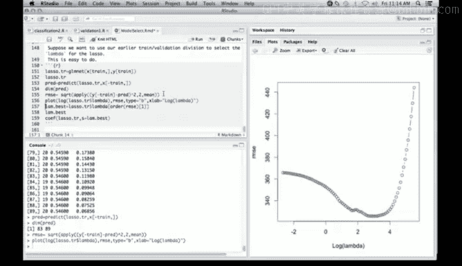

This will be overfitting， this is underfitting， and this seems to be the sweet spot over here。

And we can extract the base lambda。

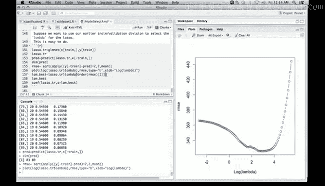

And yeah， I do this by it。

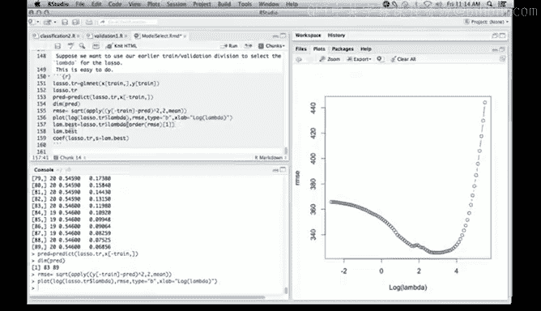

Indexing。There's a component on the Kemnet object。

Called Lambda。 So this extracts that component。 Then I index it by order of R M E。

 So that's our root meet square error。

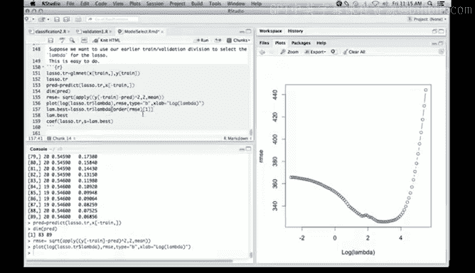

Order puts them in ascending order， and so we want first the index of the first or the smallest value。

 and that'll pick up the best lambda。

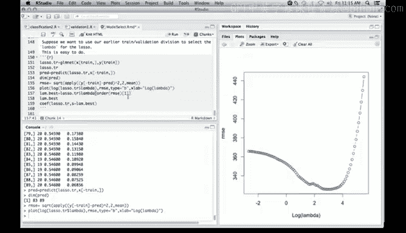

So that's a way of doing that and we find the best lambda is 19。98。

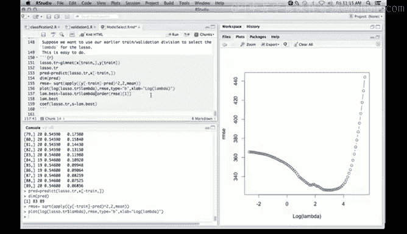

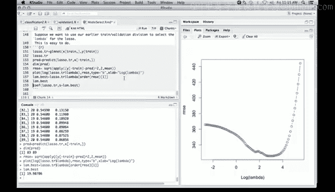

And so now we can look at the coefficients corresponding to that variable。

 and that'll give us a subset of the coefficients。

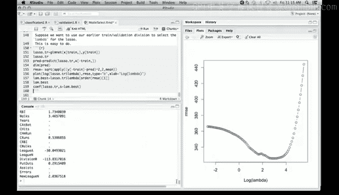

And the dots correspond to the zeros。 So those are the ones that are missing。

 And so they're not not missing， but they zeros。

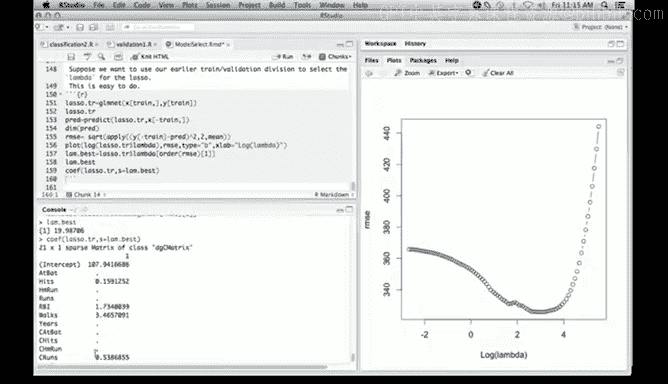

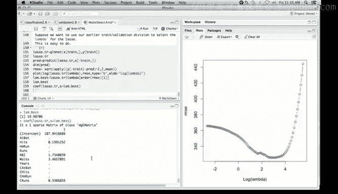

This is actually printed out in what's known as sparse matrix format。

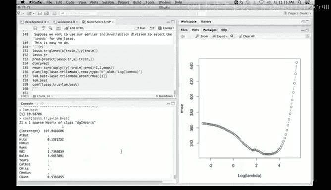

And so。Which means only the nonm values only the nonzero values are actually recorded。

So theres our coefficient vector。And that's the end of the session。

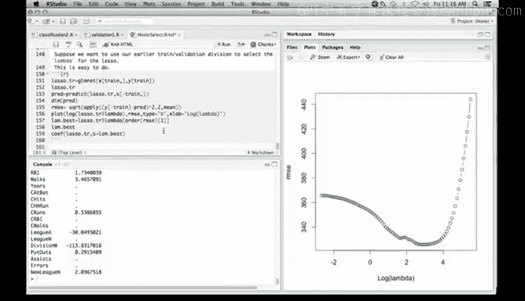

So to summarize， we've。In the last few sessions。We've looked at model selection。

 we've looked at a variety of different methods， best subset For stepwise， Ri regression lau。

 we've used validation sets to select models， we've used CP to select models and we've also used Kfold cross validation。

We've also seen how to use our markdown to actually produce a nice recording of everything we've done。

we hit the knit HTML at the top of the pager， and this is for the entire set of sessions on model selection。

 and you get a really nice summary of everything you've done， all the output。

 all the plots nicely formatted and it makes for a good report。

Think about if you're doing a data analysis for a client。

 this is a really nice way of showing the output， it shows what you did and the results of what you did。

And so that's available， it's a web page， and so you can distribute it the link to that web page。

 you can put it in a blog， you can do what you like with it。What we didn't cover was。

Princiipple component regression and partial E squares。There's a lab in the end of the chapter。

 but by now you'll have learnt enough tools you were able to go through that lab on your own。

