# 斯坦福大学《统计学习导论2023Python版｜An Introduction to Statistical Learning with Python》中英字幕 - P48：-048-Statistical Learning_ 6.9 Dimension Reduction Methods.zh_en - GPT中英字幕课程资源 - BV1u4421A7ZU

嗯。

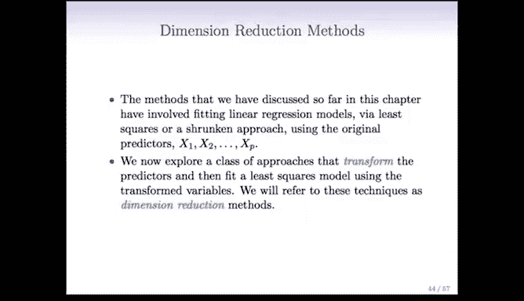

Okay， so we've talked about subset selection methods， Ri regressionham and moasso。

 and now we're moving on to the last class of method that we're going to talk about in this lecture。

 which is dimension reduction。😊，And so if we remember in the subset selection methods。

 we were just taking a subset of the predictors and using least squares to fit the model。

 and then in Ri regression on the Laso， we were really doing something different where we were taking all of the predictors。

 but we weren't using least squares， we were using a shrinkage approach to fit the model。

And now we're going to do something different， which is we're going to use least squares。

 but we're not going to use least squares on the original predictors， x1 through XP。

 instead we're going to come up with new predictors which are linear combinations of the original predictors and we're going to use these new predictors to fit a linear model using least squares。

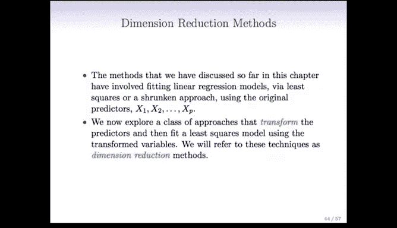

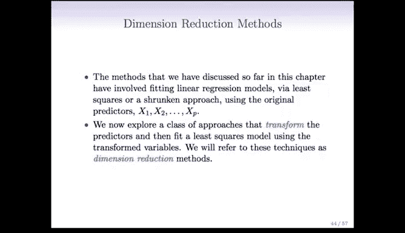

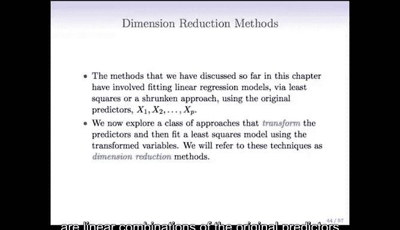

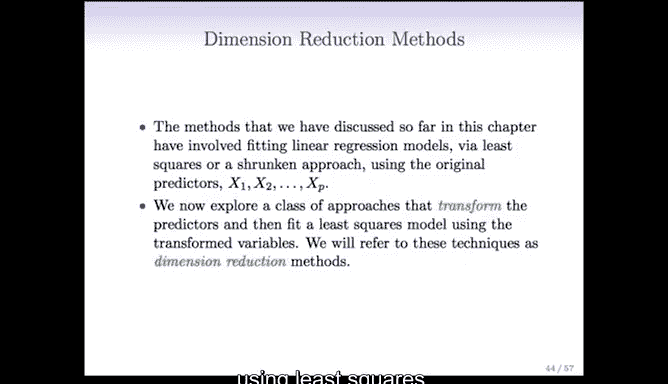

So this is known as dimension reduction， and the reason it's called dimension reduction is because we're going to use those P original predictors to fit a model using M new predictors。

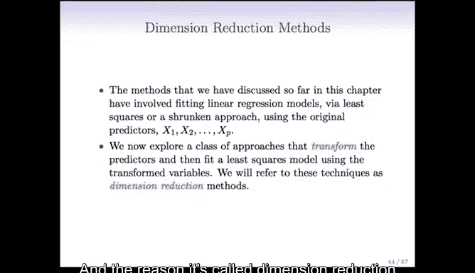

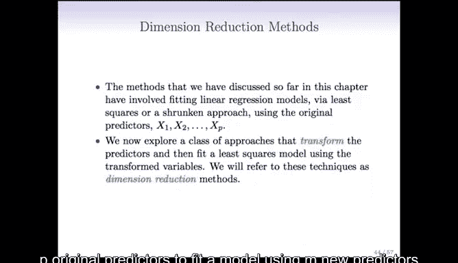

Where m is going to be less than p， so we're going to shrink the problem from one of P predictors to one of M predictors。

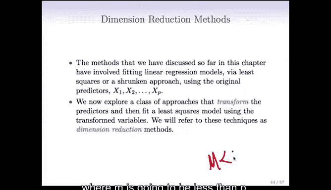

So in a little bit of detail here， we're going to define M linear combinations， Z1 through ZM。

 where M is some number less than P。And these are going to be linear combinations of the original P predictors。

So for instance， ZM is going to be the sum of the P predictors where each predictor is multiplied by PMJ。

 where VMJ is some constant， and in a minute we'll talk about where this VMJ comes from。

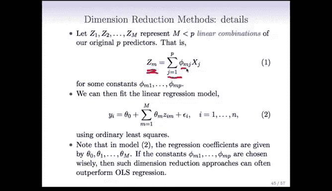

But the point is once we get our new predictor is Z1 through Zm。

 we're just going to fit a linear regression model。

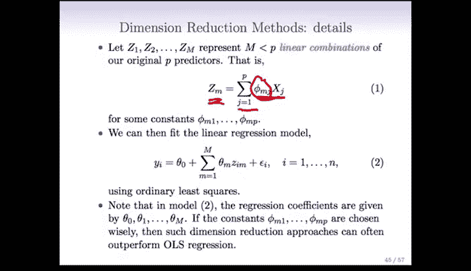

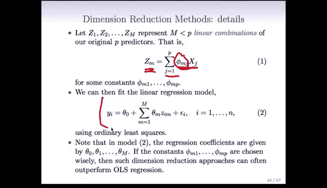

Using least squares， but instead of using the X's， we're going to use disease。

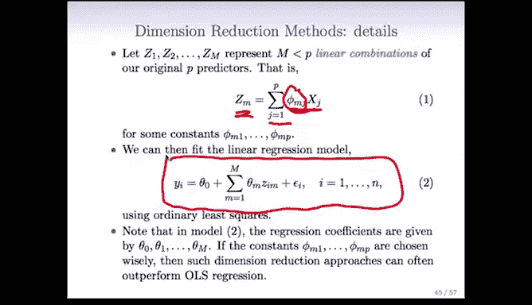

So in this new least squares model， my predictors are going to be disease and my coefficients are going to be theta n through theta M。

And the idea is that if I can just be really clever in how I choose these linear combinations。

 in particular， if I'm clever about how I choose these VMJs， then I can actually beat least squares。

😊。

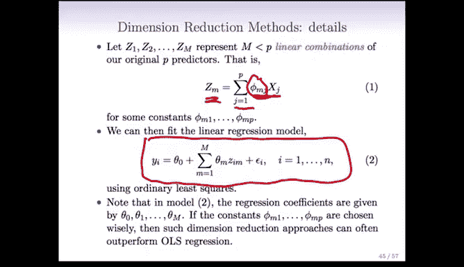

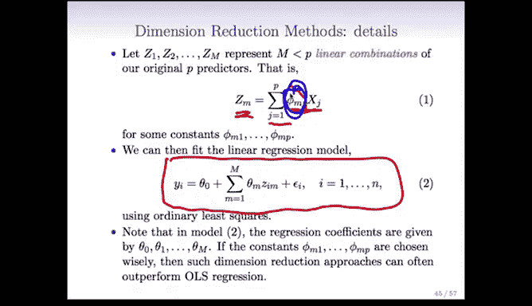

That I would have gotten if I had just used the raw predictors。

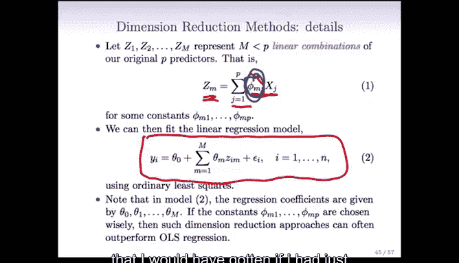

So one thing that we should notice is that on the previous slide here。

 we had this summation over theta M， Z IM。

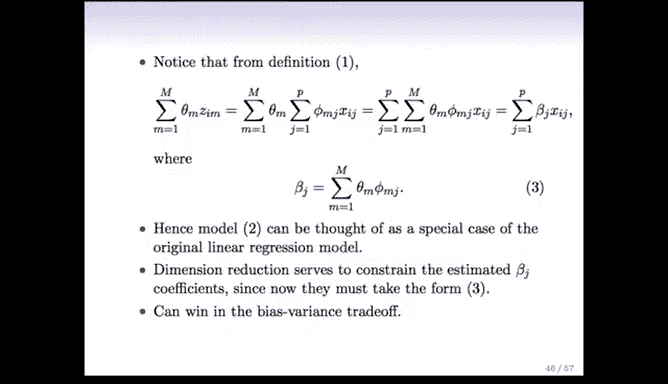

And if we look at that a little bit more carefully and we plug in the definition of ZIM。

 which remember was just a linear combination of the original x's。

And we switch to the order of the sums and we do a little bit of algebra。

 we see that what we actually have here is a sum over the P predictors。

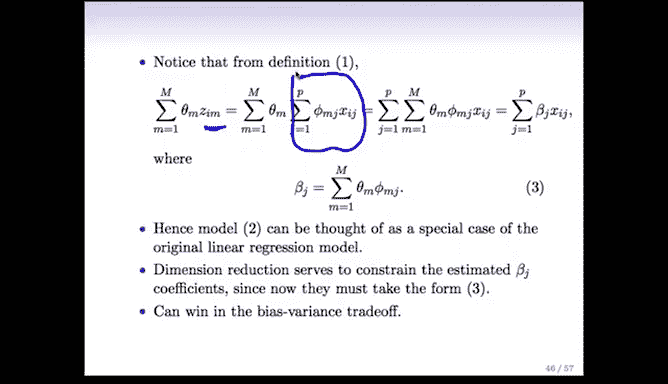

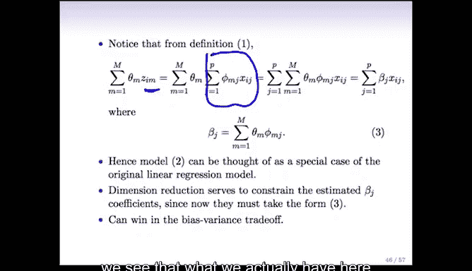

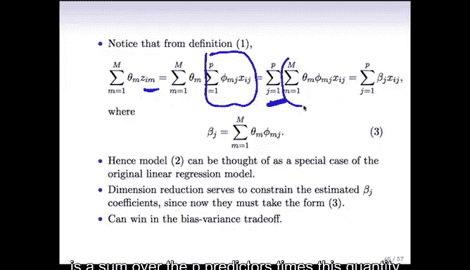

Times this quantity times the piece predictor。

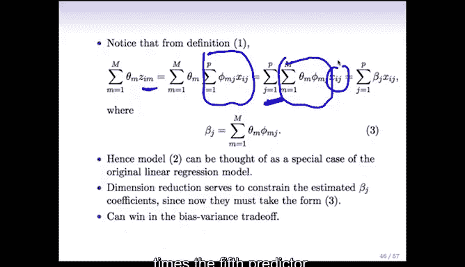

So this is actually just a linear combination of the original X's。Where。

The linear combination involves a beta J that's defined like this。

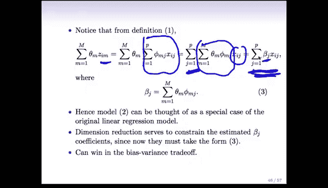

So the point is that when I do this dimension reduction approach and I define these nu z's that are linear combinations of the x's。

 I'm actually going to fit a linear model that's linear in the original x's。

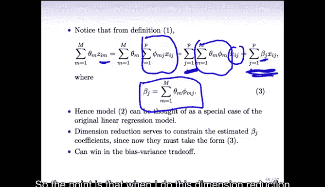

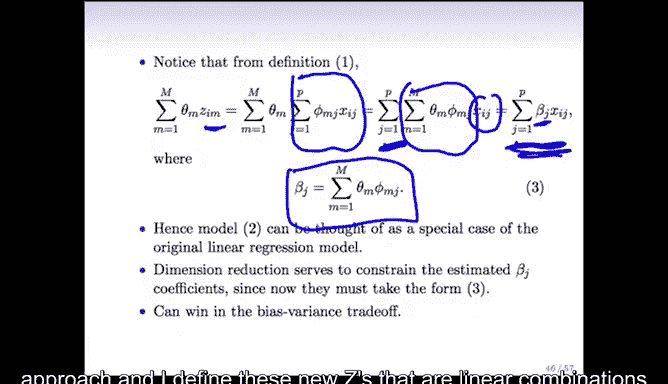

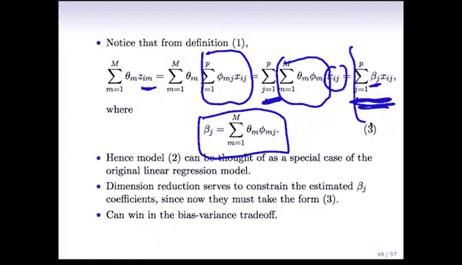

But the beta js in my model need to take a very， very specific form。

So these dimension reduction approaches， they're giving the models fit by least squares。

 but I'm fitting the model not on the original predictors， it's on a new set of predictors。

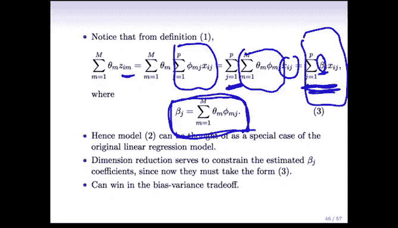

And I can think of it actually as ultimately a linear model on the original predictors but using different coefficients that kind of take this funny form here so in a way it's sort of similar rigid Lasa right it's still least squares is still a linear model in all the variables but there's a constraint on the coefficients that's exactly right but we're getting a constraint in a different way。

 we're not getting a constraint like in the ridge case by saying okay my sum of squared betas needs to be small instead we're saying my betas need to take this really funny form if you look at it but it's got a simple interpretation in terms of least squares on a new set of features。

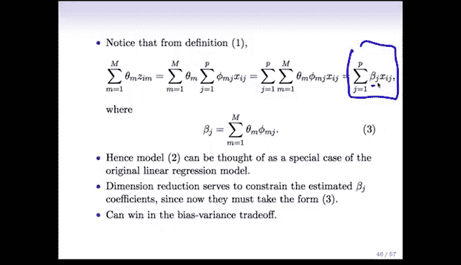

So and the idea here is really it boils down to the bias variance trade off by saying that my betas need to take this particular form。

 I can win， I can get a model with low bias and also low variance relative to what I would have gotten if I had just done plain vanilla least squares on the original features。

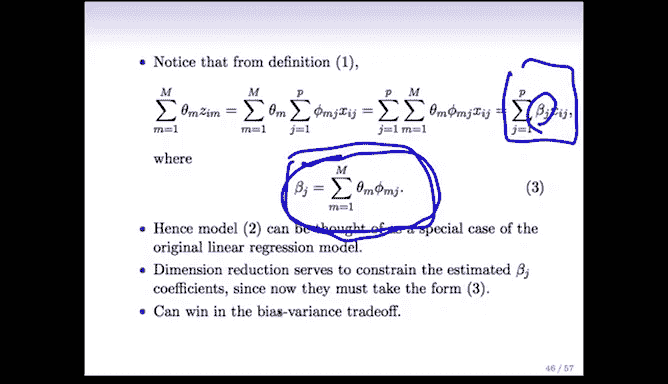

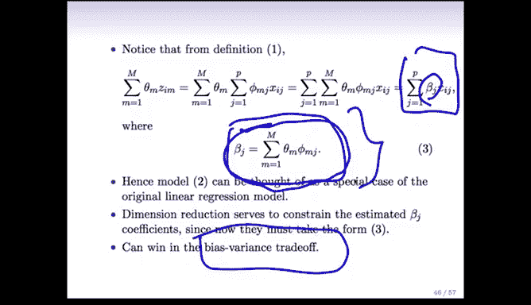

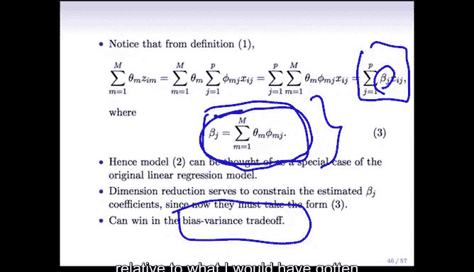

One thing that I should mention is that this is only going to work nicely if m is less than p and instead if my M equald p。

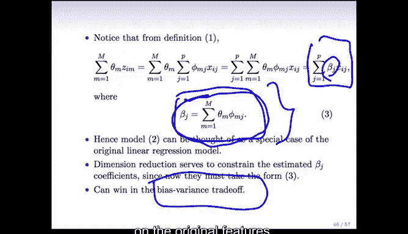

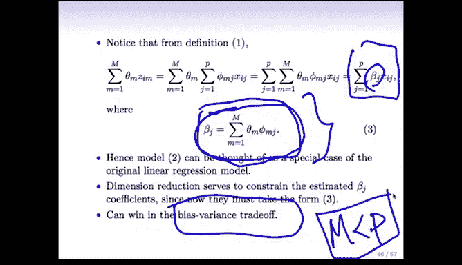

Then I would just end up with least squares and this whole dimension reduction thing would have just given me least squares on their raw data。

