# 斯坦福大学《统计学习导论2023R语言版｜An Introduction to Statistical Learning with R》中英字幕 - P49：-049-Statistical Learning_ 7.2 Piecewise Polynomials and Splines.zh_en - GPT中英字幕课程资源 - BV1yU421o7WA

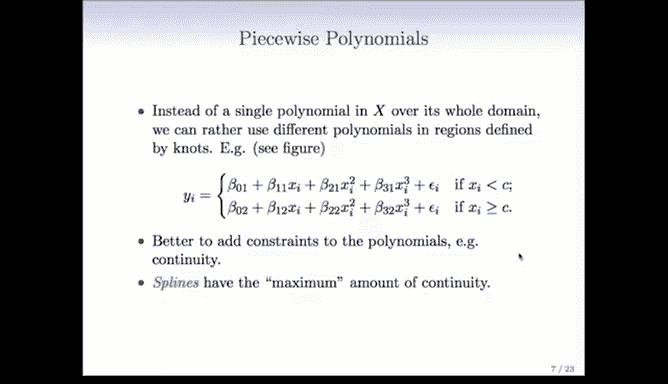

Okay。Now we're going to talk about more adventurous methods。

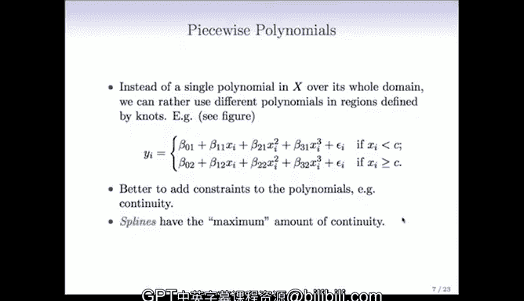

And more modern as well。And so piecewise polynomials。Generalize the idea of peacewise constants。

 So instead of having a single polynomial in x over its whole domain。

 you can use different polynomials in each region instead of different constants fit different polynomials。

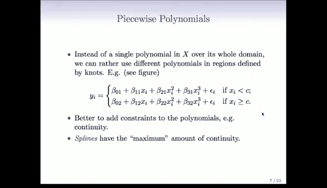

So this next figure。Chhowose a piecewise polynomial in two regions。 So you're in the top left panel。

There's a piecewise polynomial。 It's a cubic polynomial。 There's the knot at 50。And it's。

 it's a cubic to the left and a cubic to the right。 They two different cubic polynomials。

 and they just fit to the data。 This one's fit to the data on the left。

 This one's fit to the data on the right。What do you think of that， Rob？

There's a break in the middle。 It was noticed pretty ugly， isn't it。It's pretty ugly。

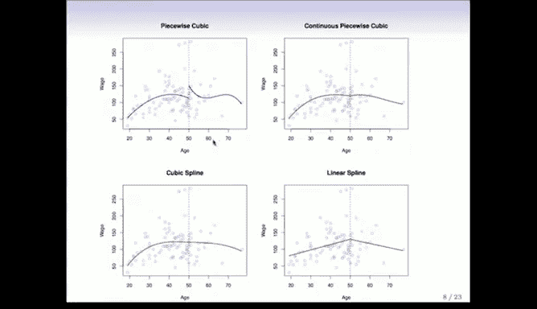

But that is a piecewise as cubic polynomial。

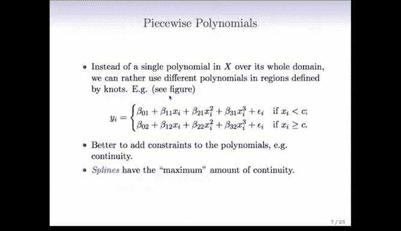

But the brake's ugly。 So it's better to add constraints to the polynomials， for example， continuity。

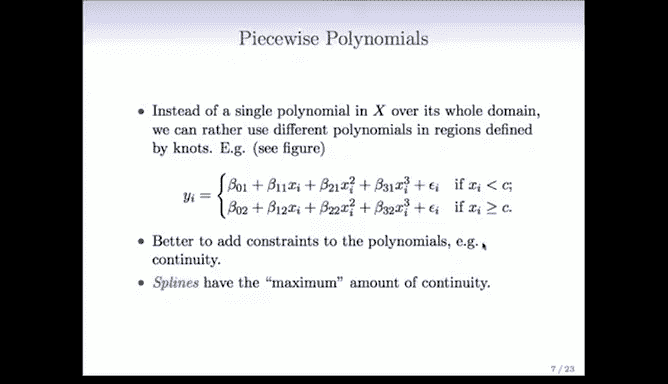

So in this top right panel， we've got a cubic polynomial in the left， a cubic in the right。

 but we forced it。To be continuous at the knot。So that looks much better already。

 This is already starting to look like the function we got from the polynomial。

 the a global polynomial， but。😊，We can actually see this little kink in the middle here。

 And in this case， it's not too egregious， but in some situations。Continuity is not enough。So。

You can enforce continuity in on， on the derivatives as well。So this function here。

 this red one is actually called a cubic spme。😊，And what it is is it's a cubic polynomial in the left and the right。

It's continuous at the not。The first con first derivatives continues。At the knot。

 and the second derivatives continues at the knot。So there's three constraints。And that's called a。

Now， we couldn't make the third derivative continuous because then would just be a global cubic polynomial。

 So we've made as enough continuity as we can still allowing some separate separate functions in cubic in each region。

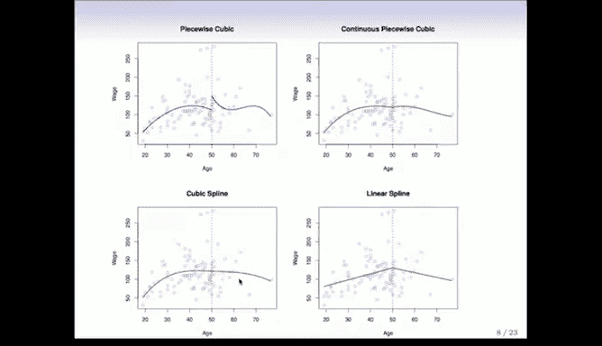

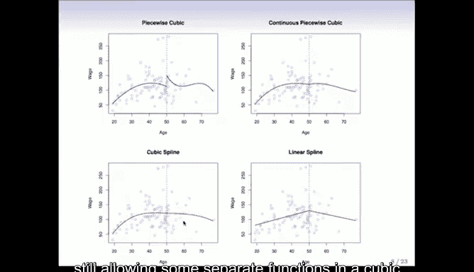

That's called a cubic sp。

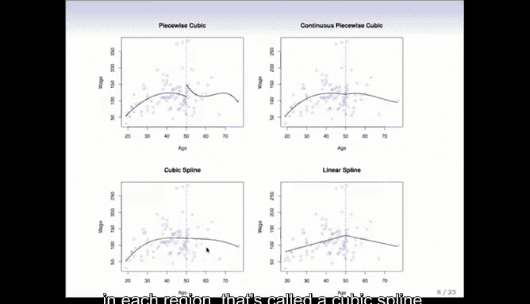

While we on it we we could have linear polynomials， and here's a linear spline。

 So it's or piecewise linear function。 It's it's linear in the left and the right。

And is forced to be continuous at the knot。So the amount of continuity you can enforce is one。

 the order of contitinuity is one less than the degree of the polynomial。 So yeah。

 we can only enforce degree0 continuity， whereas yeah we force in degree 2。

While it's a third degree of polynomial。 So maybe just sort to be clear where thoughts evolved。

 right， we started off with a global polynomial and we didn't like that because it was global so because the fit at one end would be effective by points at the other end。

 So then we move to something which more local， piecewise constants。 and they were local。

 except they're not very smooth。 So now you want something that's both smooth and local。

 So that on the top left panel， we have something which is local。 it's smooth in each panel。

 but it's not smooth at the knots。 So now we sort of move towards a compromise where it's。

It it's local， but it's also smooth throughout the whole range。

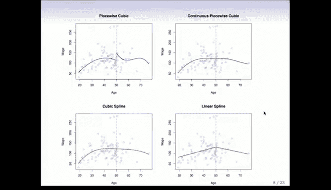

Thanks， thanks， sir。嗯。

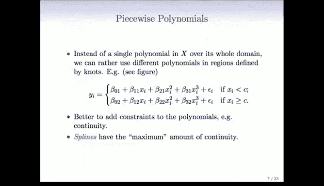

And as I said， splines have the maximum amount of continuity。 By the way。

 it's believed that a cubic spline。

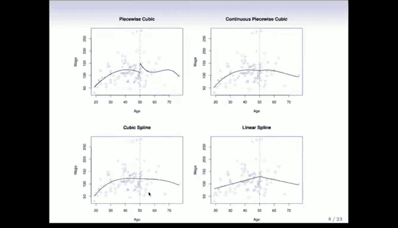

The discontinutinuity， which exists in the third derivative， is not detectable by the human eye。

 And it certainly seems right for my eyes。

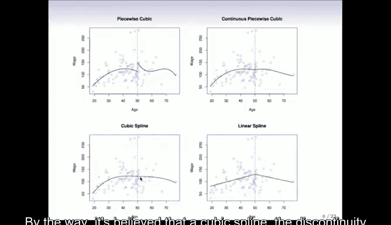

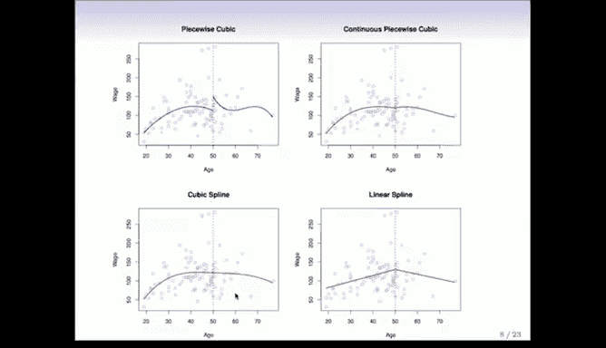

But I wouldn't trust my eyes。Okay， so let's go into a bit more detail about these liness。

 so we'll first do linear liness and then we'll do cubic sps。

So in the linear spline with knots at psi k k equals 1 to capital K。

 so you can put down we've had one knot in these pictures， but you can put down multiple knots。

Is the definition is the piecewise linear polynomial continues at each knot。And just like with the。

 in the previous cases， with the global polynomials in the and the and the。The constant function。

 piece wise constant functions。 You can represent this as a。

 we call it a linear expansion in basis functions。 So transformations of the variables。In this case。

 what you have is you have the variable itself。 So one of these basis functions is just the variable itself。

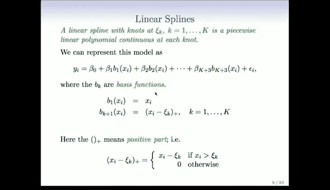

And then you have a collection of these。Trunncated functions， basis functions。

 They call truncated power functions。 but this one's to power 1。And it's here it is。It's X。

 I minus C， K， positive part。And what that means is describe below you。Is it's equal to X I minus C。

 K If X is bigger than C， K and it's 0 otherwise。 So it's not allowed to go negative。

And so you make one of these functions at each of the knot。And。

These transformations and you throw them in as additional variables。

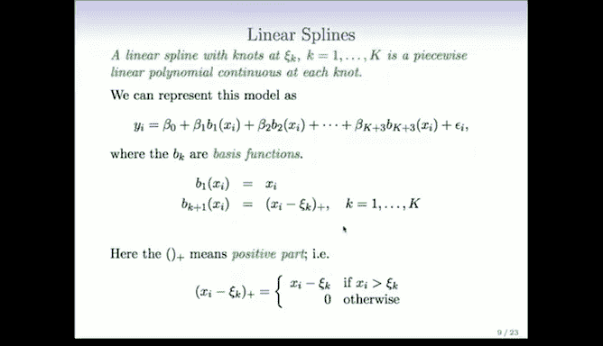

So to see how this works， let's look at a figure。So the blue curve is just a global linear function。

Yes。We've only got one not here。 So here's one of these basis functions。 See。

 it starts off at 0 at the knot， and then it goes up linearly。So this is x minus 0。6 positive part。

Below 。6 at 0。So now when you fit a linear model with with a global linear function。

 plus one of these in。And each of them gets a coefficient。

What you get is you get a function that's allowed to change its slope at the knot。

So if you add in some mix of this to a linear function， it'll。Change the slope of of this point。

 And so year， we see it over year。Okay， and because this starts off at 0。

 it makes sure it's continuous here。Very handy。 And you can make a bunch of these functions for however many knots you got。

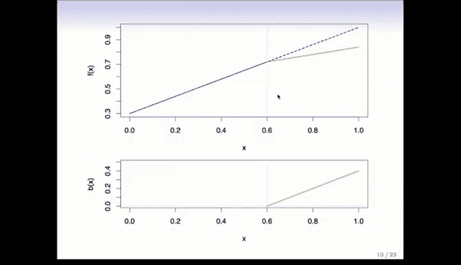

Cubic explains。Very similar idea。 So， first of all， the definition， the cubic sp with not at C。

 K K going from one to capital K is a piecewise cubic polynomial with continuous derivatives up to order2 at each knot。

 So that's the definition of a cubic sp。Again， you can represent this as a basis expansion in the original variables。

In this case。You need x1， x 1 square sorry， X， x squared and x cubed。

So the a basis for cubic polynomials， Of course， the constants always in the model。Okay。And then。

 you have similar。Tncated power functions。 But now they race to the power 3。

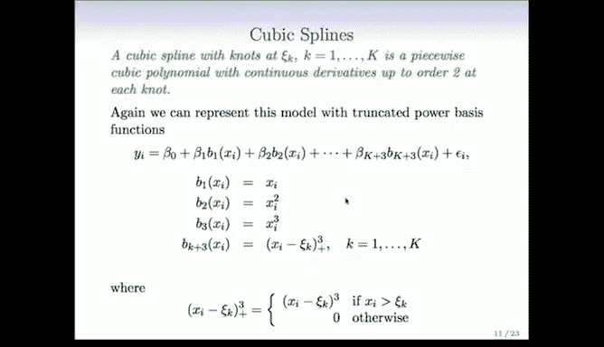

When at each knot。Where this guy is defined to be Xi minus C K cubed if X is bigger than C K and 0 otherwise。

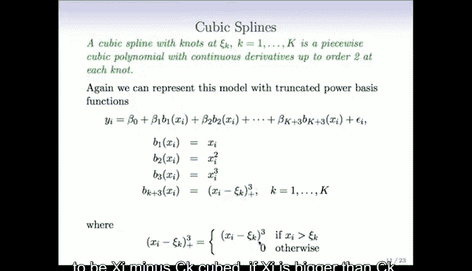

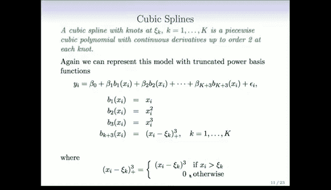

But the idea is the same。And here's the picture。 So now here's the little basis function。

 this truncated power basis function。And it's a little cubic polynomial that's 0 at， at the night。

In this figure over here， here's the global cubic polynomial， the blue1。 and years。

Added in some little linear combination of this orange guy。

 And that'll change the cubic part of the function in this region。And a bit of a detail。

 this spaces function。If you， if you check it out for yourself， you'll find out that it's。

It's0 at the knot。 It's also got0 first derivative and0 second derivative at the knot。

So when you add it in here， you don't change the derivative， those derivatives of the function。

 And so it has the required continuity of a cubic sp。

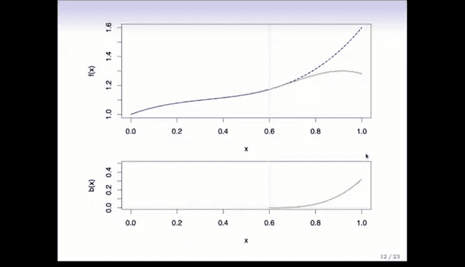

It's really handy representation。Okay， so CB explains are used all over the place and you'll see we even got fancier versions。

One fancier version is， is very handy， and it's the 1 I tend to use all the time。

 It's called a natural cube explain。

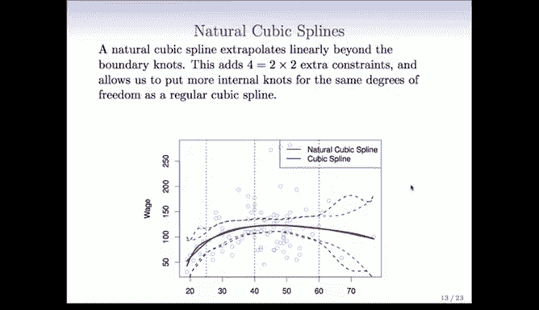

If you had the choice of a cubic explain and a natural cuic explain， which one would you use。

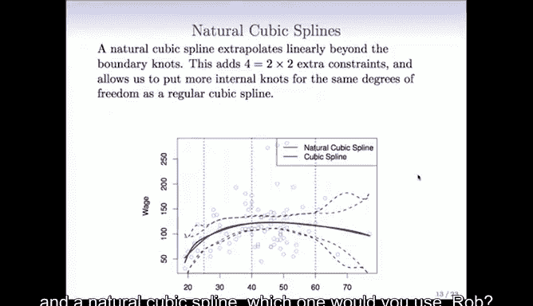

Natural I guess。It's a good choice of names。What a natural cubic sp is it's a cubic sp where you've added two extra con at the boundaries。

And the constraints make the function extrapolate linearly beyond the boundary nodes。

And what that means is that。The ends of the the function aren't just left unconstrained。

 We saw for a global cubic polynomial that the tail could wag quite a lot。 Well。

 we're not going to let that happen yet because we're going to make the function go off linearly beyond the range of the data。

 Okay And so what that does is it it adds four constraints to on each end。

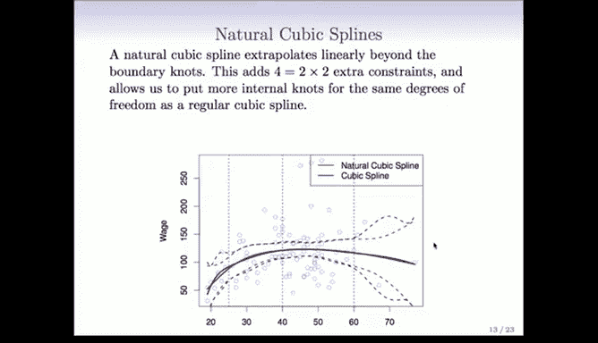

And that frees up four parameters。 So for the， for the same number of degrees of freedom or parameters in your model。

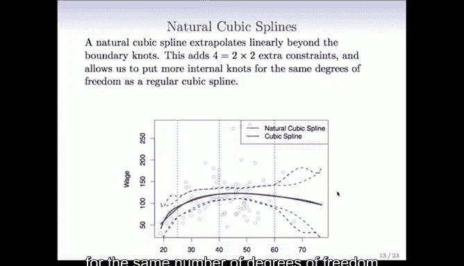

You can put extra knots in the middle and get more flexibility。

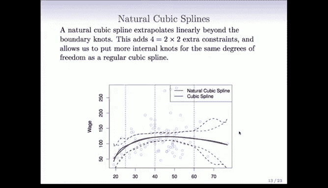

So in this figure， we've got a cubic sp and and a natural cubic sp。

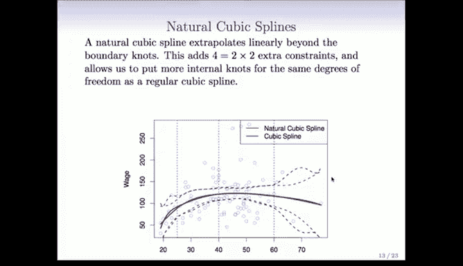

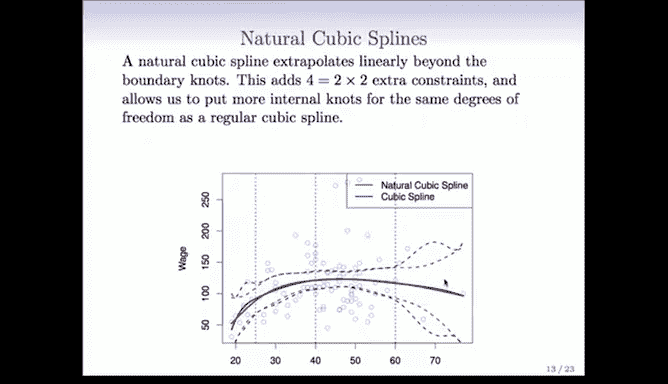

Now， you don't in the fitted function， you don't see much difference。

 You'll see the cubic explains a bit more weakly at this end over year。

The standard errors you see are much wider in places for the cubic spleline。

 especially at the boundary， which is where the act the effect of the natural spleline is。

 is taking place， and the standard errors for the natural sp are better there。

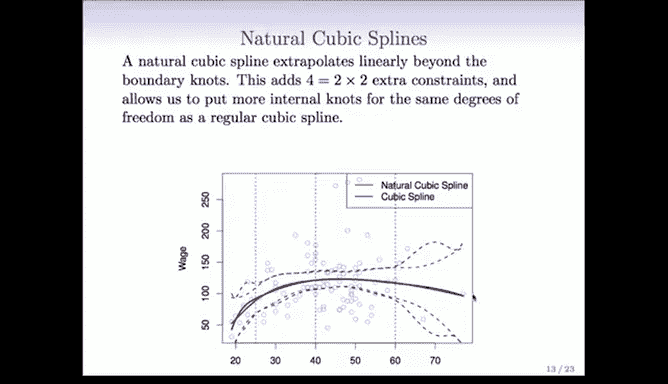

I'm actually working on something called Or cubeb explains， which even better。

 I can't give you details yet， but that bunch should catch on I think， especially here in California。

 especially California。Very good。

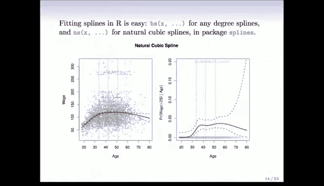

Okay， fitting splines in R is easy， there's a function Bs。

Which takes a variable X and has some arguments。 You can give it the knots， for example， And。

 or you there other ways of specifying the flexibility。 And it'll just do the work。 You。

 you put that in a formula and you can put one of those for whichever function you want to be a nonlinear and it'll just do the work for you。

 Did you think of the name of that function。 I can see you don't like the name。 Yeah don't get rude。

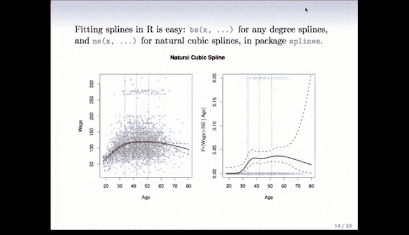

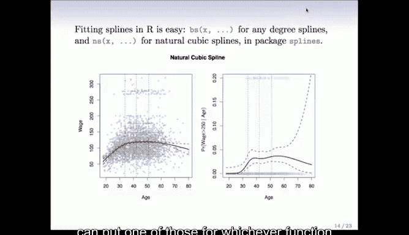

And that's for cubic sps and for natural splinees Ns and here we see a function of age。

 here's a natural cubic spline， you can see it's got three knots。

 interior knots and it's a function of age and gives you a very nice fit standard aerosol included。

Yeah， it's done for， for the logistic regression at the same time。 Okay， And for this。

 you need to use the package splines。

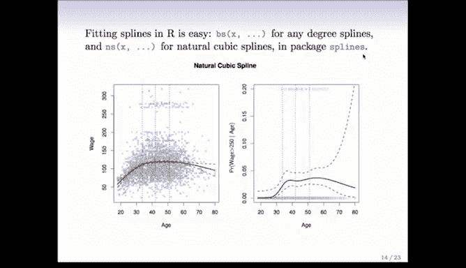

Okay， so there's some details and one is not placement。As in cannot placement。

So one strategy is to decide on the total number of knots， say capital K and then。

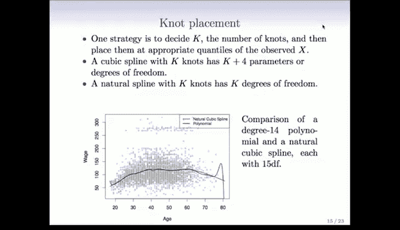

And then given that number， just a place the not at appropriate quantiles of the observed variable x。

Okay， so just to spread them out sort of uniformly。

 having roughly the same amount of data in each of the regions find created by the knots。

And when you do that， that results in a certain number of parameters。 so a cubic sp with K knots。

 turns out it's got K plus four parameters， or we call them degrees of freedom。

And as I mentioned before， if you use a natural sping with K knots。

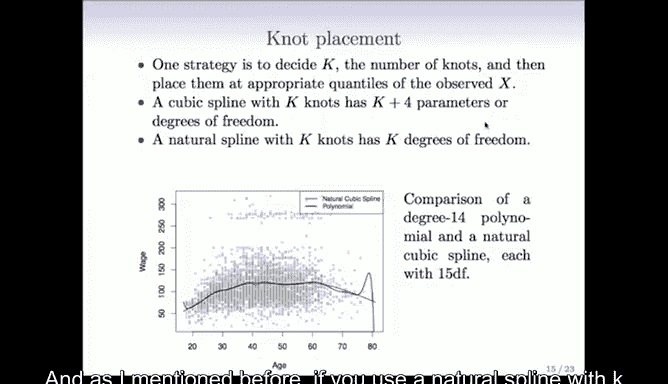

It only has K degrees of freedom， because you get back  two degrees of freedom for the two constraints on each of the boundaries。

And saying this figure over yeah， we've grown a little extreme。 we've。

We show comparison of a degree 14 polynomial and a natural cubic sp。

The net， the natural cubic spine will have。嗯。Yeah willll， will have also 14 knots。

 Turns out there's 15 degrees of freedom because the constant， we。

 we not count in the constants in in these specifications every year。

And， and so yeah， we see them the the natural cubic plane is， is much smoother than the。

 the very wgggly polynomial。 Okay， and you can see the tail of this polynomial going crazy。

So generally， I think the takeaway message is， although polynomials are easy to think of。

 Splines are are much better behaved and more local。 And so they have the way to go。

 And since they' so easy to work with。