# 斯坦福大学《统计学习导论2023Python版｜An Introduction to Statistical Learning with Python》中英字幕 - P50：-050-Statistical Learning_ 6.Py Stepwise Regression I 2023.zh_en - GPT中英字幕课程资源 - BV1u4421A7ZU

Okay， today we're going to do the labs for chapter 6 linear models and regularization methods。

And we'll start off doing forward step by selection。 but as always。

 the first thing we do is we import the libraries that we need for the lab and you'll be familiar with this by by now。

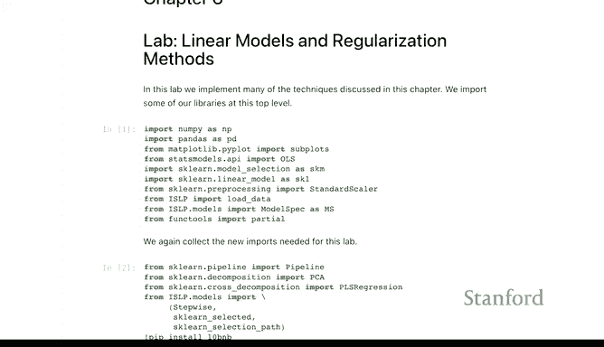

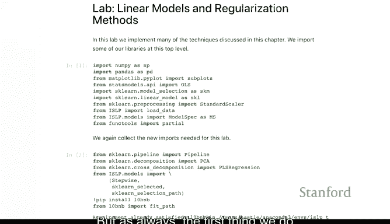

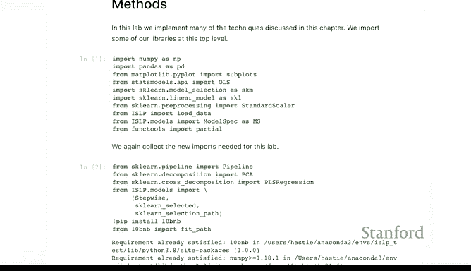

There's one little extra thing here。 There's a library we're not actually going to use in this lab。

 but notice this exclamation p in。We install in a package on the flyer， and you see some， some。

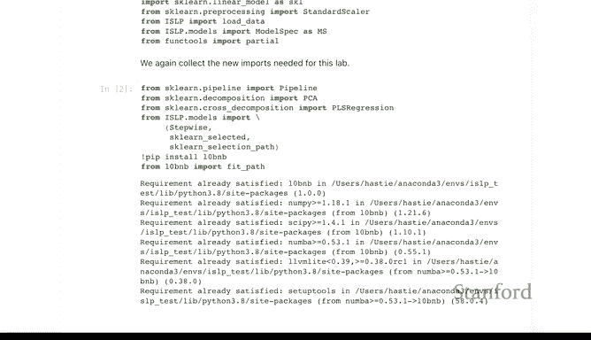

。Print out that that that follows it。 And so you can do that If you don't have a package installed。

 you can just in the Jupyter notebook， install it on the fly。 So we did that just to demonstrate it。

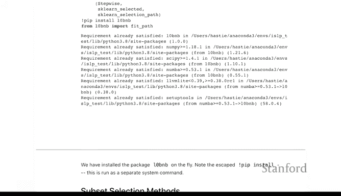

But we're going go to Ford stepwise selection， and we're gonna run For stepwise on the hits data using salary as a response。

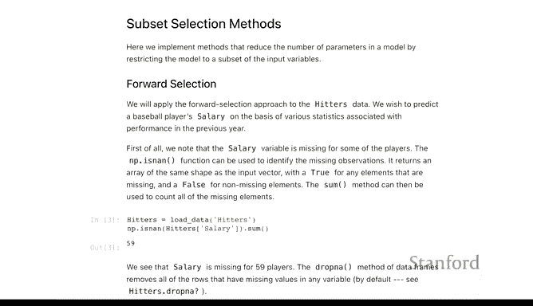

Okay。Now。There's a little problem here， because in the hits data。

There's 59 rows that have missing values for salaryry。Now， when you do regression。

 if you have missing values in some of the predictors or features， you can do things about that。

 You can maybe put the mean value in or you can do have ways of imputing。

 But if you've got missing values in the response， you can't do anything。

 so you just get rid of them。

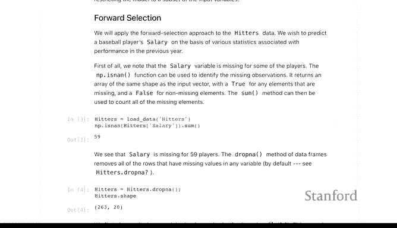

So we use the， we use a drop in a method to get rid of the the missing values in that data hitters frame and。

 and now we're ready to go。 And of course。

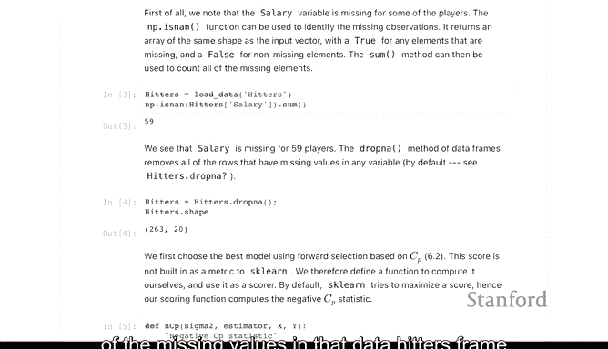

That reduces the size of the dataset set。By 59， because there were 59 that。

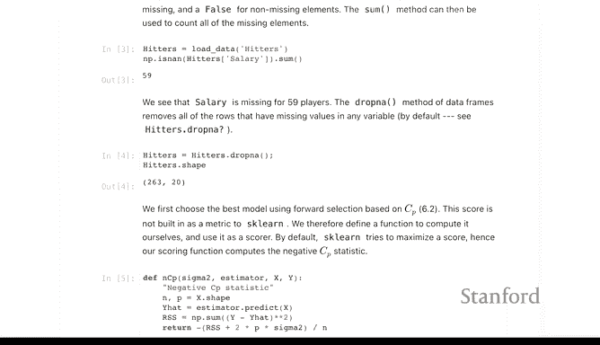

So in the chapter， you learned about using C statistic to to do model selection。

 and C is quite a well known statistic。And so we're gonna do that yeah。 But the problem is。

 it's not built into。 it's not an Sk learn。 It's not an S K learn。 Yeah。

 So here we're gonna show you how if you have a metric that you， you know。

 a custom metric that you like， you can define a metric。 You know。

 using this kind of signature and use the cross same cross validation methods to tune with that metric。

 here we use C。 but you might have your own for whatever purposes。

 And that's a great feature because it impels you， if you've got your favorite metric， you can do it。

 So here we write the function。😊。

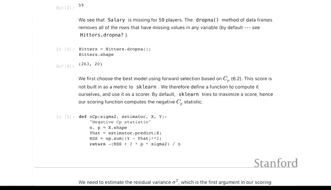

And you can go through the details。 You see the definition of C in the chapter。

 and you'll see that's what we do there。 One little catch is that SK learn tries to maximize a score。

 And so we want to actually minimize CP。 So the function we write is the negative of the CP statistic。

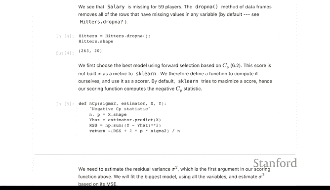

So that will， that will work out。

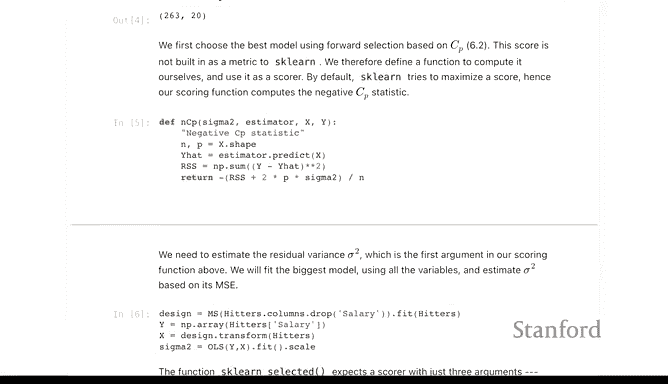

Now CP also requires in the definition an estimate of the residual variance Sigma squared so what we're going to do there and that's what's in this code here is we just fit a model to all the data and estimate sigma squared once and for all and and use that estimate of sigma squared using all the variables and that standard practice using CP're using CP and one little thing I'll just note if we go and look up at the signature of NP I maybe I can take the pencil for a second the first argument is the sigma squared which we have to set but the metric it should have a signature that takes an estimator an x in a y so we want to fix this argument。

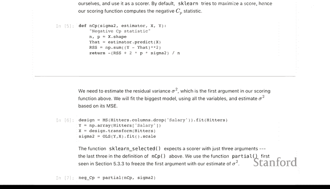

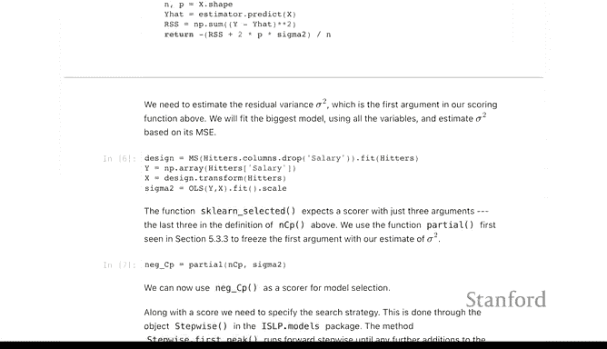

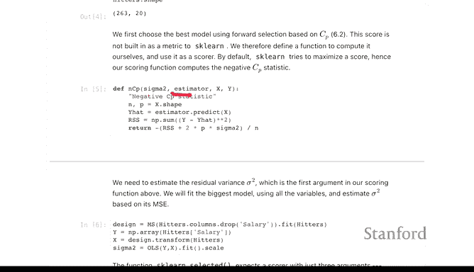

And that's what this little， this line here does。 It takes our original estimator and fix the。

 the value of sigma squared in it， okay。

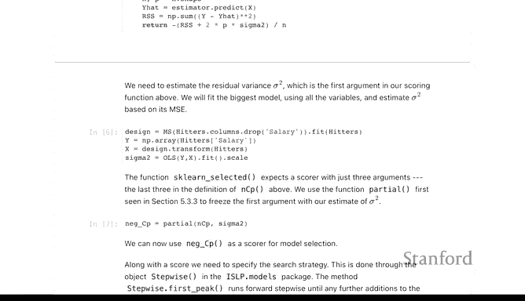

So。Okay， so now we're ready to go。 Our next C P function can be used to do the model selection。

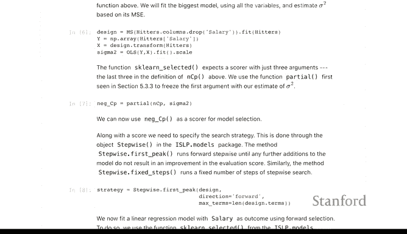

So next thing， we set up a strategy for how we're going to fit the sequence of models。 Okay。

 And so that's this chunk over here。It define strategy as step stepwise， which is forward stepwise。

And first peak。 So that means it's gonna。Run forward stepwise until it reaches the， the peak and。

 until the， in this case， it's going be the， the CP statistic negative C starts decreasing。

 it's going to stop there。 So that's where it's going stop rather than going through the whole function。

 although in this case， actually。

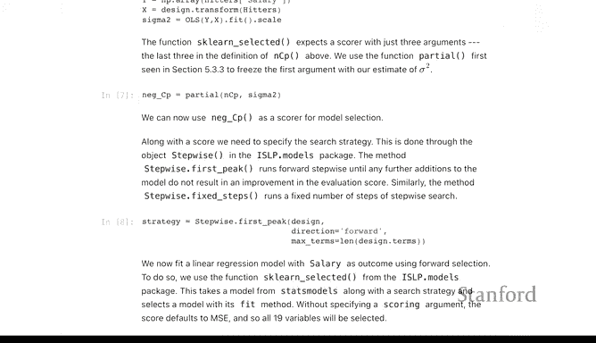

We do。 We do use all the terms。Yeah， so actually so in this one， if you look， there's no。

 we actually haven't put in a score。 So we're actually not using the negative Cp。 It actually。

 by default， is going to use something like R squared or or training MSE。 In the next example。

 we'll have the negative C。 Yes， so in fact， we're not using first peak。 So well。

 we are using first peak， but not negative CPp。 So it will just use training summer square。

 So if you allow it to go to the end， it will go， itll include all the variables。 Okay。

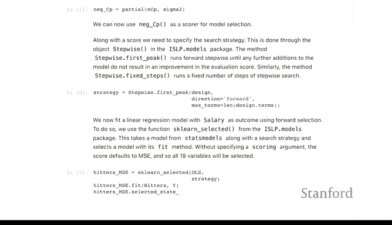

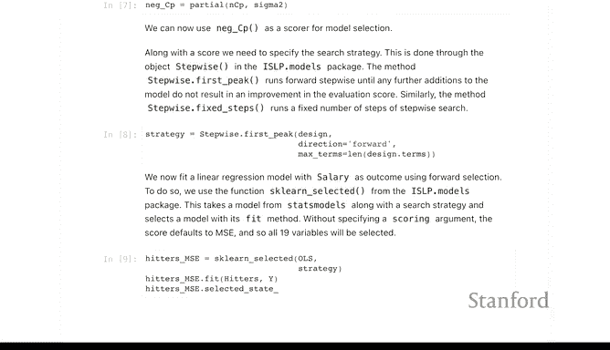

Allright。So now。嗯。We set up our method， and it's gonna be using。S K learn selected on。

Using O L S as a fitting method with the strategy that we've just defined。Okay。And now， we actually。

We run it。 hitters dot underscore M dot fit， we。That's the function。 We use the foot method。

Using the hitter's data and the response why。And， and we can extract the， the selected state。

 which is a selected model。And what we get in this case， is older。

All the variables because we didn't。 we didn't tell it to use C to select。

 So just select training MS the score Yeah is that the default default or I it's either that or R squared。

 which you know will be， you know to one functions of each other because yeah。

 we didn't specify a selection strategy whereas next time we use it。

 we say scoring is negative C Yes So if you don't select it is gonna fit them all。

So when we we do the foot using the scoring method over year。With the steps are the same as before。

 what you see is a smaller subset of the features that were selected。Okay。

 so that's selecting the model by C。

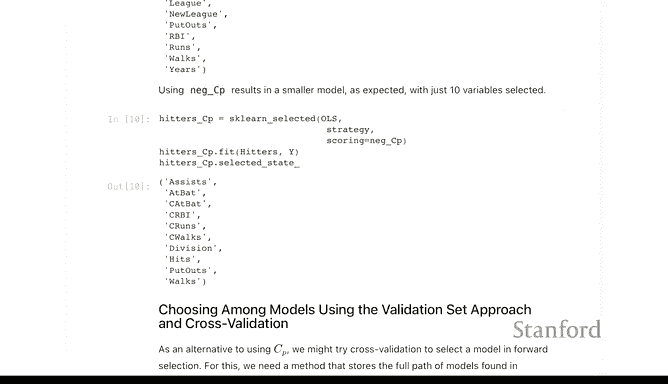

I think the next method that we're going to use the same forward stepwise。

 but we're gonna use the validation set， in fact， cross validation to select the， the model。

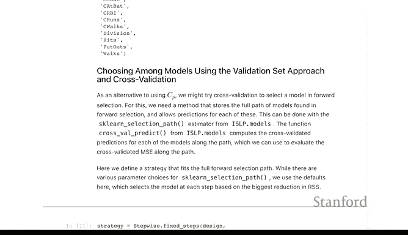

Okay， which is probably a more general method and can be useful any kind of modeling。

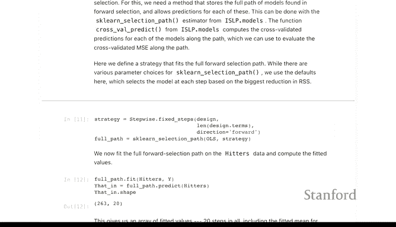

So the other strategy is stepwise fixed steps because what we're going to do is always use a full set of steps and we're going to score every single step and you'll see we're going to make a plot afterwards that shows the performance as a function of the step size。

That's right。And again， the full path we define as using the OLS method。

 along with the strategy over here。

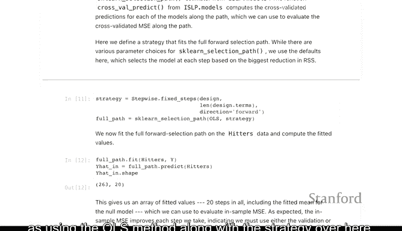

And let's fit the full path on the hitters data。嗯。And so we do that。

 And so that will fit a sequence of models。 And and we also get， we also， we call it the Y hat in。

 We get predictions on the full path。 We give it hit the hit's data。

And it gives us back a matrix of predictions so and what are the columns of that matrix。

 I guess they're the different fitted values as the model grows。 Yeah， yes， that's right。

 So there's 20， there's going to be 20 terms in the model the nu that includes the null model and the 19 features added in importance one at a time。

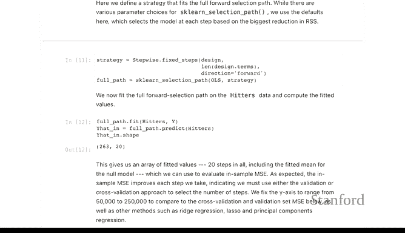

Iportance in terms of， of residual summer squares， right。

 because this is' not using any scoring method。 right。

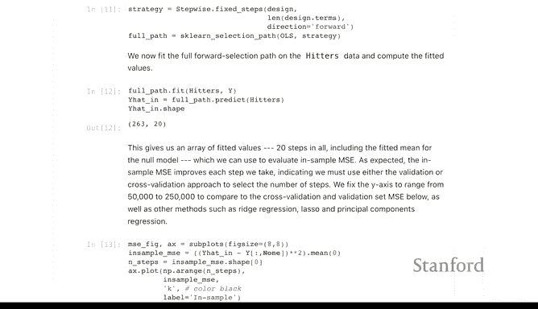

So we want to make plots to， to show how these mean squared error and other measures。

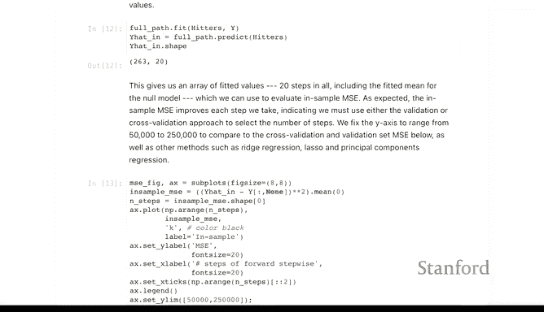

How they， how they decline as a function of or change as a function of number of steps。

 So we've written some code here。For doing that。 and， you know， the code。

Setets the size of the plot and sets the labels and so on。 And we'll make the plot for。

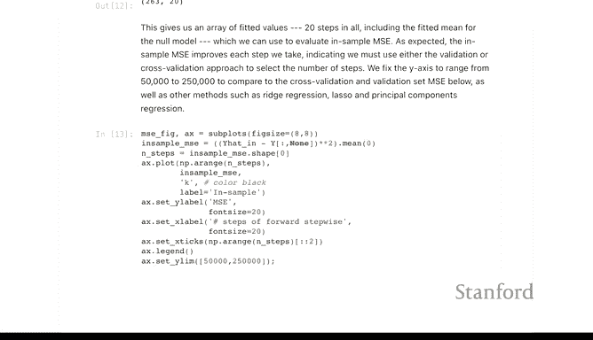

Our first sequence of models， which is just using mean squared error。

 And this is just evaluated just on on the training data itself。 Yeah subsequently。

 we're gonna look at cross validation and the validation set method and add and compare them to them just using the training data。

 and you'll see if you look at the code。 we made， we knew what sort of range we needed because you can see this。

 this range is a bit bigger than we need to plot this curve。

 but we were anticipating what we were going to see later on so that they could all fit into the plot Yes。

Now the other thing to note and of course， this has to be the case is that the residual summer squares is decreasing at every step。

Because as you add more variables， you can only do better in terms of mean squared error and。

 and residual sum squares。Okay。

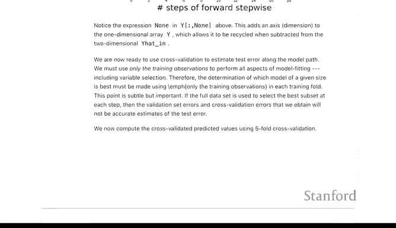

嗯。There's some details about。

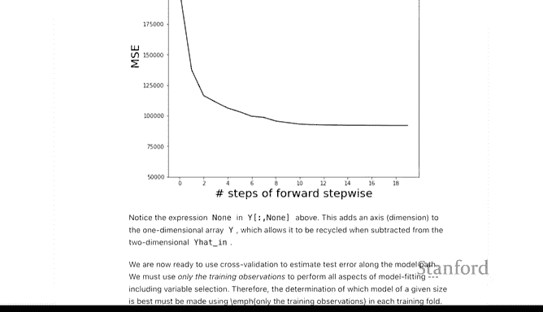

But how we， we compute the residual summer squares and we explain。

 we explain some of them in the texture here。 but we won't go over that now。

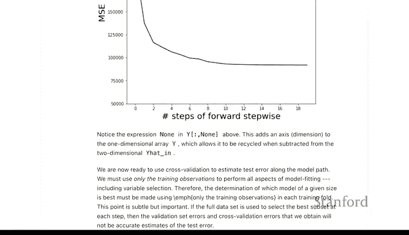

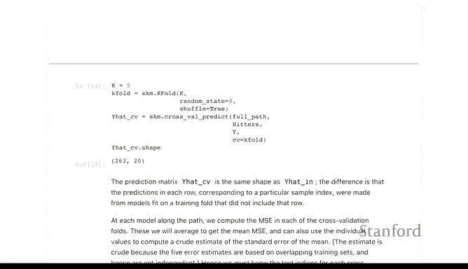

Okay， now we're going to use kfold in fact， fivefold cross validation。

 and we're going to use the SK learn cross validation technology that we've already learned in in in lab for chapter5。

 Yeah though Trevor， I think there's actually something new in this。

 So we're using this function if you look at it instead of called crossval。

 which we saw this one's called cross valve predict。

 So what that gives us is actually the predictions for whatever for the you know whatever the method is and the cross validation。

 itll give us the predicted value。 So on each fold you'll get the predictions having trained on the remaining folds。

 Okay so that's that's a function in Sk learn。 Yes。

 yeah and so that's why the Yat C has the same shape。 it's actually all 20 crossvalated predictions。

Okay， so that's， and that's， that's really convenient because sometimes you want these。

Prediction matrices that have been predicted in an honest way through cross validation。

 and it can compute any measures you like。

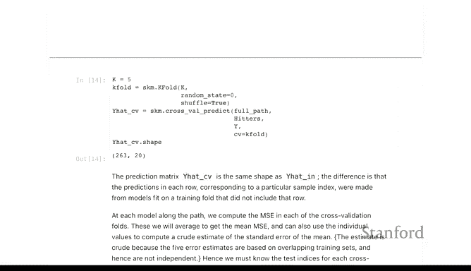

And in this case， we are gonna to compute mean squared error。O。So。So in this。

 in this chunk of code here， what we do is actually compute the， the mean squared error。

this cross violated C prediction matrix has got 20 columns again。

And we want to compute a mean squared error for each of those columns。

 but this will be cross validated mean squared error，So in doing so， what we do。

 we do it in two steps。We first。We compute this matrix here， which is 20 by 5。

 and that's the cross validate the average error inside each of the five folds。Okay。

And so there's 20 different models is five folds for each。 We get a mean squared error for each。

 So why do we do this， We could have just computed the average over everything。 Well。

 we want to also compute the standard error。 And so our final estimate of mean squared error is going to be an average of these five numbers。

 And then we can have a acc crudeed estimate of standard error for the average。

 So that's why we do that okay。

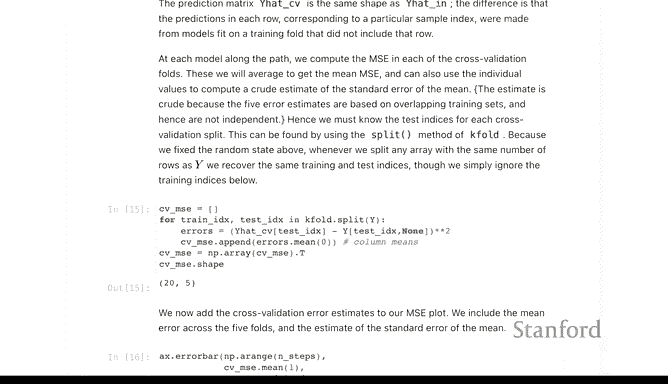

And now we having done all the work， we now add the cross validation estimate to the mean squared error plot。

 and this is the code for doing that。And。There we see the results。And so。

It seems to flatten out a little bit。 It not doesnt shouldn't doesn't necessarily have to drop。

 of course， like the the ins samplele one， but it seems to flatten out some。And and。

 and do you sometimes see that。 And， of course， we have to take the standard errors into account。

 Yes， But， you know， if， if I were to look at this plot， Jonathan。

 I would say maybe a model with six terms is， is a good is is a good model to select。 Yeah。

 that looks promising。 Yeah， Yeah the standard errors help us make the selection。O。

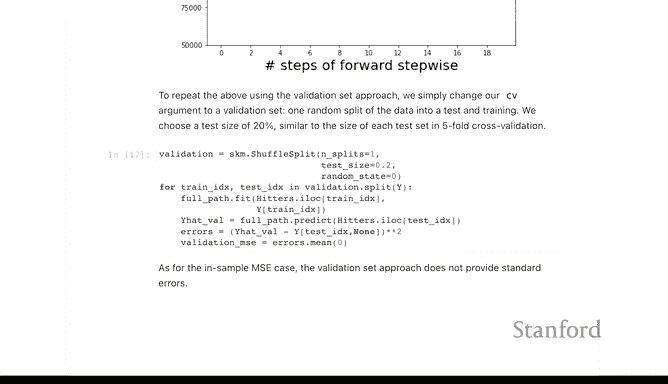

Were also going to add to the plot we're going to use。

 we talked in the chapter about the validation approach， where the validation approach。

 you just set aside a training set and leave some data as a test set。And so here。

 we give code for doing that。 So I guess for this one。

 we won't get the same standard errors we did for cross validation。 Yeah we had。

 we had no standard errors， yeah。

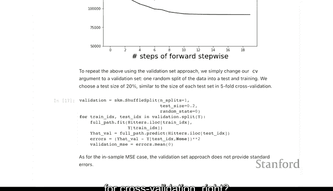

In fact。So the code looks pretty much the same。 And this is the error on the validation set that we get when you just have one validation set。

 Now， the interesting thing is this validation set was randomly selected 20% of the data。Now。

 in the fivefold cross validation， they were also 20% the the the valid。

 the validation sets for each folder is 20% of the data。 So this， this guy seems a poor。

 a poor  estimated compared to the cross validation because you only get the benefit of one curve whereas cross validation。

 you do this five times you get to average the curve and get a should be more stable average guess and averages up the error and you get and you get the standard error。

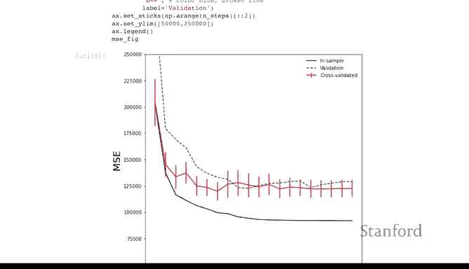

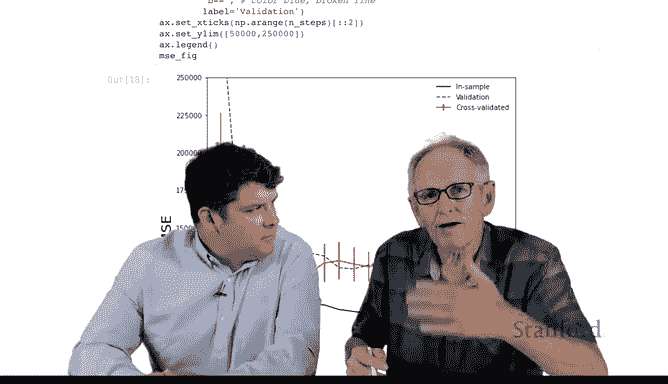

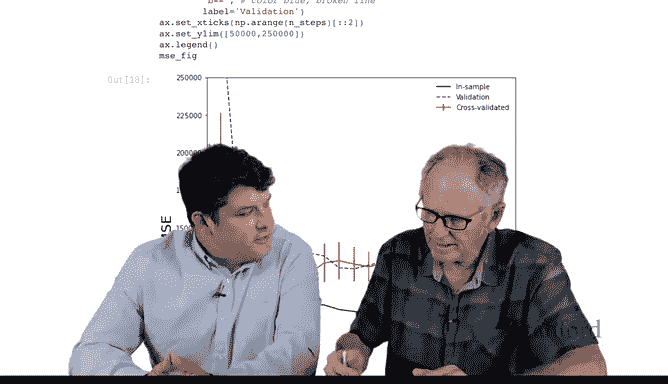

Okay， so that's it。 we not we're going to skip the best subset selection and the next section we're going to discuss is going to be red regression and lessu。

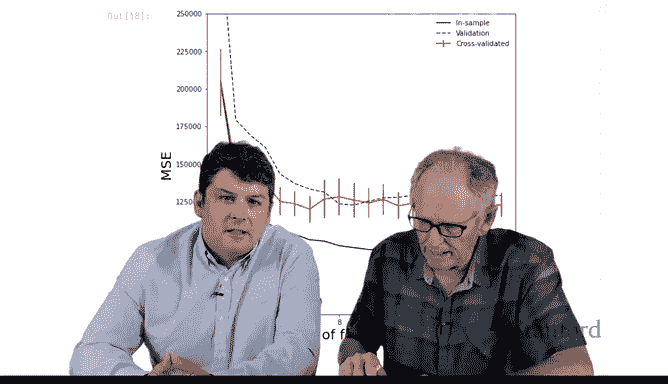

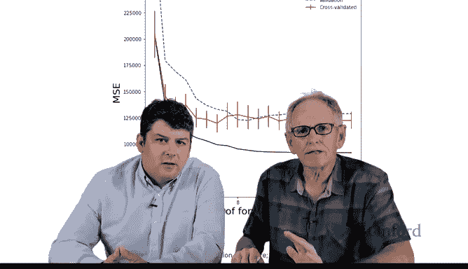

