# 斯坦福大学《统计学习导论2023Python版｜An Introduction to Statistical Learning with Python》中英字幕 - P51：-051-Statistical Learning_ 6.Py Ridge Regression and the Lasso I 2023.zh_en - GPT中英字幕课程资源 - BV1u4421A7ZU

So our next topic is Rige regression in the Laso。 You'll be happy to know that the Python professional is back。

😊，Yes， well。Thank you， Trevor。We just saw a forward stepwise selection。

 which gives us a way to choose important variables in a model。We'll see these are other two methods。

 Rige regression and the laso Rige regression isn't really a selection method。

 but the Laso is something something like forwards forward stepwise that it does model selection as well as estimation。

Okay， so we're going to use the elastic net method fromsyit Learnn and we use that to be for simplicity in that it fits both the Rige regression and the Laso In fact it sort of interpolates between them that's one of the things we saw in the chapter and I'll just make a note here that when you run this code right now。

 there are a lot of warnings for Rige regression in particular。

 and that has something to do with you know arguably a bug in any case。

 the solution is actually fine so we can ignore those warnings for now in any case。

 but just a heads up。Okay。嗯。So what we're going to do is we're going to use the same data。 Now。

 in the chapter when we talked about Ri regression and Laso。

 we noted that it's it's common to scale the data before you use rid regression and Lasso just because so you're penalizing each variable in a comparable fashion。

 So we're going to scale the data first。 We could have used the the standard scalar method。

 But we just at this point hand scale it。 And then we're what we're going to do。

Is we're going to get a ridge solution path。 So that's using this psychic learn elastic net dot path method。

 And for that， we give it this array of values of Lada。

The argument lambda is called alpha in in the elastic net package。

 but that's what lambda is in the book。 And this L1 ratio here。

 This is that parameter that interpolates between the ridge regression estimator and the Lasso estimator。

 So at 0， this is the ridge regression estimator。 and at one， it's the Laso estimator。

 So we'll see later when we do the Laso all we have to change is this from 0 to1。

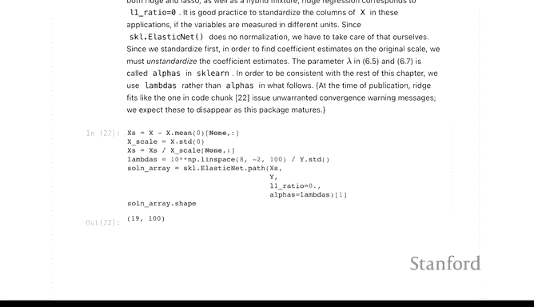

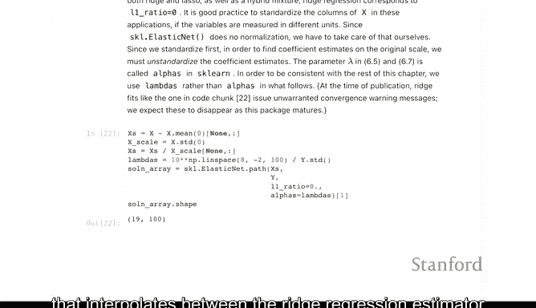

Okay， and so we asked for this path and it gives us a 19 by 100 matrix。

 there are 19 features and we have 100 values of lambda。

 so each row of this is going to be a path for a single coordinate and we'll plot those in just a second。

So we can look at the the data。And here what I've done。

 psychic Learn doesn't actually have variable names。

 but I've added some variable names to the features and an index of lambmbda values。

 so to be a little more informative， but you can see now I've transposed that array of now each column is a solution path as a function of lambda down here。

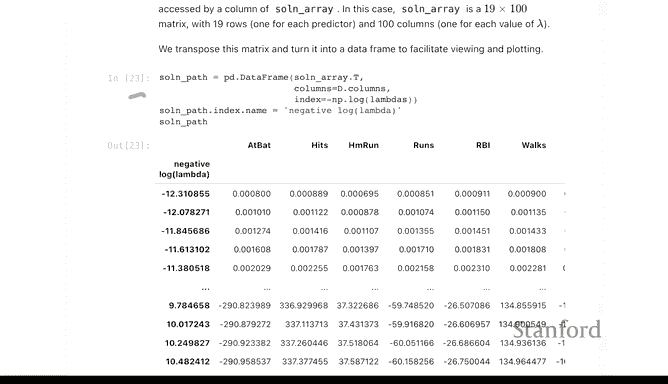

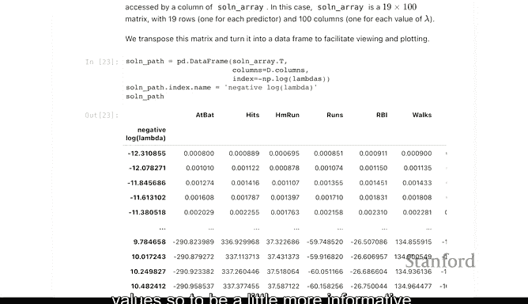

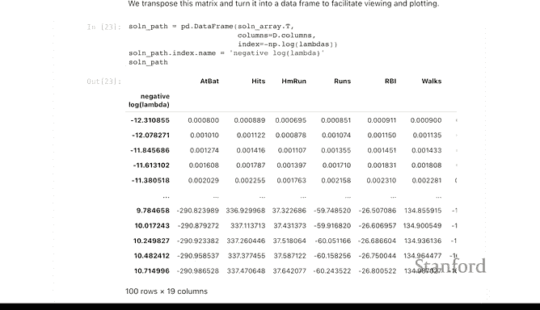

Okay， let's get to the here's a plot。And so youre get a pretty plug。

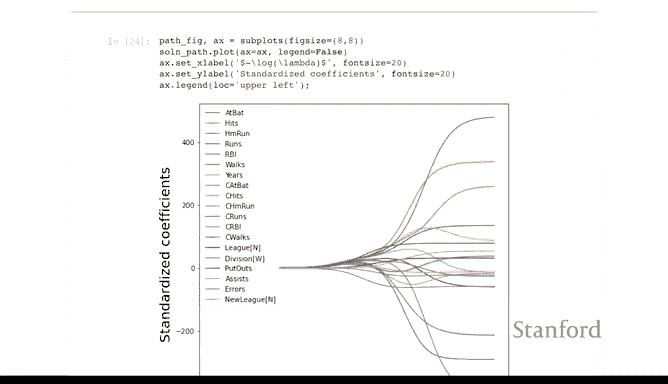

Yes， they're nice smooth curves。 the rid regression estimated the legends a little bit big。

 We might want to you know， put that in a different place if we were producing。

 but it it's in a good place， at least it's not sitting over the coefficient path。 So Jonathan。

 each curve is what each curve corresponds to one of the features。

 So I think this blue one here is at bat。 And you know unfortunately。

 the color blue repeated a little bit。 But I'm going to say that this is the coefficient for at bat。

 And when lamb this is minus log lambda down here。 So this corresponds to a very large value of lambda。

 And that's a lot of penalization。 And we can see that all the coefficients under here are right around0。

 And then as lambda gets smaller and smaller， that is minus La lambda grows。

 we get towards the ordinary squares solution。 So these values here should correspond pretty closely to if we just fit O。

 lovelyly。

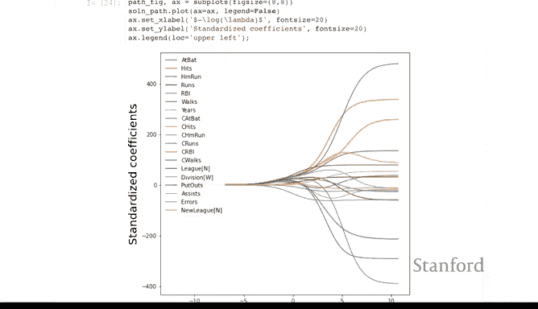

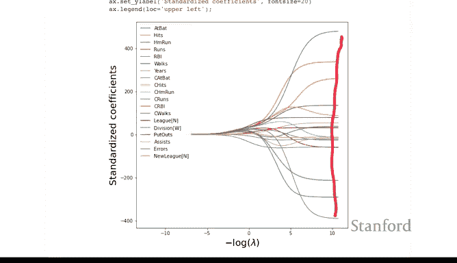

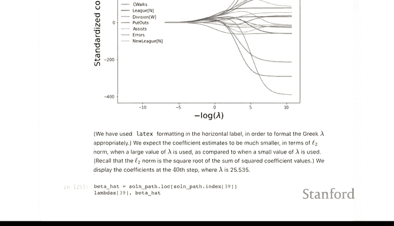

Okay。So you can extract individual coefficients， if you like。My。Well， just by。

Looking at the solution path we constructed and what we're going to see here is that for different values of lambda。

 So remember Lambda is decreasing as we increase the index。

 so we'll compare lambda the 40th entry Lada 39 to the 50th lambmbda 59 and we should see is that at 59。

 we sort of relax the penalties so it should be a bit bigger。

 so we're just going to compute we could inspect the coefficients。

 but we'll just compute the norms at the two different values。

 So at the 40th lambda the coefficient vector has length 24。

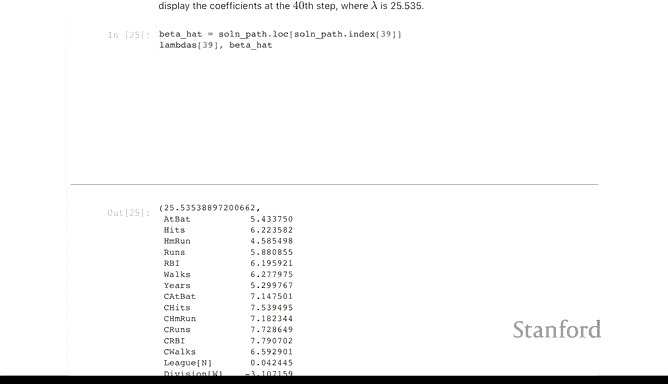

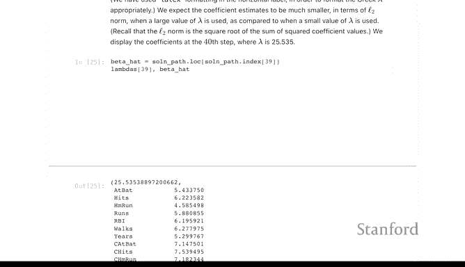

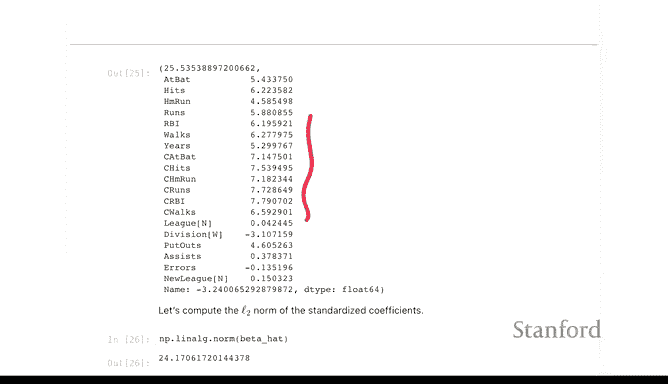

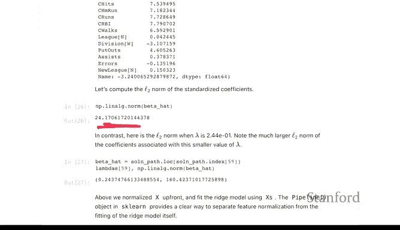

And at the 60 is lambda， the coefficient vector has length 160 and you can see that you know these are just two different places on this axis as we go down the path。

 the vector gets longer， so that's the summer squares of the coefficients at those two different values of lambda。

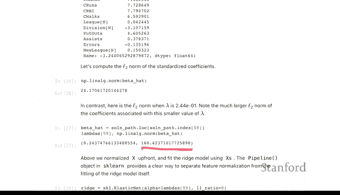

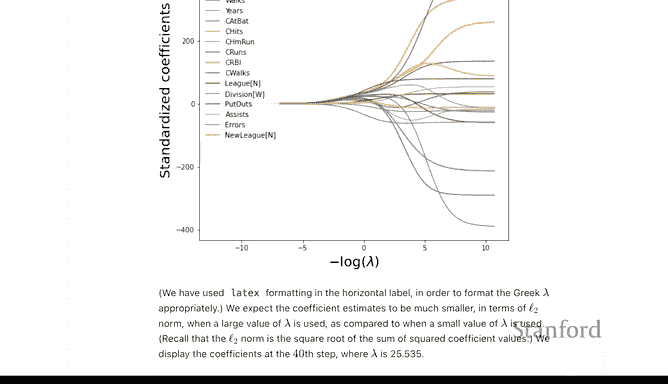

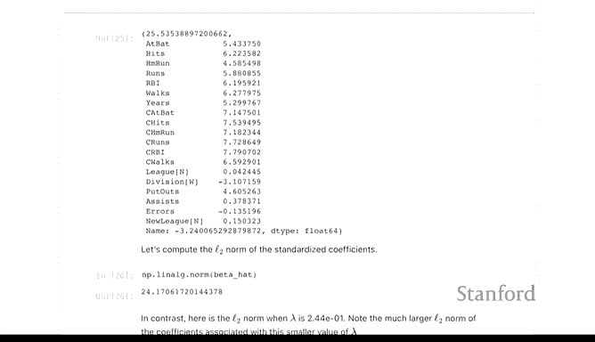

Yes。Well， sorry， it's the square root is the norm。 square。 I just just looking at that。 Yeah， I。

 you know， it is related。 I just wanted to answer it correctly。 So Id look check the code。

 So the code is helpful。

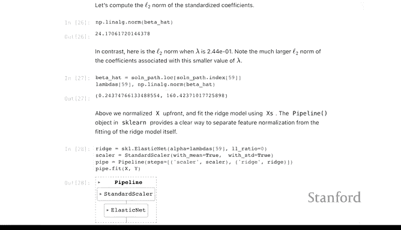

Okay。So we， we had computed the above with using the path method。

 But if you want just a single value， you can use the elastic net estimator instead。

And give it a specific value of alpha rather than a path of alphas。

So earlier I said we could have used the scalar to standardize our data。

 we had hand standardized data before we're going to instead combine these methods now in this thing called a pipeline so this is asit learn object that allows you to combine different steps of a procedure and it might seem a little bit like overkill。

 but what's nice about the pipeline is we'll see later you can each of these estimators have different tuning parameters and you could like。

Wiggle them a little bit and then automatically cross validate over different grids of the parameters。

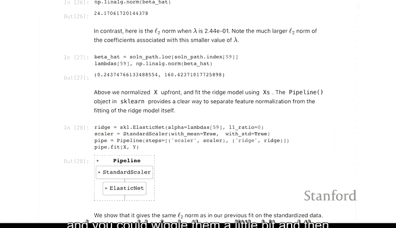

I see。 So is the point here Jonathannathan that each time if we use cross validation in each fold。

 we want to standardize the training data in the fold。 Yeah。

 that's using this pipeline that will do that。 thatll Yes whereas hand whereas if you call if we just if we used our X scale here that we had done before。

 it would have done a global standardization not within each fold。

 so for something like standardization， it may not matter too much。 but for other transformations。

 you might want to repeat it on each fold。 So this pipeline method allows you to do that。

 I could see it's very useful Yes And so the pipeline method is just another psyic learn estimator。

 So we can cross validate it。 just like any other psyic learn estimator。

 and it will give us an estimate of whatever metric we use。 we saw earlier， you could。

 we could compute negative Cp with this or whatever custom metric is't wait to see the result。

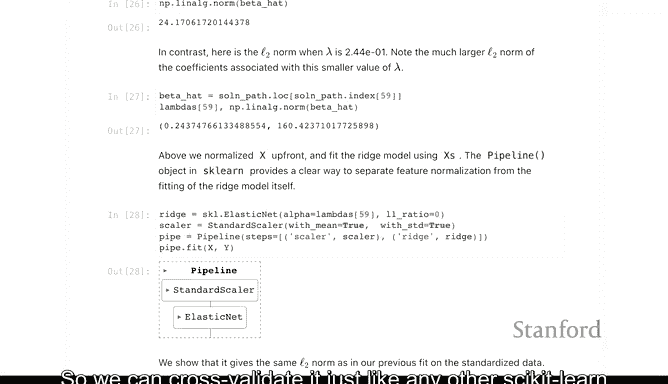

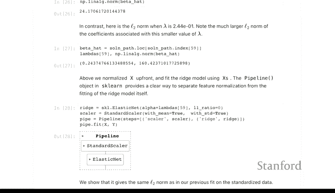

And as we'll see， one of the other nice things that you can search over variations in the parameters here。

 right Rige has the parameter we saw up here， whereas always right here， Ridge has the power alpha。

 if we give the same set of alphas that we give to the path argument。

 it will search over those same path to find the optimal CVv。

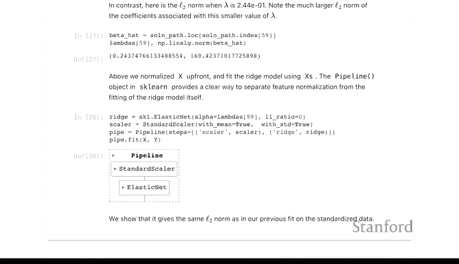

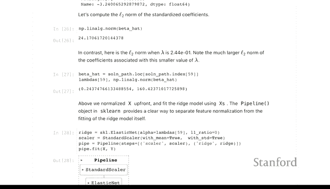

。

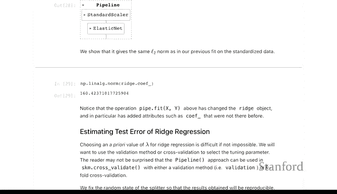

Okay。So， let's use。The psychs learns。Cross validation， or in this case。

 we're going to do a test train split。It's using the same cross validation function。

 but it's actually going to compute a use the validation method to estimate error。

 and we know that it's using the validation method because instead of using Kfold。

 we're using this shuffle split and this corresponds。

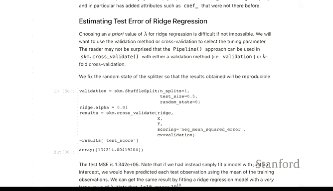

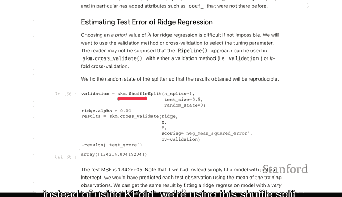

Test size is 50%， that corresponds to split test and training equally and。

Setting the random state fixes the split so that when we rerun this code， we'll get the same answer。

So this gives us you know using。Oh， this is just using the ridge。 Oh， I guess I should have。

 maybe we should have used pipe here。 but so this is the。

 the cross validation error of the ridge estimator。 And that's one of the the parts of the pipeline。

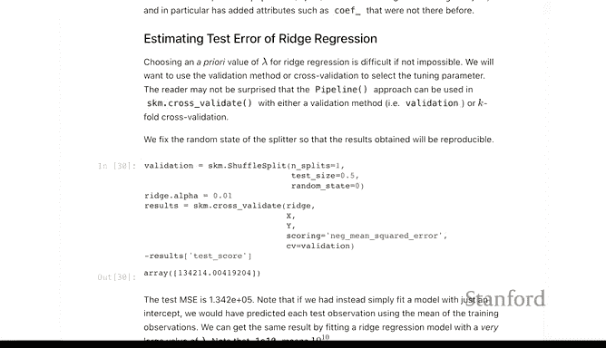

Okay and we can change the parameters of the estimator， rerun cross validation。

 and it will use the same split as it did previously because we had fixed the state。

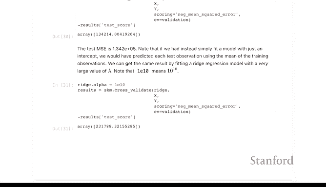

At this point， we've used a very large value of lambda to get something like the null model。

 So the null cross validation error or null。

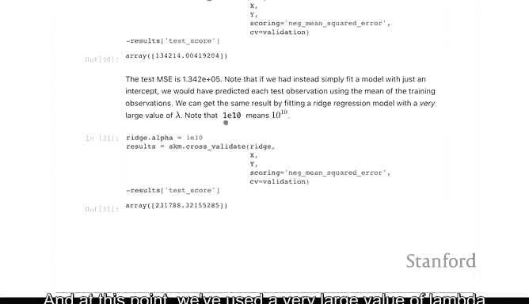

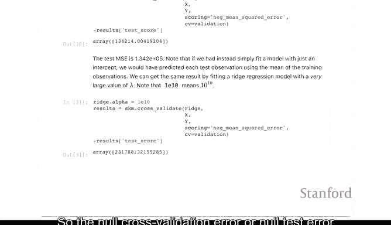

ATest error with a test train split is about 230，000 compared to about 134，000 for the ridestimator。

 so quite an improvement。

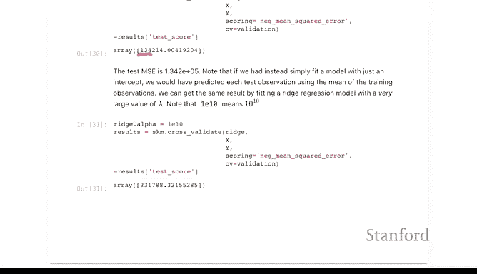

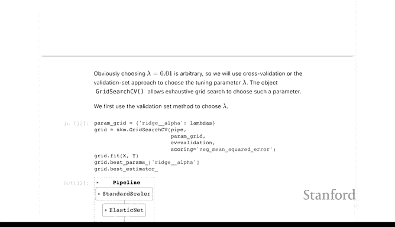

And if we wanted to use。Cross validation， a k fold， of course。

 all we would have to do is change this argument here to be some a kfold argument instead of the test training split。

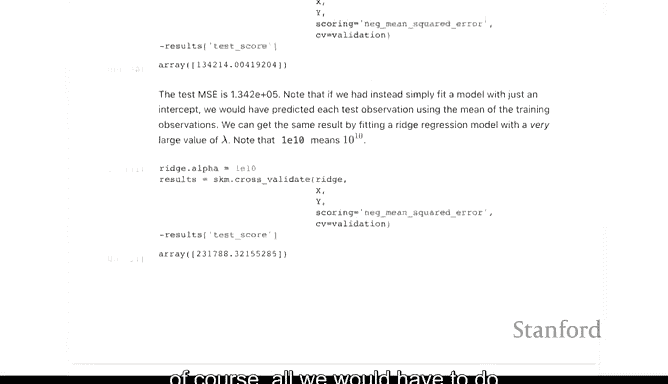

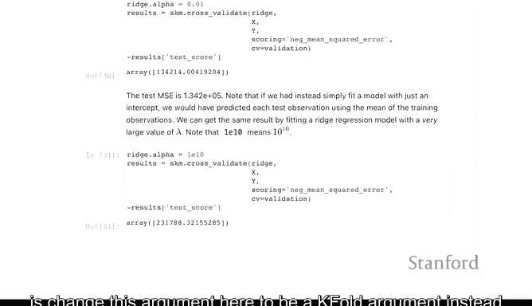

So， now。We'll do the same thing， but we'll。We're gonna use the pipe estimator。

 which actually scales and standardizes each time。And going this is an example here that where we'll see how to search over a grid of parameters。

 so this function grid search CV。It takes some form of cross validation。 In this case。

 this is this test train split we saw above。And it takes， of course。

 we have to describe the variation in the parameters。 So that's this argument， parameter grid。

 And so we've told the way， the format of this is。iss， well， there was an estimator called Rige。

And it has an alpha parameter， so this ridge double underscore alpha。

This tells S learn to vary alpha along all these values， Lambdas。

 and those are the same0 values we saw before。

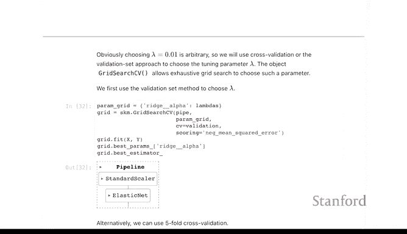

Okay。

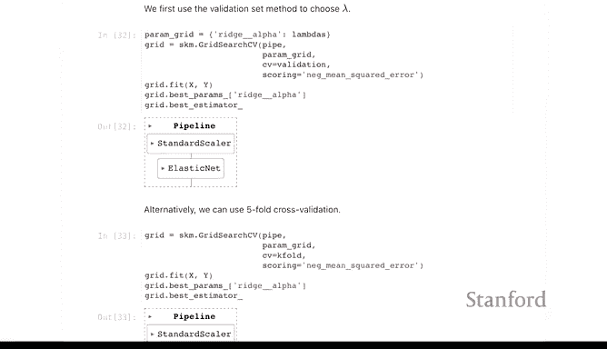

And as I said， if we want to use kfold cross validation instead of the test train split。

 we will just give this argument， the kfold argument。 So now when we this again is an estimator。

 as estimator so we again fit it on our x and Y。 and then at the end it has these these new attributes。

 the best parameterss and the best estimator。

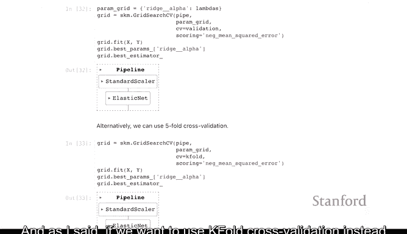

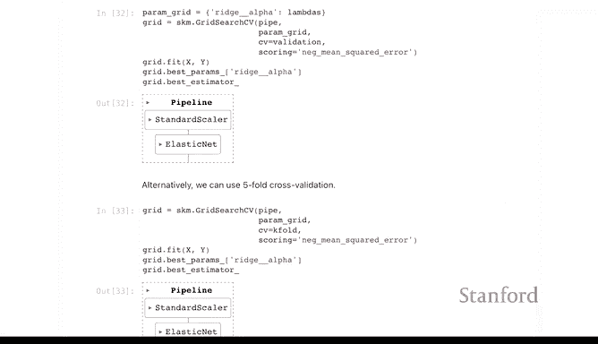

And。Our grid of parameters here only had a single entry。

 so the best parameters has an entry for ridge alpha。And this best estimator is， well。

 this pipeline where the ridge alpha is set to the best alpha。

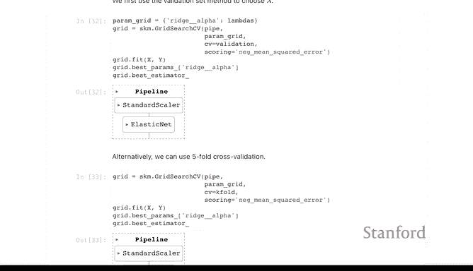

That's what this。Returns。Okay。

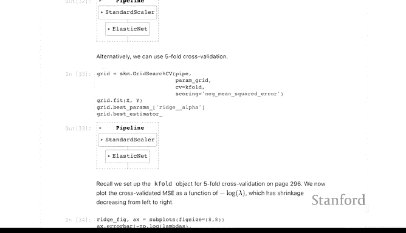

Let's see。 And， of course， we could have there's maybe not for our， for our pipeline here。

 there's not that many other interesting parameters in the scalar。

 but there could have been something， maybe in the we could have tuned the L1 ratio to go from Ri regression to Laso。

 but we haven't even seen that So yet。 So we'll see that coming up。

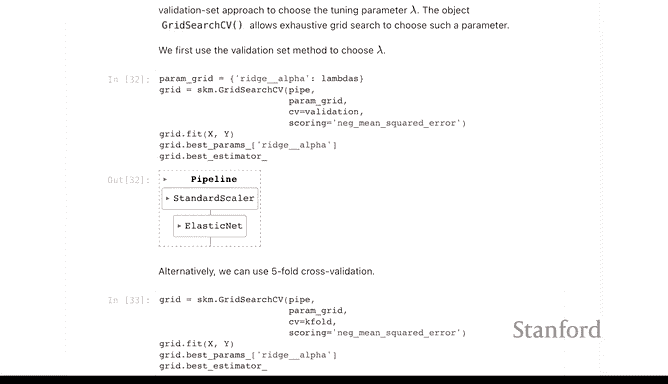

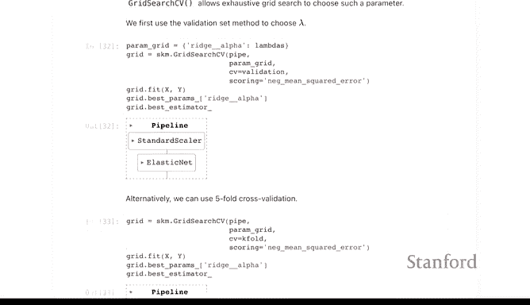

Okay。So besides finding the best estimator， it also computes the score within each fold like we did by hand before right so earlier we saw for forward stepwise we had 20 models and five different folds。

 so we had 20 by5 matrix of mean squared error for this data here we'll have about there'll be 100 by five matrix and。

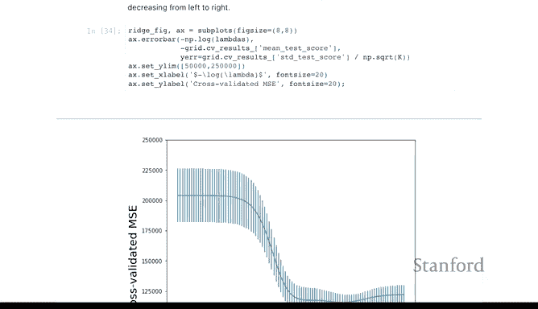

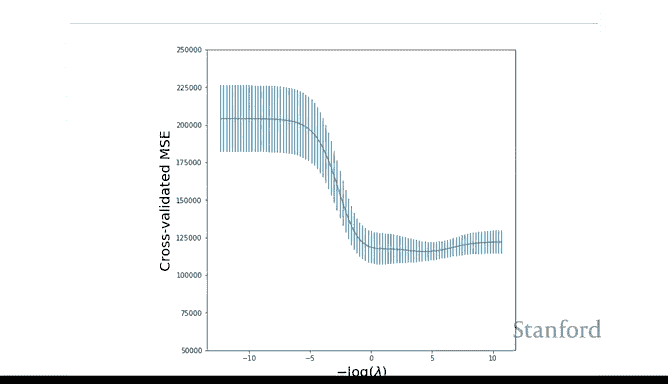

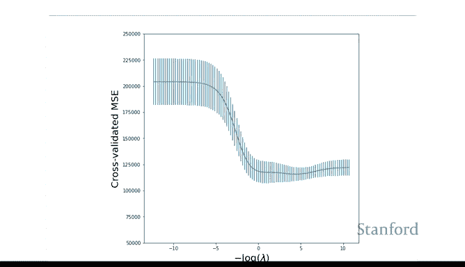

It actually computes the mean test score for us and the standard deviation of the test score all by itself。

 So it's done what we did by hand automatically， good。

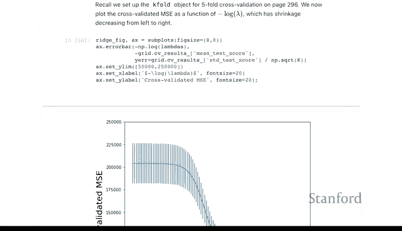

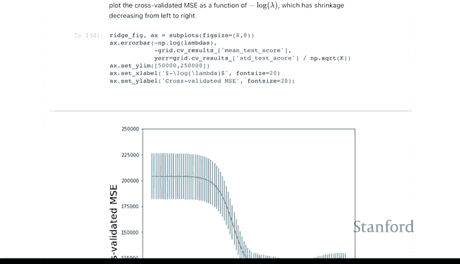

And so we can make a plot similar to what we saw in Ford stepwise， but the axis here is different。

 this is the regularization parameter in forward stepwise。

 this was the the complexity here was going from the null model。

 which is an intercept to all 20 features here it goes from the null model to well。

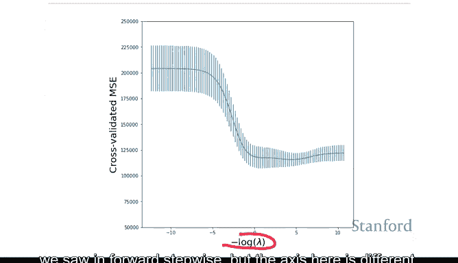

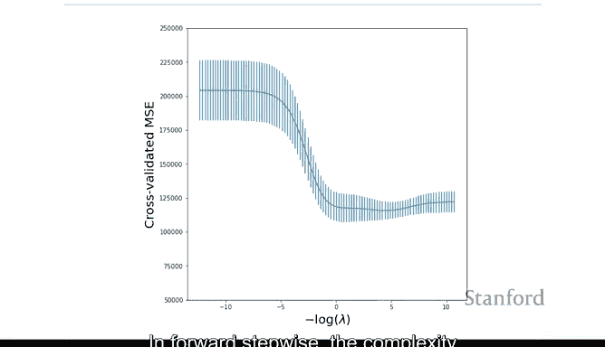

The or O S model， but along this ridge path。 and we'll see for the last similar path shortly similar a little bit to Ford stepwise in that it doesn't increase at the the end。

 It just sort of gets done and stays flat。 That's right。 So， I mean。

 we talk about in the book that you know， eventually， you'd expect these curves to sort of turn up。

 But for the data sets we've happened to use。 We haven't seen overfitting in very drastic overfitting。

 There's a slight turn up， but it's not abrupt。Then again， it's only 20 features。

 so it's not that complicated in model。

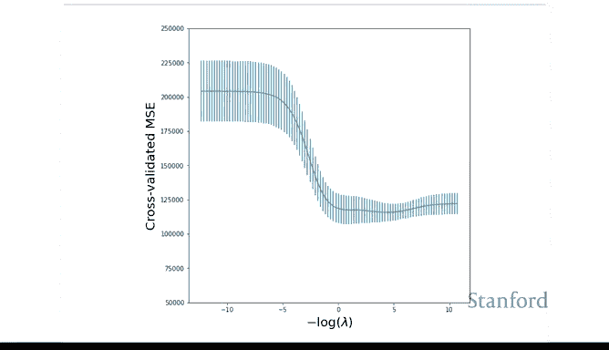

When picking you know， optimizing parameters in a C grid， you have to pick your metric。

 So here we included this metric。 We wanted to use mean squared error。 and of course， to maximize it。

 It's negative mean squared error。 So that's what that string indicates。 If we hadn't done that。

 it would be R squared。 So that's what the last plot here shows。

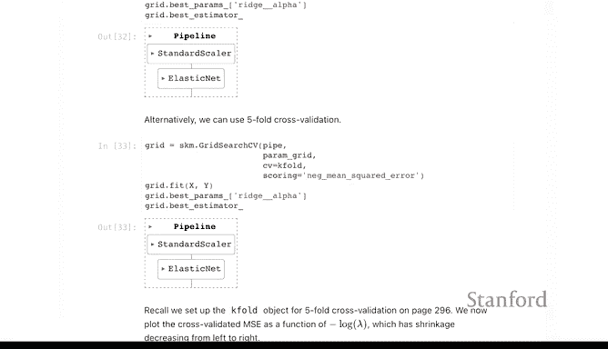

So without saying anything， the the estimator uses r squared as a metric。 and this is。

Similarly， there'll be 100 by5 matrix of r squares。We will average those， and。

And get the standard errors。 That's what this plot is producing。Okay， and of course。

 it has the same form because r squared is very closely related。

Okay。So。

Lastly， I want to talk about something for。For both Rige regression and the Laso is that there are very fast methods to do cross validation。

 So we above， we searched over Lada using the grid， the the pipeline and the grid search C method。

 There are custom built ones for， for elastic net。 That's this elastic net C function。Okay。

 so what this is essentially going to do is the same thing we just did， but it's， it's。

 it's very specially built for the elastic net。 That is the rid estimator and upcoming the lastso estimator because。

It's a commonly used method。

So if we plot the MSE out of that， this plot is unsurprisingly very similar to what we have before。

 this was just to show there's a specialized method。

Okay。So。I think， well， I'm going to skip this in the interest of time。 So what this section of code。

 What it does is it recognizes that。

In tuning a parameter like by cross validation。we are still somewhat left in the without an honest estimate of error。

 so split what we've done here is split into training and test。

 run cross validation on the training data， and then evaluate the final estimator on the test data。

And so that's why there's a split here into training and test， a K fold， cross validation， and well。

 that's what the code will compute here。So it's 132，000。

 it's not that different from the actual cross validated one we saw before。

Okay， so our final method in this lab is the， the Laso。 And as as we mentioned earlier in the lab。

 this is a method that does selection like Ford Shewise。

 as well as regular estimation like rid regression。And so as we mentioned earlier。

 the difference between rid and Lasso in terms of the code。

 at least this version of the code we're using is this L1 ratio at 0。

 This is the ridge estimator at 1， it's the Lasso estimator。So we're going to， you know。

Fit a path a lastssopath of solutions using the same function elastic net CV we saw above。

Though it will give us the laso fit this time instead of the ridge fit because of this difference in the parameters。

Okay， so as we did for the ridge regression， we can make a data frame and you can inspect that。

 if you like， of the solution path to the the de laso。

 and we can also make a plot like we did for the ridge estimators。

 So this plot is going to be interpreted very similarly to the ridge regression estimator。

 though it looks a little bit different。

Let's see， Trevor， what's the biggest thing you notice about this plot？

The biggest thing I notice is it's， it's not as smooth as as the earlier one。 And。

 and some coefficients are 0 for a large portion of the path。 And then they。

Jump away from 0。 Of course， Of course， Trevvin knew the answer to that question before。 But O。

 so yes， the laso， if you note for at my age， you can't rely on that。

So for for some large values of lambda。 remember， this is minus log lambda。

 So these are large values of lambda。 a lot of the coefficients are 0。 and in fact。

 hidden under this legend， which is a little unfortunate， they're all zero at the beginning。

 and then some coefficients come in one by one。 and sometimes they actually go out。 I'm not sure。

 Yes， in this， we can see maybe a little coefficient come off and then go back to 0 and then come off again。

 So these paths are， well， as we change Lada， the Lasso solution changes。

 And what's notable about the Lasso， as we talked about in lectures， of course。

 that it can do selection， it can set some coefficients exactly to 0。

 So if we select a value of lambda around here。Then this will correspond to you know。

 we'll have a solution with maybe this looks like seven or eight non zero coefficients out of a total 20。

So this has sort of been between the ridge and forward stepwise， and it's quite a popular estimator。

Okay， we can look at our。Our test error， so。Using the optimal test error for Rige。

 I guess our going back was 115000 for Laso， it's about 100。15000， very similar， very similar。

 yes and。

Let's just look at one big difference before I go back to the plot。

 one big difference is that when we looked at the optimal choice of lambda。

 the coefficient vector for the Laso actually does have some zero， so it's actually selected。

 I think five or six coefficients out of the 19 to be zero。

 whereas the ridge of course all of them are non- zero some of them might be small。

 but they're nonzero。

And as in the Rige regression example， we can also make this plot of cross validated mean squared error to choose。

 and I've indicated here the Lada selected as the best using the 54K cross validation。

Okay， so that wraps up the lab for chapter 6 for what we'll talk about today。

 there is an additional section on principal components regression and partial least squares regression that we encourage you to do offline。

