# 斯坦福大学《统计学习导论2023R语言版｜An Introduction to Statistical Learning with R》中英字幕 - P55：-055-Statistical Learning_ 8.2 More details on Trees.zh_en - GPT中英字幕课程资源 - BV1yU421o7WA

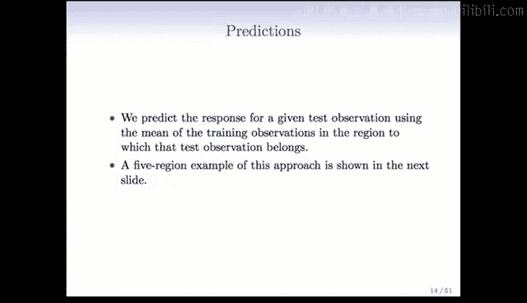

At any point， once a tree is built， you'd predict the the test observation by passing it down the tree。

 obeying each of the splits。 It'll end up in a terminal node， and then you'll， you'll。

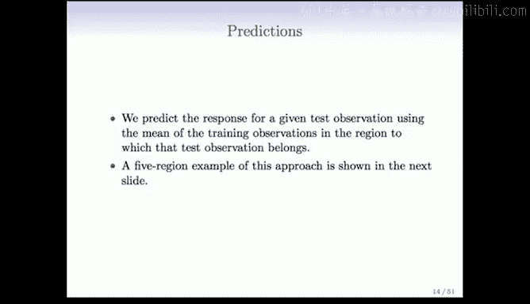

Use the mean of the training observations in that region to make the prediction。

Let's look at a slightly bigger example， a cartooning example in the next slide。

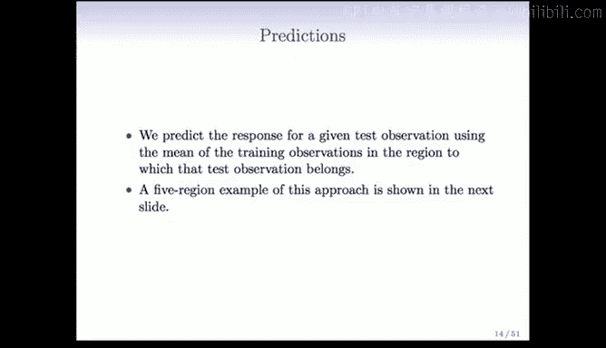

嗯。

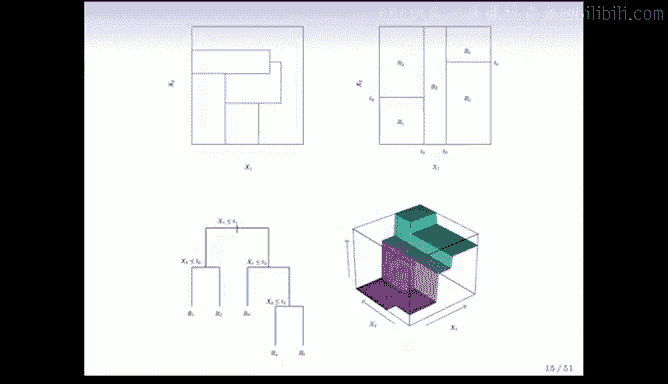

First of all， in the slide， we show in the， in the left panel here。嗯。

ASe of regions that couldn't be achieved by this process。

 So this this one here could not be achieved because these aren't boxes that were obtained by sequentially splitting the data repeatedly。

 whereas the one on the right can。 If you look at the one on the right in conjunction with the tree on the bottom left here。

 you will see that the first split was made at T1。 So there's T1 over there。

 and that was a vertical split。

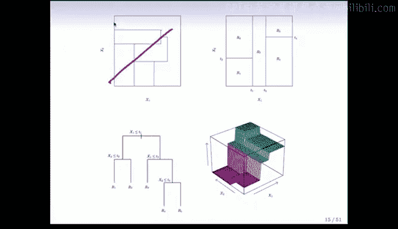

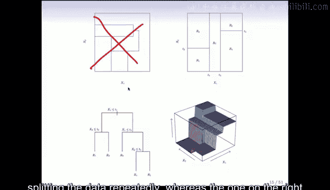

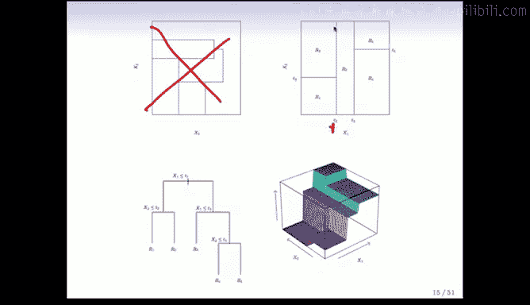

Right， that。Broke this region。 we've two variabless x1 and x2 here into a region to the left and to the right。

 so that's a partition。

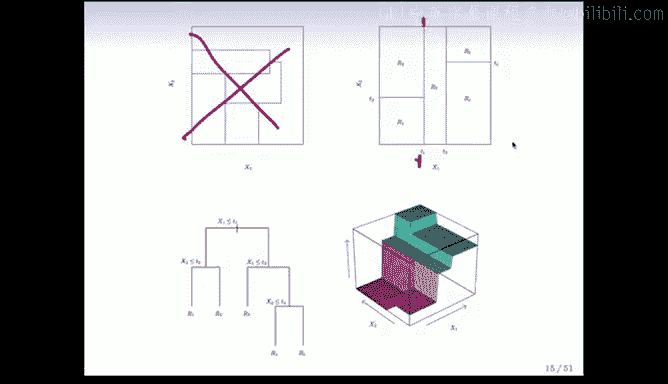

Then we have a split on x2 at T2， so that is this split over here where we divided that box into 2。

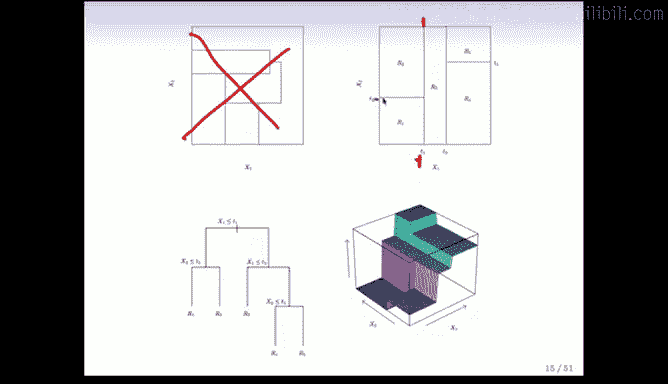

And so that takes care of the left， we got region one and region2。

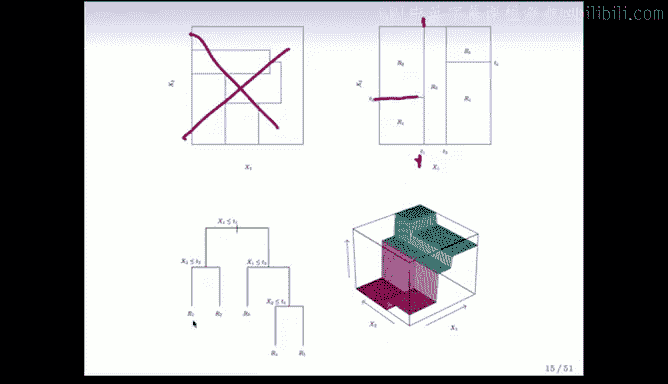

Then on the right hand partition that we had by splitting T1， we split x1 again at T3。

 so we make another vertical split here that partitions。

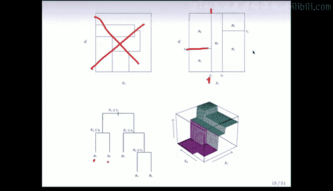

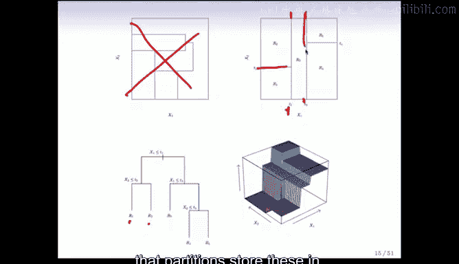

Sall these in。And so that's split at this internal node over here。

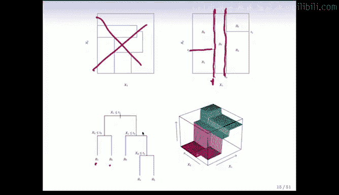

And so that makes region 3 on the left。

And on the right we're going to do one more split and that's a T4 on variable x2 that divides that into2。

 so you can see in the sequential greedy fashion we've subdivided the space。

 which is just two variables here into five different regions。

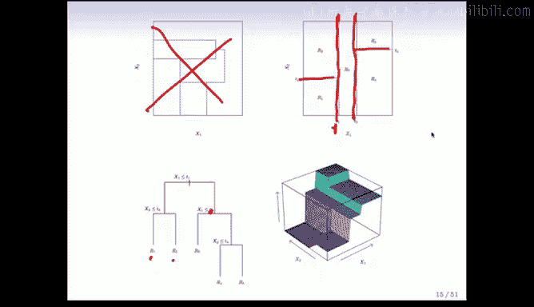

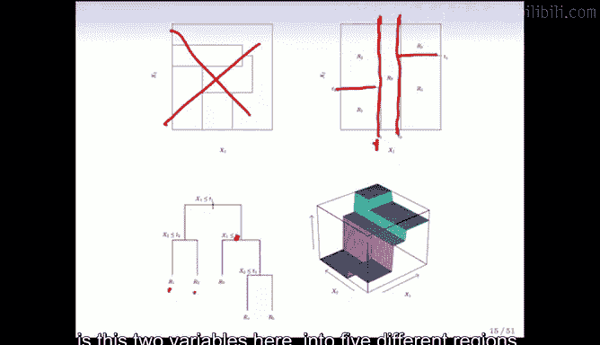

Now， at each of the terminal nodes， we are going to approximate。

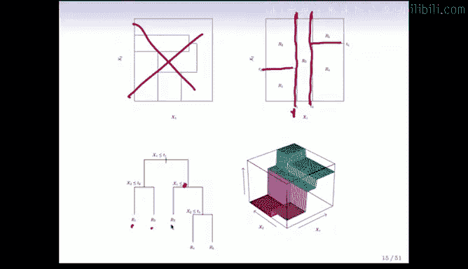

The regression function in this case by the mean of the training observations that end up in these terminal nodes。

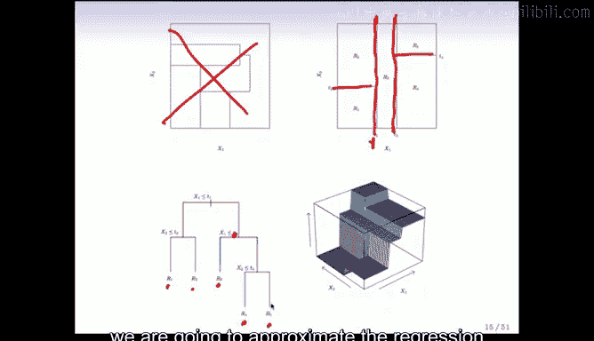

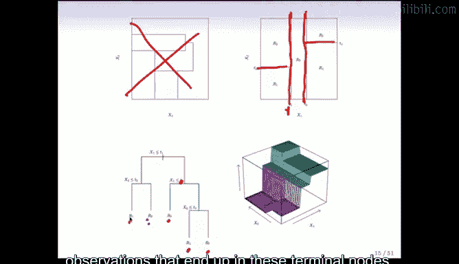

So what that means is if you have a test observation and you want to come and predict it。

 you're going to start at the top and you're going to query what's its value for x1 if it's less than T1 you'll go to the left otherwise you'll go to the right。

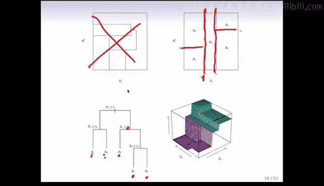

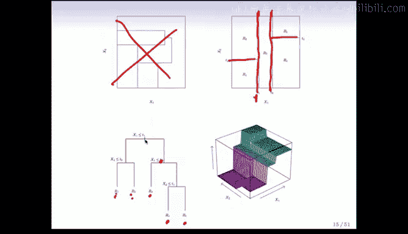

Likewise， you answer each of the questions at each of the internal nodes and you're going to end up in one of these regions and then your prediction is going to be the mean in that region。

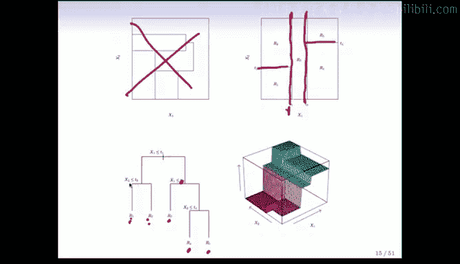

So as a function， you can actually represent it nicely because it's just a two dimensional function by this picture that we got on the right here。

 and so it's a piecewise constant function。It's piecewise constant you can see here the slices。

 let's see this will be this will be T1 is this slice over here and this will be T2 and this function is constant in each of the regions and that's how we're going to represent our function at the end of the day。

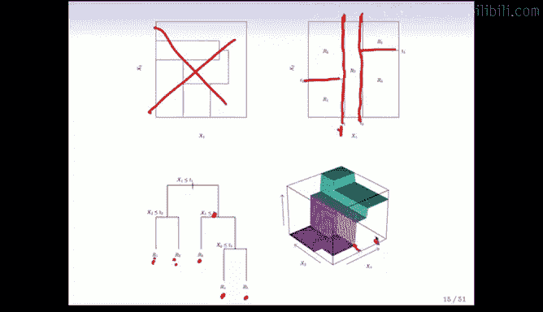

Okay， so we've seen how we grow a tree。 question one question arises is how large should the tree be？

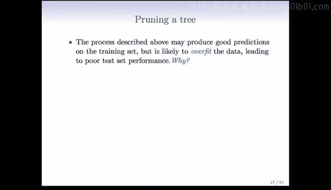

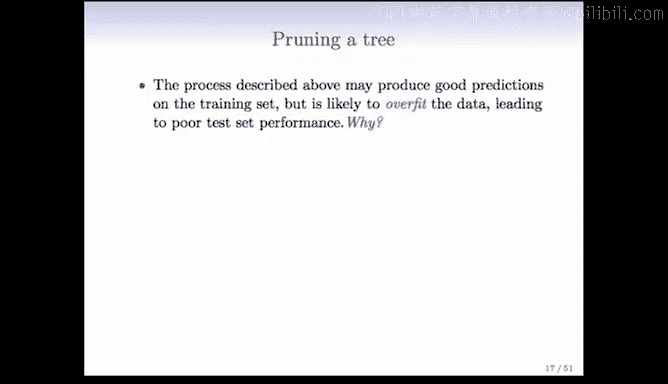

When we stop growing the tree， well， one possibility would just be to grow as largest trees as possible right？

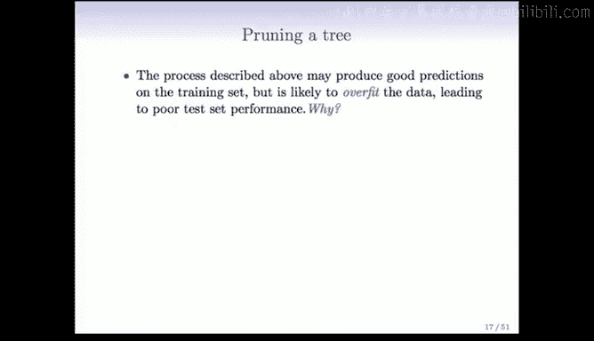

At the extreme， we could， for example， have a tree that had one observation each terminal node or leaf。

But that's likely could to overfit the data by producing poor test set performance。I say why， well。

 I guess it'ss kind of obvious right if you have a tree that's so large that each observation has its own terminal node。

 it's going to have training error of0， that it's going to be adapted to that data very much and it's going to overfit when you give a new test data。

 you're probably going to have a quite high high error as a result。

 So not a good idea to build as large as a tree as possible。

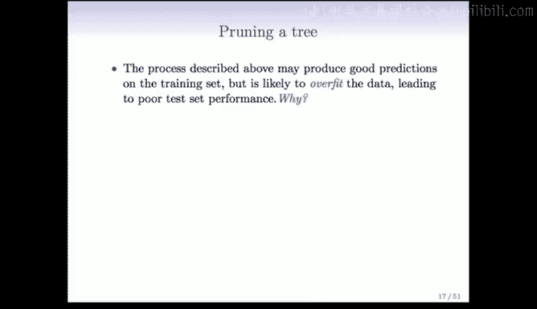

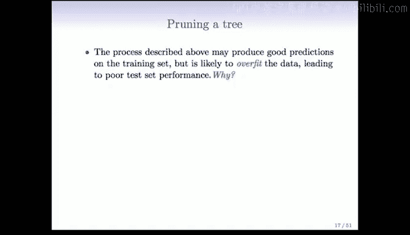

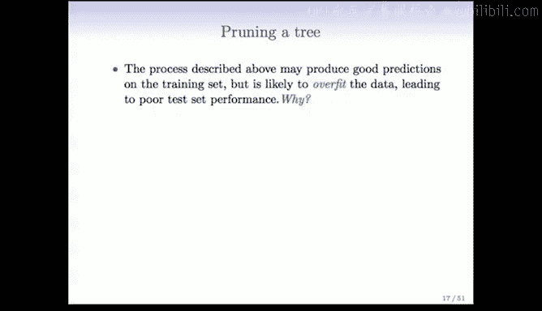

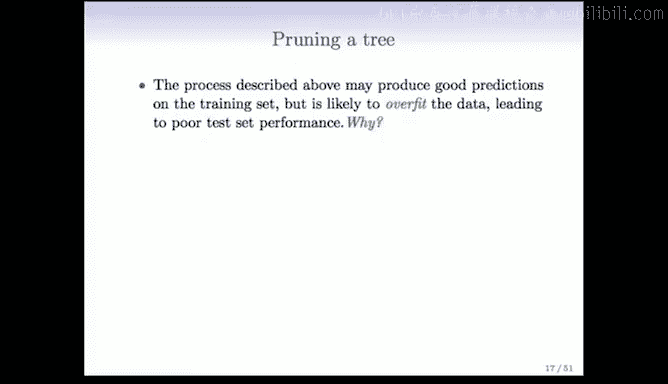

Another possibility would be to stop early， in other words。嗯。

Just keep splitting until it looks like no split helps in some sense in terms of reducing the residual sum of square is the criterion we saw before。

But it turns out。This strategy can be too short sighted will very often stop too early because it looks like no good split is available。

 but actually if we kept splitting， we'd see a better split farther down the tree。

So it turns out that a better strategy is actually to grow a large tree。

Stopping only when a rule like， for example， a civil one thats used is a terminal node has to have no fewer than five observations。

 say。And then with this large tree， which is probably too big。

 we prune it from the bottom to produce a tree which。Of midsize， it tries to balance bias invari。

And hence have lower prediction error than either the single node tree or the extreme tree that has one observation。

One node per observation so a very bushy tree has got high variance in right。

 it's got high variance overfitting the data no bias。

 but is overfitting and probably not going to predict well。So actually。

 so what's done in the cart software， for example， or the treere library in R， which we'll see。

 is this idea of building a large tree and then pruning it back。

And the framework for that is called cost complexity pruning or weakest link pruning。So for that。

 we do something actually very much like the。The lastso we saw for regression。

 we have an objective function， which is the fit。And remember the fit we're going to measure in terms of the sum squares of observations are the response around the assigned terminal nodes。

 so our terminal nodes are R1 through。RM， I would say， Rt。

The number of term nodes we're going to den noteote by this notation looks like an absolute value。

 but that means the number of terminal nodes in the tree T。

So this is the sum of squares of observationss around the mean of region M。

Which is one of the thermo nodes。 and we add them up over all the terminal nodes。

 So we want a tree which has small variants， but we also want to counterbalance the size of the tree。

 So we put a penalty on the total number of nodes of the tree with the penalty parameter which will last cross validation。

 Again， this is very much the laso where we had a sum of squares of regression and we penalize the sum of the absolute values of the coefficients。

 which is complexity。 So we wanted the coefficients to be small to avoid overfitting Here we want the size of the tree to be small to avoid overfitting。

OkaySo cost complexity perruning is kind to find the best value of alpha by cross validation。

And then we're going to pick the subtree。In the tree。

 the large tree we've grown that has the smallest value of this criterion。

So summarize in the next slide， well， sorry， this actually just says what I just said。

Again。

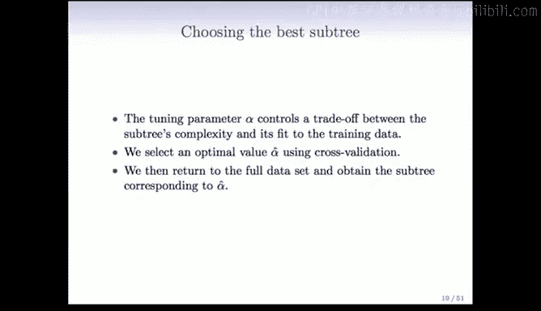

Yes， oh okay so here's the summary of the tree growing algorithm。 again。

 this is not something that you would normally have to program yourself because software which is available。

 for example， cart or the tree software in in R， it does all this cross foundation process for you。

 but it's good to see at least once what it's doing So we build a large tree with a very simple stocking rule again for example。

 the。For example， we stop it when the number of observations in a Tru node is some minimum number like five。

And then we， we prune the tree to find the the。The best subre。 and for that。

 we need to get an idea of the cost complexity parameter。

 the best trade off between fit and tree size。So for that。

 we use cross validation in the similar way that we've used it before for regression。

We divide the data into K parts， Kb maybe 5 or 10。we set aside one part。

 We fit trees of various sizes on the K minus-1 parts and then evaluate the predictionary on the part we've left out。

 Oh so it's clever the whole thing's controlled by alpha then Al decides how big the tree is and you use cross validation just to pick alpha exactly right。

 And so we choose the alpha and we'll see cross validation curves in a few slides。

 but it's going to tell us a good idea of that the best value alpha to trade off the fit with the size of the tree。

Having chosen alpha， we then go back to the full tree and find the subt that has the smallest。

 mean the key grown on all the training data， exactly。

So let's see what this looks like for the baseball data。

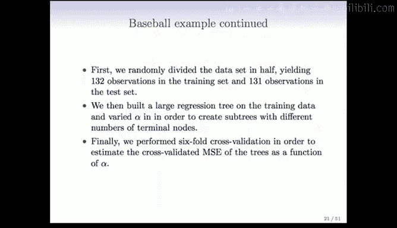

So。For illustration， we actually took the observation and divided them into a training set of 132 observations and the remainder 131 in a test set。

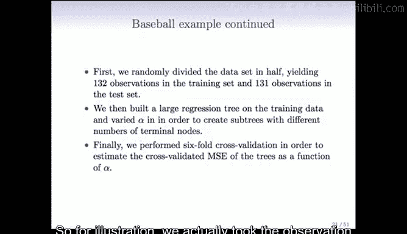

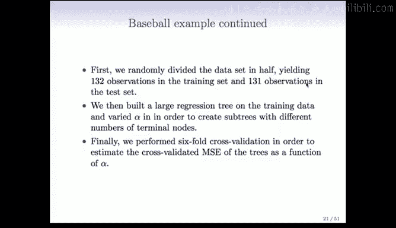

Is that we want to compare the cross validation error what we're going to get to the test error on the separate test set just for illustration。

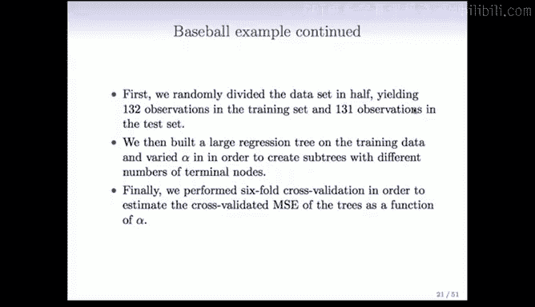

We build a regression tree on the training set using cross validation and get an idea of the best cost complexity parameter alpha。

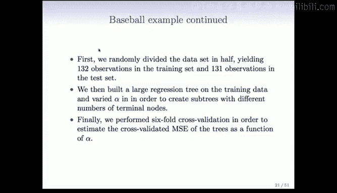

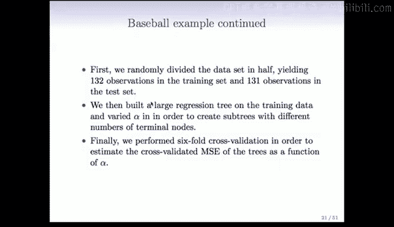

嗯。Using six wall cross validation， and by the way， six may seem like a funny number of bets it' because six divides into 132 exactly。

So。

This was the full tree before pruning， so remember we saw the top part of this tree before。

 right we saw the top split。

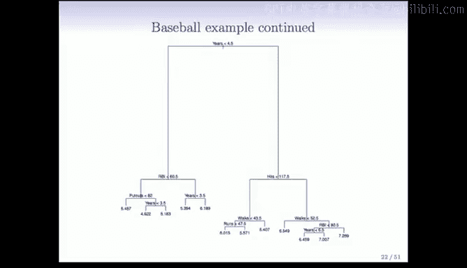

And the right split。 And this had all been pruned away。

 But now we're seeing the details of how we got to that 30 tree。

 Here's the the large tree that we get。 The only rule being that。

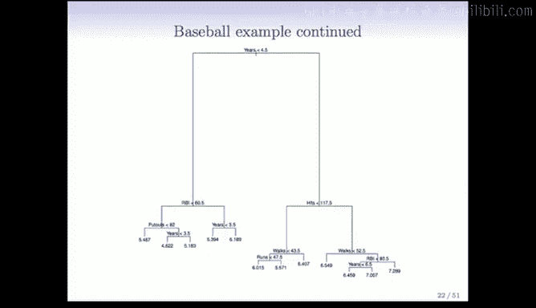

The size of the we don't split a terminal node that has fewer than say five observations。

 and that gave us this tree with how many nodes，1，2， 3，4，5，6，7，8，9，10，11，12。

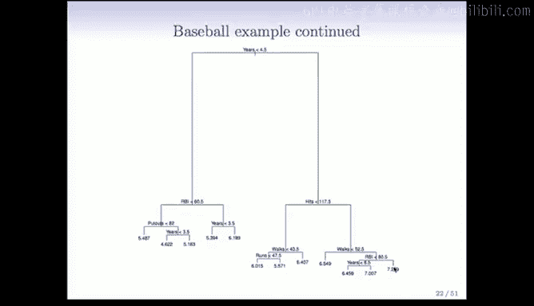

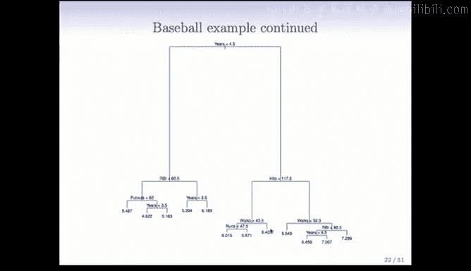

But probably not all these are predictive， Why are some of the arms of the tree long and some shorter term？

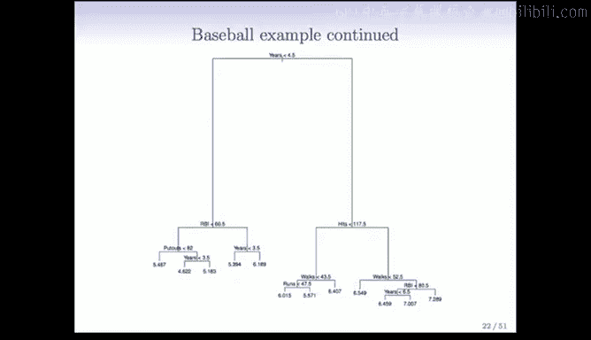

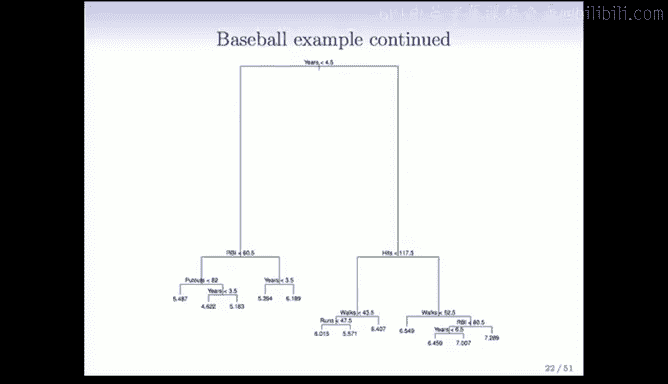

Good question。Tell me why that's because the early splits which have caused a big decrease in the summer squares。

 they depicted by long arms and then as we get down deeper。

 the incremental improvements get smaller and smaller so that's depicted in the way the trees represented your idea or who thought of that not me it's a good idea so it's whoever the author of the tree growing program in R is so here's the all the cross foundation which is going to give us the prune tree So what do we see here we see along the horizontal axis tree size which is the alpha parameter so as a very alpha it's in one to one corresponds with tree size？

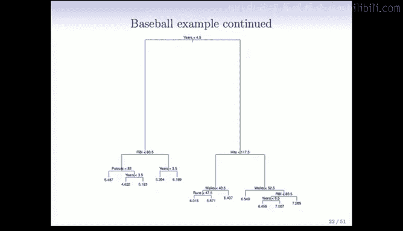

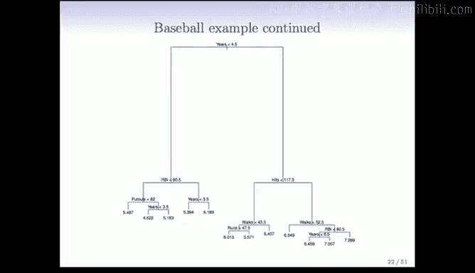

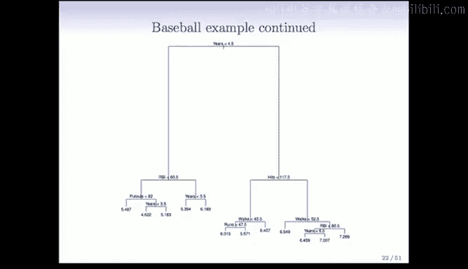

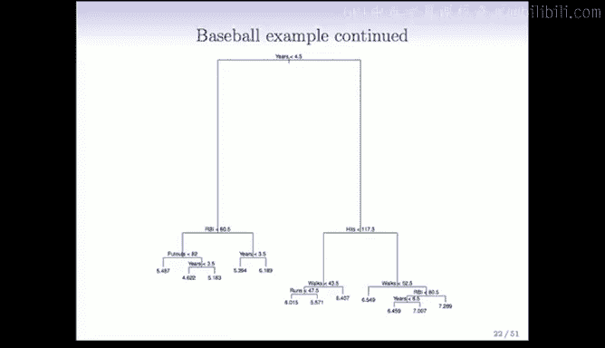

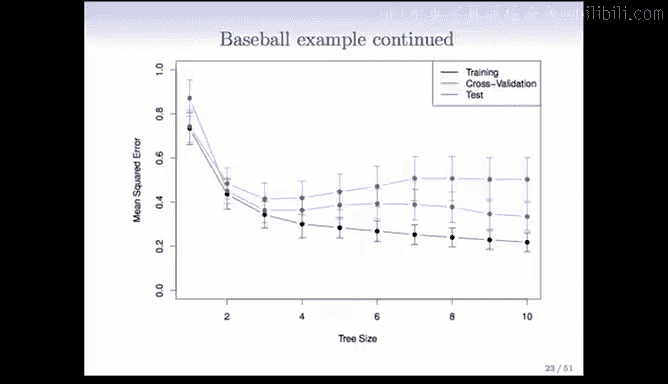

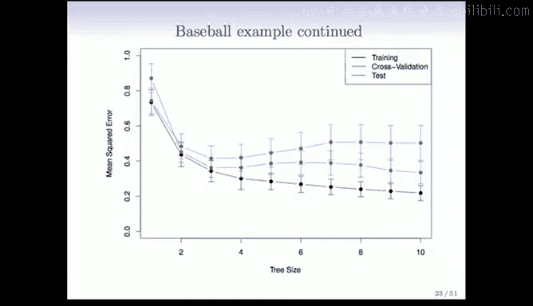

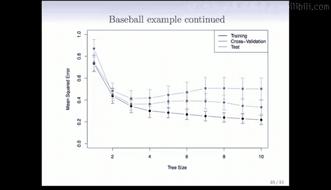

If alpha equals 0， there's no penalty to tree size， so we get the largest tree that we fit。

 which was about 12 terminal nodes。

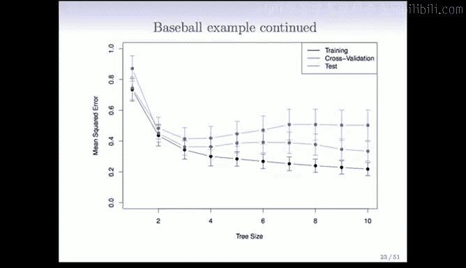

As we crank up alpha to be bigger and bigger， it puts more and more penalty on tree size until eventually we're forced to the left hand side here。

 we have actually just there's just one no， there's no splits at all。

So we're seeing the extreme from the full data set to the 12 terminal node tree。

 and let's look at the green curve as what we get from cross validation。

 and it's minimized at around three terminal nodes okay。

Well， the training error， should have said this first。

 as we expect this is of course we know that we can't use training error to choose a cost complexity parameter because the more we fit。

 the better it's going to look and we see that here right， the more we fit the lower the error。

So cross foundation， the other hand， you fit for a while。

 it's happy with the splits and then it looks like it's overfitting。

 just increasing variance and not helping prediction error。

The test error which we can evaluate here because we've set aside a separate test set。

Is it's roughly tracking the CV curve， it's minimized maybe around the same place。

So it looks like about three terminal nodes is good， which was the first tree we showed exactly。

 so it wass on the basis of this graph that we drew that three node tree。

