# 斯坦福大学《统计学习导论2023Python版｜An Introduction to Statistical Learning with Python》中英字幕 - P56：-056-Statistical Learning_ 7.Py Polynomial Regressions and Step Functions I 2023 - GPT中英字幕课程资源 - BV1u4421A7ZU

Welcome back today， we're going to do the lab for Chapter 7。

 and this is the chapter on non nonlinear modeling and additive models。Okay， as usual。

 we'll do our inputs at the top。 We won't dwell on the ones that we've seen before。

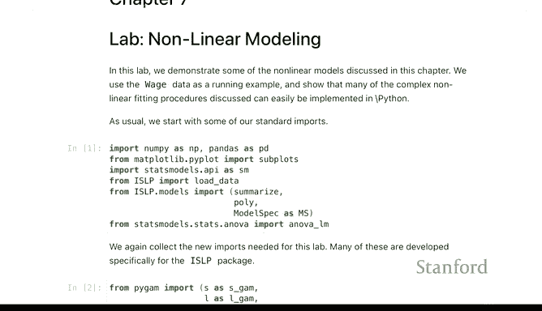

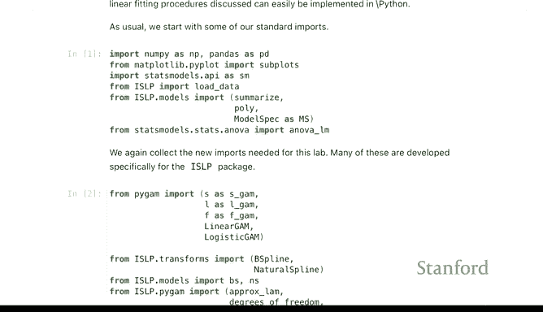

We'll look at some of the new imports。So one of the new imports is going to be from this P gam library。

 that's the library that we're going to use to fit generalized additive models。And then we have。

 we're also going to talk about splineds in this lab and we'll talk about two different transformers for be blindlines and natural splines from ISLP。

 and they're associated helpers for Model spec， this BS NS function。

We also have a few utilities that we wrote to help with the Pi package。

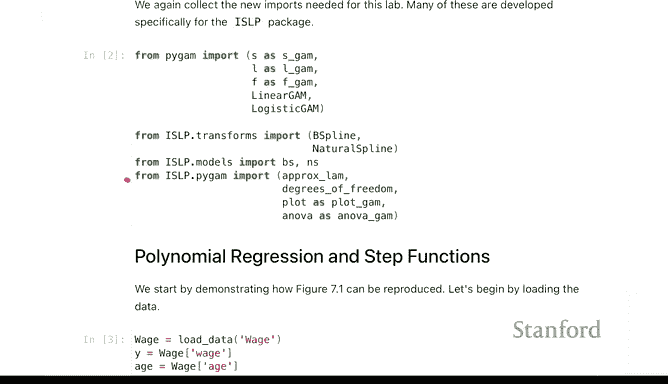

Okay。

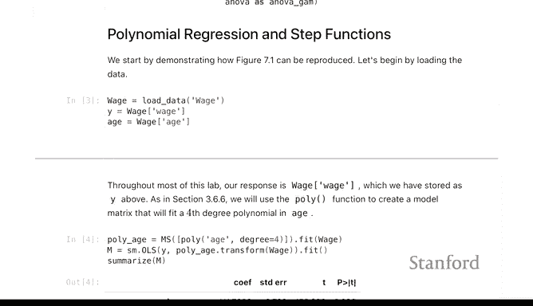

So the lab starts off with a sort of review of polynomial regression。

 We saw polynomial regression in chapter 3 already， but。

We're going to use that to compare that to splines and later to addjectitive models。

The data we're going to look at is trying to predict wage。

 I think this is the mid Atlantictic wage data。 We're trying to make wage of workers as a function of different attributes。

 and we're going to。Mostly look at wage as a function of age。

There's also going to be education level is another feature。

 there are several other features you can find in the documentation。

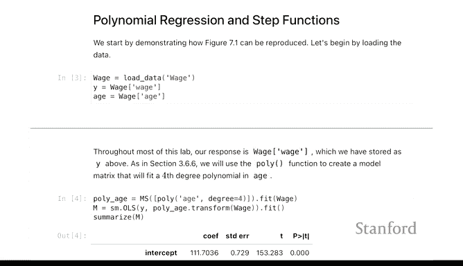

Okay， so having fit polynomial regression we're going to want to look at the fit because one of the nice things about additive models is for each feature。

 you can make up a plot of the estimated effect for that variable。

 So we'll first a take a look at the fit for the using polynomial regression。

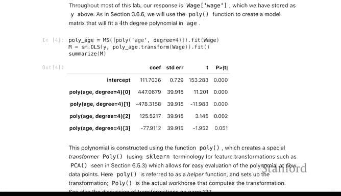

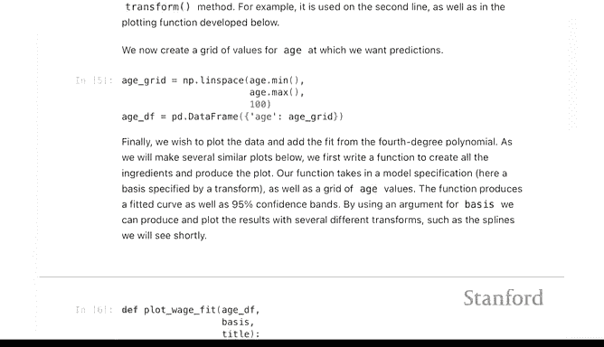

So。There's a bit of。Of。A bitit of a boilerp code here to try and make these plots that I'm not going to dwell on。

 We're going to use a function here in this lab because we're going to fit mint plot several things as a function of age。

 We wrote a little function make to make our life a little bit easier so we're going to change in the function what the modeling that is what in the fact what the model spec is。

 that's what we call the basis and we'll evaluate the basis on this age DF。

 this is a grid of Reg space values of age we can use to make a plot。

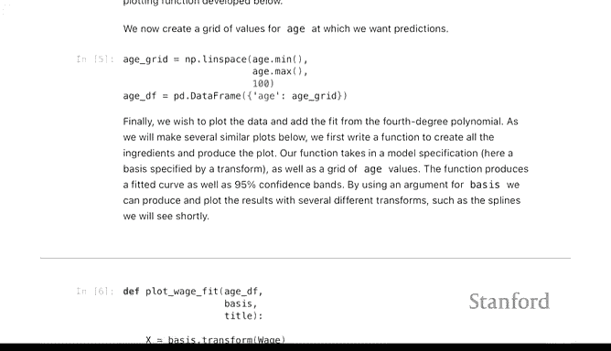

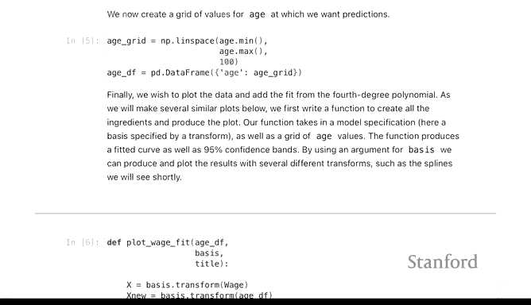

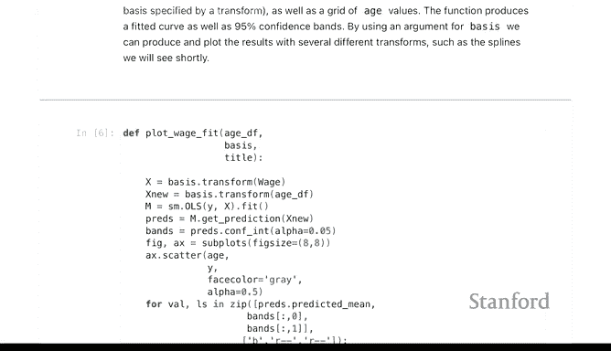

um。So let's just take a look。At the fit of the fourth degree polynomial。

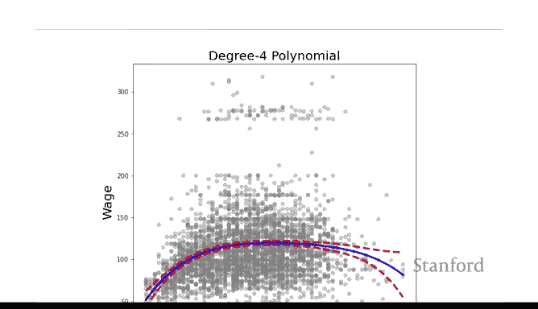

And we've also included error bars。One other thing about this plot of note if you want to read the function that produce it。

 because we have quite a few points to try and get a sense of in the scatter plot of density。

 we've added some opacity so an alpha channel to the point。 so this is alpha I think 50% and 40%。

 it gives some sense in the scatter plot of how many points are in different regions。

I'm sad to say that I'm on the beginning of the downward curve of that wage plot。

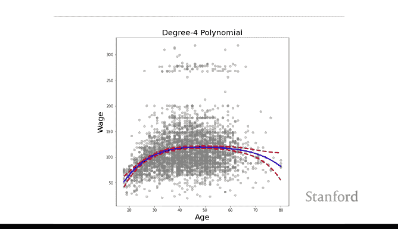

问。It doesn't go down too critically。Right yet。

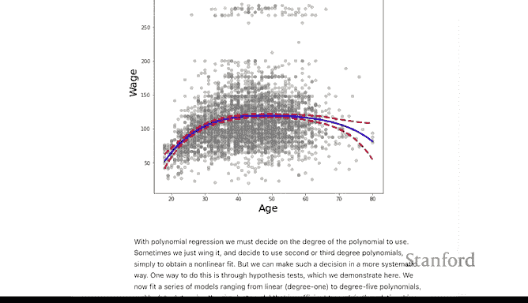

Okay。So in building a model like a polynomial regression。You know。

 we often maybe want to determine the order of of， of， of the of the regression model。

 One way we could， we could do that is using something like the validation， cross validation。

 as we had seen in。In chapterpt 5， another way we might do it is by looking at how what a statistical measure of how much the fit improves as a function of of degree。

 And we'll do something like this later in the generalized additive model where we compare fitting。

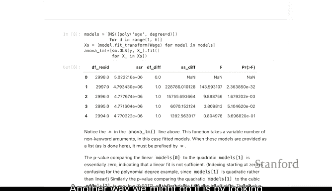

Having no fit for age not being in the model linear and then with an additive function。

 So what we're doing here is we're using this annova LM function。

 which is something we saw in chapter 3 to compare the models as we increasingly we increase the degree of the polynomial。

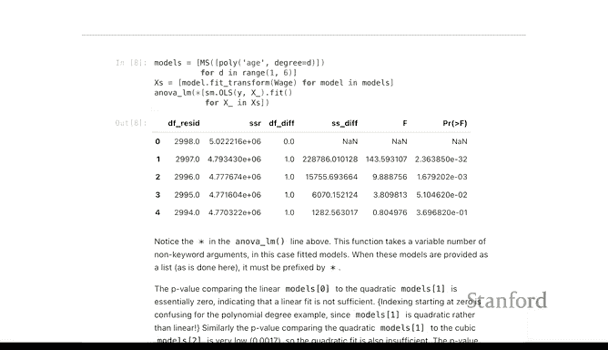

And just a quick takeaway we're looking at these S statistics。

 a large S statistic means the transition from one model to the next is a significant improvement。

 F statistics are around one on average， so anything much bigger than one is good evidence of is evidence that there's an improvement so we see going from having no aged age linearly as a big improvement and then quadratic quite a bit cubic a little bit less and then the fourth order doesn't seem to really add anything to this fit。

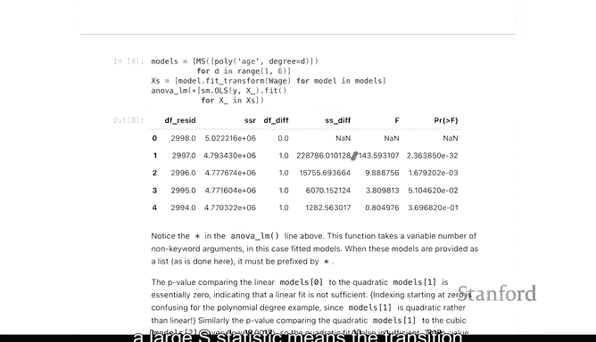

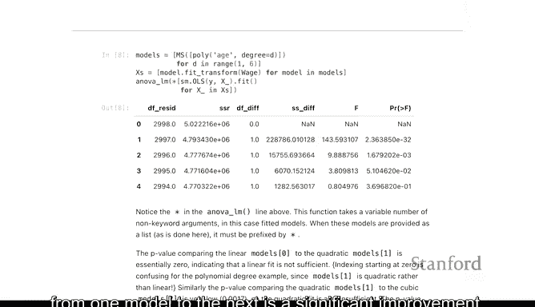

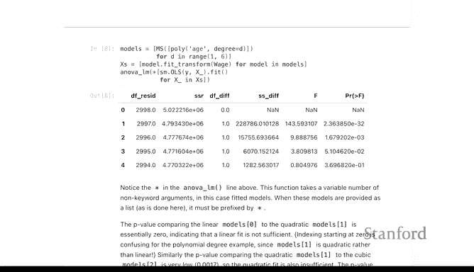

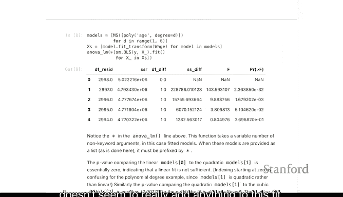

Okay， and just a note， you can find those F statistics in the case。

 we only have a single feature can also be found from fitting from the summarized table， but。

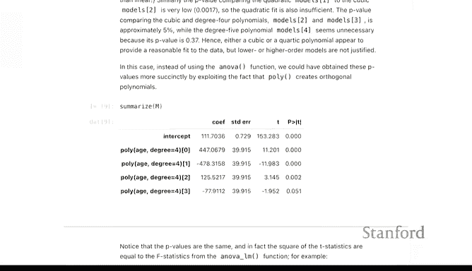

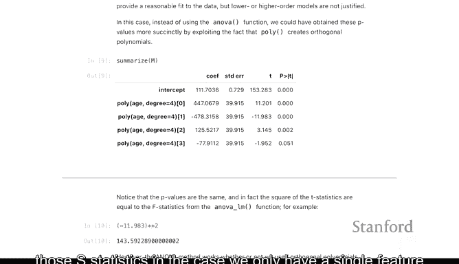

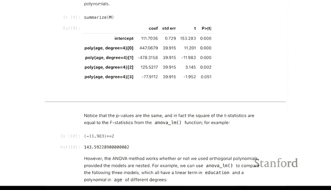

Let's move on。Okay。So that table we just saw before looked at the effect of changing the degree the degree we model age with and trying to pick。

 you know going to stop adding stop increasing the degree。

 We are not limited only using age as a feature。 We can of course， do that without feature。

 So here we've used education， which is a categorical variable So we' we're looking at the effective age allowing for education and we can do a similar sort of construct a similar table to see the improvement of the fit as we increase the complexity of the age fit。

 and we do again， see a big increase big improvement when we add go to linear and some improvement when we go to quadratic。

 We haven't gone all the way to the fourth order degree here。

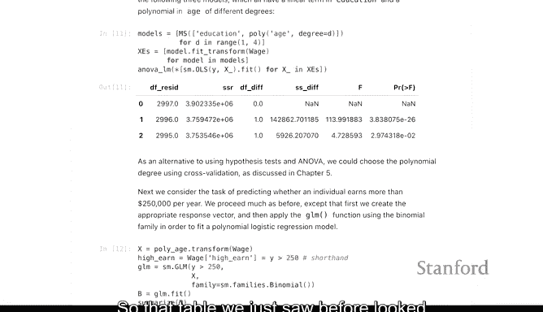

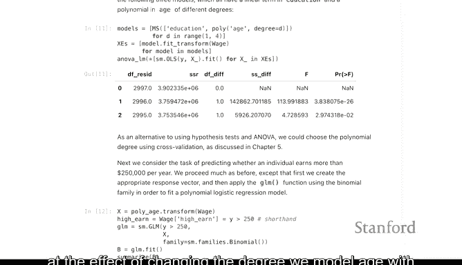

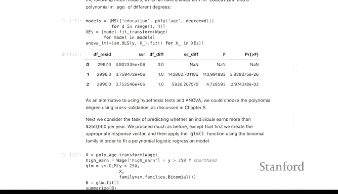

Okay， so。We've looked now at how to， how to sort of。

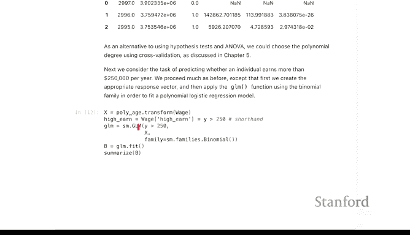

Make a flexible model of age for。Wage is a function of age， I should say。

 another thing we might consider is instead of predicting the wage。

 we might just trying to predict whether they you know turns a binary problem to see whether the worker earns more than 250000 or not so we'll call these the higherers whether they earn more than 250。

000 or not and we can repeat the same process but instead of using ordinarily squares。

 we're going to use logistic regression and remember this is the GLM object from stats models and the family is the binomial family that tells the computer that it's a logistic regression。

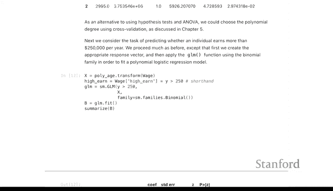

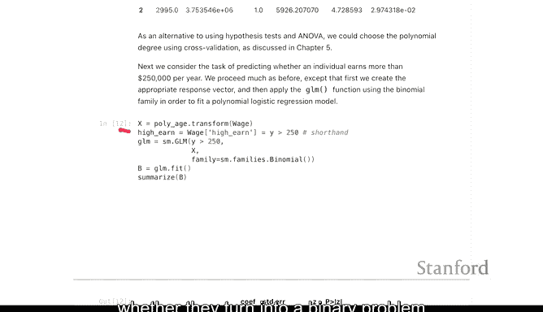

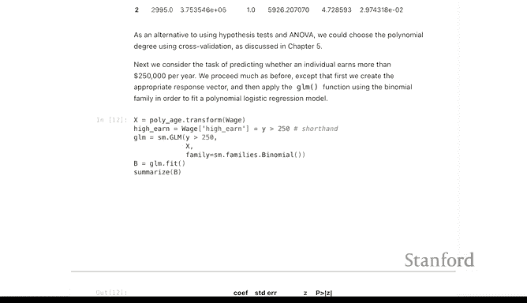

So this is going to we can， if we fit this mod and summarize it。

 it will look a lot like the linear regression fit。

 though now we're trying to predict a binary outcome rather than a linear outcome。

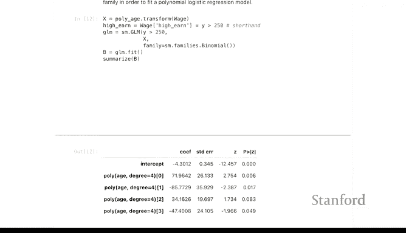

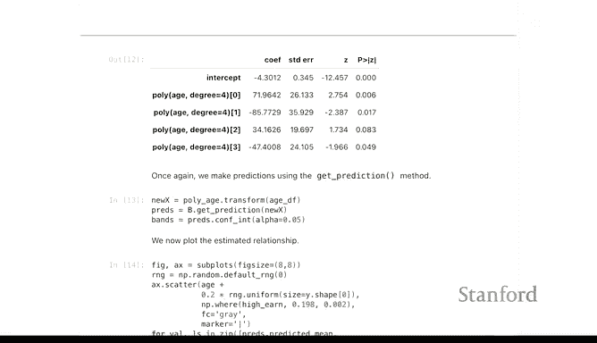

So we can similarly make a plot of the estimated effect。

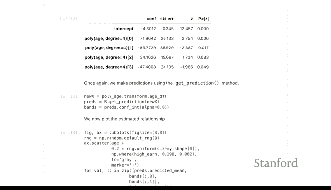

And let's take a look at this plot。

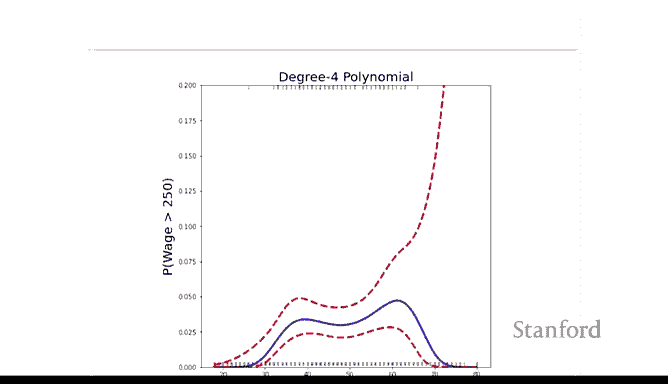

We have blue curve is the fourth order polynomial where we fit。With standard error bars。

 Now my age category looks much worse Yes， yes， maybe I spoke to you soon about the tick。

 So a few comments about the plots。 So we don't see the scatter plots that we did when and that's because we've changed the y axis here。

 we're trying to predict whether something you know a binary outcome。

 So we really have cases that are0 and cases that are one。

 though here we've trunncated the axis to point to just so that we can see this of this fit here。

 So we've labeled the points up here。 these are the age values where there's a tick here。

 These are the age values where we had a greater higher nerves And these are the values of the lower nerves。

 And a similar device to get a little little better visualization is to add a little bit of jitter to the x axis here to try and get a sense of how dense the ages are because the ages are actually just integer values。

 So you can't really see anything by the tick。 And notice how wide the standard error is on the right hand。

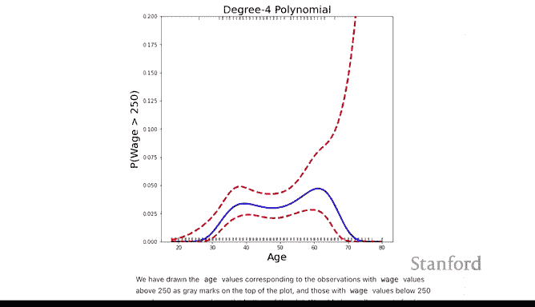

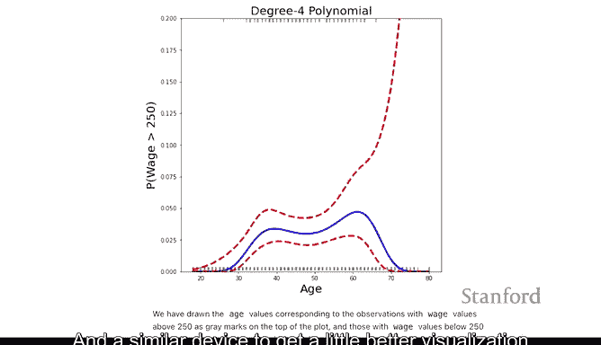

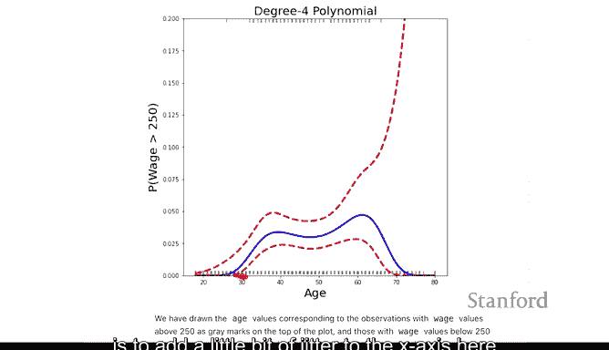

The plot It usually means there's very little data there Often you do get wide standard errors at the edge of the range。

 but if there's very little data， then it gets even wider。 Yes。

 and I'll just add one another facet if everyone is a low wage earner。

 then that's another sense for binary classification that there's low data。

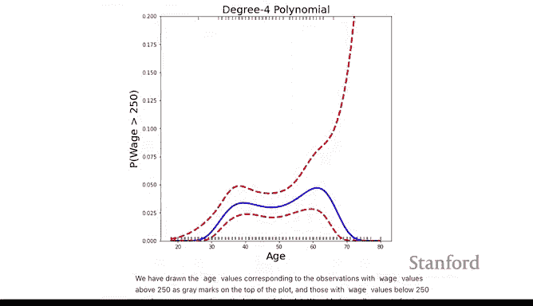

