# 斯坦福大学《统计学习导论2023Python版｜An Introduction to Statistical Learning with Python》中英字幕 - P57：-057-Statistical Learning_ 7.Py Splines I 2023.zh_en - GPT中英字幕课程资源 - BV1u4421A7ZU

We've seen how to fit regression models with high order complexity in terms of the degree of a polynomial。

 The next topic we're going to look at is how to fit similarly flexible functions， but using splines。

 And remember these are piecewise smooth functions， they can be piecewise constant if it's order0。

 piecewise cubic if it's a cubic spline and the order typically cubic splines are the default for modeling smooth functions。

 But we can use。Constant to linear quadratic qubit。 Okay。

 so as we might want to use splines in a regression setting， we have。

We've implemented something like the poly function for using bees blinds and。

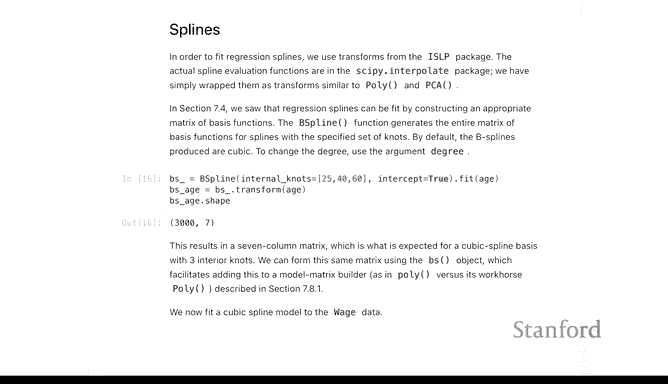

You can construct。

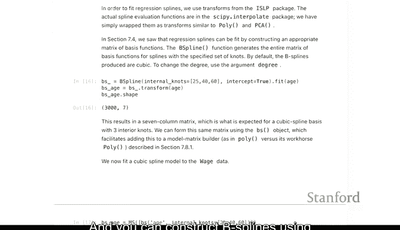

Bees blinds using this beast blind object we've written in the。

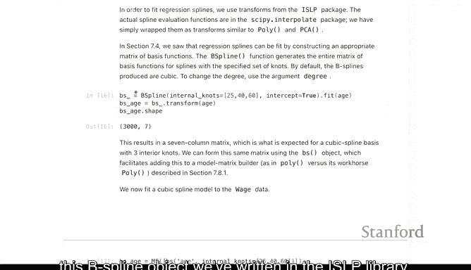

In the ISLP library。 And this is a psyit learn transformer。

 So you see it has the same interface we fit and transform。

 and this will produce the beastblin basis。

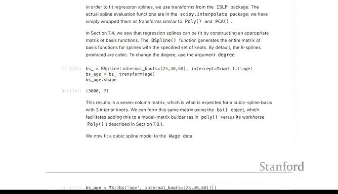

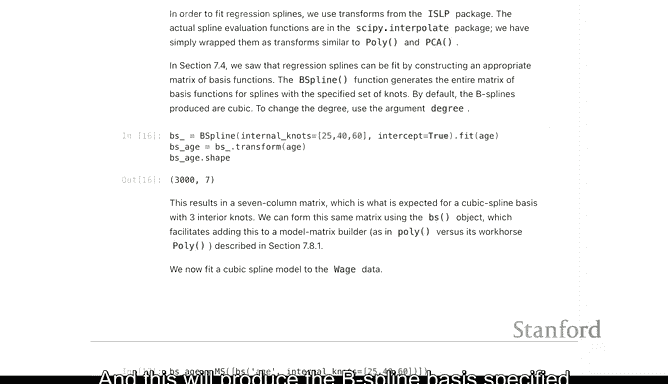

For you specified by the number of knots and well， whether or not you want to include an intercept。

 etc。

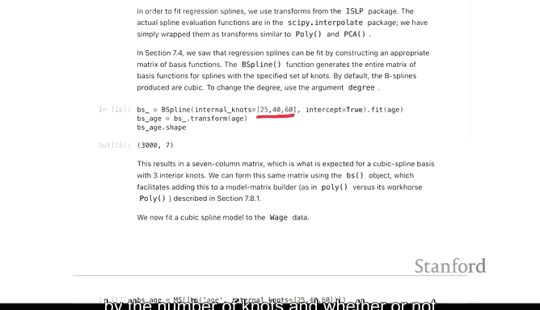

So when we fit this in a regression model， though， we don't use the transformer directly。

 We use this helper function。 This is like using the helper function lowercase poly that we saw above。

 So we'll fit the same model with these sps and we'll get you know we can summarize it again and look at the individual individual estimates over a B sp。

 the individual coefficients are often you know less informative。

 It's really the form of the function that's more interesting。 So we'll we'll start。

 we'll look at a plot of。

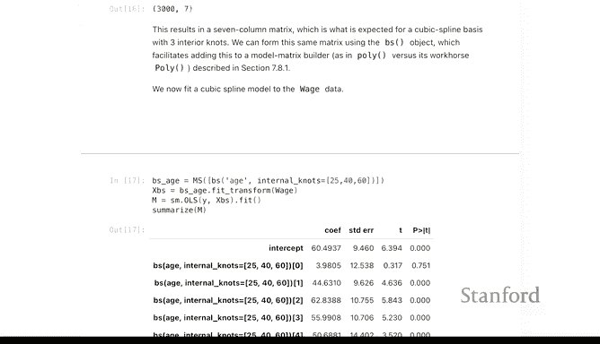

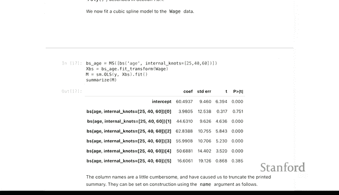

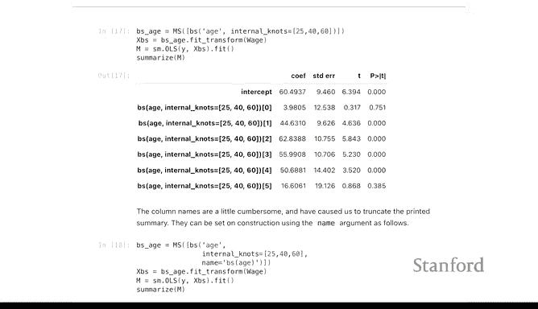

Of。Of the beastbl instead。

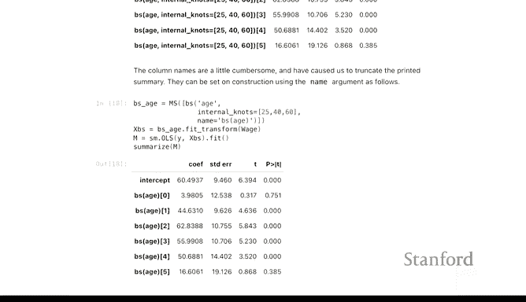

Okay， so I'm skipping over some of the details that go into， you know how peace lines are described。

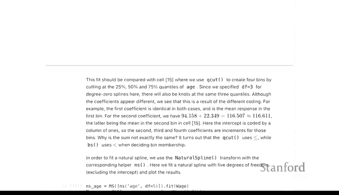

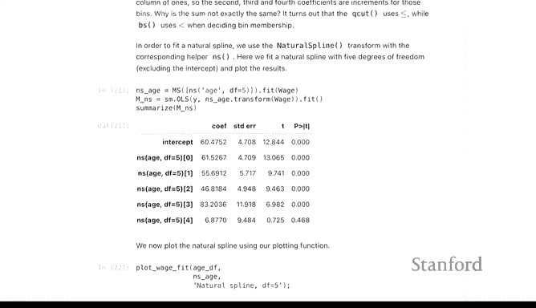

And we're going to talk now about natural splines。 Remember。

 natural sps are special cases of bees blinds that are subject to extra constraints。

 And that is that beyond the last knot， they just are extended linearly rather than cubically。

So they look like a beast mine in the middle， but they extrapolate slightly different。

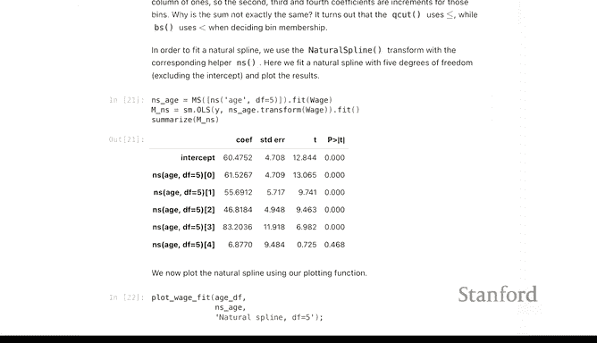

Okay。So， there's a。Deegree of freedom associated to the spline， which is related to how many knots。

 So where the breaks and the discontinuities in the dirts occur。

 So using five degrees of freedom is close to using a fifth order polynomial， in some sense。

 it uses the same number of parameters of the fifth order polynomial。

 though it does it in a slightly different fashion。

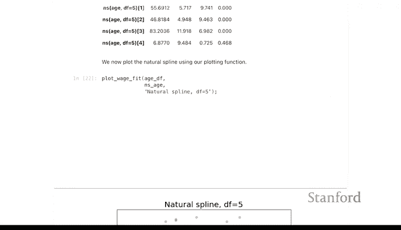

Let's take a look at the regression model。And actually。

 if we think back to the plot of the fourth order polynomial， the fit is not very similar。Yeah。

 though the natural splines have， they， they typically will extrapolate a little bit better because they extrapolate linearly。

 You know， polynomials can get can grow very quickly beyond the edge point。

 So that's one of the nice things about using a spline instead of a polynomial。

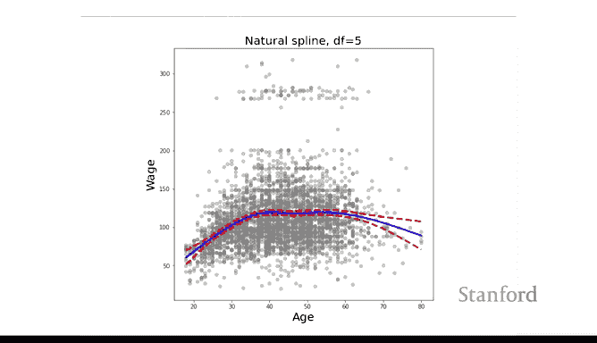

