# 斯坦福大学《统计学习导论2023R语言版｜An Introduction to Statistical Learning with R》中英字幕 - P57：-057-Statistical Learning_ 8.4 Bagging.zh_en - GPT中英字幕课程资源 - BV1yU421o7WA

so the next topic is called bagging a bootstrap aggregation。

 which is a way of using trees in ensemble an average of trees to improve their predictionary。

 And as we'll see that the bagging methods， well， I'll mention the bagging method is due to Leo Bman and it kind of a bootstrap process And I remember seeing when at first time I saw this what would that been maybe in the mid-90s。

 I knew a lot about the bootstrap actually， I was a student of Brad Aphron who invented the bootstrap and Brad and I wrote a book together on the bootstrap in the early 90s。

 and then when I saw the bag idea from Leo， I thought this looks really crazy。

 usually the bootstrap was used to get an idea of standard errors or bias。

 but Leo wants to use bootstrap to produce a whole bunch of trees and to average them which sounded really crazy to me。

 and it was a reminder to me that you see an idea that looks really crazy。

It's got a reasonable chance of actually being really good if things look very familiar。

 they're not likely to be big steps forward， this was a big step forward and took me and others a long time to realize that and bagging and you'll see random forests that we're going to talk about as well they used all over and I just was at a talk the other day where random forest was the primary tool used in a big image classification problem using state of the art methods and random forest was at the heart of it。

Okay， so let's see what the bad idea is， so it's the basic。

It's a way of taking a bunch of independent observations and taking their average to reduce variances。

 so just recall if we had a bunch of observations Z1 through ZN。

 the independent observations with variance sigma squared，Now if you take their average。

 the variance of the mean of the mean y bar is sigma squared over n。

 so by taking an average of independent things， we reduce the variance by n。That's good。

 so what does that say to us in terms of supervised learning it says that we had more than one training set。

We could grow， for example， a tree on each training set and take the average tree， right？Now。

 that doesn't really help us probably because we don't have multiple training sets。

 let's assume we just have our。The one available training set。Well bagging is going to turn to what。

Achieve this now by taking not without new training sets。

 by taking bootstrap samples to create sort of pseudo training sets。

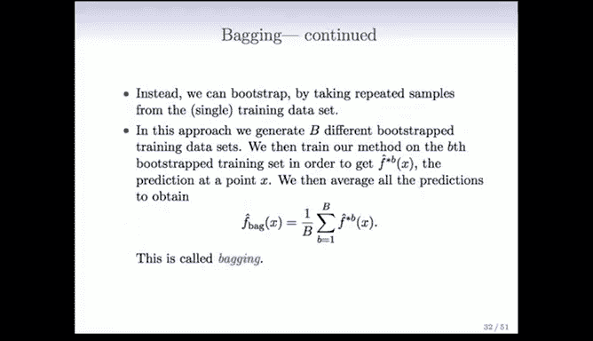

Grow a tree on each one and then take their average。That's the simple， but I think。

 very clever idea of bagging。So we're going to take bootstrap samples from my training set of the same size as the original sample。

 that's the usual bootstrap。

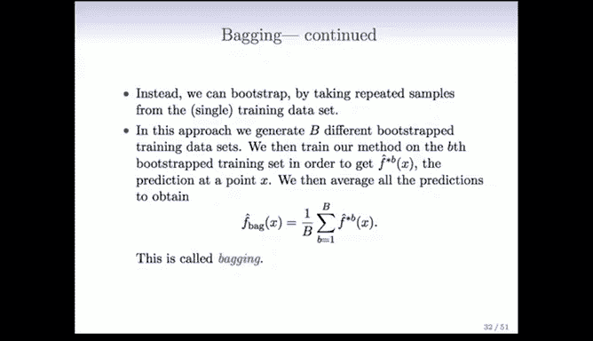

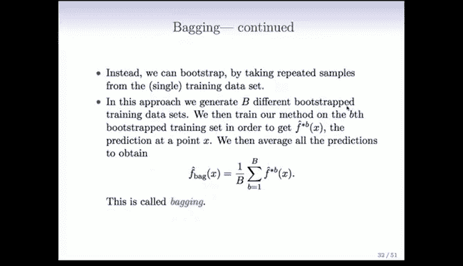

And I can maybe draw a little picture here， just so we can。

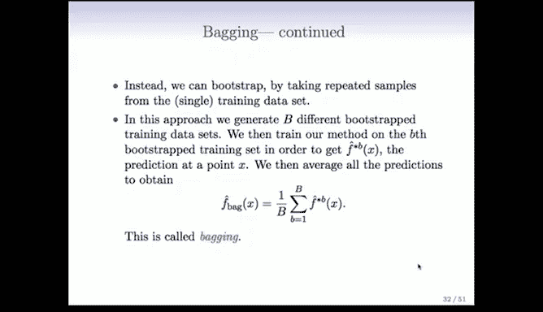

Think about it， here's our original training set， we're going to draw bootstrap samples， again。

 their samples taken wither place them of the same size from the original data set。

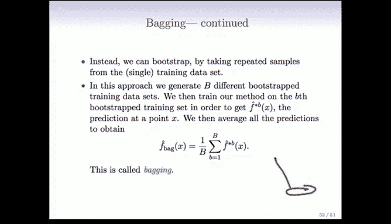

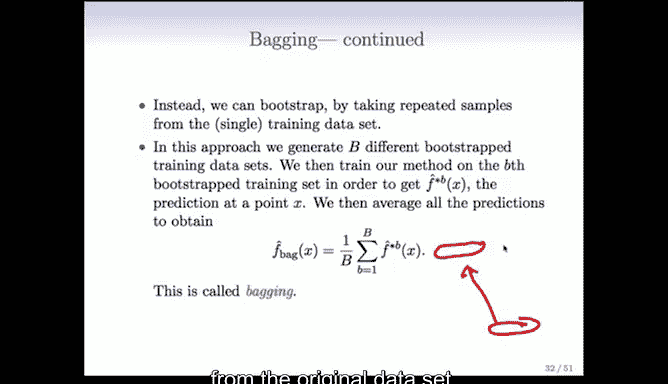

And we'll take lots of them， maybe a few hundred。Okay， and for each one， we're going to grow a tree。

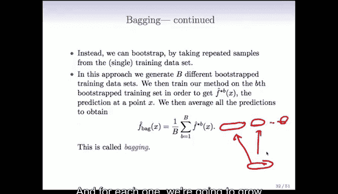

Using， for example， the procedure we just went over。

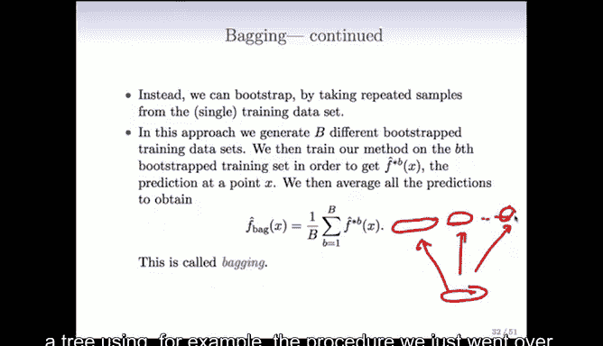

啲。On each of these training sets， we're going to get a little tree。

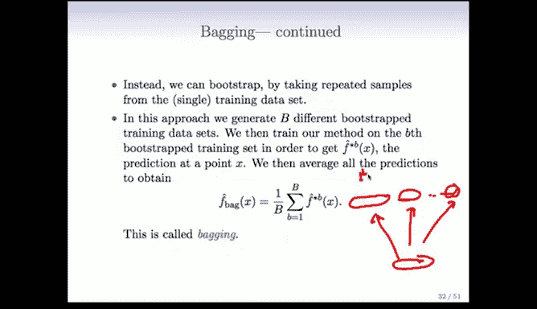

They're actually quite big trees， big trees。 that's extra。's a little tree。 But actually， in fact。

 we don't need to， turns out we don't need to worry about pruning the trees。

 We can grow large trees and just。

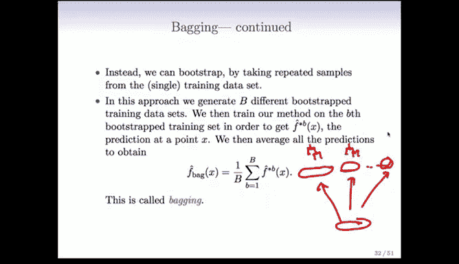

When we average them we'll reduce variance， so we don't need to prune even as' another happy coincidence。

And notation wise， we'll call the tree that we grow on the beef tree， again。

 B going from maybe  one to 200。F hat star b of x。The prediction at feature x for the B3 will call F hat star B of x。

Our overall bagged estimate prediction is just the average。So in other words， we grow these trees。

 we have a new X， and we want to predict it X。 we ask each tree， what's your prediction for X？

And that's a hat star B of X and we average the predictions and that's called bagging。

 it's a really clever idea。 So you know the old idea of pruning a tree back was to reduce the variances。

 you prune it back。 But when you prune it back you give it a lot of bias because you make it necessarily just a much costarser tree So Bman's idea was don't prune back。

 have bushy trees which tend to have low bias and get rid of the variance by doing this average。

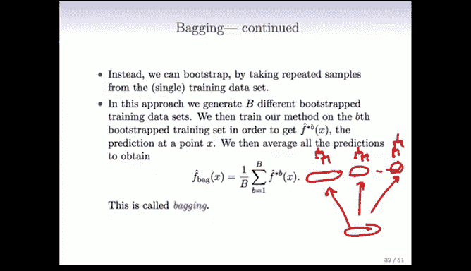

RightAnd we're going to apply this to regression or classification here。

 I basically p assume we're doing regression so that the prediction is actually a quantitative variable。

 but we doing classification， we can just do a majority vote so we can。

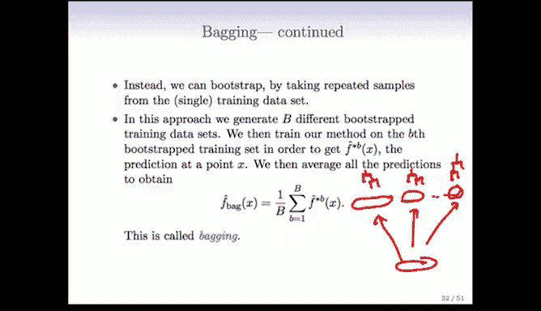

We can have 200 trees， since we have two classes， we make a prediction of each X。

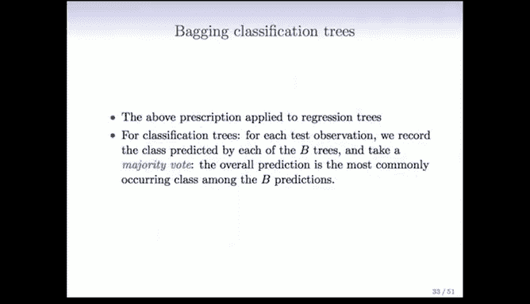

And we ask you to treat what's your class prediction and suppose of the 00 150 say class1 and other 50 say class2。

 then our prediction is class1， so we can just take a majority and vote among the bee trees that we grow。

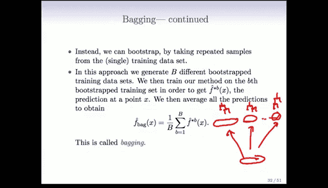

So here's actually the heart data， this is the result of bagging the heart data。

 so alone the horizontal axis is the number of trees， which we grew up to 300 trees in this case。

What do we see here。

呃。We have the test error bagging， first of all， maybe we had a test set aside。

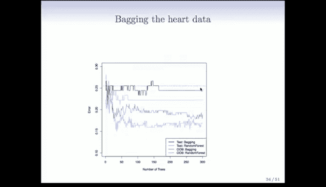

And it's the black curve。嗯。

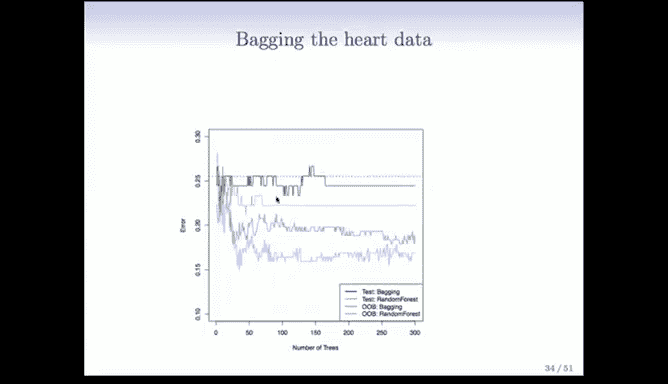

And its air is around。ALittle over 。25。If we go over the left here。

 we'll see as a result of a single tree。

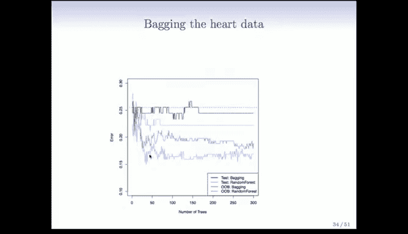

So in this case， bag can improve a single tree maybe just by 1% error actually the dotted line is a single tree Okay。

 thank you so the dotted single tree。 so it looks like we may have improved the prediction error by perhaps 1% not a great win in this one case The random force。

 which I'll talk about in a few slides is a sort of it's a。

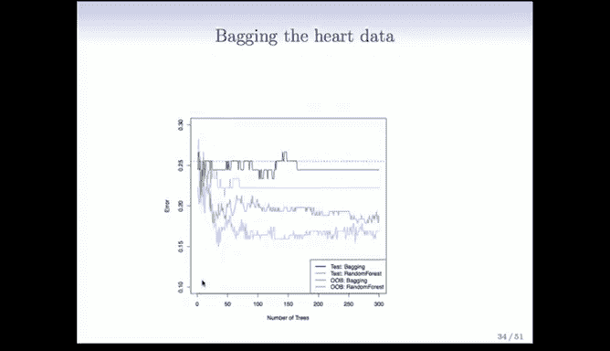

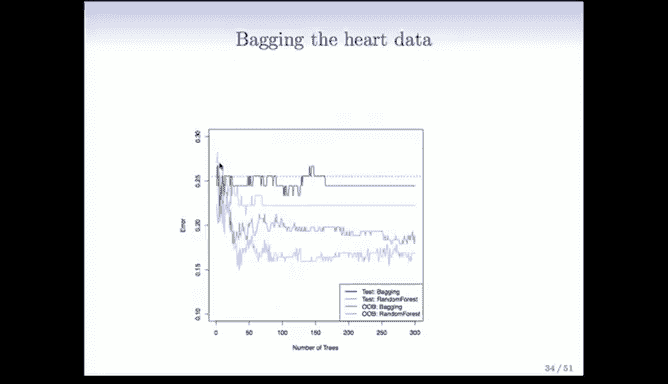

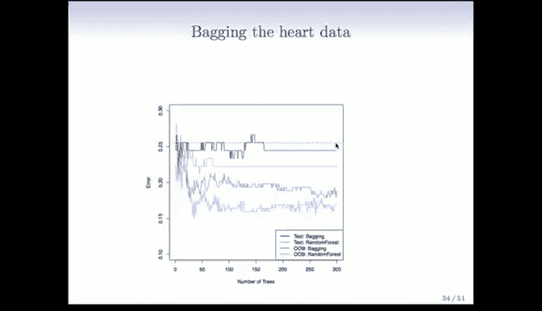

More advanced form baggging where we do it。Do another trick of brman's that's going to prove things here by maybe another couple percent。

So in this figure we've also got two eeros called Out of bagg for both for baggging and random Forest。

 we'll describe it for baggging now， so the out of bag area is a very important part of baggging and random forest and it turns out it's a essentially free way of computing leave one out cross validation and it works as follows。

Each of those bootstpped samples includes about。Two thirds of the observations and about one third of the observations are left out。

And of course for each bootstrap sample a different one third is left out so suppose we want to compute the error for a particular observation well we can take all the bootstrap samples that didn't include that observation and we just average their predictions for that observation and use them to predict that observation。

Well， that's going to be that observation wouldn't have been in any of those training samples。

 and so that's a left out area estimate。And so you can just accumulate those predictions in that fashion for each of the observations and that's called the out of bag error and if you think about it carefully if B is large。

 the number of trees is large that's essentially leave one out cross validation and it just comes for free and so that's what was given in the slide here so for bag in that's the green curve and it's quite a bit lower than the black curve above which is the error on the test set the green curve and of course there's variability in these because these are just samples of numbers and so that variability is just due to the division of the test samples and the training samples。

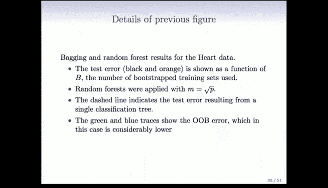

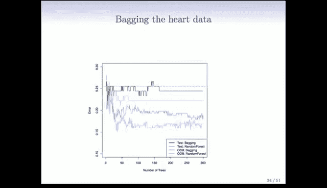

Okay， so the next study that Leo Bman had a few years after begging was called randomandom Fors。

And the idea here is that we're taking an average and the average would be lower if the things being averaged have lower correlation。

So the idea of random forces is to build trees in such a way to actually make the correlation between trees smaller。

Even smaller than you get from bootstrapping， exactly right And again， this is one of these ideas。

 which when I first saw at least look really bizarre， but it's a very clever thing。

 So what is that idea， Well， the idea is we're going to do bagging exactly the way we did before。

 except with one change when we build the trees and we make splits。

Every time we consider a split in a tree， we don't consider all possible predictors as we normally do with trees。

 but rather。We selected random m predictors among the P。

 and the M must say typically about the square root of P。

 so in other words if there's100 predictors in our data set every time we go to make a split。

 we don't consider all 100， but rather we take a random subset of 10 of them and the other 99 considered only the 10 are even allowed to be considered for the splits and the random selection is made。

 a new selection is made at every possible split。Okay， so again。

 it seems kind of crazy to throw away most of the predictors at every split。

But the effect of doing this is that it forces the trees to use。

Different predictors to split at different times and since we're going to build lots of trees。

 although if a good predictor is left out of a given and splits gonna to have lots of chances in that tree or in other trees to make an appearance so although it seems crazy to throw away in the sense most of your predictors at every stage since we're going build a large number of trees and then take the average it actually works out very well so even with the same training sample。

 if you run if you grow two trees， you'll get two different trees because by chance it'll pick different variables each time。

Okay， so let's see how randomfor does in the。Heard data so you remember the bagging era test error was about here and random force improves by maybe one or 2%。

 so again by doing this trick of throwingaway predictors we've decorelate the trees and the resulting average seems to do a little better and the out bag estimate is also a little better than it was for bagging。

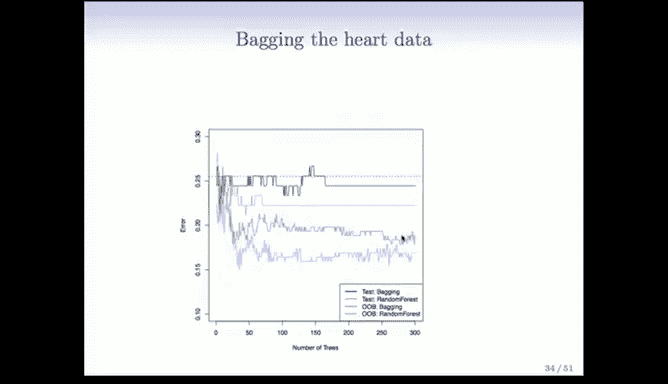

Our next example is a high dimensional example from chapter 8 on gene expression。

 so this is using the gene expression from 349 patients， since you're cancer patients。

A gene expression of 4718 genes to predict their cancer class。

 and this is a common activity among people in statistics and genomics to try to do classification into things like cancer class based on the gene expression of genes and cells。

So in this case there's actually 15 classes， the one class is healthy or normal。

 and there's 14 different types of cancer。So we're going to apply the random force method we just described to this high dimensional data。

But。Instead of using the entire set of 4718 genes， we're going actually going to prescreen the genes。

 we're going to choose that the genes having the highest variance across the training set and it kind of makes sense to if we want to reduce the number of genes to use variants because if something has。

Small variants across the train said it's probably not very predictive， right。

 so Jews the one have the largest variants or the other ones that are most likely to be predictive。

So is that cheating room， you went from 4700 genes down to 500 genes？That's a good question。

 is it cheating is it biasing things well it's not because the outcome。

 the class is not being used to choose the genes， it would have been a problem if we chose the genes that vary the most from one class to another。

 in other words actually if we use the class label to choose the genes。

But because we're just doing this just looking at the overall variance without regard to the class label。

 this is fine， it's not going to bias our results so it's unsupervised screening exactly。

 so supervised screening creates a bias in our would create a bias in our cross validation or the out of bag estimates。

 but if we do it unsupervised， it's no problem， which that's what we're doing here。So again。

 for comparison purposes， we divided the data into a training in a test set。

 we're going to apply random force to the training set and for three different values of the M。

 which is the number of variables that we choose at each split。

 the random number among which we're going to choose at each split。So let's see the results。

 so again， a horizontal axis has a number of trees， total number of trees， we go up to about 500。

On the left we have the single tree results， so remember we been saying quite often that the trees are attractive because they're interpretable。

 but they really don't often predict well and here we see a case where they're predicting pretty badly here's the single tree and it'。

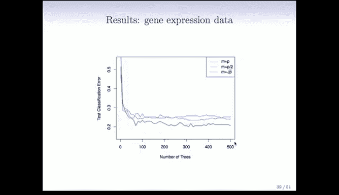

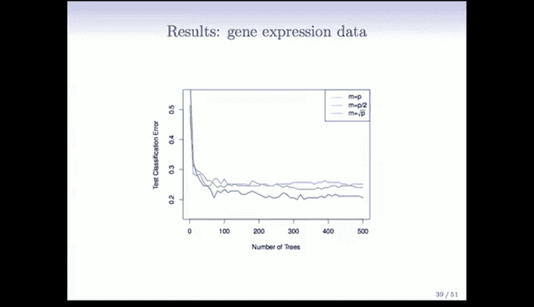

Its errors。Upwards of 50 or 60%。 remember there's 15 classes。

 so an error of 60 or 70% isn't crazy right because there's so many classes， but it's still。

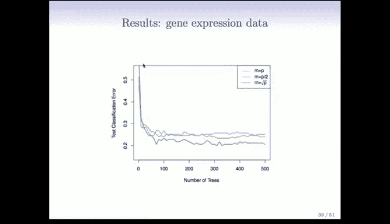

not very good It's interesting， Rob， quickly the error comes down with random forests and then sort of levels off。

 it doesn't take long before by about 100 trees， it's kind of leveled off and not really changing that much。

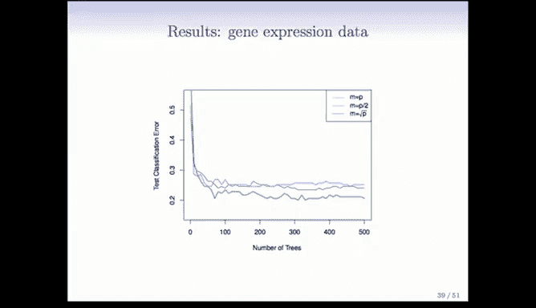

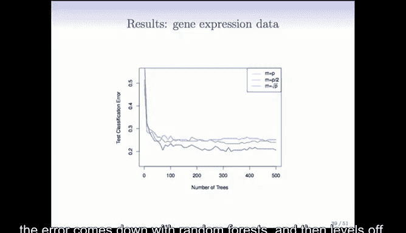

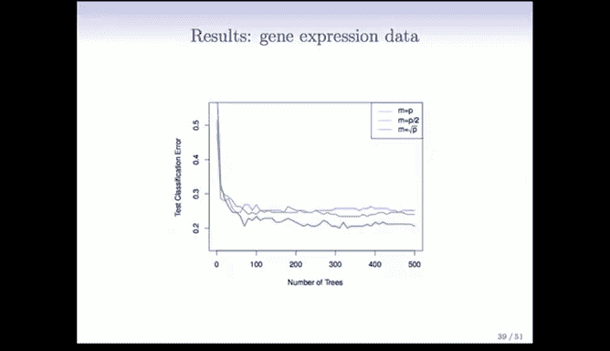

Exactly， and so and that levels is around。 so we look at looks like the best is around。

 well if we use。

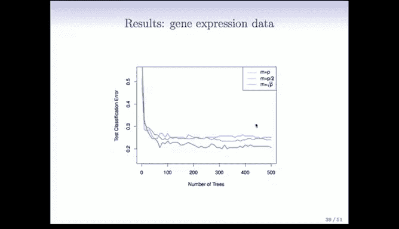

M equals P， which is just bagging right that means at every split we're using all possible predictors or considering all possible predictors。

 that's bagging， those are usual trees。

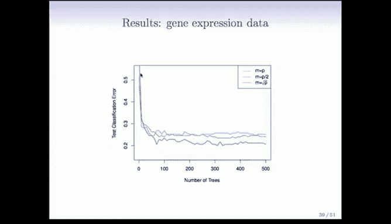

That gives us the gold curve。

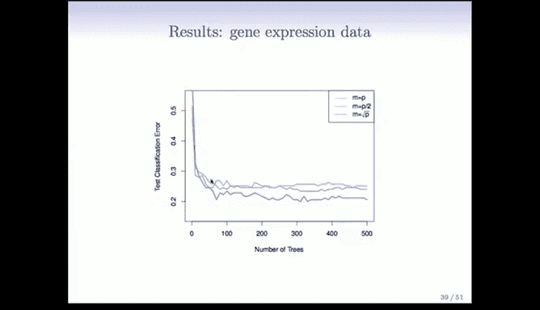

Random force the green one with the square root of P， so that's where we're throwing away。

 we're retaining square root P and throwing the rest away。

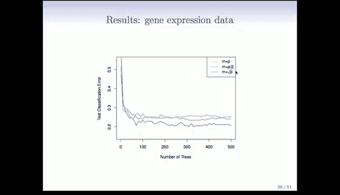

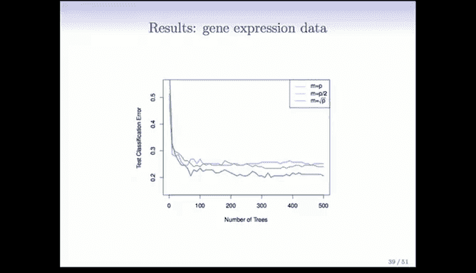

You see， it gives us an improvement of perhaps three or four% overbagging One nice thing about random forests and baggging is that you can't overfit by putting in too many trees。

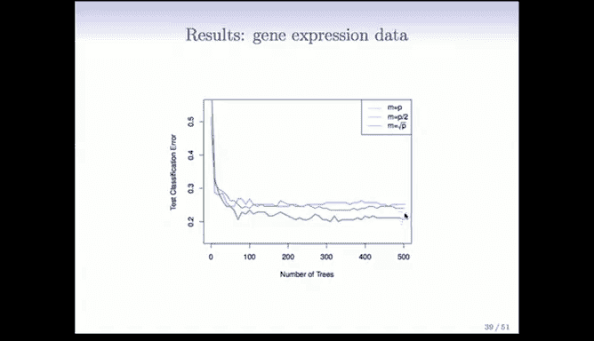

The only benefit of adding more trees is it brings a variance down more。

 but that at some point the variance stops decreasing and adding more trees doesn't help you at all。

 but it never will hurt you so by looking at for example。

 these out of bag errors you can just decide when you've done enough。

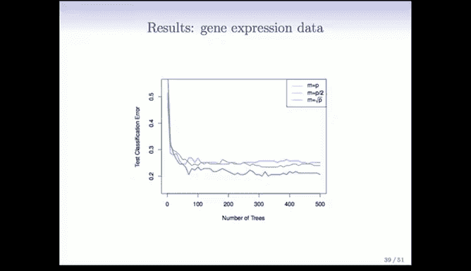

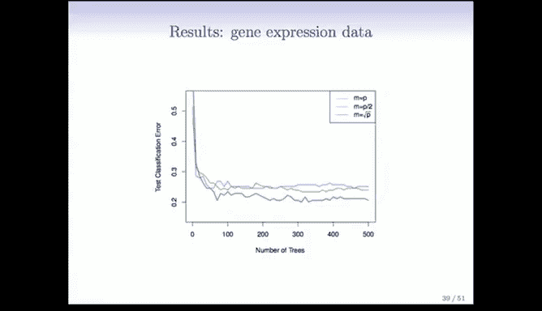

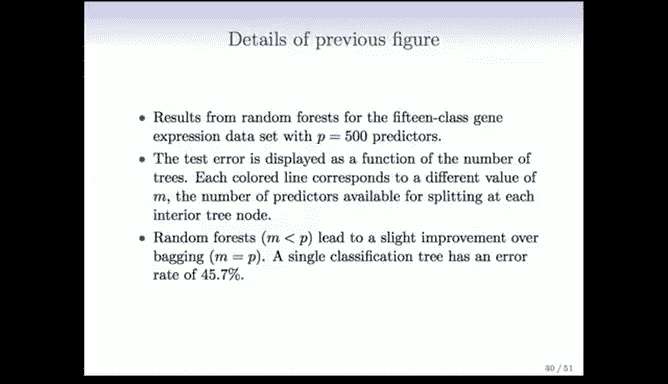