# 斯坦福大学《统计学习导论2023Python版｜An Introduction to Statistical Learning with Python》中英字幕 - P58：-058-Statistical Learning_ 7.Py Generalized Additive Models (GAMs) I 2023.zh_en - GPT中英字幕课程资源 - BV1u4421A7ZU

So we've seen now how to fit regression models with with splines and polynomial regressions。

 We're going to move on now to generalize additive models。 So the first part of this。

This section of the lab goes through something similar to what we saw for just having modeling wage as a function of age。

 We're going to skip that to talk about the more interesting aspect of gams or addeditive models that is when we include more than one feature。

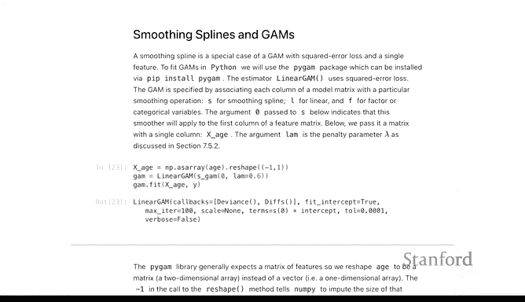

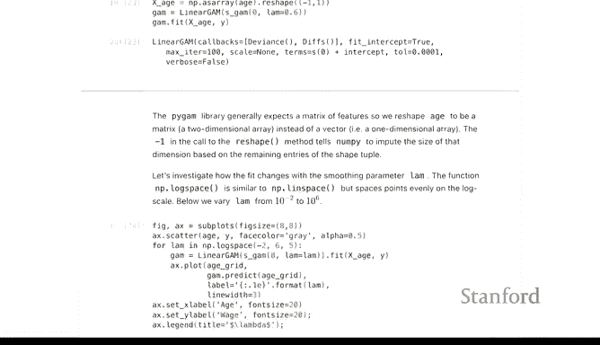

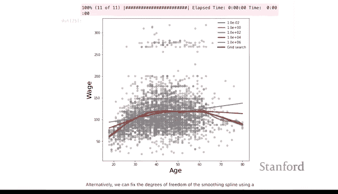

So the first model we're going to fit with more than one feature。

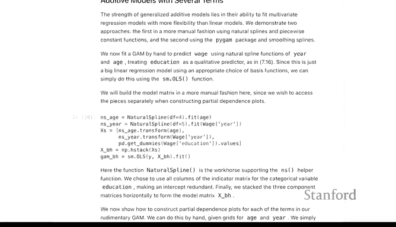

Is going to be necessarily not strictly again， but it's going to include splines for the wage as a function of age and a function of year。

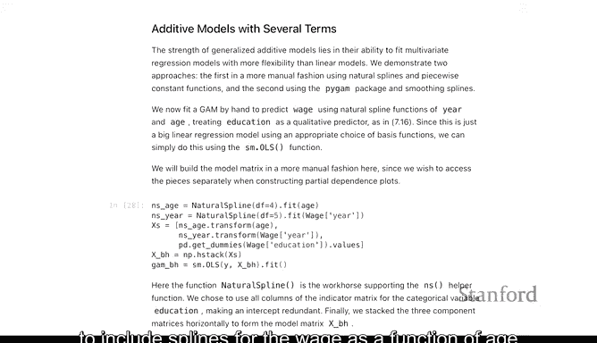

Okay， so we'll see we're going to fit natural splines for both of these with different degrees of freedom and we'll you know use ordinarily squares regression as we had above for the the natural spline and B sp fits。

 So if you， if you' just look in that expression for excess。

 you'll see we've got a nonlinear term in age， you've got nonlinear term in year and then we've also got education。

 which is a categorical variable and we're going be foot in constants at each of the level of those。

 So we put in all three of these into a model and and you'll get these。

The the fits for the two nonlinear functions and these， these constants。 Yes， yeah， I。

 I did not mention the the education。 And this is just to。

 the distinction between what we've seen before really is that now we have more than one feature。

 And that's really what makes it an additive model。

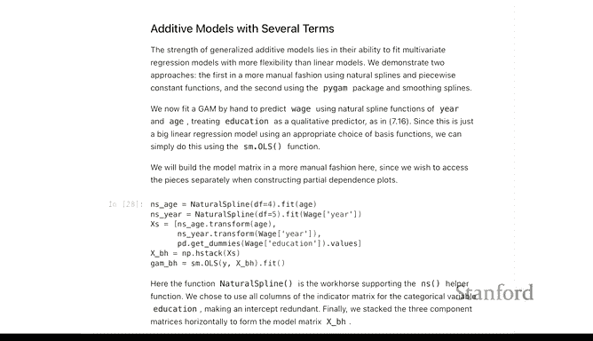

So often in an additive model， you'll want to look at the individual effects of each feature。

 and that's typically done through a partial dependence plot。

 So I'm not going to go through the each of all the the steps of the the code to produce these partial dependence plots。

 But what what I want to show here is that for each of the the features in the model。

 you get a nonlinear function。 So here is an estimated effect of the the nonlinear effect of。

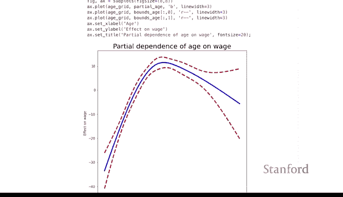

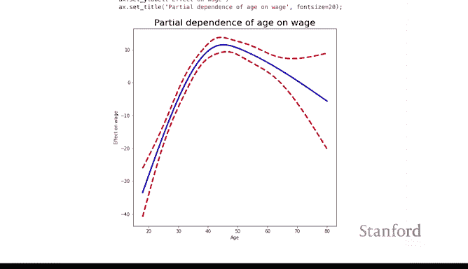

Age on wage and the y axis here is kind of arbitrary because there's because there are other features in the model。

 unlike when we just had age that was， you know， we actually the raw y scale。

 and we could see that the form is actually relatively similar to what we saw before。

 but it was not quite as flat up here， but it has the same sort of inverted quadratic type of fit。

 So the general message here， Jonathan is that with standard linear models。

 you get a coefficient for each variable with additive models。

 you get a fitted function for each variable。 yeah。

 we' showing the fitted function for age we could we could show you the function for yeah and and we can show the set of constants for education。

And so it's a nice generalization of， of linear models。 Yes， yeah。

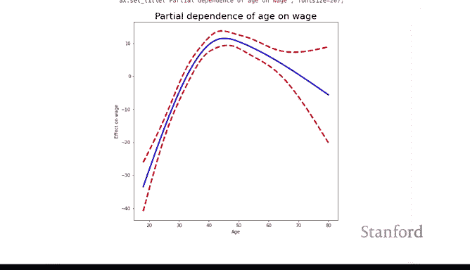

So we also， as Trevor just mentioned， there's， there will be a fitted function for year as a function its effect on wage。

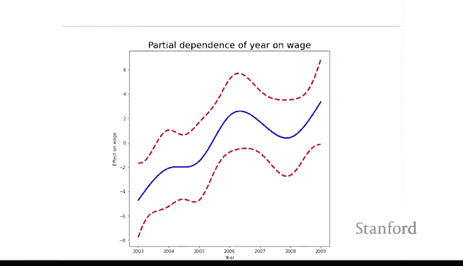

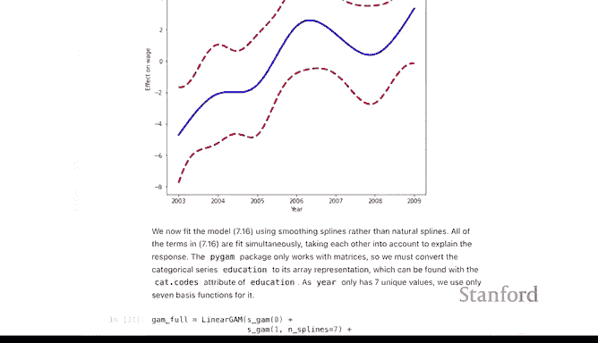

And therell also be， oh， we haven't plotted them， but there would be estimated coefficients for each education level。

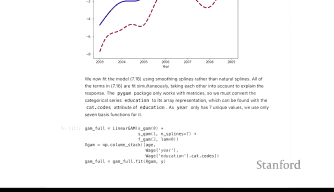

Okay。

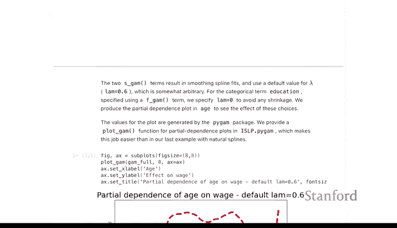

So。What we had just fit there，ToThe right spot。 What we just fit there was just ordinarily squares。

 right， We had sp。 We had specified a flexible function for each of the two features and dummy variables for the。

 the education level。And it wasn't strictly what's called what wasn't strictly a generalized additive model because it didn't have this smoothing penalty that we saw we seen in the lectures for chapterpter 7。

 So here we're going to do a similar fit using the pga function。 a pam library。

 So linear gam from the pga library tells us tells Pgam that we're going to do a regression problem。

 and pgam is not set up。To， to consider。Feature names it only considers。

Column indices in specifying a model。 So this S gam0 here says。

Sgam stands for smoother or a sort of sp for gam0 indicates the first column of the matrix that will ultimately fit。

 and you'll see this X gam matrix。 the first column of it will be age。

 So we're going to this is a sp for age if this Sgam1 with number of splines equal 7。

 is this says that。We you use whatever number N splines means for， for year for the second column。

 Okay， I just want to in to point out that unlike the model spec。

 the gam function doesn't use variable names in， in specifying it。But it's fit using a fit method。

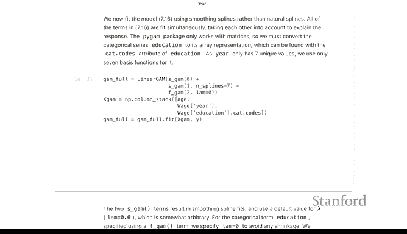

And。We've written a function in in the ISLP package to make these partial dependence plots for the。

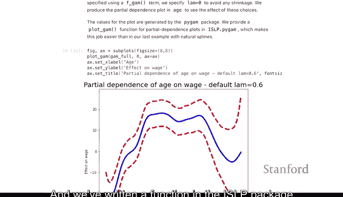

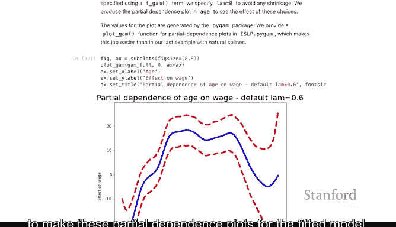

For for the fitted model。 So I'm just showing you here the the partial dependence plots for age on wage when we don't specify any parameters to the S gaM function。

 the sp function for gaM。 So this indicates we'll， of course want to tune this。

 So lambda lambda equals 0。06 is not very smooth compared to the other one。

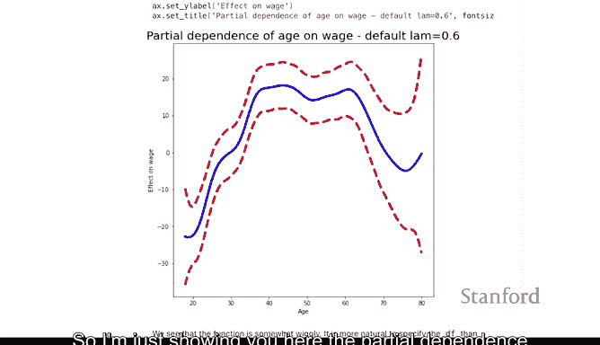

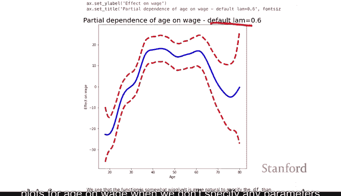

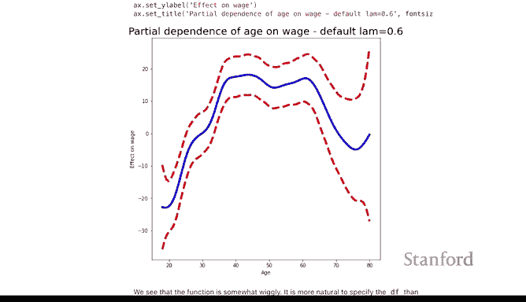

So maybe one thing we could do is we could try and estimate。

A lambda that gives us a certain number of degrees of freedom。

So here we're gonna try and get 5 degrees of freedom for the。

For the age term and 5 degrees of freedom for the year term。

And that corresponds to finding these lamb values， these lambda values。啊。

Then these are so what we've done is we've modified the lambda values of our original gam and reffiit it here。

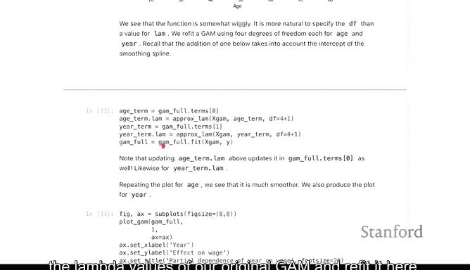

So now let's look at the partial dependence plot and they do they are smoother than before。

 and so we've used roughly five degrees of freedom for each of these plots。

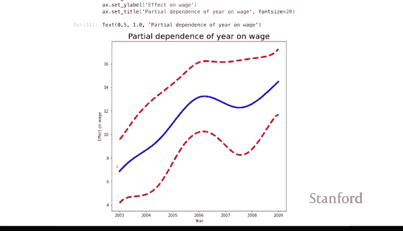

Each of these effects。

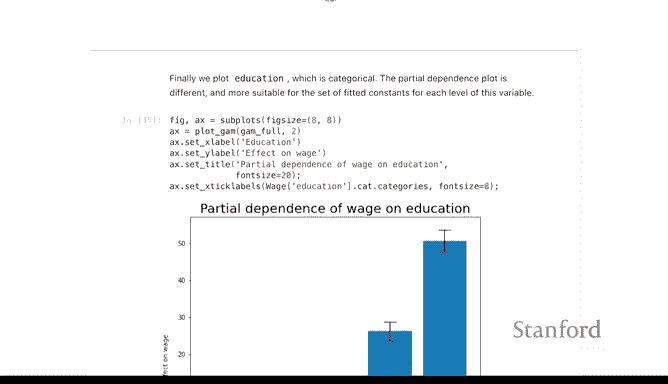

Okay。So here's a plot， this is what a partial dependence plot for categorical variable would look like。

 it would be a coefficient for each category。

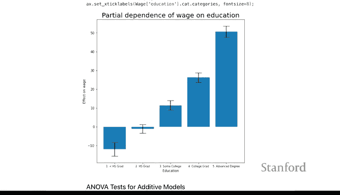

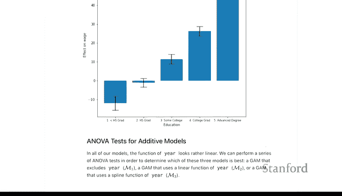

Okay， so I'm just going to wrap up here with an example of how to use binary。

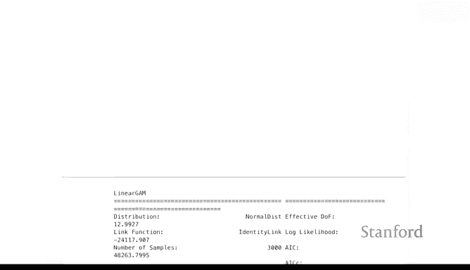

Regression for gam。 What changes really just is the base estimator instead of being linear gamuts logistic gam。

 Things are specified in the same way。Here， one。In this in this gam。

 instead of using a spline for year， I'm going to use a linear effect for year that L stands for instead of a smoothing spline for an effect。

 a linear effect。Okay， so we fit。

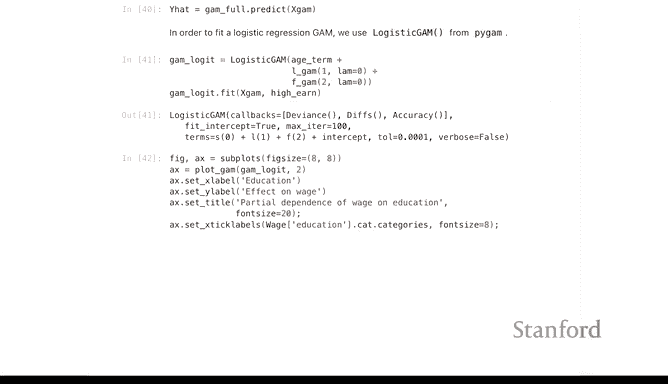

Using the same method， the fit method， okay。

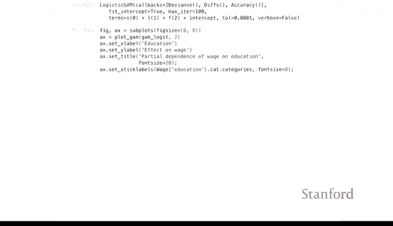

And then we can look at partial dependence plots。 One thing we see in this par in these fits is some rather unusual behavior for the estimate of。

People who do not have a high school diploma for high wage earners and that's well what's happening in this case is there really are likely no people who don't have a high school degree who are making more than 250。

000 so we can't estimate this parameter so that causes these estimates to look very variable。

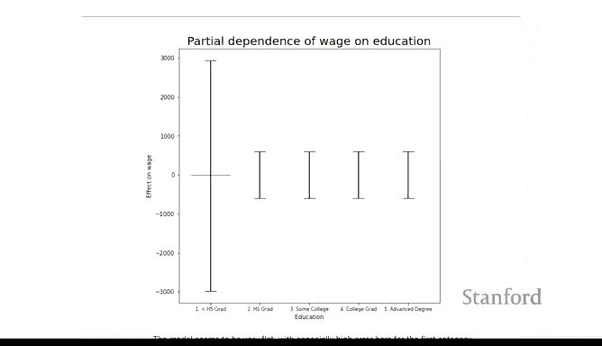

So we're going to refit the model。

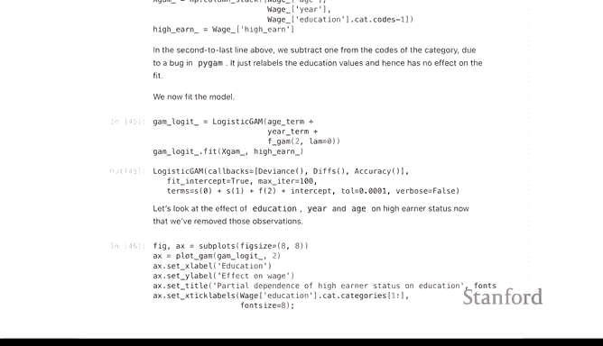

Excluding though， the observations that don't have。

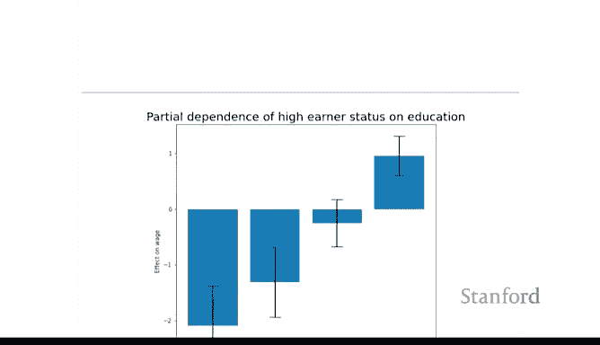

Have more than a high school diploma more than us。 And now we see， well。

 we have reasonable estimates of the effects of。

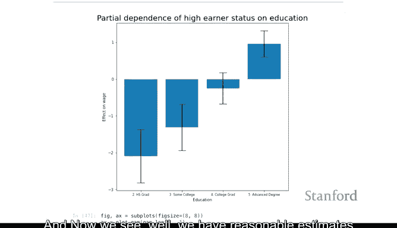

Of being a high earner for the different。

Levels of education。And just like the linear gams， we can produce partial dependence plots for each of the features here。

 this is the partial dependence of plot for year。

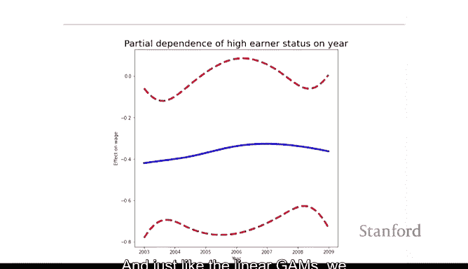

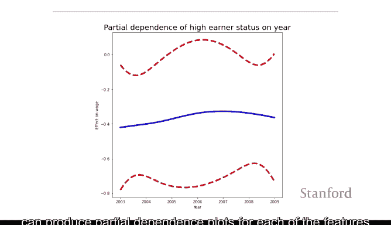

And I think we have the。Partial dependent plot for it for。Age， and actually， interestingly。

 this one doesn't seem to have that precipitous drop off that we saw when we just modeled with age。

 Oh， So that's good to see that。 Yes， maybe it's because I'mm。

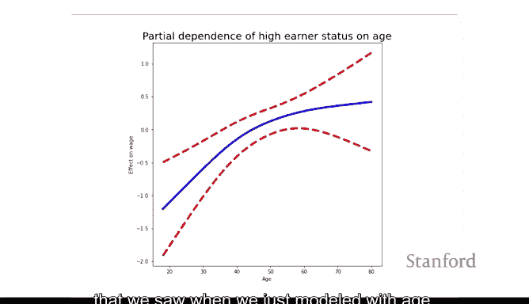

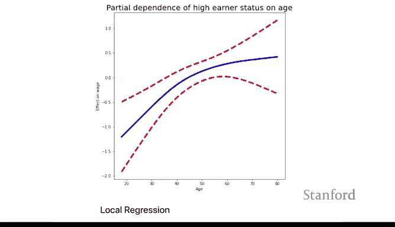

Had a good education。I think so。

