# 斯坦福大学《统计学习导论2023R语言版｜An Introduction to Statistical Learning with R》中英字幕 - P58：-058-Statistical Learning_ 8.5 Boosting.zh_en - GPT中英字幕课程资源 - BV1yU421o7WA

So our next topic is boostting and boostting is a relatively new method as well。

 and similar to bag and random forest， it it gives prediction models at are averages over trees。

But there's a fundamental difference， random forest and bagging。

 the trees that are averaged are all equivalent and the aver is just used to reduce variances with boosting it's a sequential method and each of the trees that's added into the mix is added to improve on the performance of the previous collection of trees so that's a fundamental difference。

We look at first boosting for regression trees， it's simpler to explain there and we just think of it as a sequential algorithm and the bottom line is with boosting what we do is we keep on foot trees to the residuals and so we improve the fit and so we can describe that very easily here。

 we start off and we try to build a function f of x。

Which is going to be an average of trees， and this is evaluated at some point x so we think of it as a function。

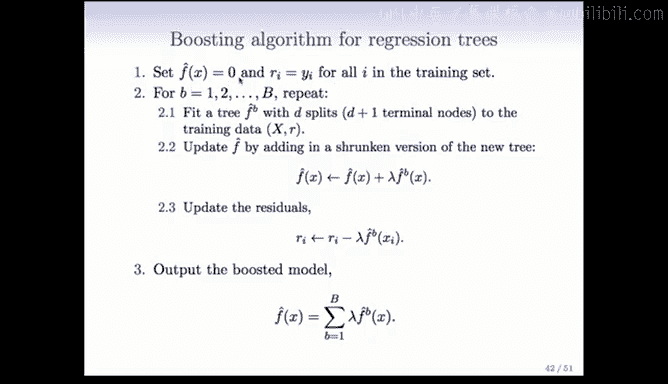

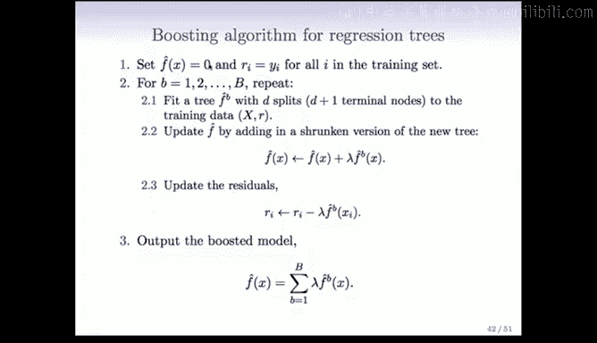

It'll start over zero and the residuals will dispute the data observations Yi。

And what we're going to do is sequentially。

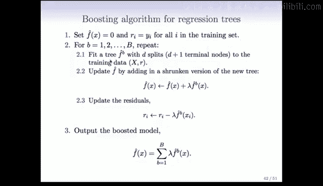

Going from B， going from one up to capital B， we'll just keep on going。We're going to fit a tree。

With D splits， in other words， D plus1 terminal node to the training data X and R where R is the current residual。

 initially the residuals are just the observations。

So we build a relatively small tree to the residuals。

 and then we're going to update the function by adding that tree into our current model。

 so our current model starts over zero and now repeatedly we're going to add in the tree that we've just grown and when we add it in we actually shrink it down by a factor lambda。

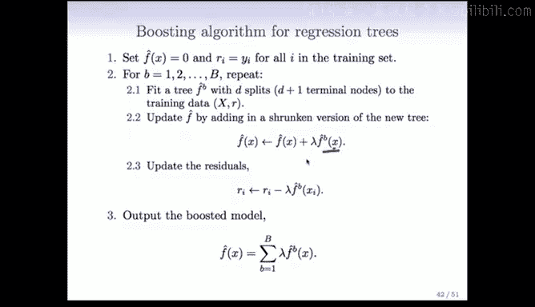

So there's these two components grow in a tree to the residuals and then adding in some shrununk conversion of it into your current model that lamb is pretty small right it's like let me see about 0。

01 for example as a value of lambda so really shrinking down okay and then of course you update the residuals because the residuals will change by a corresponding amount。

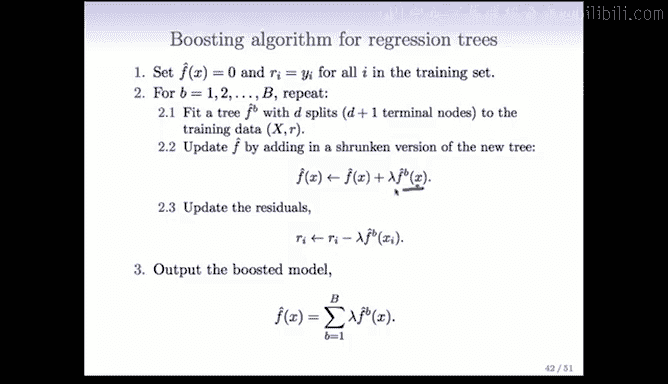

And so you keep on doing that gr tree to the residuals， add it into your function。

 down the residuals， and continue。And you can see at the end of the day， your model。

 your boosted model has this form。 it's a sum of shrunken trees all B of them growing to the data。

 Now， these trees are not independent of each other like they were in random forest and boosting because each tree was growing to the residuals left over from the previous collection of trees。

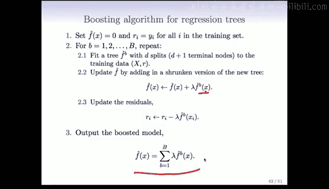

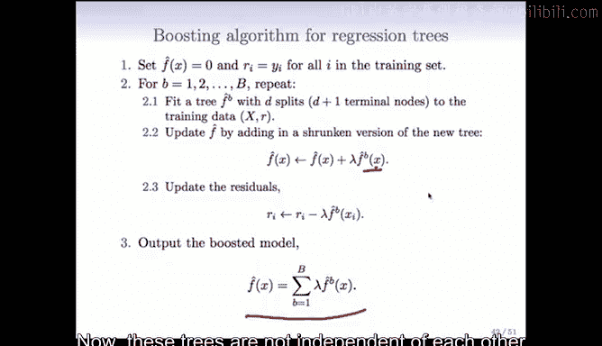

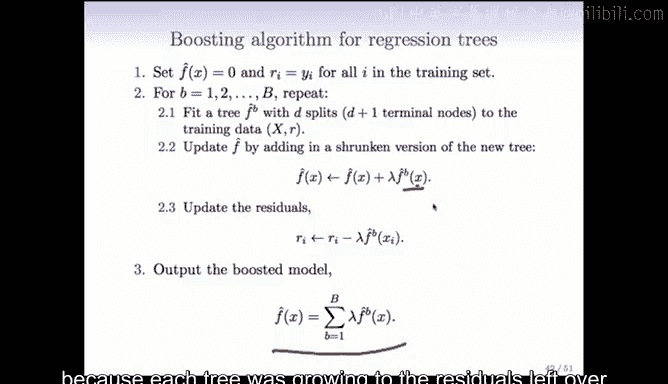

Okay， so what's the idea behind this procedure， Well， for a single tree。

 we can fit it large tree of the data and fit the data hard with a large tree， we can overfit。

So in contrast to the idea of boosting us to learn more slowly， so we start with why。

 we build a tree to Y， and it can sometimes be a small tree， but rather than accept the full tree。

 we shrink it back by a lot， for example， factor 0。01。And then we take residuals and repeat。

 so the idea being that instead of to avoid overfitting， we're going to fit very slowly。

And at each stage， try to pick up a small piece of the signal with the next tree。

So instead of trying to grab a lot of signal over with a large amount of fitting。

 we're going it fits very slowly in small parts， shrinking each time in order to。

To approximate the signal without overfitting and as a nice consequence is。

 we'd actually have to grow very large trees， as we did in random forest。Quite often。

 smaller trees fit in this slow sequential manner will be very effective。

Boosting also works for classification and it's similar in spirit， but it's slightly more complex。

 so we're not going to go in detail here， in fact we don't go into more detail in the textbook。

 but there's a detail section in our other textbook elements of statistical learning in chapter 10 and you can learn about how boostosting works for classification。

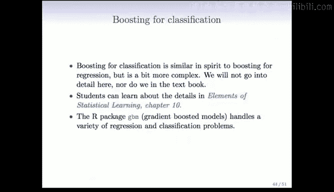

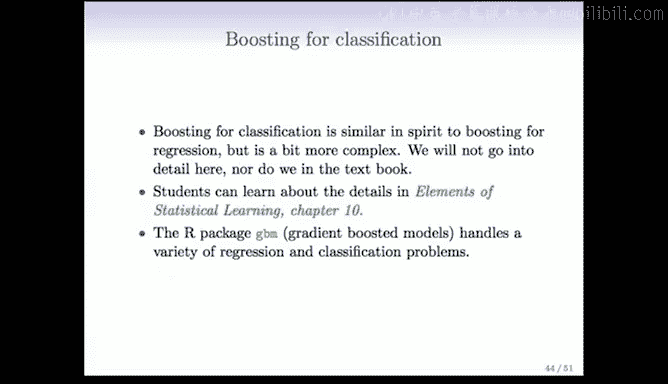

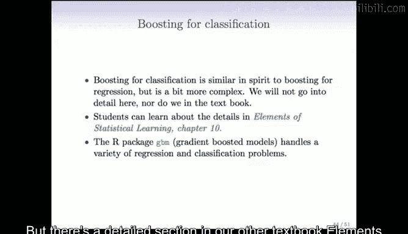

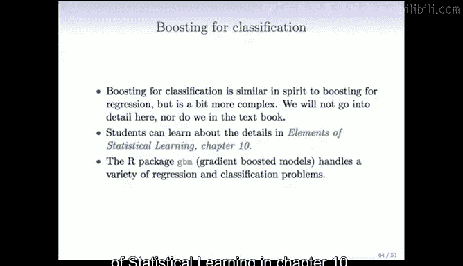

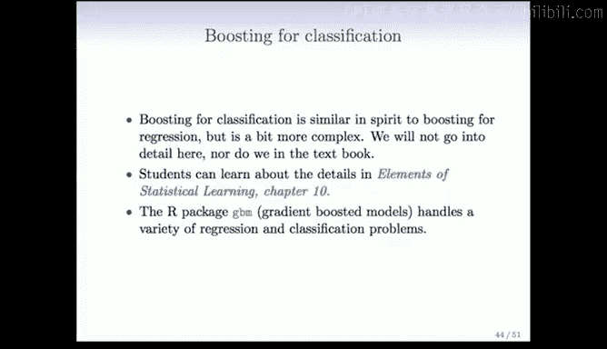

It doesn't stop you using boosting for classification。

 there's the R package GBM which we use in the exercises and the examples and we'll use in the R session and that handles a variety of regression and classification problems。

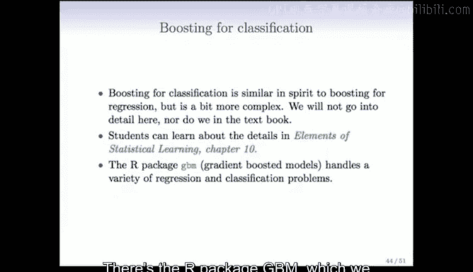

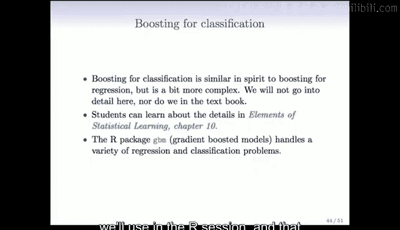

Okay， so let's see the results of boosting for the gene expression data。

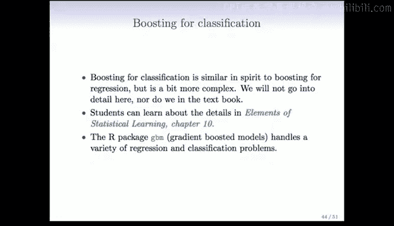

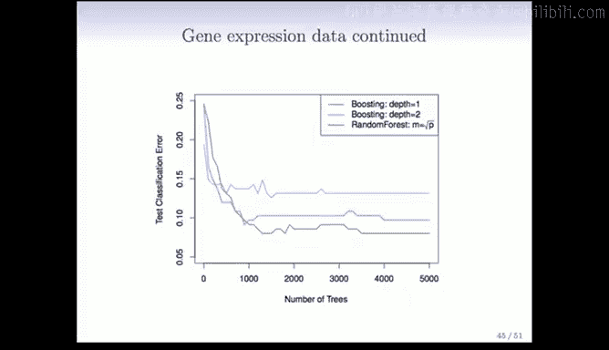

These are test errors， the orange curve is boosting depth1。

 so what that means is actually each tree's got a single split sometimes called a stump， so a very。

 very simple tree。

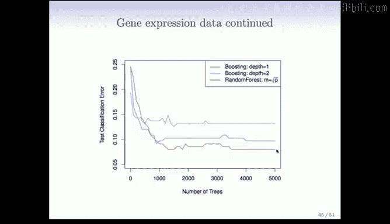

Which again， might seem a little crazy， but we're going to use 5，000 of them。

 and when they're using in this sequential slow fitting way， it actually does quite well。

 the error is about7 or 8% random force。

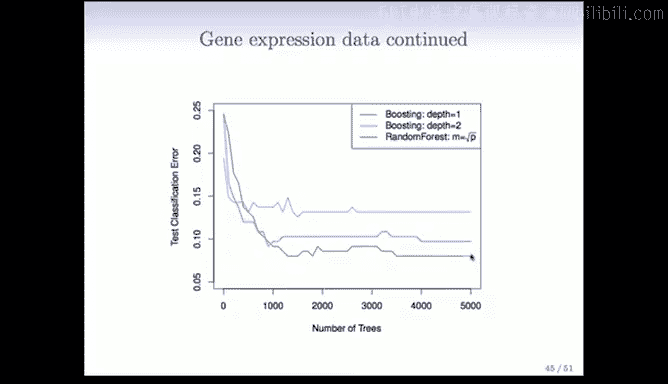

Oh sorry， yeah ran a forest or a little higher here they're about 12 or 13%。

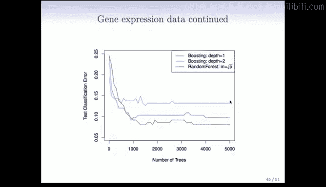

嗯。

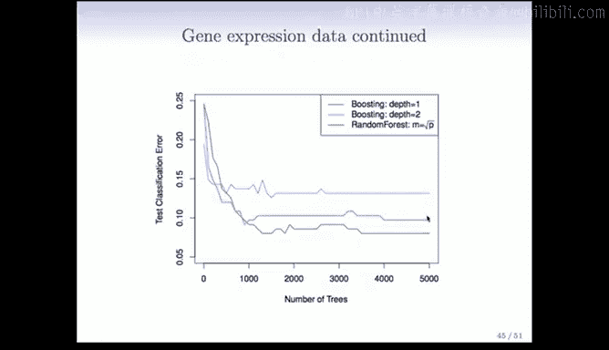

Using a depth2 tree， which means two splits。We do maybe a little worse than the simple stump model。

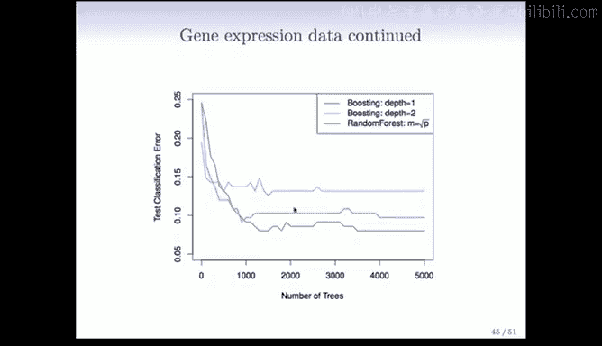

So again， it's quite striking that a very， very simple model applied in a slow and sequential way。

 at the end of it， we get an ensemble that actually predicts very well。

 So Robert it seems like the depth of the tree that you use in boosting becomes a tuning parameter。

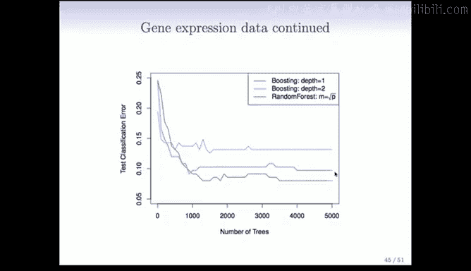

Exactly， well， thank you for the leading to the next slide， which is。

The2ning parameters， so there's a bunch of tuning parameters， trevor to just mention one。

 the depth let， let me just put them all up。

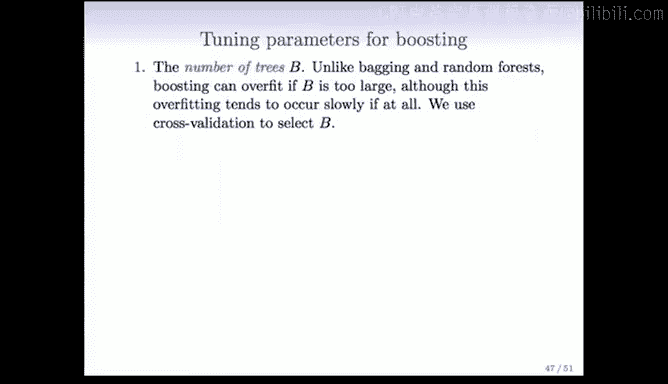

So well， the third one here I've written is what Trevor has mentioned。

 the number of splits of the tree。Is a tuning parameter？呃的。

The depth is called something closer D is if D is one， it's simply a stump。

 which we saw was successful in the previous example。 And if we D is larger。

 it allows it the interaction between predictors。 So typically， when tries。

 a few values of D maybe be d equals one to。4 and 8， that might be a typical example。

 depending on on the size of your data set and the number of predictors。 Oh say if D is one。

 each little tree caninve a single variable， right。

 So it's actually an additive function of of single variable So there's no interactions allowed。

 And if D equals2， it can involve at most two variables。 right。

 So that's pairwise interactions interesting。So that's one tuning parameter。

The number of trees is also tuning parameter。Unlike in random forests with a number of trees。

You just went far enough so that you。t you stop to getting the benefit of averaging right I think it's still the case that the number of trees is not a hugely important parameter it's possible to overfit。

 but it takes I think a very large number to typically start to cause overfitting and here we see we're up to 5000 and not much is really happening yet terms of overfitting I think it especially depends on the problem。

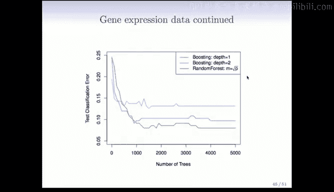

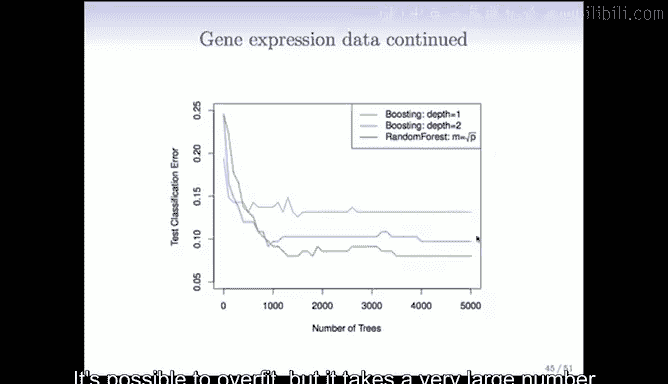

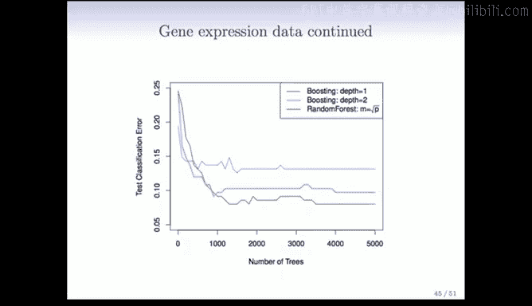

In some problems， you'll see the curves really going up， but with classification problems。

 it often just levels out like that。

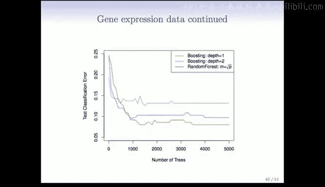

So the other one is the shrinkage parameter， remember every time we grow a tree。

 we don't accept the full tree rather we shrink it back by a quite small fraction and typically 0。

01 to 0。001 are the choices one uses。

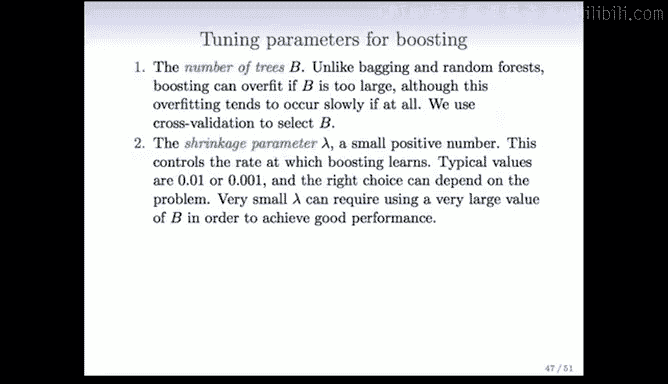

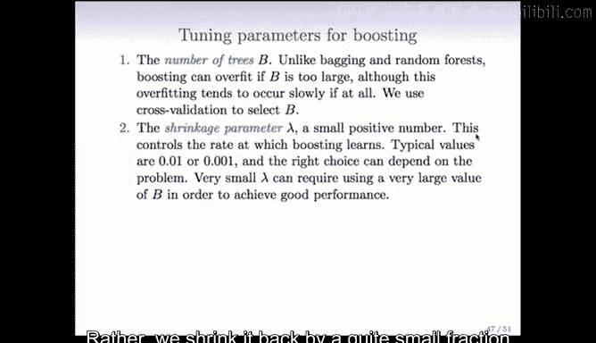

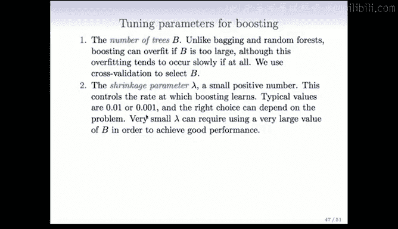

So these。These three tuning parameters。

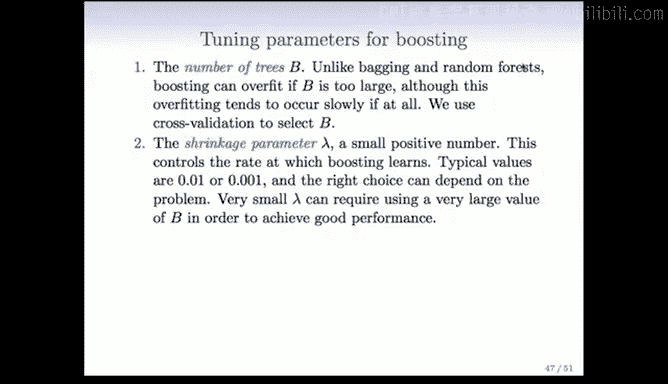

One can just try a few values of each one。And look at the cross validation error over the grid to choose good sets of parameters。

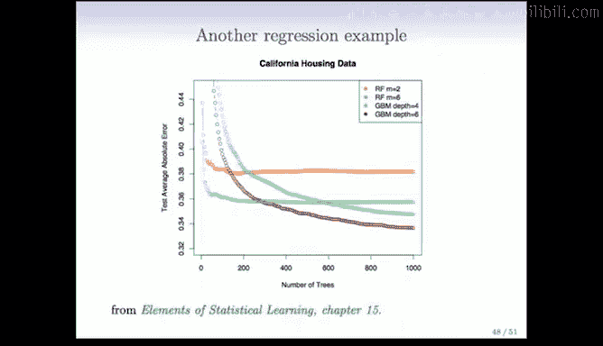

Here'sSo I have a couple more examples here from actually from our earlier data mining book。

 this is the California H data。

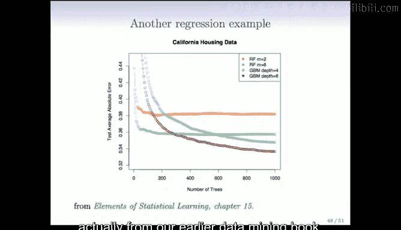

Looking at housing prices and。

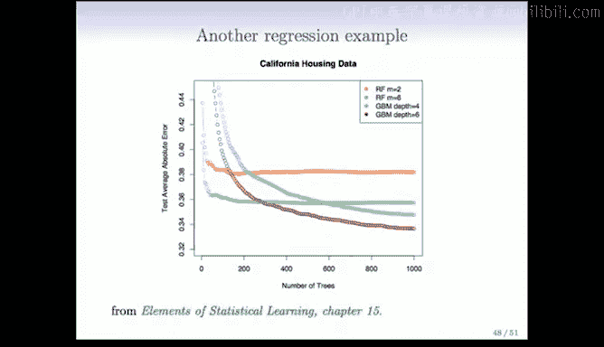

We have the。The test error here is a function of number of trees for a number of methods we've talked about。

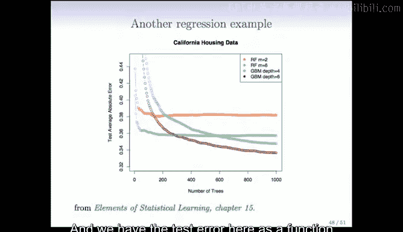

Random force m equals 2- have to remember how many variables there are。

 we'll have to look on our in chapter 10 15 of our book to。

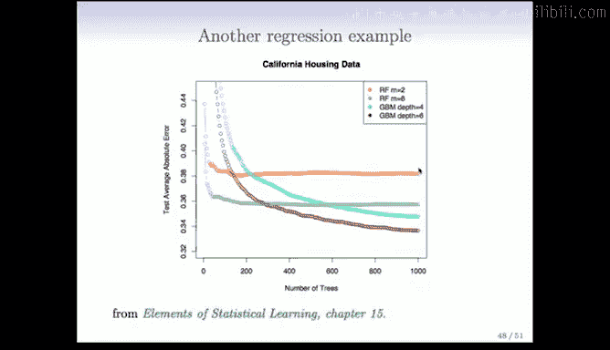

To check that， but the using random force with only two variables allowed at each split gives you an error of about 0。

39。

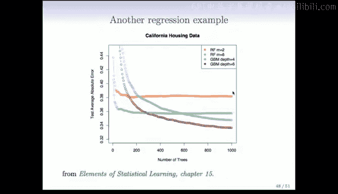

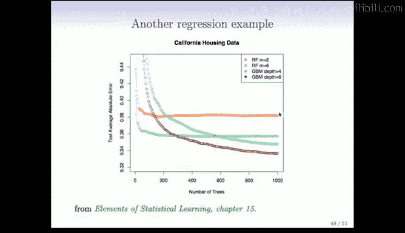

Random forest with more splits improve things a bit GBM。

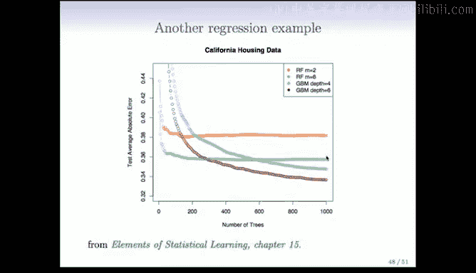

Gandient boosting machine， this is the R package that does boosting that's we'll see in the lab with depth 4 and eight trees are doing somewhat better。

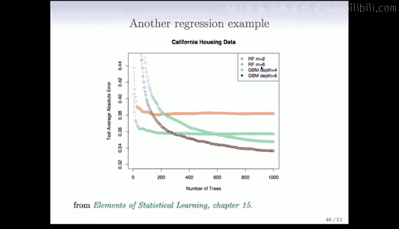

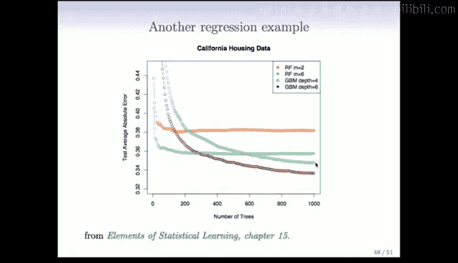

Looks like it looks like they're still on their way down as well， exactly。

 so maybe in this example one should have run even more trees。

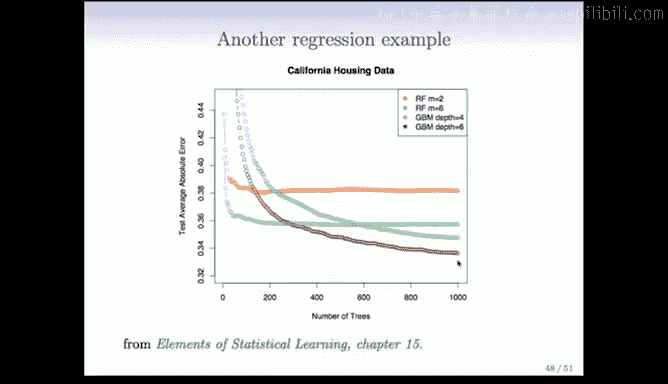

Another example， this is a spam data from our the earlier book chapter 15。

 this is again a two class problem。

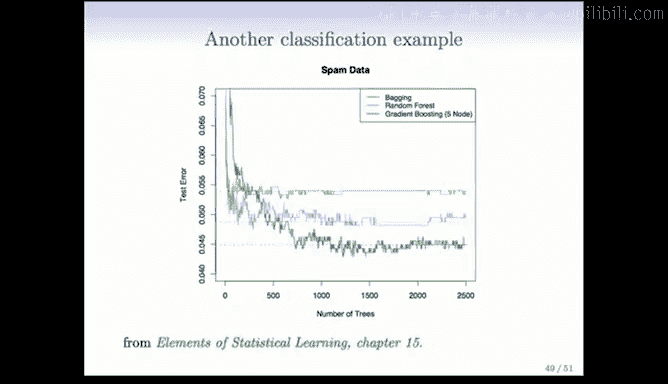

WithAbout 50 predictors， what do we have here？Well let's first another case where a single tree is really not very good。

 right， we've even truncated a scale here because they're going somewhere above 7% single tree。

Bgging as we beg， we level off at around5 and half percent。

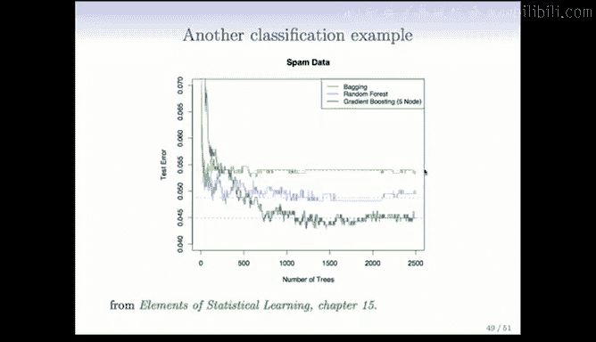

Random force。Probably using the default of the square root of P as the number of predictors to selected every node has an error。

 reduces that by。

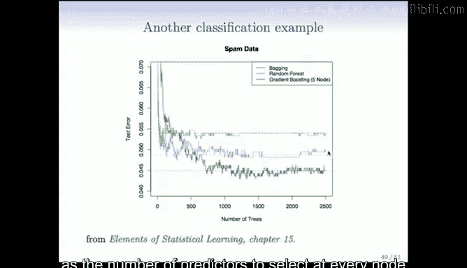

The scale is pretty compressed half a percent。

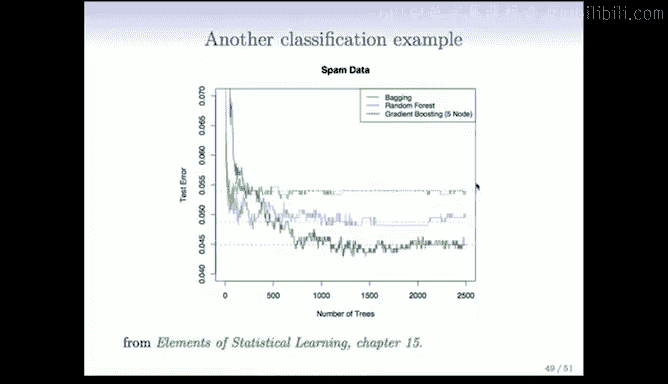

And then boosting five no trees gets another maybe half percent。

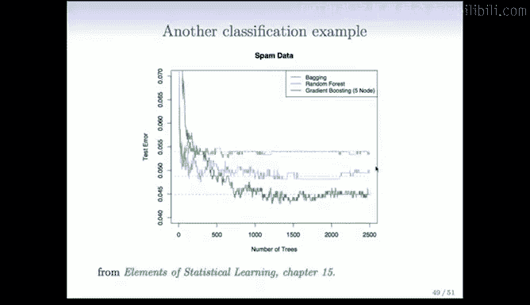

So these two methods are quite good and they're， I think we've seen a lot of examples that're pretty comparable when you're say performance。

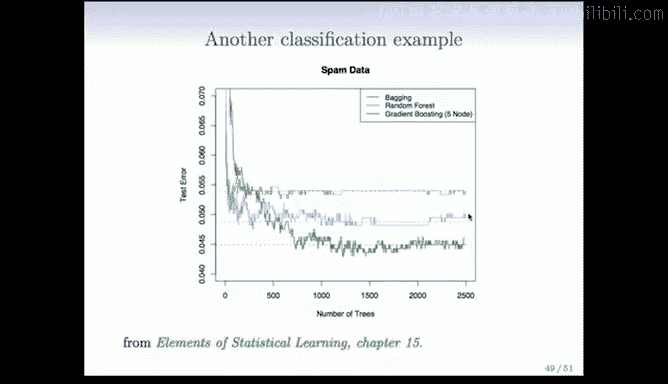

Those look like they might be quite two different curves。

 but actually if you do the proper statistical test， they they are not significantly different。

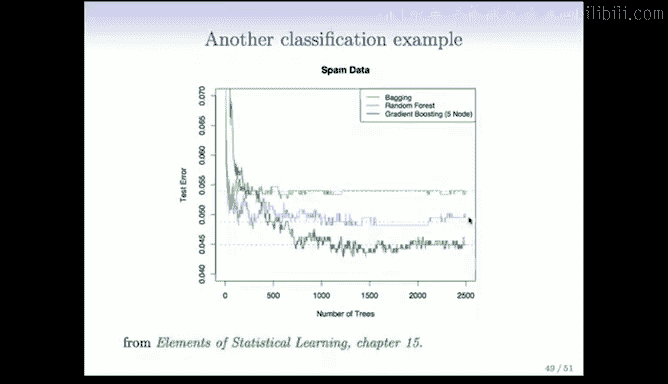

Okay， this actually last topic， variable， the importance of variables。

 how do you measure importance of variables in trees and bagging and boosting？

In random forest well， there's no single parameter or no coefficient with the standard error you can refer to because trees use variables in multiple places every time you split。

 a variable could participate in the split。

So what's done in bagging random forest is one records the total。

Drop in RSS for a given predictor over all splits in the tree。

 so we look at all the possible splits we look to see where the variable was involved in that split。

 if it was， we measure how much it dropped the RSS and that's average over all the trees。

So the higher， the better。And。A similar thing with Gite index for classification trees。

So what you get is a essentially a qualitative ranking。

 this is the variable importance for the heart data and you can see the Eyleium stress test is at a variable points of 100。

 things are usually normalized so that the top variable has 100 and you can see the other variables are indicated here in terms of their importance from calcium down to。

Variables of lower importance。 So these variable importance plots are quite important part of the random forest toolkit also used in boosting。

 The same plot is used in boosting。

So to summarize， we've talked about decision trees and using ensembles of trees。

On the plus side they're simple and interpretable when they're small。

 but as we've seen in the examples we've seen in other examples that they're often not very competitive in terms of prediction error。

 so some newer methods， bagging random forest and boosting use trees in combination as an ensemble。

And in the process they can prove predictionary quite considerably。

And the result is that the last two methods we talked about。

 random forest and boosting are really among the state of the art techniques for supervised learning。

 so if you're interested in prediction and really just prediction performance。

 they're very good techniques for interpretation as we've seen they're more challenging。

