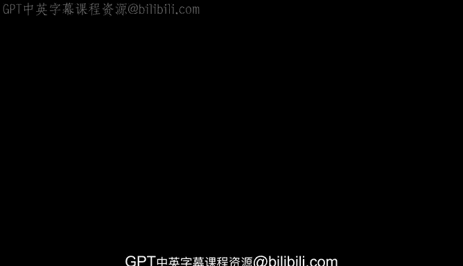
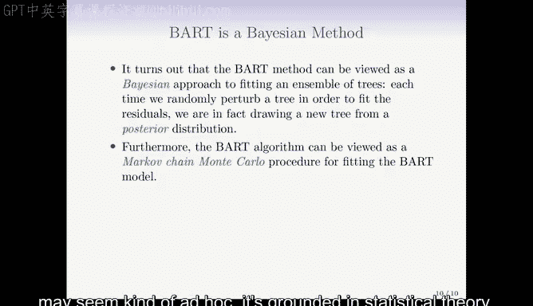

# 斯坦福大学《统计学习导论2023R语言版｜An Introduction to Statistical Learning with R》中英字幕 - P59：-059-Statistical Learning_ 8.6 Bayesian Additive Regression Trees.zh_en - GPT中英字幕课程资源 - BV1yU421o7WA

Welcome back， our next topic is Bayesian additive Agion T。

Also known， you how do you say that， Trevor？But I just want to make fun of your accent。

 It's it's bart。This's what I see， but okay。So we're going to discuss Bayesian additive regression trees or bart。

 an ensemble method that uses decision trees。As its building blocks。Now。

 we've talked about two or three other methods already for using decision trees and supervised learning。

 bagging and random force， for example， make predictions from an average of regression trees。

Each one is built up using a random sample of data。

 either sample the data as a bootstrap sample and or we sample the features， right？

And each one's built up separately in their average。 at the end， Boosting， on the other hand。

 uses a weighted sum of trees。Each of which is constructed from fitting a tree to the residual of the current fit。

 so that they're not built independently， but they're built in sequence， right。

 So each tree tries to capture the signal that's not yet counted for by the current set of trees。

So it's kind of a Ford stepwise Ford stage wise method So Rob， what does bar do differently？Well。

 if you wait for the next slide， you'll find out。 Okay。

 Bart is related both to random forest and boosting。It it has the random feature。

 as in bagging and boot and random forest that it draws random samples to pill trees。

But it also has a similar to boosting in that it uses the other trees and kind of a parser residual to choose the next tree to improve the overall fit to try to account for the。

This signal has not been captured by the current model。

 So it's got similarities to both random forest， bagging and boosting。

The main novelty as you'll see is the way in which the new trees are generated。

 which is quite different than the other methods。It can be applied to regression， classification。

 other problems like survival analysis， but here we'll just focus on regression。Okay。

 so first of all， in a picture， this is the idea， and then we'll go into details on in the coming slides。

 A number of trees that are fit in parallel。 So one chooses a number K， maybe a few hundred。

And B steps in each state and each tree is changed B times as the algorithm proceeds。For each tree。

 say the first tree， we start with the root node， right， So we all start with the root node and then。

Perturbations are applied to the trees to to change them。 These perturbations， as we'll see。

 can be of various kinds we can add add a branch。Or we can delete a branch or or we can change the predicted values at each of the nodes。

 In this case， since we start with a root node， each of these trees gets a single split added to them。

 Although the split points and split variables are different。And then at the next stage， this tree。

 we've added another branch。On the left， this tree。

 we've actually removed single the existing branches is back to the root node。 And this tree， again。

 we add another branch on the left side。 And this continues for maybe a few thousand steps。

These perturbations to get a whole sequence of trees a varying sizes with different predictions in the root notes。

 so Robert， so it looks like so the iterations where you go one through B。

 and seems like what you're doing is maintaining K trees at each step exactly and each step you change each of those K trees in some kind of random way exactly。

So at the end， we make our final prediction by averaging the prediction over all K sequences of trees and all steps B。

Okay。So let's actually go over that now in more detail with some notation。

 So the number number of regression trees。That was the different columns in that previous picture is K。

 and the number of iterations for which we apply the algorithm called B。Okay。

And the prediction at a query point x for the K3 and the B iteration， we'll call F hat。Sup B sub K。

So at the end of the each iteration， we have K trees and the。

Our prediction for that at the beatstep is simply the。The sum of those predictions。Okay。

 so what do those iterations look like at the beginning？As we saw in the picture。

 each tree started to the single root node， and the prediction in each tree is just the average of the observations。

Of observations。 So our overall prediction at the first step is simply。This average。

 So we divide each of them by those averages by k。 so that when we sum up K of them。

 we get the overall mean of y exactly。 And then in coming iterations，2，3， etc cetera。

This is what happens We take the partials residual。For all tree， but the cafe tree。

 we subtract off the current fit。And we form what's called the parsor residual。

 and then we build our tree on the parsor residual。But we might think， well。

 I'll just build a regression tree directly。 but from scratch。 But instead。

 what Bart does is it takes existing tree at that step， and it pertturbs it in a certain way。

And so instead of fitting a fresh tree， it choose a perturbation of the existing tree from the previous step for the ca tree。

From a set of possible。Perturbations。Try to improve the fit。 I return to make the summer squares。

On the par digital as small as possible。And there's two different ways perturbation can be made。

We can change the structure of the tree by adding or pruning branches。

And we saw that in that picture， one case we added branches。

 another case we actually removed the only branch。Or we can leave the tree alone and change that their predicted value at each terminal node。

So we choose among a set of perturbations to vary the tree。

 what we're doing here is sort of moving around the tree space right in this kind of in a similar way。

 bagging and boosting do the same way。 they generate a set of trees。

 It tries to cover the set of sort of possible trees。This is also moving around the tree space。

 the space of possible trees， but in a different way through perturbations。Here's some examples。

 supposeupp we start we're at a step where we have at the ca。For the cafe tree， we have at step B -1。

 this tree， one possibility for perturbation is to leave the structure of the tree the same， right。

 But the predictions in the terminal nodes are varied a little bit right， like this 。

4079 is changed to 0。444221， et cetera。Another possibility is to remove。A branch。 Well。

 here it actually looks like we've trimmed off。This branch here。

 so we've removed these three terminal nodes， right？

And then here's another possibility instead of trimming a branch we've added quite a bit of randomness in this trimming rub。

 similar to your mousework on the computer。I wish I had a mouse， but I don't。 So okay。

 so in this fourth example， I've added a branch looks like here。So it can remove branches。

 add branches， or change the predicted values in the notes。So we to give them all this。

 we get a collection of prediction models right at each step B again。

 our predictions are some of the predictions for the K trees。And。As I mentioned。

 the prediction is that the average。Of all the predictions at。For all trees and for all be。

 except that since this is a process which is random and it starts。

 it starts in a place and it kind of。The hope is going to settle down after a while。

 what's done is a kind of burning in。 So you don't actually。

 the first alliterations you actually throw away。So。Maybe B is 1000 L's 100。

 That means you ignore the first 100 steps in the prediction and you take the average of the remaining 900。

 So Rob， what I'm seeing you is that for any given be， the bot prediction is like a boosting model。

 right， It's a sum of trees， K， trees。But the difference here is that you've got many of those。

 and you've created these many by having this randomization in the tree selection each time。

 That's right。 And another difference is you're not building each tree by a simple tree fit to the residual。

 You're actually taking existing tree doing a perturbation。 So it's actually kind of slower too。

 right， you're not fitting as hard as to data each time。

And I think we'll see in an example of this section that overfitting is reduced by this kind of the slower learning。

Another nice thing about Bard is not only do you get， as we'll see quite good predictions。

 you get other quantities like quantiles， right？ So， for example。

 you can take the percentiles of the non burningian。

Predictions as a measure of uncertainty of the final prediction， right， You get not just one number。

 but a collection of predictions。So if you want to that the 95th percentile of the prediction。

 you can get use the。The 95th percentile of the predictions after burning。

 Here's an example until on the heart data， which weve saw in the book in which we applied in the first edition。

 we applied it to we applied bagging and boosting in random forest。

 And now we're going to see what happens when you apply Bart。So the number of trees here was 200。

 and the number of iterations， the bee up was brought up to 10000， right。

 And the burn in here is 100。 you can see。Here's the training and test air for boosting。

 which you've seen before。 That's the dark blue and the dark green。The bart training air is in gold。

 and the bart test air is in light blue。And you can see it。

 the training area goes down more slowly than in boosting。 again。

 this is the evidence that it's not fitting nearly as hard。But the test error is competitive with。

 with boosting， there it is。So that's really interesting because you can see boosting， you know。

 it as you foot more and more trees really starts to overfoot。

 the training error keeps on going down and the test error starts increasing。

But is showing behavior more like random forest where once you reach a certain number of trees。

 it just flattens often。It doesn't seem to overfi right， It's not not as aggressive。

 which is one of the selling points， as we say， it'll work well out of the box you don't need to tune it very much because it's not as prone to overfitting as say boosting as。

So where do these perturbations come from， or they just sort of pull out of the air。

 well it turns out it's a Bayesian method hence the name Bayesian additive regression trees。

And we didn't talk much in the book about Bayesian methods。

 We talked a little bit about Bay's rule and Bayes methods。

 but the Bayesian method starts with a prior on the parameters。

You collect the data you have a sampling model。You then combine the prior in the sample model to get a posterior distribution。

Well， it turns out that the perturbations inbart correspond to a certain prior distribution on the parameters。

Their parameters here being the split points and the values at the notes。

So we won't go into detail here， but it it's a Bayesian method under a certain prior。

 And what we're doing with these perturbations is actually drawing from the posterior distribution。

From that model。Furthermore， the BarRT algorithm can be viewed as a Markov chain Monte Caro MCMC method for filling the barRTt model。

MCMC is a standard way of drawing from a posterior distribution from a Bayesian model。

So the point is that this method which may seem kind of ad hoc is actually it's grounded in statistical theory。

It's a real posterior distribution from an actual prior distribution。

And we typically choose values for B And K。They're large， and the B ins pretty moderate。

So for example， the reasonable choices might be 200 sets of trees，1000 iterations， or we did 10。

000 of that example， and a burden of about 100。And as I mentioned。

 what selling point of bar is that it works well right out of the box without much tuning。

 which we saw also with random forest and bagging。