# 斯坦福大学《统计学习导论2023R语言版｜An Introduction to Statistical Learning with R》中英字幕 - P60：-060-Statistical Learning_ 8.R.1 Fitting Trees.zh_en - GPT中英字幕课程资源 - BV1yU421o7WA

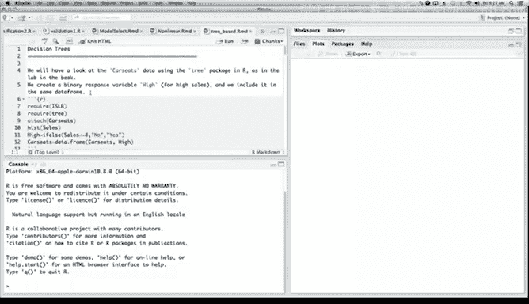

Okay， here we are。Today， we're going to look at trees and lots of trees。

 We're going to look at decision trees， and then。Later on。

 we're going to look at random forests and we're going to see how to fit these in R。

And just says before we using our studio。And so here we are。 We've got our studio session。

 and we're going to use markdown and。We'll start off by just getting our packages loaded。

 including the tree package， which you need to load。

And we're going to start off with the car seats data。So we got all those loaded。

 and let's just have a look at our data。 Well look at the histogram of sales。

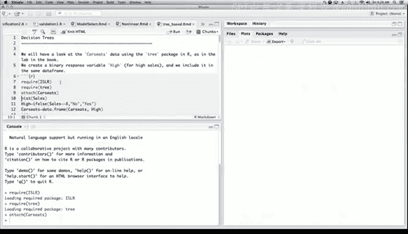

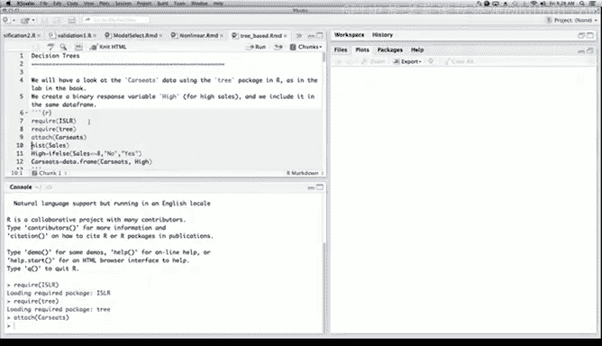

And we see sales as a quantitative of variable。 I want to demonstrate using trees with with a binary response。

 So we'll turn sales into a binary variable， which well create called high。

 and you'll see there if else， sales is less than8， we'll say it's not high。

 So the cells are not high。 otherwise， yes， so that if else is a handy construct。

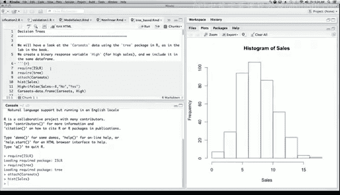

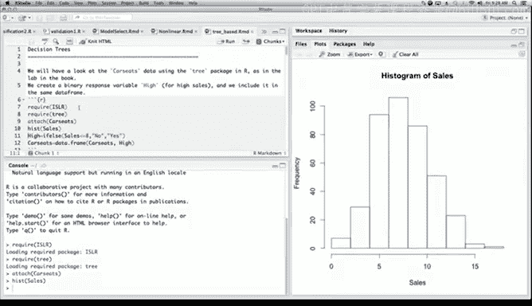

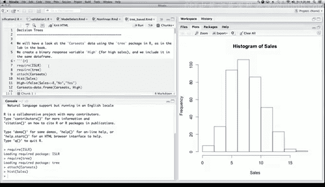

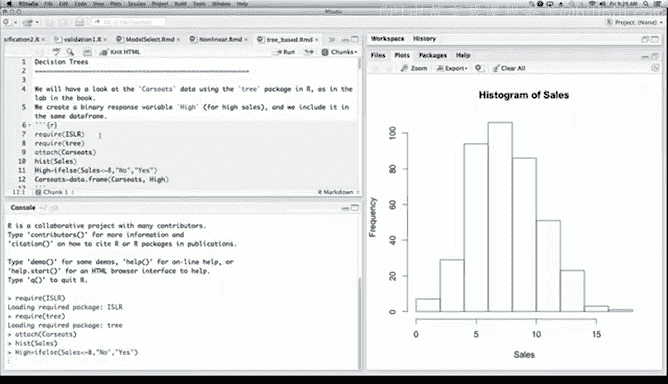

Okay。And now we will put high back onto our data frame。

 which we can just use with the data frame command and it's smart enough it sees car seats as a data frame it's already got some variables it includes a variable high on it。

 so there we done and so now we created a binary variable。

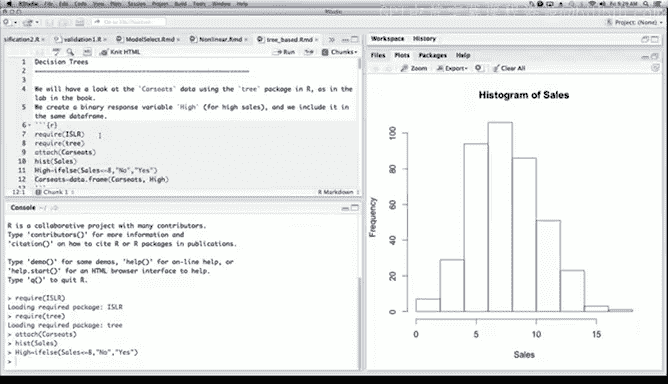

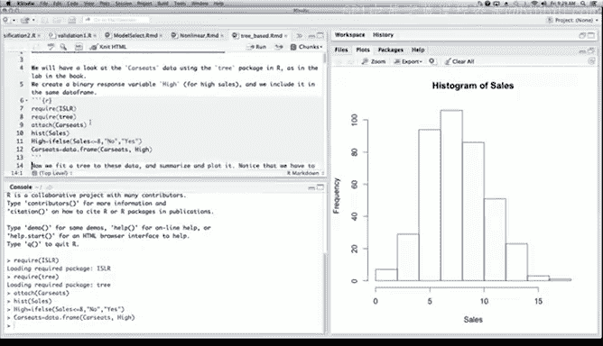

And now we're going to fit a model using trees。

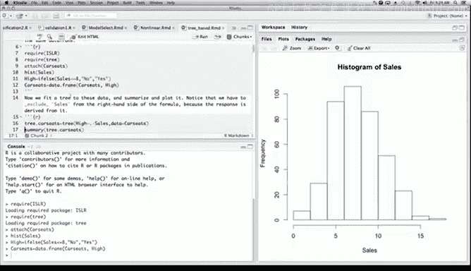

Now， of course， we can't leave sales if we're going to use the dot notation as we have before。

 we have to exclude sales because our response here high was created from sales。

 so you can put a minus sign in a formula so we got high twiddle dot minus sales。

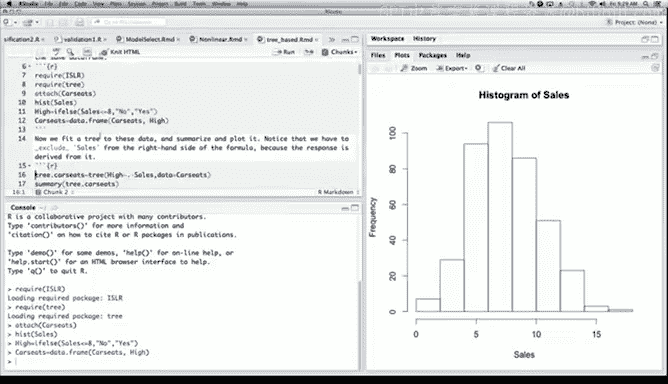

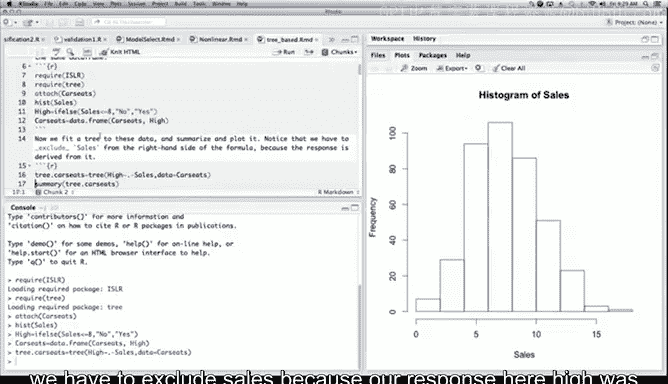

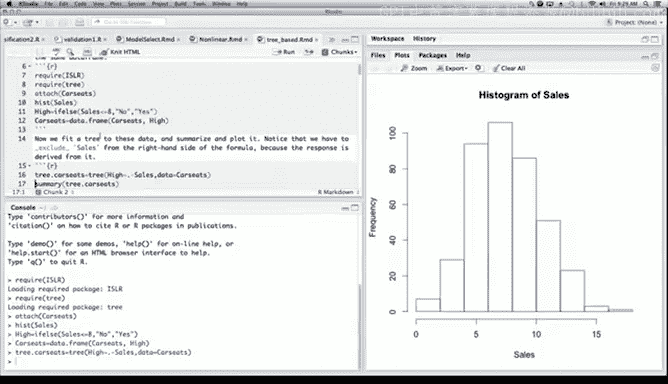

So that means model high is a function of everything except sales。

 You've taken sales out and you can subtract other variables out the formula as well。

 So it's just a handy way of doing it。

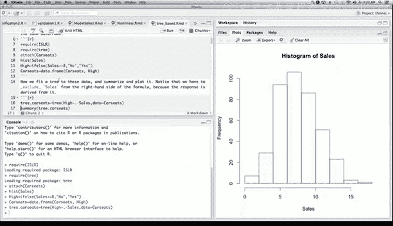

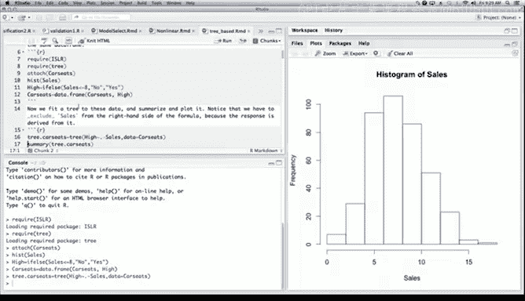

And。So we foot the tree and now we do a summary。

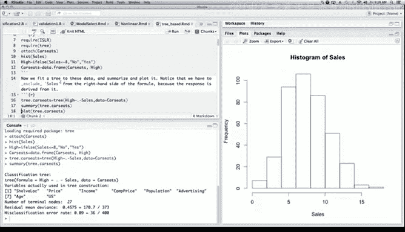

And underneath and we see the summary below there， we see the variables that we involved。

 number of terminal nodes， residual mean deviance， which in this case is。

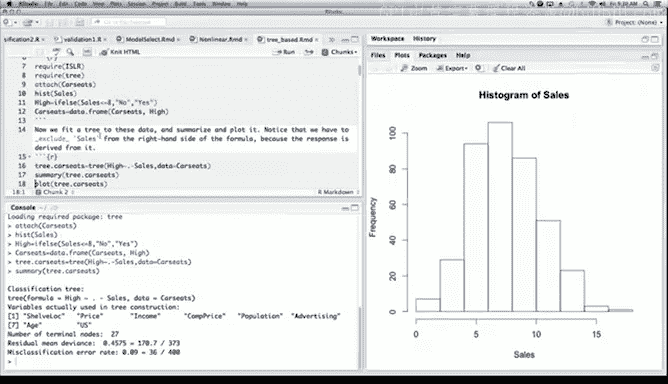

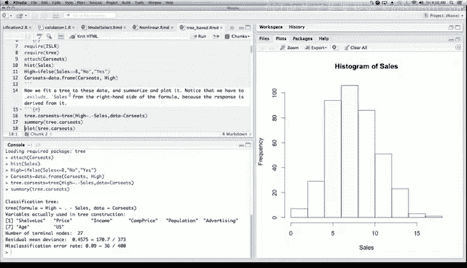

。

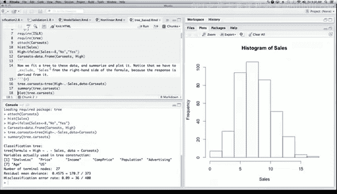

Yeah， it's a binary response。 So it's a binomial devviance。 and we can plot the tree， which we do。

 and you get a。

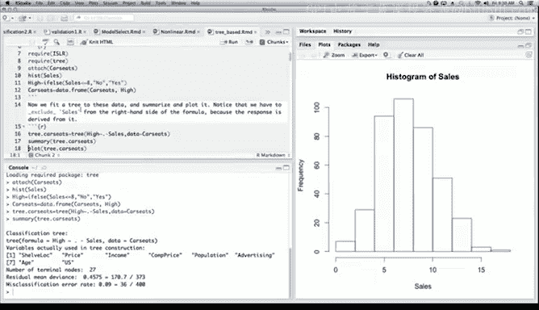

A plot of a binary tree。 you see all the terminal nodes， and you can annotate it with a command text。

 which is very handy。

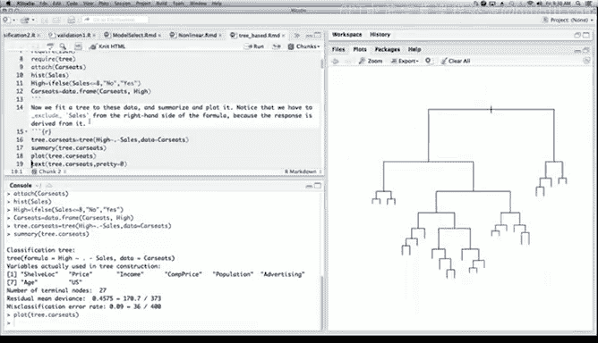

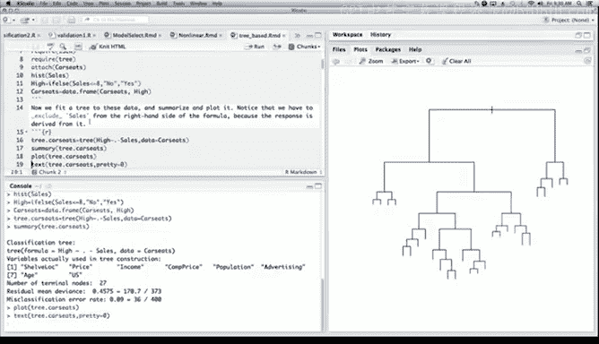

Now， on the in this picture， yeah， the the font is bigger。

 I made the font big enough so that you could see it。 Of course。

 what that means is you can't actually see all the details。 But there's so many variables。

 there's so many splits in this tree that it's a complex tree to to to to look at。

 So we wouldn't really learn a huge amount from this tree。

 And what you do see is that each of the terminal nodes。 So if we look down yeah。

 at the terminal nodes they labeled yes or no。And， and each of the splitting variables is labeled at the place where the split took place and at which value of that variable the the split occurred。

And then by the time you get to a terminal node， the。The， the vote goes。

 the label is according to the majority of the yeses or nos in this case。

 that are in the terminal node。Okay， so that we've grown a tree and we've plotted it。

This tree is a little bit big so。We're going to see how we can prundent it down。

You can look at a detailed version of the tree， which we would do by just printing。

 And so we type tree and you'll see， we've got。A printout。

 which basically gives details of every single terminal node。 So the root。

 it tells you how many observations at the root， What's the， the mean deviance at the root and。

And then。For every single split in variable， it。And this is a proportion of yeses and nodes at the root。

 I mean， for every single node is numbered。 and you can see， if。

 you can see how the numbering works by。By。Going down the tree。

 And it gives you details of every node in the tree。 So that's handy。

 especially if you want to extract the， the details from the tree for， you know， for。

 for other purposes。Okay， so what we're going to do now is we're going to create a training。

 we're going to split our car seat data into train and test set， so we'll make a 250 to 150。

 there's 400 observations in all and as we often do we' will set the seed just to make our results reproducible。

I make a habit of never always setting the same seeds， I jump around and use different seeds。

 which is not a bad idea。And then we sample from we're going to take a random sample of the ID numbers of the samples。

 the index numbers of the samples， so we sample from the set one to n row number of rows of car seats。

 which is 400 we know that and we want a sample of size 250 default by default sample users with replacement。

Without replacement， I should say。And， and so now we got this indexed train。

 which indexes 250 of the 400 observations。So now we can reit our model using tree same formula。

 except we tell a tree to use a subset equals strain， so it'll just use that subset。

And when we make the puck。The plug looks， seems to look a little bit different。 Of course， it's a。

 a slightly different data set that the complexity of the tree looks roughly the same。

And so now we're gonna， what we're gonna do is take this big bushy tree and predict it on the。

On the test set。Wch and we use the predict method for trees。And so there we go， T。preed gets predict。

We give it the fitted tree tree dot car seats， and then we give it the data on which we want to predict。

 Now， we want to use the test data。 So that's the data frame car seats。

Indexed with minus trains and we want to remove the the training observations。

 which will of course leave the test observations， and then we also tell a type equals class because you can make different types of predictions in particular can predict the probabilities here we want to actually predict the class labels。

And so we do that。 And now we want to evaluate the error。 And so yeah， use the width command again。

 So with car seats， minus train。 So that's with the test data。Is this a handy way of， of just。

Assign in a data frame and as the context in which to do the next command and the next command is table。

 the3 dot pre which we just computed， which is the classification on the test data and the variable high。

 which is going to be in that that test data set。So there we get a little。

Misclassification table on the diagonals are the correct classifications on the off diagonals or the or the incorrect classifications。

 So yeah， we'll just record the correct。 So we'll take the the sum of the two diagonals divided by the total。

 which is 150 year。 And we see that we get an error rate of 。7 with this， this big bushy tree。

So we know that when we grow a bushy tree it could have too much variances and so now we're going to use cross validation to prune the tree optimally。

 and so we do that using CV。3 and we tell it that we want to use misclassification areas the basis for doing the pruning。

So this will do tenfold cross validation for us。And。We can。We can print out the results。 It。

 It was very quick， and it， it tells you。some details of the path of the cross validation。

 so it tells you the size of the trees as they were pruning back tells you the deviance as the pruning proceeded and notice the devvi drops down and then it seems to increase and it tells you what the cost complexity parameter was in the process Now you can actually plot this guy and so if we plot it we see this kind of jumpy because it's misclassification error on any on 250。

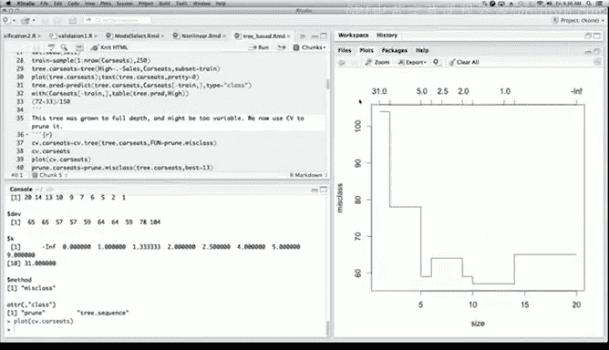

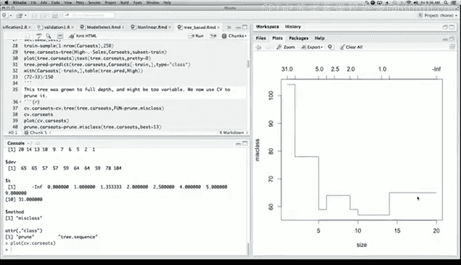

Cross validated points。 It's somewhat jumpy， but we see it does seem to bottom out before it increases。

So let's pick a value down near the minimum。 So we'll pick 13， which is somewhere in the middle。

 and we'll prune our tree to。To a size of 13， to find， identify that tree。 Now。

 this is the tree fit on the full training data。

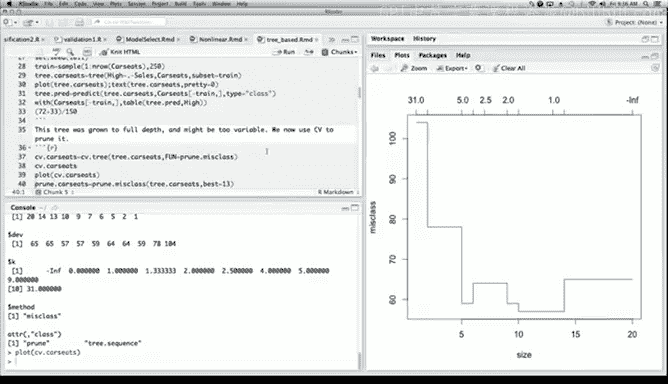

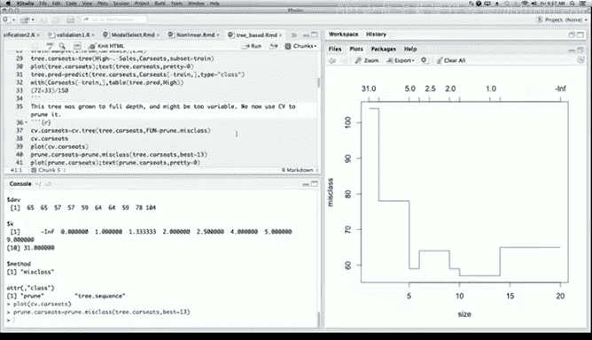

Okay， and we can plot that tree and， and。Annotated， as well。So it's a little bit shallower than the。

 the previous trees。 And now we can actually read the labels。

And so that's the result of cross validation。 and now we can evaluate it on our test data set again。

 So this is just a repeat of the commands we had before。

 we got a table doesn't look much different actually and in fact it seems like the correct classifications dropped a little bit but it's probably just one observation so we didn't get too much from pruning except we got a shallower tree which is easier to interpret。

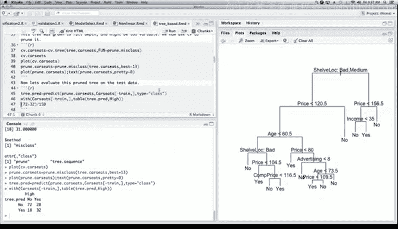

So。So that's using trees。 Trees are very handy， especially if you get shallow trees。 they。

 they nice to interpret。 You can， you know， you can describe to people。

 You can see exactly what's going on。 Often case trees don't give give very good prediction errors。

 So in the next session， we're gonna look at random forests and boosting。

 which tend to outperform trees as far as as prediction and misclassification errors are concerned。

