# 斯坦福大学《统计学习导论2023R语言版｜An Introduction to Statistical Learning with R》中英字幕 - P62：-062-Statistical Learning_ 9.1 Optimal Separating Hyperplane.zh_en - GPT中英字幕课程资源 - BV1yU421o7WA

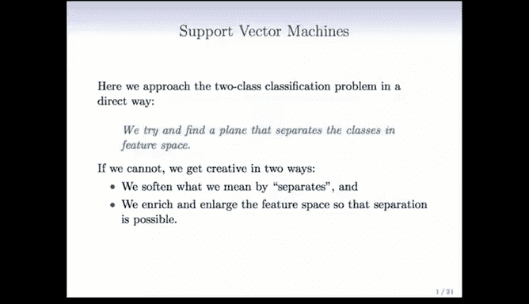

Okay， well， we're going to talk about support vector machines today。

 which is another way of doing classification， and it's a direct approach to the classification problem。

In a single line， we try and find a plane that separates the classes in feature space。

And supported vector machines are a very popular way of classifying。

 And there's one reason for it is the name is very neat。

 You're probably thinking just you hear the title， support vector machines。

The word supports kind of interesting and machine evokes something much larger and powerful and we'll tell you where the name comes from as we talk about the method。

 It was actually due to Fpnik， an applied mathematician from the former Soviet Union who came over to United States around 1990 and developed the method with Cortez while working at Bell Labs which Tvor used to work。

 Yes， they went to lab down the road。And when they first came and talked about support vector machines and having this great new idea。

 I scoffed it a little bit and I thought oh， yeah， another you know。

 brazen claim by computer scientists， but well， it turns out it's pretty good。Right。

 and as you'll see it's a unique kind of way， it approach the classification problem in the way computer scientists would approach it。

 there's no probability model as such， it really just looks for a hyperplane that separates the classes in a direct way。

So they've been around for about 20 years now and support vector machines are still firmly embedded in the community and considered one of the best ways of doing classification。

So we're going to tell you about them today。The idea will support vector machines， as we say。

 this to to。Find a plane that separates the classes in feature space。

And we'll tell you what we mean by that by a plane and and separation and so on。

 And but the idea is natural。 you try and。Separate the two classes。

 I mean that's what we want to do when you classify。 But you can you'll see we cannot always do that。

 and the the technology gets creative in two ways。 One is that we soften what we mean by separates and the other is that we enrich and en larger feature space so that the separation becomes possible。

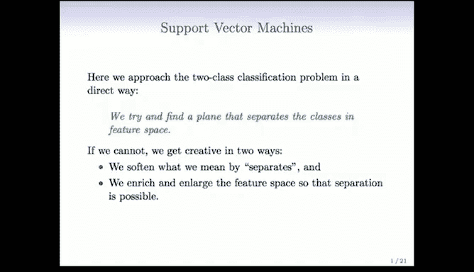

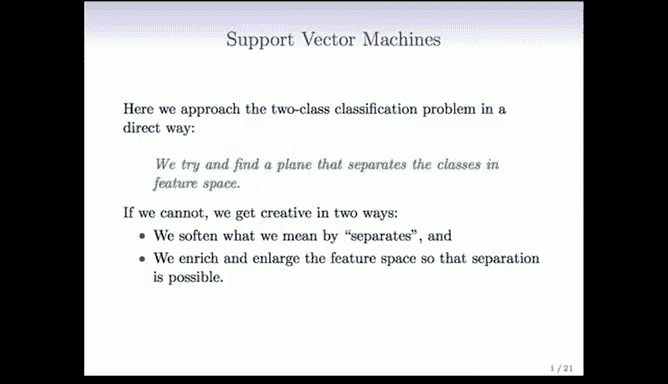

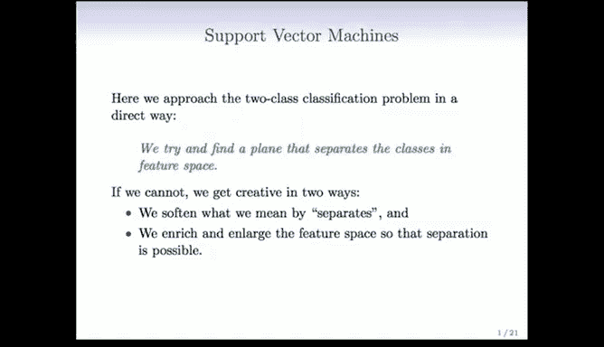

Before we can get into this， let's just talk about what is a hyperplane。

 So I'll give you some technical definition， and then I'll show you a picture。

So a hyperplane is in P dimensions， if you've got P features。

 is a flatter Eine subspace of dimension p minus1。

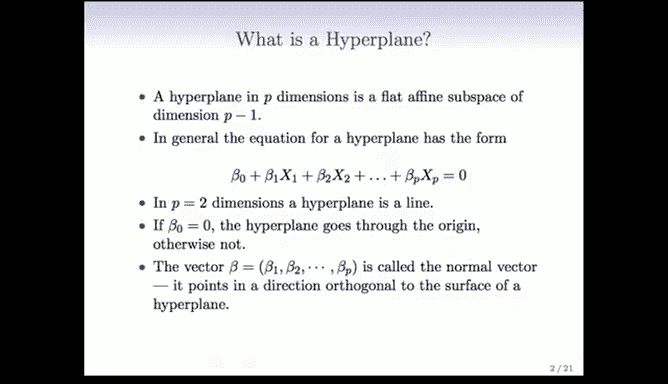

Well， if that didn't help you， let's just。Look at a little bit deeper。In in general。

 the equation of a hyperplane has the form as follows it's a。An equation is a linear equation。

 that's equal to 0。Okay， it's called a。

呃。L it's a linear function。In two dimensions， a hyperplane will be a line。

 and that's the one I'll demonstrate on the next slide。And if beta is 0。

 which is called the intercept if that is zero， then the hyperplane goes through the origin。

 otherwise it doesn't。And the vector beta 1 through beta P， excluding beta 0。

 is called a normal vector。 It points in a direction orthogonal to the surface of the hyperplane。

So let's have a look at the picture and see what we mean by that。So in this picture， the blue。

 the blue line is the hyperplane。 We got some points in the picture， and we got。

 there's the origin over here。And we've got this red line， which is the normal to the hyperplane。

So it's orthogonal to the surface of the hyperplane。

And the way you understand what's going on is as follows。For any given point， so for example。

 take this point over here， we can project it onto the normal。

 so here you see the orthogonal projection， the little right angle showing that we projecting orthogonally onto this normal over year。

And so we get the distance from the origin where this point projects。

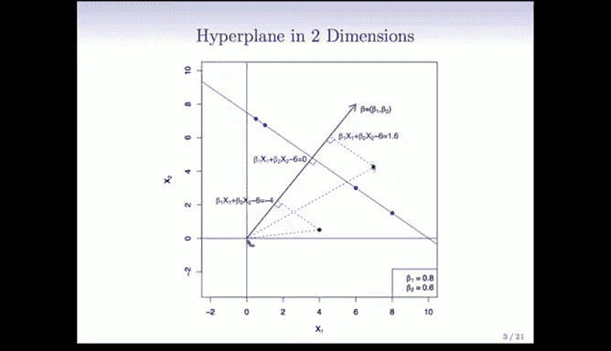

Well， in this case， the value that you get is 1。6， well。

 that's actually the value of the function yeah。

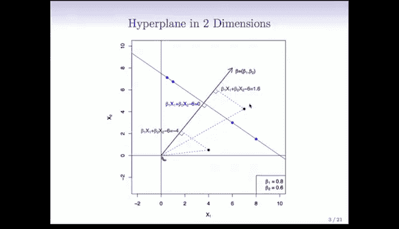

For the points beyond the hyperplane， the value of the function should end up to be zero。

So which points are going to project onto this normal and have a value 0。 Well。

 they're going to be all points on the hyperplane because you can see there's a right angle there。

 too。 So if we project this point， it's going to project over over here。If we project this point。

 it's going to predict over here。And。The value of the function is0 over here， so all these points。

End up having the function values 0。 and so they on the hyperplane。 These points， on the other hand。

 don't。In this example， the direction the beta 1 and beta 2 are given by 0。8 and 0。6。

In the bottom corner those are the two values for beta 1 and beta 2 that define this normal。

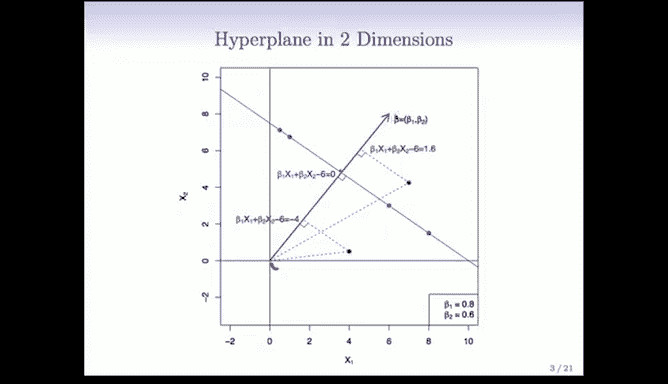

Well， if you check， you'll see that the sum of squares of beta 1 and beta 2 adds up to1。

 That means that this beta is a unit vector。

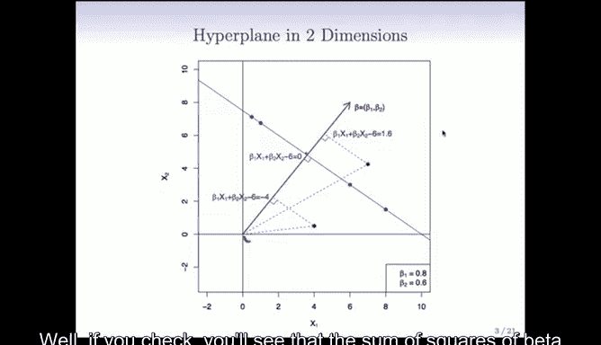

And so the direction vector is a unit vector。 And when that's the case。

 there something special happens。 and that is that。When you evaluate the function。

 the value that you get is actually the distance， the Euclidean distance of the point from the hyperplane。

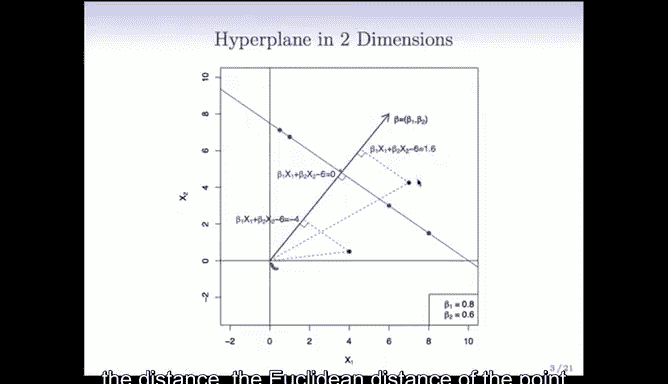

Now that's not too hard to prove， but we won't do that here。

 but for those of you who can do a little bit of calculus and no bit of geometry。

 see if you can try and show that， it's not that hard。

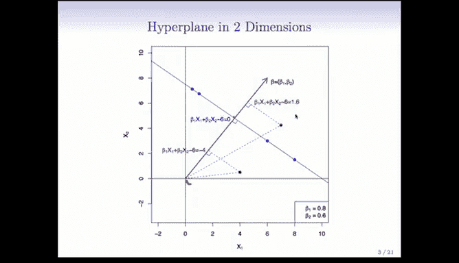

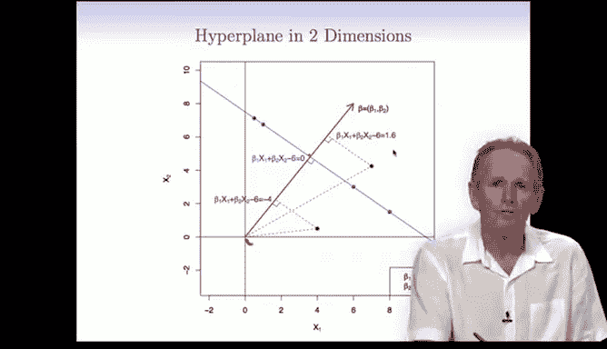

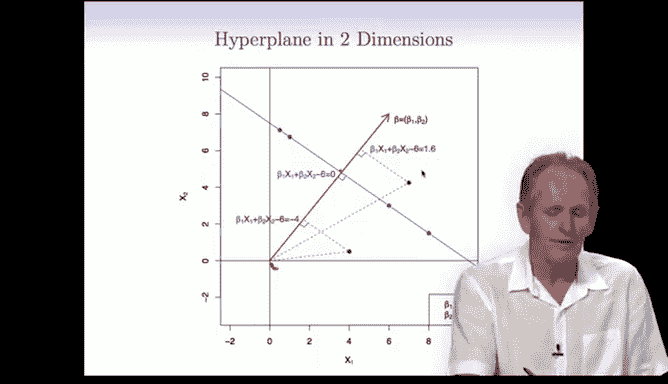

So this point is 1。6 units from the Hyplane this point over here。

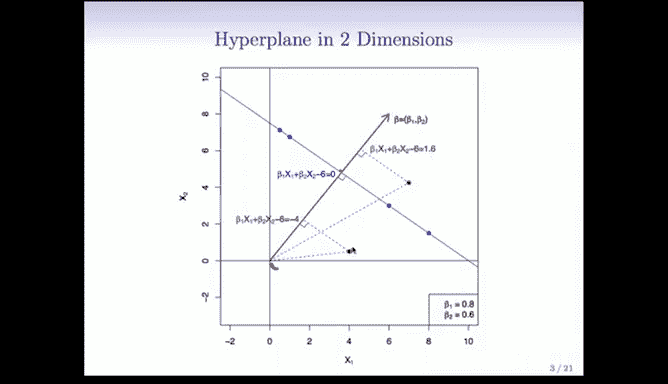

Is -4 units from the hyperplane。 So there's a sign in the， in the distance。

 It's one side of the hyperplane。 It's going to be negative。 the other side positive。

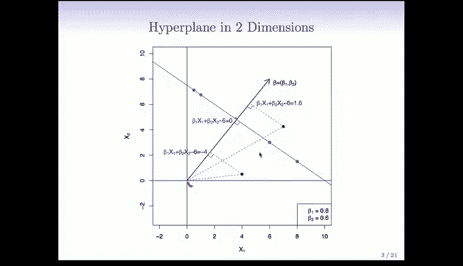

All points on this side would end up having a positive distance。 All points on this side。

 a negative distance。 And， of course， all the points on the hyperplane are a distance 0。

So that's a little tutorial on hyperplanes。

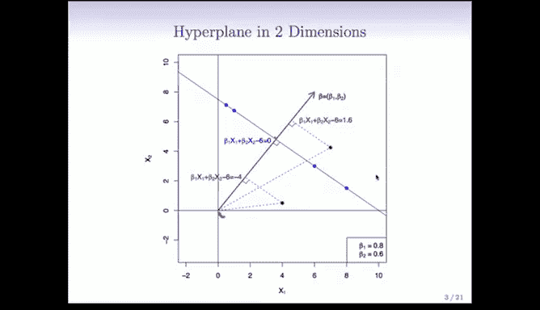

So with that in place， we can now talk of separating hyperplanes。

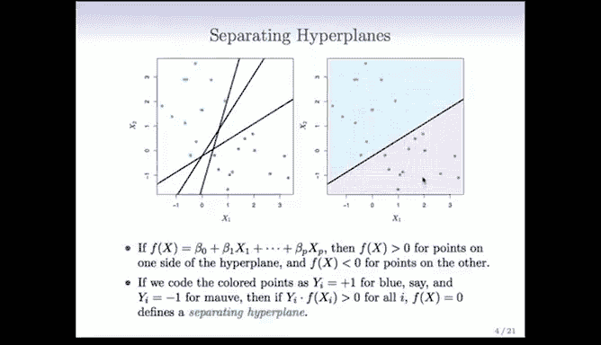

So in these two pictures， what we show a set of points， some are colored blue。

 some are covered a pinky move color。Okay。嗯。And。

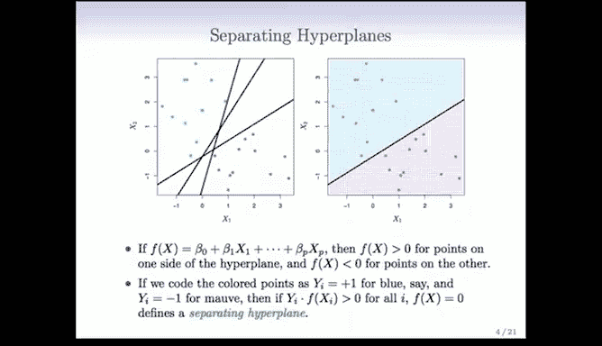

We've got three lines in in this picture over， and you'll notice that each of these three lines separates the blues from the purples。

 from the movess。

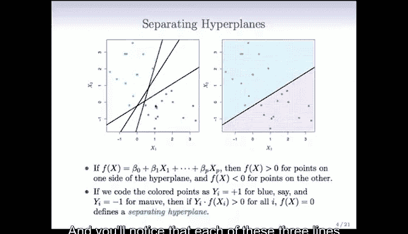

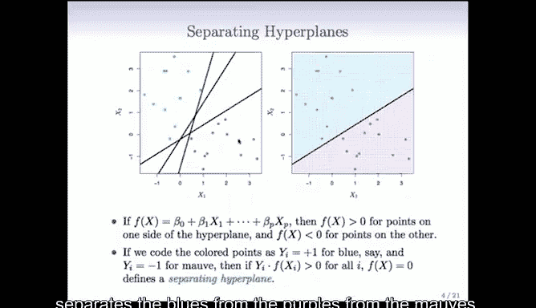

Right。This one does。Becauseuse there's all blue points on one side or purple points on this side。

 So does this one， and so does the other one。 So all three of them separate the two classes。

 So in terms of making a classifier， in principle， all three of those would do。

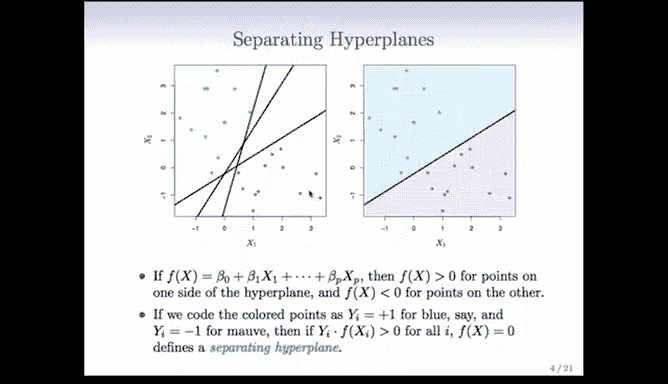

If we pick one of them， we can say， well， that's going to define the classifier。

 it separates the two classes。

Anything to this side we classify as blue， anything to this side will classify as purple from what we've seen before。

 we know that on one side of the hyperplane， the function is going to be positive。

 and on the other side， it's going to be negative， okay。

So what we can do is code the colored points。And those that are blue say we make them one and those that are move。

 we make them minus1， and then we can say that if the y that we've made。

 y is plus  or minus1 times the value of the function is positive。Then we， we classify。

Each of the points perfectly because they're on the right side of the hyperplane。

And the function itself evaluated as zero is called a seating hyperplan。So。

So that helps us define what we mean by separating hyperplane if this product is always positive。

 where we've coded the points as plus1 and minus-1。

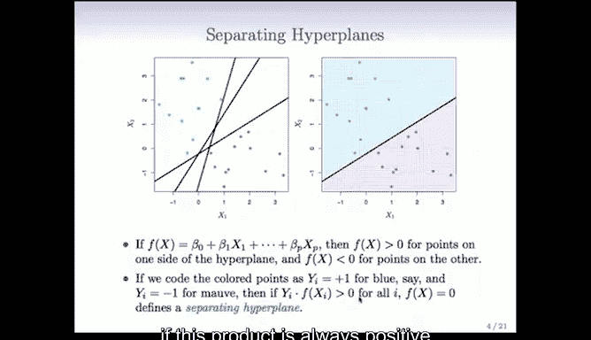

Now。

It's all very well coming up with a separating hyperplane， but we got many to choose from。

 So if we had to choose， which one would we pick。

And so that brings us on to the idea of the maximal margin classifier。

So the idea is the same set of points。The ideas amongst all separating hyperplanes find the one that makes the biggest margin or biggest gap between the two classes。

 right， And we've indicated over here， there's a hyperplane。 In fact， this is the optimal one year。

Found through an algorithm we'll tell you about。And you can see that the the hyperplans exactly equi distance from the closest blue point and the closest mo point。

And that makes the biggest gap。So why， why is that interest in having the biggest gap， Well。

 the idea is simply that。If you make a big gap on the training data， these are training data。

 hopefully when you put test points down there， you'll also make a big gap on them。

That's an underlying thought， of course。From a statistics point of view that's maybe not always going to make sense because it seems like this is overfiing we focus in on a few of the very closest points。

 but we'll see in general it seems to perform very well。

So that's the idea of the maximum margin a classifier。Now， how do you actually do that， Well。

 somewhat technical， you can set it up as as a a optimization problem。 And this is how we do it。 So。

 first of all， we constrain the sum of squares of the of the betas to be 1。 remember。

 these are the beta is0， not the beta is 0。 and if the sum squares are these are1。

 then the function evaluates to the distance If you multiplied by the y I。

 which is coded as plus1 or minus-1。 This year is the distance of the8h point from the current hyperplane defined by the betas。

 Okay， Now we want to make。

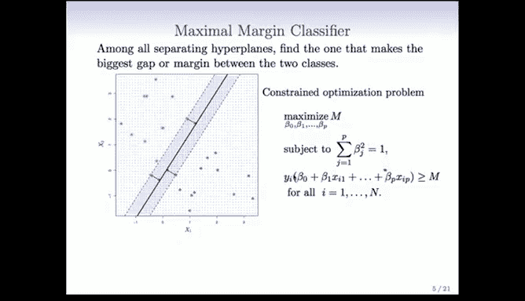

And it's a sign distance。 So if they're all positive。

 it means all the points on the correct side of the hyperplane。And if we want to maximize a margin。

 we want to find that hyperpane for which。These distances are all as big as possible。

 So we want all of them to be bigger than some number M。And we're going to maximize that M。

 So we're going to find the parameters that gives us the largest M， such that for every point。

 they at least M units from the hyperplane。Okay。So that's a nice mathematical way of defining the problem。

To solve it， it actually goes a little bit beyond the scope of this class。

 so that's what you see the uphill car logo there that's in the book as well。

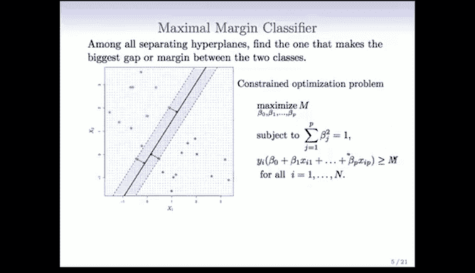

The way it's phrased here， it's not quite a convicx optimization problem。

 but you can rephrase it and make it one and then you can solve it using software。

 and there's a function SVM in R， for example， in the package。With a strange name E107，1。

 And we'll see when we do the labs that that solves the separating hyperplane problem。Okay， so we've。

 we've seen how to solve the separating hyperplane problem。 We've got an algorithm for doing it。 and。

 and it's， it's a pretty slick algorithm。 We get the maximal margin classifier。Well。

 we're going to see that that's not going to be good enough and in the next section we'll talk about what we do in cases when you cannot get a separated hyperplane and we'll also talk about how we deal with noisy data as well。

