# 斯坦福大学《统计学习导论2023R语言版｜An Introduction to Statistical Learning with R》中英字幕 - P64：-064-Statistical Learning_ 9.3 Feature Expansion and the SVM.zh_en - GPT中英字幕课程资源 - BV1yU421o7WA

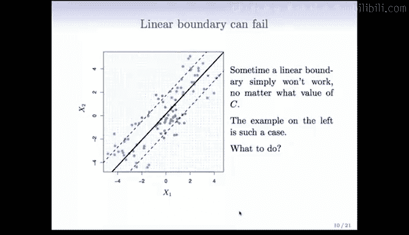

Okay， we saw there were situations where soft margin wasn't going to help us。

 And so were going to find ways of overcoming this problem。

 And a natural way to do that is using feature expansion。

 So what we can do one simple way is a standard trick is in larger features by including transformation transformations such as polynomials right So we started off with just in this example。

 just x1 and x2。 we can add in x1 squared。

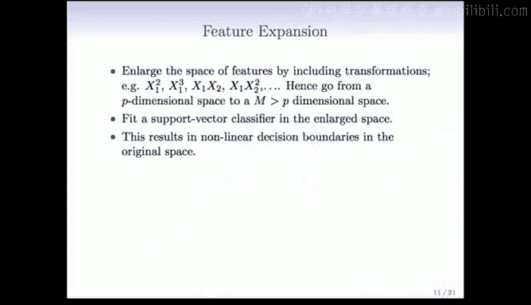

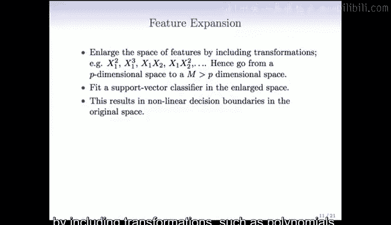

X2 squared， x1 cubed。X 1， x2 and so on， right， polynomial expansions。

 So you can go from a p dimensional space In this case，2 to a higher dimensional space。

 And the more transform variables you add， the more likely ought to be be able to get separation in this higher dimensional space。

 I just know something。 The M there， of course， is not the same M as we use for margin。 Oh。

 so that's a good point。 Maybe should use different letter。Okay， thank you。 That was a。

Bad choice of of letter。 That's usually the kind of mistake I make when I caught you on one。

s the kind of mistake I hate making。So。Enlarger feature space and then fit a linear support vector machine in the enlarge space。

And then when you project it down to the original space。

 that it results in a nonlinear decision boundary in the original space。

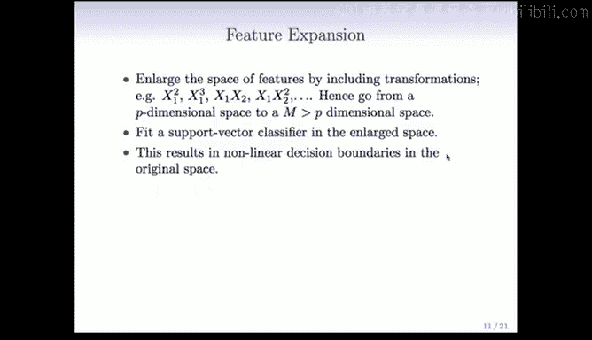

So， for example。Suppose we we use degree 2 polynomials。 So well use x1 x2， x1 squared。

 x2 squared and x1 times x2。So that's a basis for fitting a general polynomial in two variables of degree2。

Well， in the enlar space， the decision boundary would take this form。

 It's linear in the new variables。RightSo there's a coefficient for each of them。

 So that was the form separate of a hyperplane。But of course， in the original variables。

 it's nonlinear because we've got squares and cross products。Okay。And。

This is what it results in in for the same example that we saw。The decision boundary。

 you can see it's kind of split in to now。 So remember。

 how do we get these these decision boundaries in in the five dimensional space。

 there's a single linear decision boundary。Okay， and we can color all the points on one side。

 blue and on the other side move。Well， if you project it down into the two dimensional picture of the original variables。

 this is what it looks like。So these are con sections of a quadratic polynomial。

 and this is what they look like。And it's curious because in the five dimensional space。

 there's a margin on either side of the linear boundary， which are the dotted lines。

 Well they also project down。 And so there's a pair of margins for this piece of the the curve and one for this。

 You'll notice these are nonlinear and they even ends up in two pieces here。And。Importantly。

 in this case， this does a really good job in separating the two classes。Okay。

Here's the equation in this case， it's a cubic we used a cubic polynomial in this case。

 so there's nine transform variables altogether， and so it starts getting a little un weirdly the dimension of the space is getting a little bigger。

 but it solves the problem。Okay， well， so we seem to have a way of getting around these situations where we can't separate the data。

Now polynomials aren't the greatest choice because especially in high dimensions they get wild rather first。

 we know even in regression， we don't like doing polynomial regression with degree bigger than three and if you've got a large P to start with and if you have a full even cubic polynomial space。

 it's quite a large space。So it turns out there's a more elegant and controlled way to introduce nonlinearities in support vector classifierifies。

 and this is through the use of what's known as kernels。But before we get into these。

 we need to understand the role of inner products in support vector classifiers。

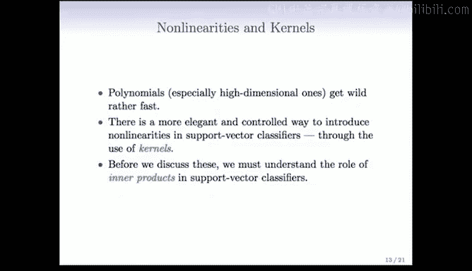

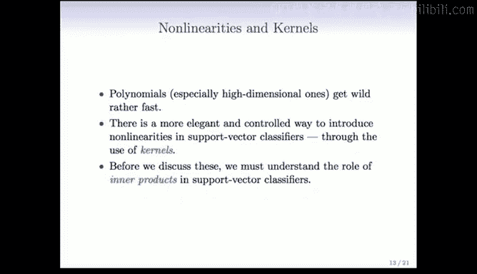

Okay， so in the products we。If you've got a set of vectors so we've got Xi and Xi prime Now remember Xi is a P vector。

 it's the set variables for observation I and Xi prime is another P vector and this angle notation means inner product between these two vectors and it's just the sum of crossproduct of each of the individual components of the vector so that's called the inner product between two vectors and we write it in this compact way over here。

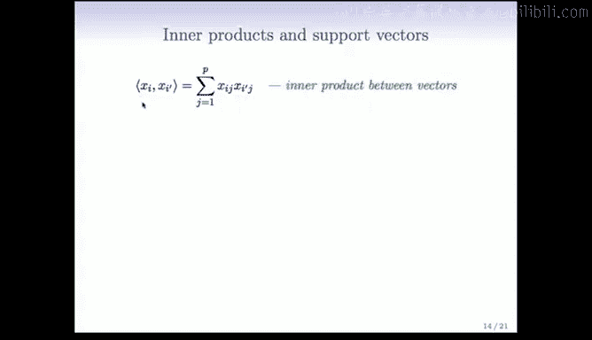

嗯。So using that notation， we can write a linear support vector classify。

 you can write it in this form over。And。And so here we have an inner product between each of。

The x size in the data and the target point。 So we're thinking of this as a function of a new point x。

And it turns out you can write the support vector machine classify a solution in this form。

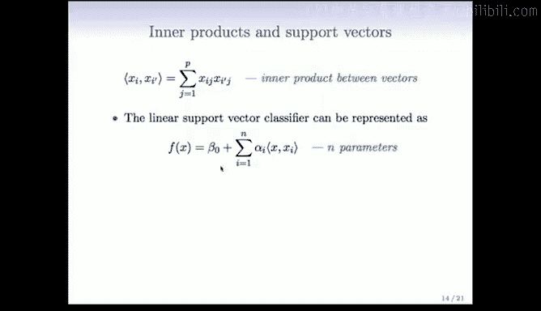

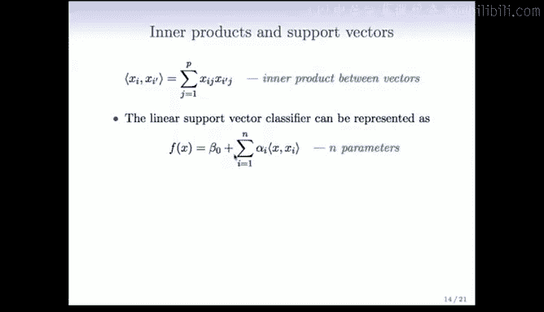

Now you're not going to be able to see that just from looking at the formula for the linear function。

 this turns out to be how it comes out in the solution。

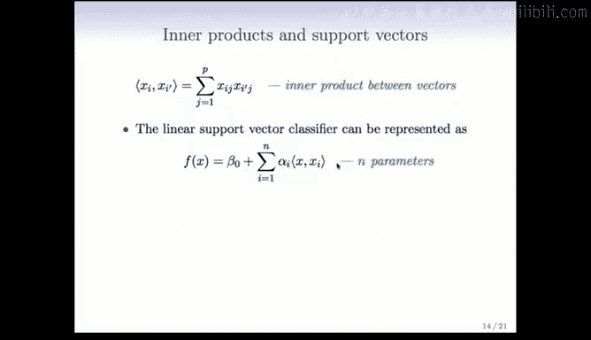

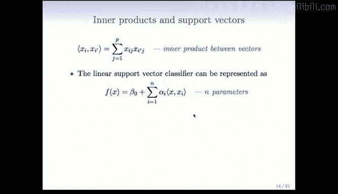

But it's going to be important。It also turns out to estimate the parameters。

 So now we've got n parameters instead of the P， and n could be bigger than P。

To estimate the parameters。And beta Nor。All we need are all the paywises inner products between all the endpoints in the data。

So there's going to be an n by n in a product matrix。And it turns out that if we have that。

And that's all we have。We can fit the support vector classifier。And represented in this form。

 and it's going to give us the same solution as what we had before。

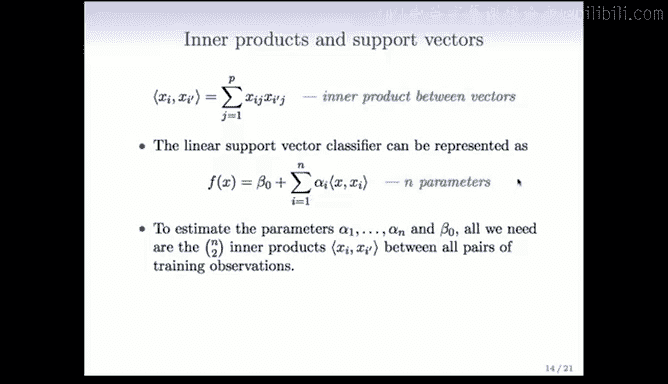

Now when you do that。What happens is that many of the alphas end up being 0。 So here。

 we put hats on the alphas。And many of them are zero。

 and so the only ones we need to include here are the ones that aren't zero。

 and so we call those the support set or the support vectors。

And so those are the alphas that are not zero， and each alpha is tied to one of the original points or vectors in the original data set。

So we'll go back to slide8 and see which ones those are。

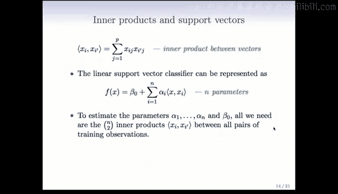

So let's get back here to slide 8， your slide 8。So which are the support vectors are the points with nonze alphas？

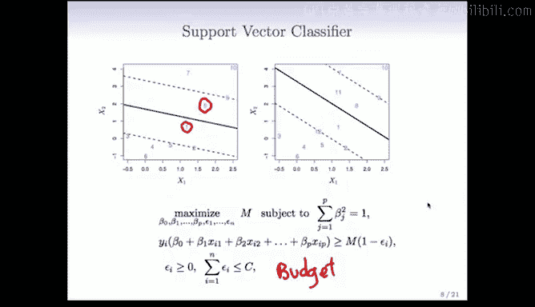

Well in this left picture over here， there's the two circle points。

 those are support vectors and also any points on the margin。It looks like this one， and this one。

 and。Possibly this one。So in this case， there'd be five support vectors。

 so of all the points in the picture， only five of them would have non zero alphas。

And it sort of makes sense， right？ Certainly， the ones on the margin make sense because they define in the direction。

But the ones inside are also going to define the direction， because remember。

 they have these little epsilons tagged onto them。 and so they're going to play some role in in the definition of the direction。

In this one over here。There's 1，2，3，4，5，6，7 support points。 And just to add to that right。

 if a point's not a support point， it means it's on the right side of its margin。 And if we。

 if we moved it， but we kept it in the same area， it's not going to affect the solution。

 so they're not support points。And one more thing to add this is the kind of sparsity。

 but it's kind of a funny sparsity right remember you talk about the Lasso it proves a sparse solution in the coefficients of the features。

 This is a kind of sparsity but it's different it's actually in the data space right because now we're signing a weight to each data point and some of these weights are zero and the ones that are non-ze called the support points。

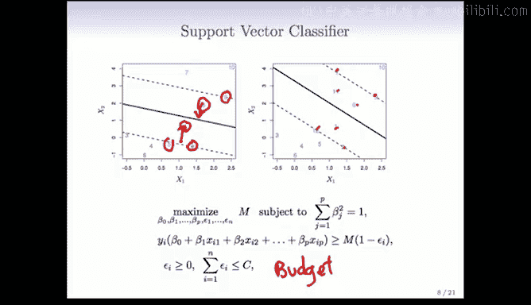

So sparsity， but in the data space， not the feature space。That's a good point， Robin， you know。

 and when you think of it like that， you say， suppose you had 1000 points and it ends up that there's 10 support points。

 You think， oh， great。 You could have thrown away the other 990 points。Well。

 not really because you had to have them all there to decide which ones would be the support points Once you found him。

 you can throw them away， but doesn't really help much in the computations。So it's。

 it's a very interesting topic support vector machines。 And it took us a while to understand。

The details。

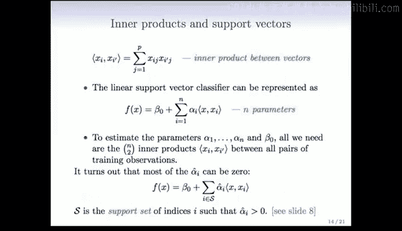

Okay， so that's in the products。And now what about kernels？

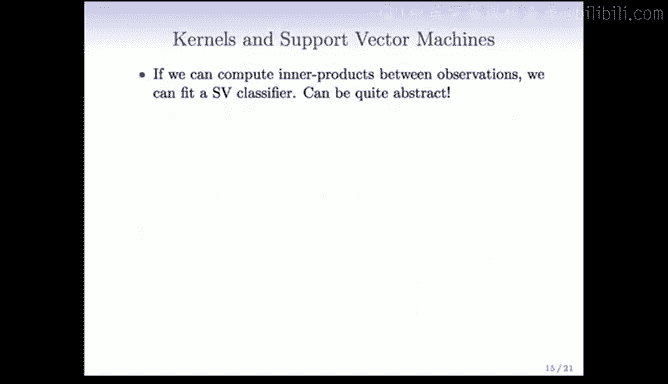

So。From the from what we saw previously， if we can compute the inner products between all pairs of observations。

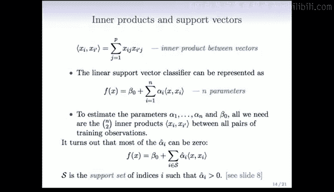

And if you can also compute the inner products between all the training observations and a new test point。

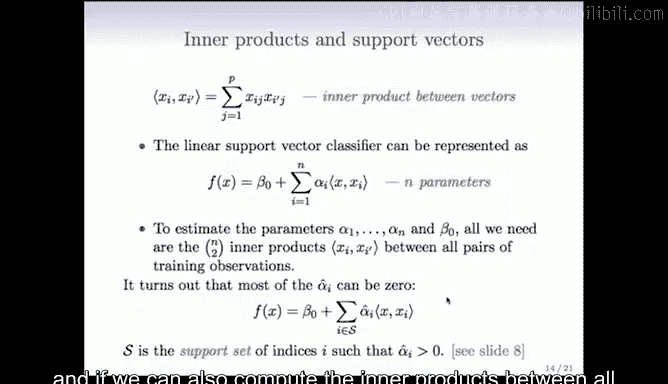

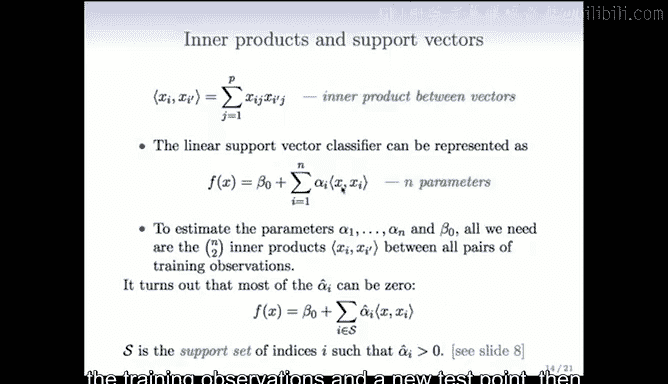

Then we can both fit the support vector machine and evaluate the function。Okay。

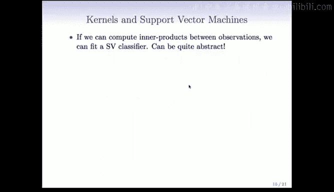

So this can be quite abstract。First of all， an inner product is like a similarity。

 and so if you didn't really have data and you just had similarities。

 pair pairswise similarities between observations in principle。

 you could come up with a classifier and there have been some interesting examples of that。

 so it allows us to be a bit more abstract。

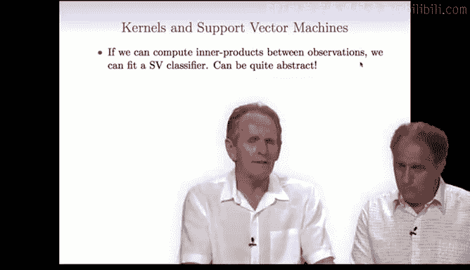

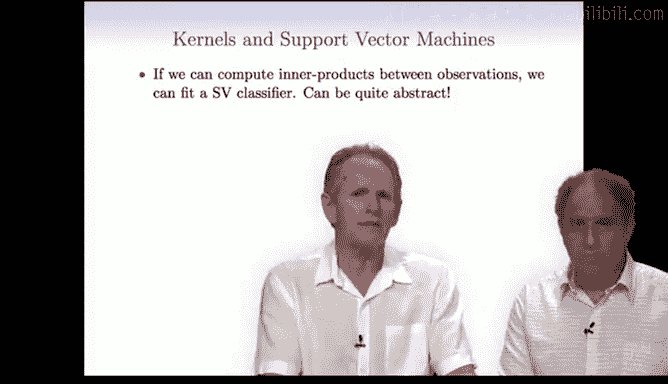

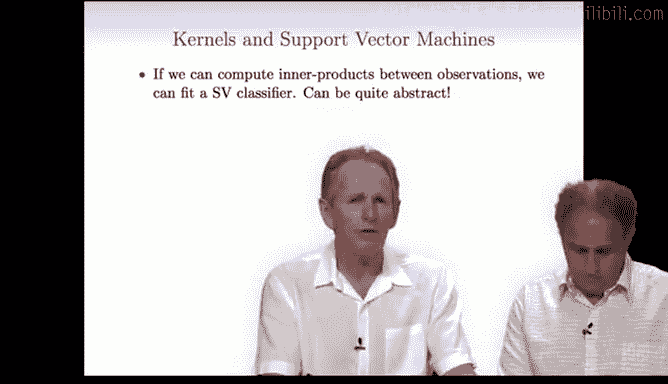

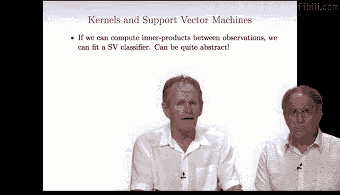

But more importantly， there's some special kernel functions。

 So these are a kernel function is a function of two arguments。 In this case， two P vectors， right。

So it's called a bivariate function。

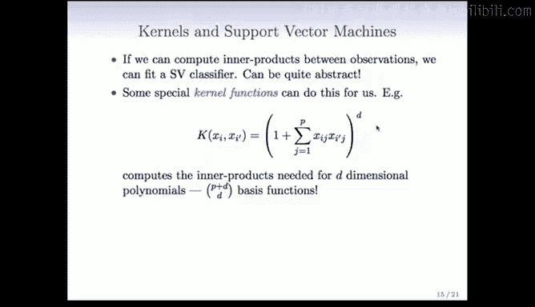

And these。These kernels compute the inner products for us。

And you might not even know what the feature space is in which they compute in the inner product。

 but they can be thought of as doing that。But a concrete example is with polynomials。

 So here's a bivarirate kernel function。 Look at it。

This part is just the inner product between the original vectors， X I and X I prime。

We add a one to it。And we raise the door to the power D。

And it turns out that this kernel computes the inner product in a featureji expansion space that we get by expanding。

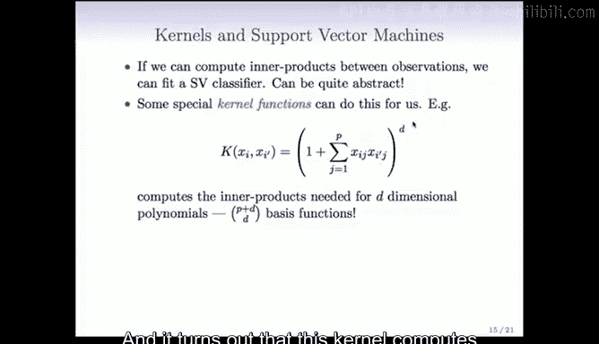

These vectors these P components into a basis for D dimensional polynomials。 sorry。

 D degree D polynomials。

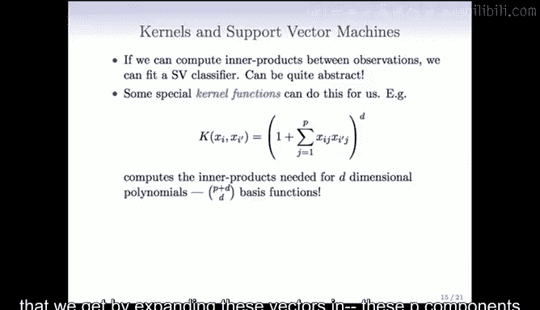

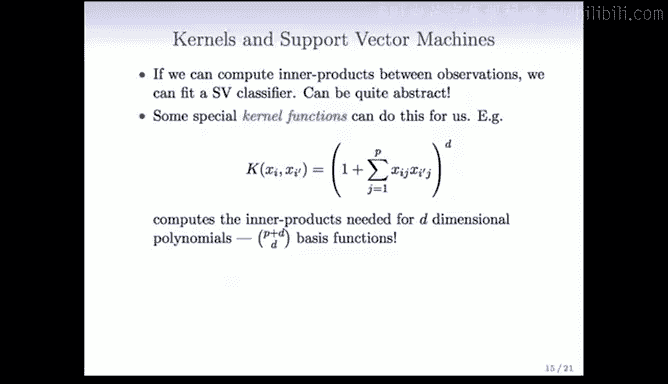

WellThat can be a huge space if P is large and D is large。

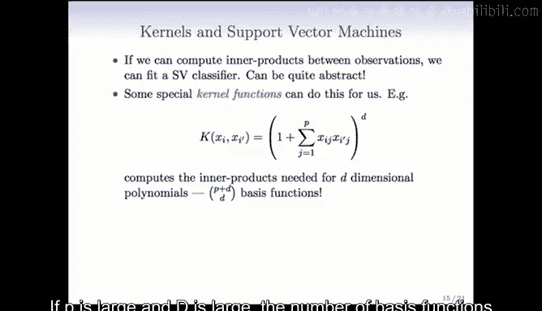

The number of basis function is actually P plus D， choose D。Which。

 grows very fast as P And D grow fast。 So that's a very big dimensional space， potentially。

 but we don't need to actually visit that space because this function will compute those in a product。

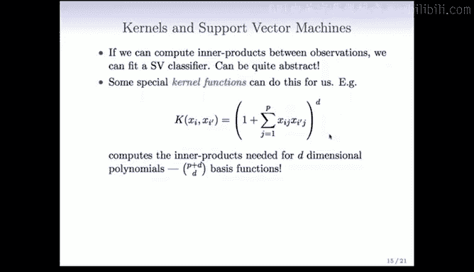

It's sort of like magic。 Youve got a kernel function that computes this in a product in。

 in this very high dimensional space。😊，So。Try little try a little example with with P 2。

 So like in our example， we have two components in x and Ds2。

And just expand this function and see what you get。 And you'll see that， indeed。

 it does just what I said。And having done that。We can therefore compute the n by n in a product matrix for all the n observations by evaluating this function at each pair。

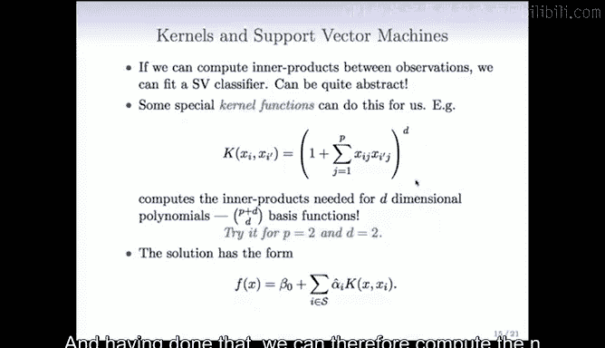

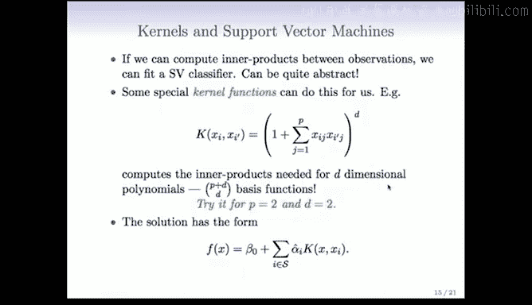

And then we get a solution which is of this form because again。

 k is computing the inner product between the target point x and each of the x size in the sample。

 and once again these alpha I's are going to be nonzero for only those points in the support set。

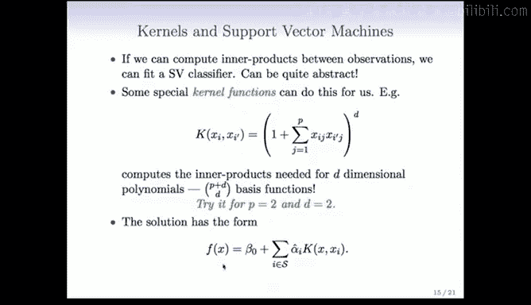

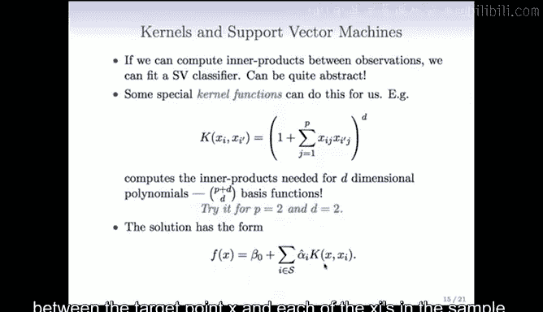

So that's where the kernel comes into to the support vector machine。

One of the most popular kernels is called the radial kernel。And it's defined like this。

If you know what a multivariate Gaussian distribution looks like。

 this is the important part of that distribution。The sum of squares between the components X and X prime each of the elements。

There's a gamma yes， so there's a tuning pre and's trace to the power E。

And this is an inner product in an abstract infinite dimensional feature space。

So this is a very high dimensional space。 so high we could never visit it。

 Yet this kernel computer in a product for us。And we can therefore fit the support vector machine。

And in our example where we had the two classes separating the Move class， the two blue classes。

 this is the solution that it gave。And again， it seems to have done a really good job， okay？

So something's got a little weird here， how can we fit models in an infinite dimensional feature space and not be overfitting the data？

Well， it turns out that even though it's an infinite dimensional feature space。

 many of the dimensions are squashed down heavily。 in fact， almost squashed down to 0。

So it's a very high dimensional feature space， but most of the space is squashed down and。

The dimensions that are squashed down tend to be the more wiggly dimensions。

 The smoother ones are squashed down less。You'll notice when you， if you。

 if you went through this little example over year， you'll notice that。

It was did give you the inner product between a degree two polynomial。

 but there were coefficients in front of these and those are what give you the squashing factors。

 So Trevor in that example， I'm in polynomial kernels， I could take D to B a million right。

 You have a huge number of polynomial functions。Which if I did with the feature expansion method。

 I would things would get out of control。 So so what happens here。

 trouble down right2 a million Yeah， with a polyoma kernel， I can get away with that。

 we can get away with it。 Yeah and that's because of the squishes of all the squishing down。

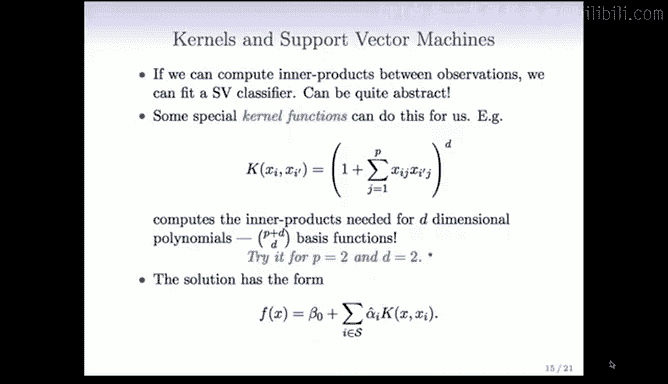

Okay， so。A radial kernel is very popular and it's one of the most popular kernels it's used for nonlinear support vector machines。

And there other kernels， but this is the one people usually go to。

And this gamma is a tune in parameter。And。The if you make， if you make。You can think of it。

 like the standard。It's like one over the standard deviation of the Gaussian。

So if gamma is really large， it's like having a small standard deviation。

And you get much more wiggly decision boundaries。Whereas if gamma is small。

 the the decision boundaries gets smoother。So。We're going to take this machinery and in next segment and look at an example。

