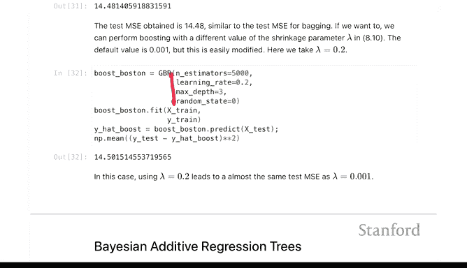

# 斯坦福大学《统计学习导论2023Python版｜An Introduction to Statistical Learning with Python》中英字幕 - P65：-065-Statistical Learning_ 8.Py Tree-Based Methods I 2023.zh_en - GPT中英字幕课程资源 - BV1u4421A7ZU

Okay， welcome back today we're going to run through some of the lab for chapter 8。

 tree based methods， focusing on random forest and boosting。

We're going to start off with a single tree based method just to get a sense of how that performs and comparing it to the ensemble methods。

Okay， as usual， we have our some imports at the beginning。

 and then we have some new imports for this model module， I should say。

So the main methods we're going to talk about today are random forests and boosting。

 and we're going to be doing regression。 So that's why we're looking at random forest regressor and creating boosting regressor instead of classifier。

Okay， we'll also talk a little bit about decision trees。 We'll look at the decision tree regressor。

 and there's the corresponding classifier， decision tree classifier。Okay。So。

Fitting a classification of regression tree。Because well there again， methods from psychit learn。

 they will look almost identical to the methods we saw in chapter 4 for classification。

 so once we form a set of features and an outcome， we'll just use the fit and predict method and similarly for cross validation like we saw in chapterpt 6 because it's an SK learn estimator we can use the same kind of setup to do classification。

So since we're gonna focus on regression for random forest and boosting， we're gonna。

Jump to the part of fitting a。Regression decision tree， rather than a classification decision tree。

Again， they look similar， The main difference being one is a binary outcome or a categorical outcome。

 and the other one is a continuous one。Okay， the data set we're going to use for regression today is the Boston data set we saw in chapter 3 and the preprocessing is pretty simple。

 we just have to find a set of features and we'll do that by making a design matrix as if we are doing linear regression and just taking the design matrix。

Though we don't want to include an intercept。 so we're going to say intercept equals false because the regression trees fit their own intercept。

 and well， it be could be problematic having an intercept column in there。So regression trees。

We're going to convert the design matrix to an array rather than a data frame。

 So we lose some of the。Some of the feature names， but this is the preferred data format for fitting the regression tree。

Okay， so。For validation， we're going to。Split our data into training and test and。

Fit on the training and evaluate value in the test。 we've seen this before。

To fit a regression tree we first construct the estimator and remember for psyic learn。

 informing the estimator， we'd give no data in this argument。

 we just sort of specify the hyperparameter of the method once we have constructed the estimator we call the fit function and after we can call predict function to predict on new outcomes。

So， one thing。You know， slightly。Different about a tree is people sometimes want to visualize what a regressiong tree looks like。

 So there's this function plot tree that gives us a visual representation of the tree。

And you can see some measure of a fit in each of the leaves。

 The resolution of this picture is not great。And from also， you can sort of。

Trace an observation down the regression tree。 whoops。 Let's see if I can zoom in on this。

So if the number of rooms is less than 6。8， we'll go to the left and then the next variable check is Lst。

 etc， and that's how the predictions are formed in a decision tree。

So let's just let let's look at the the accuracy of fitting this regression tree。

 So just for reference later， we see for using a regression tree。

 we got about mean square error of about 28。This means square is for the here， quote。

 the best regression tree。 and what is best here， well。We didn't。 I haven't mentioned it yet， but we。

 we show how to do the cost comp cost complexity pruning path in this bit of code。

 So we've optimized this parameter on the training data to try and get a better estimator。

 And this is。According to that metric， the best estimator found with a means square error of about 28。

This grid parameter we saw in chapter 6， when we have a tuning parameter。

 this is a method generic method in a psyic learn， you can use to tune a hyperparameter for an estimator right。

 This is our estimator regression。We specify some arguments to the， the。The reg estimator。

 And then we。Bury that over the grid to get this best parameter。So just to summarize。

 the general procedure is to grow a biggerot tree and then use cross validation to determine how much to prune it back in this case。

 and this was all done on the 70% of the data which was training data and then this final estimate of error for the optimally prune tree is on the 30% of the data which is test data and we saw we see it's 20。

Just over 28。Okay， so that's。Using this tuning this way is about as well as we can do with a single tree。

We're gonna move on to。Two ensemble methods。So the first ensemble method we'll talk about is bagging or and or random forest。

 Remember， the main difference between bagging and random forests is random forest randomly。

Has some randomization injected in which features are used for each tree。

But remember basic the basic scheme of bagging is well。

 what it it's bagging set for bootstrap aggregation。 So a bootsshoprap sample is taken from the data。

 That's a sample with replacement。 A tree is fit to that bootsshoprap sample and then the final estimator is the average of these these trees fit on each bootstrap sample。

 The random forest adds this wrinkle of not using every feature on every tree。

 So along with taking a random sample of the feature of the rows of the data set the cases。

 we also take a random sample of the features。 Every time a splits taken take a sample of the features Oh yes。

 and I'm sure there are variations of this。 but yes。Okay。So okay， let's see， so how do we specify。

 well， the random forest is a psyit learn estimator。Once we construct the estimator using RF。

 this is our shorthand for random forest regressor。Well。

 we just have to call the fit method on the training data that is xtrain and Ytrain。

 and then we can evaluate we can predict on the test data and evaluate the accuracy that way。Okay。

 and note here I've put an argument， random state equals0 because this is a random procedure。

 there is a random number generator underlying this and setting the state means that the results will be reproducible。

 So when we run this again we'll get the same answer， if you don't specify a random state。

 then the results will change from run to run。Okay。So， just with that。Simple regressor。

 We get a mean squared error。Of 14， that's about half though we had on a single tree。

 So we see that in terms of predictive performance， ensemble methods， you know。

 without very much effort， really out outdo a single tree very easily。So， let's。Look， this is， we've。

 I've called this the bag version of the tree。 And that's because I've here， I've put in this note。

 Max features is the number of columns of X train。 and that that essentially tells the。

Random force regressor to use every feature when it does a split。 so it doesn't do any sampling。

Of features when it splits， if we made this smaller than the number of columns， which is 12。

 we've made it smaller， then we would it would be a random forest。And just a note for。

 for psychic learn， then the default。Number of features used for splits varies between the regressor random forest and the classification random forest。

 I think it's P。 the default is。Is to do bagging for regression， I believe。

 and square root of P or square root of the numbers for classification。Okay， so。

TheAnother parameter you can specify in the random forest is the number of trees grown。

 The default is 100。 We can here。 let's try increasing the number of trees to 500 and see if we do any better。

We didn't really do any better。 it's about 14。6。And of course， what's happening here is that。

We're averaging the sick。You know， independently drawn trees from the same distribution。

 given the data， so。At a certain point， averaging will kick in。

 and we will no no longer see any improvement。 But if we take too few trees， like a single tree。

 we will not achieve as high as good and means square as as low it means criteria。Okay。

 so if we want to have something more like a random forest。

 we can decrease the number of features Here。 we set the number of features equal to 6。

 That's bigger than the square root of P， but。This will give us some selection of features for every split。

And we see here that actually degrades the performance a little bit。 It's 20 instead of 14。6。

One of the nice things about random forests is that you can there's a measure of importance for each feature that you can use to sort of。

You know， post hoc analyze which features seem to be important in， in producing these predictions。

 So these are。This this measures the sort of average improvement gained。

 but whenever we added a split on Lstt， theres some improvement in mean squared error。

 and this is the in some sense， the average improvement over whenever we had done a split in any of the trees。

So it's， it's saying that Elt and and number of rooms are by far the most important features。

 and all the rest seem to be much smaller in comparison， yes。And that's you know。

 if we think back to that plot of our single tree， Al Statton room or also the first few features we split on so these seem to be important for prediction here。

Okay。So the other ensemble method that we'll talk about is boosting。

If you both boosting in random forest use a collection of trees。

The the one of the big differences between random forest and boosting is the type of trees fit at each stage in random forest at each stage the tree fit is of the same as the first stage。

 because once we fix the data， a bootst sample at any given time is istap sample at stage one is the same as the bootstap sample at the 500th stage in boosting what happens there can be resampling。

 It depends on the implementation， but what changes as you go through the stage is we're fitting trees to the residual after having removed some of the effect of up to that point the fitted the fitted model。

So there are so Jonathan， unlike in， in random forest， where once you foot enough trees。

 things don't change with boosting， the more trees you foot。

 the more you're going to start overfiing the data。

 And so there really is going to be a biosphere and straight off in the number of trees。That's right。

 And we'll see a plot of that coming up。 We as， as， as the number of estimators。

 that's the number of trees grows， we can plot both the， the test air and the training error。

 And we'll see we'll see what Trevor just mentioned coming up。 But in terms of fitting these models。

 once we specify the hyperparameters again， since it's an S K learn method， it's we use the fit。

The fit method。To predict， to fit on training data， and we can predict on test data。

So let's make that plot of。Of prediction of training error and test error as a function of tree。

 And to do that， we can use this this for the a boosting estimator。

 There's this thing called stage predict， which as its name suggests。

 it predicts in stages and the stages are as we go through the trees fit in the boosting process。

 So the residual changes and gets smaller as the。The training residual get smaller as we go along the stages。

The training error should go down。 and at some point， test error。Will possibly go up。

Let's just look at the plot。After 5，000 trees here。

We see training error has sort of begun to saturate。

 we didn't see here that a real increase in overfitting on this data set。

 but that doesn't mean that boosting will number overfit is just on this particular data it has not。

 it's possible that we would see some uptick in test error as we grow the number of trees in this data set for you now。

Okay， so let's take a look at our mean squared error on the test data at the final stage。

 And it's about 14。5， which is， you know， just slightly better than random forest。

 but they're very comfortable here。 And the bag version the bagging version of random forest。

 That's right， okay。Okay， so。The last。Thing we could talk about is there's this。

 there's other parameters。 And if you look at the， the help for GBR。

 you'll see many parameters you can set。 one of them being the learning rate and。Here， we just。

Change the learning rate just for for to show you that you can change several things and on the the boosting estimator。

 And actually， in this case， it does not make a difference。

 That doesn't mean it will never make a difference。 but there are a huge number of tuning effect。

 tuning parameters。 And I think some the implementationation of boosting also do some res samplingling as well as they go along。

 So， but the the general flavor of boosting is fitting a tree to residual compared to the general flavor of random forests。

 which is fitting you know， an identical tree to some randomized version of the data at every stage。

Beyond that， there are different details in their implementation。Okay。

 we're not gonna the the final topic is Bayes in additive regression trees。 We're not gonna go in。

 we're not gonna。We're not going to talk about that。

And this is a good place to wrap up the lab for chapter eight， thank you。

