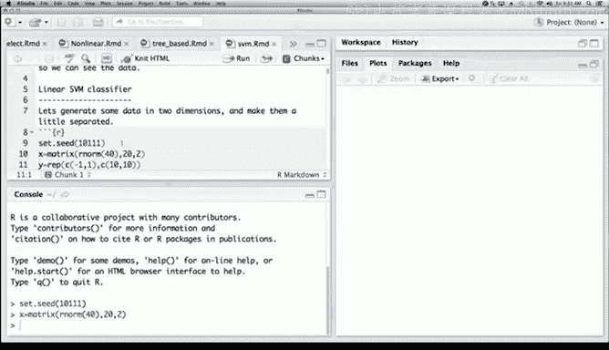
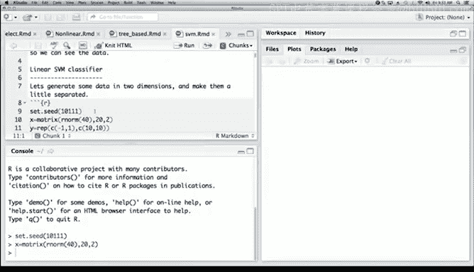
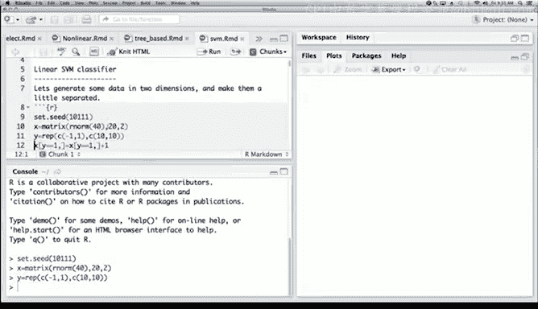
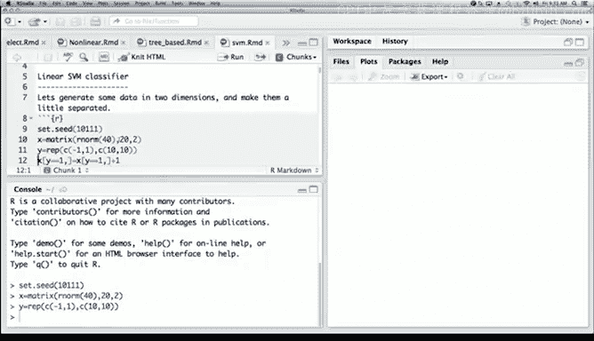
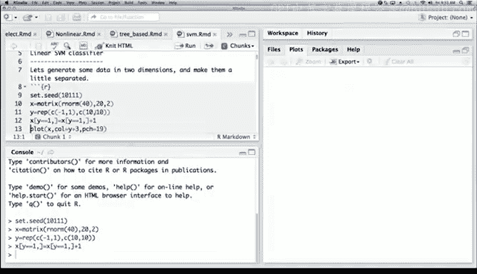
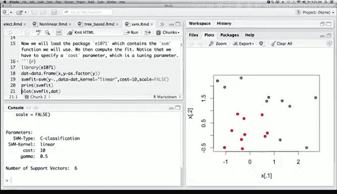
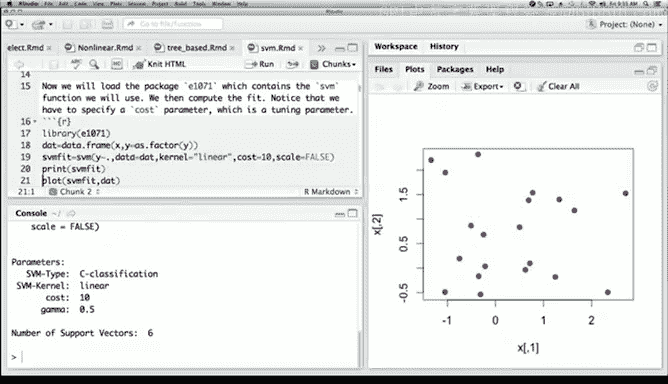
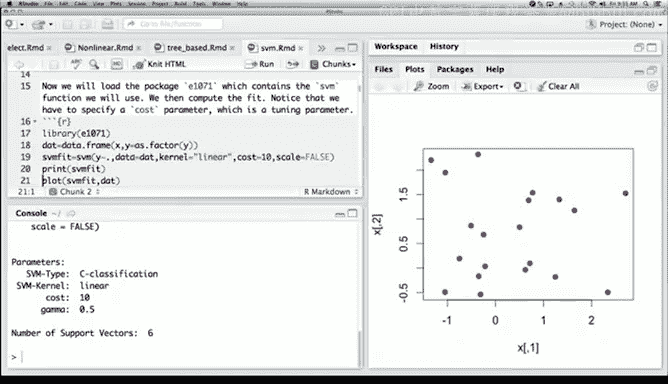

# 斯坦福大学《统计学习导论2023R语言版｜An Introduction to Statistical Learning with R》中英字幕 - P66：-066-Statistical Learning_ 9.R.1 Support Vector Classifier.zh_en - GPT中英字幕课程资源 - BV1yU421o7WA

嗯。Okay， in this session， we're going to look at the support vector machine and we're going to do it again in our studio using the markdown script as before。

We're going to depart a little bit from the R code in this chapter in that I'm going to be showing you two examples of using the support vector machine。

 both in two dimensions and I'm going to focus on producing plots of the result and so you can see how to make nice pictures like the ones we do in the book。

And。In the book， there's examples of how you use cross validation to select the cost parameters and so on。

 And， but we won't do that in the session today。Okay， so we're going to generate some data。And。

We'll make a matrix X。 We'll make 20 observations。

in， in， in two classes on two variables。 So that's。

We use the matrix command and we make them normally distributed， and then we make a y variable。

 which is going to be minus1 or plus one。

嗯。

And。Theres。10 in each class。 And then for the y equal plus one guys， we move there。

Their means from zero to one in each of the coordinates。

So that's what we've done there。 Now we plot the data and we color code the points according to the response。

And there's a simple way of doing it。 And notice I used the plotting character 19 again。

 because that gives us that nice， big visible dot coded blue or or red。

 according to whether the response is plus 1 or -1。Okay， so those are our data。Now。

 the SVM function that we use is in the package E1071。

Which is a room number in in the technical university in Berlin。

Where a lot of this code was developed。 so we'll。We load that library。Of course。

 you have to have it installed， but it's easy to install these libraries。And。

Now we'll make a data frame of our data。 and SVM， we're going to turn y into a factor variable here。

And and so that's done in in that command。 And now we make a call to SVM。

 So it uses a formula language， just like in our other examples。 So we'll go wire Twiddle dot。

Why is the response and the other variables are the predictors？

The data frame will have unpacked the matrix x into two columns named x1 and x2。

And we tell SVM that the kernel is linear because we want to fit a support vector classifier。

 which is a linear classifier in this case， later on we'll do a radial kernel。

And the tuning parameter is the cost which will set at 10。And scale equals false for this example。

 we'll ask it not to standardize the variables。And there we've done the fit。

And now we can print it and you get a little summary of the fit doesn't tell you too much。

 except that it does say the number of support vectors is6。

So remember in class the support factors are the points that are close to the boundary or on the wrong side of the boundary。

Now there is a plot function for the support vector machines。

 but I would say it's not a particularly nice plot function。

It， it shows you， it， it shows you the decision boundary。 It looks a little bit jagged here。

 It doesn't seem there's much control over the colours。 And as we point out in the book。

 it breaks with convention and it puts X 2 on the horizontal axis and X1 on the vertical axis。

But it's there。 And it's， it's， you can， you can get a quick pot。If， if you want。 But we。

 I'm gonna show you how you can make your a plot on your own。

And what we're going to do is the first thing we're going to do is we're going to make a grid of values or a lattice of values for x1 and x2 that covers the whole domain on a fairly fine lattice and then we're going to produce the we're going to predict the classified each point in the lattice and then color code plot them and color code the points so we can actually see the decision boundary。

And so there's some text that tells you about what we're going to do。And let's just get to the code。

 You can read the text later。 So， first of all， we're gonna make a function called make dot grid。

 And it's gonna take in our data matrix X。 and it takes an argument in a number of points in each direction。

 and we're gonna ask for 75。 So we're gonna ask for a 75 by 75 grid。Okay。

 and this function make dot grids gonna do it。 So make dot grid， so。I'll enter it now。

 So the first thing it does is it it uses the apply function to get the range of each of the variables in x。

Okay， and then for each of them， x1 and x2， it uses the seekq function to go from the the。

 the lowest value to the upper value and， and make a grid of length n。 So it's very simple。

And then now it's got these x1 and x2 now or each of length 75 uniformly spaced values on each of the coordinates。

 And then there's this wonderful function called expand dot grid， which takes those two。And makes。

 makes the letters for you。Okay， and， and then that's what gets returned。 So let's apply it。

 X grid gets make dot grid of X。And before we， we actually go into our prediction。

 let me just go down here。 and let's look at X gridd。 Let's look at the first， the first few values。

 So one。To， to 10。And so you can see there's the， the grid starting。 So it's， it's， it's。

 it's going through the first coordinate at first holding the second coordinate fixed。

And it'll be 75 times 75。So that's 5625 points are gonna be on this grid。 Okay。

 but it's done that for you。So back to our code， we now predict from our SVM foot at the values on the grid so the new data we've given it is X gridd。

And we called the response viaag grid。So now what I'm going to do is make a plot and I plot all the points in Xcrd and I color them according to what their prediction was。

And there it is。 And so now you actually see the decision boundary。 So each of the。

 you see the fine letters， say each of the points。Is is one of the points on the letters。And we've。

 we've color coded where they classify。 So you can clearly see the decision boundary。

And we'll put our original points on this plot。And there they are。

And so now you can see which ones are close to the boundary and in fact on the SVM foot is a component called index and that actually tells you which are the support points so we're going to include them in the plot by using the points function。

And as a slightly different plot in character。 And we made a C E X equals 2。

 That's carry the expansion is 2 to make this， these plot in symbols a bit bigger so that we can clearly see them on the plot。

 And as I， as I， I promise， these are close to the decision boundary。

 So these are the points that were actually instrumental in， in determining the decision boundary。

Okay， so that's using our linear support vector machine in two dimensions。The the function SVM is。

 I do not think that user friendly， and one of the things you don't easily get from it are the coefficients that one would use to describe the linear function。

They coat they can be derived from the objects on the foot。

 but we're going to have to do that ourselveslf。So that's not really described in this book。

 but there's chapter 12 of elements of statistical learning， which is our earlier textbook。

 more advanced textbook and if you look in Cha 12， you'll see how to do what I'm about to do here and we've just written some code to do that So this is to extract the linear coefficients that describe that linear boundary。

And so I'm going to just go through the steps here and do that。

And and so that I extracted beta and beta is 0， which used the formulas described in that chapter。

So now I'll re plot my points on the grid。 I'll put by my。

My points back in and the support vector machines， the support points。

And now I'm going to use the coefficients。To draw the decision boundary。So this will。

It's a simple equation。 the， the， the， the， the equations of the form beta 0 plus beta 1 x1 plus beta 2 x2 equals 0。

 And from that equation， you have to figure out a slope and an intercept for the decision boundary。

So it's a little bit of algebra， it's not too hard。 and once you do that。

 you can use the function A B line A B line expects an intercept and a slope。And you can see it。

 we've got it spot on。 theres the decision boundary。

 And now we can put in the margins as well and I'll put in the upper margin and the lower margin。

And so that's very nice。 You see that some of the support points are exactly on the margin and and some of the others are inside the margin。

And so there we've done with the linear support vector machine。

 we've seen how to extract their coefficients。And we've seen how to produce the pictures like pictures that we have in the book。

