# 斯坦福大学《统计学习导论2023Python版｜An Introduction to Statistical Learning with Python》中英字幕 - P69：-069-Statistical Learning_ 9.4 Example and Comparison with Logistic Regression.z - GPT中英字幕课程资源 - BV1u4421A7ZU

嗯。Okay， so we've learned about support vector machines in the full generality。

 Lets see it works how they work on a simple example。

 which is the heart data where we've got a bunch of variables， not too many。

 10 or so variables and and。We there's two classes， heart disease or no heart disease。

 and we use to support vector machines to classify。So in these two panels， we showed the performance。

On the training data。And next slide we show on the test data。So what we are showing are ROC curves。

 so we've seen these before， but just to remind you。Once we fit our function。

 which is initially going to be a linear function。We threshold it zero。

 and that's a decision boundary if the function is bigger than0， we'll classify to one class。

 otherwise less than zero to the other clause。And you'll make a number of errors。

 You'll make some false positives。And false negatives yeah。

 we actually look at the false positives and the true positives。Well， as you change the threshold。

 you're going to change the false positives and true positives。

And what the ROC curve does is trace out false the true positives versus the false positives as you change the threshold。

 and that gives you a curve。And if you think about it。

 what you'd really like is a curve that really hugs this northwest current corner。

 this one seems to be doing pretty well。Okay， and a way of comparing classifier is to see which one gets closer to the corner。

Okay。So that's called the R OC curve。 The name comes from an engineering term。

 but it's not really relevant in terms of how we use it today。 remember the so-cal the AU。

 the area under the curve is the the usual measure of how close the curve gets to the northwest corner。

 good point Yeah Rob。 So AU。

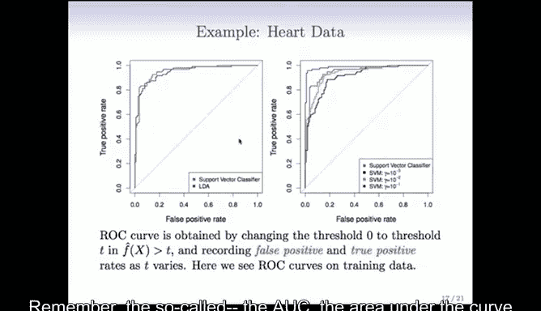

Area under。Under the curve is a summary measure of how close you get to the corner here。

 if the area under the curve is one， notice this is a unit cube that means this curve exactly gets into the corner。

And there's a 45 degree line， you should always be above the 45 degree line， so Auc C or B between 0。

5 and1。So in this left panel， we've got this the linear support vector classifier。

 that's the red curve。And we compare it to linear discriminants analysis here。

 which is the blue curve。 And on the training data， they do pretty much the same。

 Maybe the support vectors got a slight edge in in a few places。In the left panel， in the right。

 in the right panel。We compare the linear support vector classify。

 which is the red curve to the SVM using a radial kernel with different values of gamma。

And you'll notice that。It's not monotone。So when gamma is 10 to the minus1。

 we seem to do really well。嗯。When gammas 10 to the -2。That's the green curve。

We do do worse than the red curve。And 10 to the -3， even worse again。So remember the larger gamma。

The more restrictive。 sorry， the more wgggly， the decision boundary and so。

This is ordered in complexity。 So when gamma is large，10 to the -1， we're doing the best。

 and then as we， as we decrease gamma， we start doing worse and worse。

 and the linear classifier sort of comes in in between in the middle of that regime。

Which means gamma is another tuning parameter for the support vector class。

 And just keep in mind what they're telling us， it's not really a fair comparison on the right panel。

 right because the。The gamma smaller has more complexity， so it's going to fit more。

 and this is a bigger。 Yeah， so a training year comparison isn't a fair comparison。Right。

 so we didn't do it here， but if we made gamma even much bigger。

 we'd probably get an area under the curve of one。

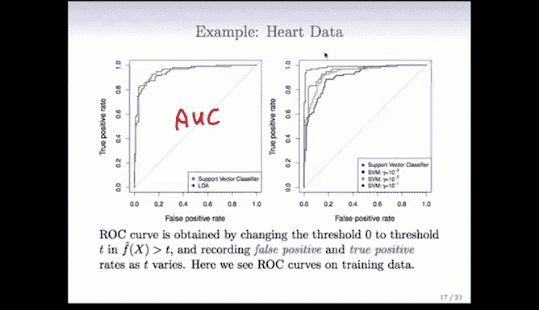

So of course， we know we should look at test data and so yeah。

 we put aside 80 observations as test observations and fit the classifierifies on the training data and now compared to the now we look at RC curves on the test data。

And again， linear versus LDA， it looks like the S support vector classified does a little bit better just by a small amount。

Okay， but notice that this R O C curve is not as good as the previous one on the training data。

 because that was。

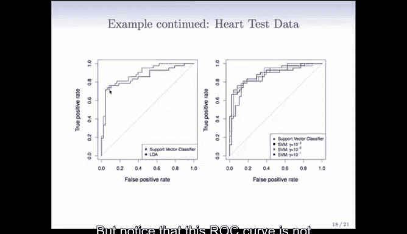

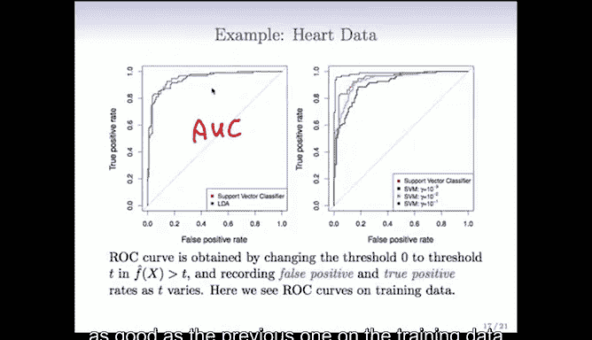

Overfitting a it。And。In the right hand panel， we look at the different support vector machines again。

 and now the one with the biggest value of gamma actually does the worst。

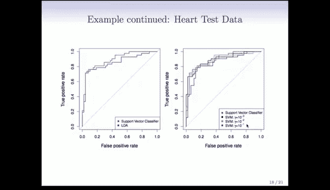

So， while it was。Doing the best on the training data that actually does the worst on the test data。

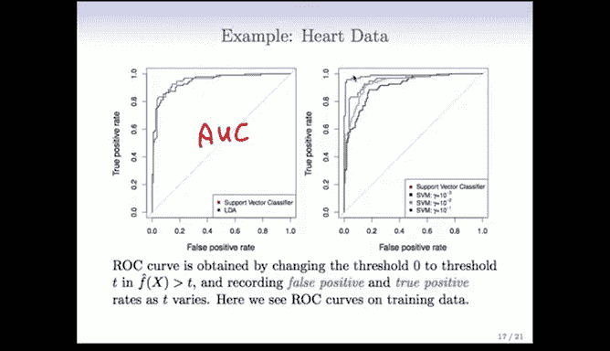

And yeah， the linear support vector machine does pretty much the best and the most regularized SVM is with gamut 10 to the minus。

You can't see that number， but three is doing about the same。Okay。

 so these are tuning parameters and we'd have to use all our usual tools for deciding if。

If we had to pick a value for gamma， we may use cross validation or validation data set to pick it。

As well as the the cost parameter to see。So。With a kernel。

 we've got two tuning parameters with a linear support vector classifier， we've just got one。

 which is C。

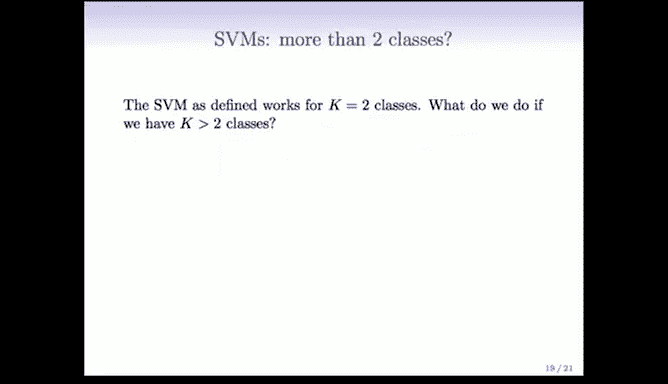

Okay， so everything we've talked about so far is for two classes， separating Hyplan two classes。

 So what do we do if we have more than two classes。

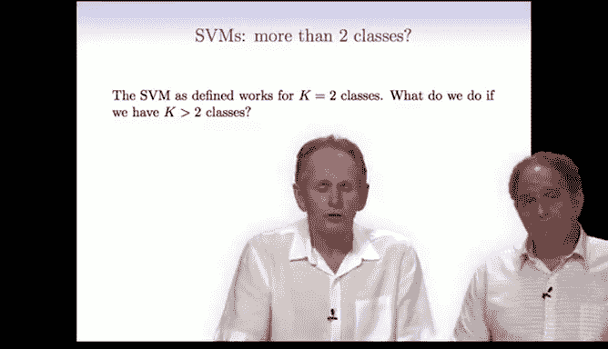

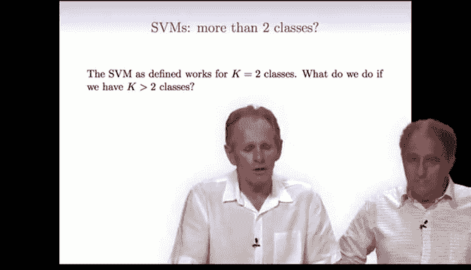

Well。Unfortunately， things get a little bit ad hoc here。 And so there's two general approaches。

And the ones called OVA， one versus all。It's an acronym。

And so the idea is you fit K different support， two class support vector machine classifiers。

Each class versus the rest， so you just relabel all the other classes as a mega minus1 class and say the target class as class plus one。

You fit a support vector classifier， and you do that with each of the classes as being the plus one and all the others being the minus one。

 so that means you'll fit K different classifiers。Which means you'll have K different functions。

AndNow when you come to classify a new point， you evaluate those K different functions and you'll classify to the class。

 which is the largest。So that's the one approach。And the other approach is OVO。Which is1 versus 1。

 which means you do all K choose two pairwise classifiers。So。if k is for example， 10。

 that means you have to fit k choose2， which is45 45。

45 classifierifies and so obviously that gets big as the number of classes gets big。

And so now you've got all these paywise classifiers and to classify a new point。

 what you do is you evaluate every single one of these classifiers。

And you see which class wins the most pairwise competitions。

And that's the cost to which you classify。So these see ad hoc。

The actual mechanisms aren't quite as ad hoc as they sound。

 and so you can explain this from a somewhat theoretical point of view。

 but that's what gets done in practice One of these two The number of classes is too large。

 usually OVA， otherwise OVO tends to get favored。

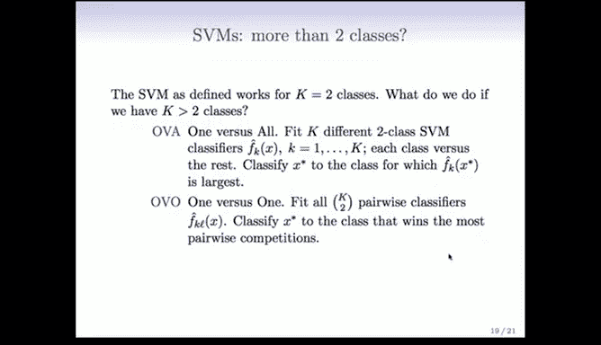

Okay， near the end of this section， well end up by comparing support vector machines to logistic regression。

 So remember logistic regression。What did solve classification problems by modeling the probabilities of the classes？

We support vector machines， were optimizing。Donown directly for the decision boundary。

 They seem very different。 it turns out they're not as different as one might think。

So if we write the linear function in this form， as we've done before。It turns out we can。

We can rephrase the optimization problem for the support vector classifier in the following form。Now。

 this is somewhat technical， but there's a loss function。Between y and F of x。

Summed over the observations。 So this is similar to， but not the same as a log like you。

 there's a penalty on the coefficients。 It looks like it's a quadratic penalty like a rich penalty here。

 and there's a tu in parameter lambda。Now， this loss function is a somewhat strange beast that's known as the hinge loss。

 and maybe it's better just to show you a picture。So it， its primary argument is y times F of x。

 Remember， this is what we call now the margin。 This is the quantity we'd like to be positive。And。

The bigger it is， the further a point is away from its margin。Okay。So。

This is the loss that we assign to that quantity。In this formulation， if it's bigger than one。

 we sign 0 loss。 So that's 0 over the year。 But if it's less than one。

 and particularly if it goes negative， it means。In all these regimes。

 we were on the wrong side of our margin。We pay an increase in linear loss。

So that's called the hingelo。 And if you optimize this problem。

 this criterion with respect to the beers。The solution is equivalent to the sports vector machine。

 Oh， that's not obvious， right， It's it's pretty hard。The derivation is not so easy。 Really。

 you can't see just from lookings。 No， it's very hard。 Well， it's not very hard。

 but it's quite hard to map this to the other one。 but what's more important and it's not necessary that this is the way one does it。

 it's just illustrative because it allows us to compare to logistic regression。Ca。

 with logistic regression， we also fit in a linear function。 So the function looks the same。

Remember there， the linear function was the lo of the probability of class 1 versus class  -1 in this case。

So， and for logistic regression， we had a log likelihood plus we could have a log likelihood。

 plus a rich penalty。And the log likelihood is given by this green curve over here。And you'll notice。

 it looks very similar。In this formulation， it tapers off to be horizontal over year。

It asymptotes to be linear over year。 but instead of having a sharp corner over here。

 it has a gentler corner。Which means you can also think of logistic regression as having a kind of soft margin。

And that it focuses more and points close to the margin and points further away。

So there's a lot of similarity between logistic regression and support vector machines。And。

And if you want to learn more about that， you may want to look at our book elements of statistical learning where we go into this in a little bit more detail。

 It's one thing to add the fact that the hinge loss has that corner is what gives it the support vector property。

 right， is the alpha thatter some which is0， whereas the smooth loss doesn't have that property。

 You don't get support points。 Good point job and you may get points whose sort of weight gets close to0。

 but not exactly zero。

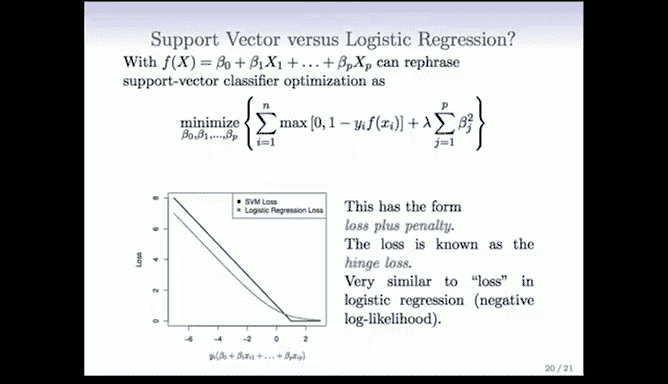

Okay， so which do you Support Victor machine or logistic regression。Will just sum up Yeah。

 So if the classes are nearly separable， the support vector machine tends to do better than logistic regression。

 And so does linear discriminant analysis。 Lo regression actually breaks down if the classes are exactly separable。

In that case， you'd have to use some kind of regularization with logistic regression。But support。

 that's a regime where support vector machines do well。When the classes aren't separable。

 where there's somewhat， there's quite a bit of overlap。Logistic regression。

 perhaps with a rich penalty or with a lessssou penalty。Tends to do better。And and it's more useful。

 they similar。 The results will be similar， but it's more useful because it's actually estimating probabilities for you。

For nonlinear boundaries， you can use kernel support vector machines and they popular。

 you can use the same kernels with logistic regression and LDA as well。

 but the computations tend to be more expensive， and so in those scenario support vector machines tend to be used。

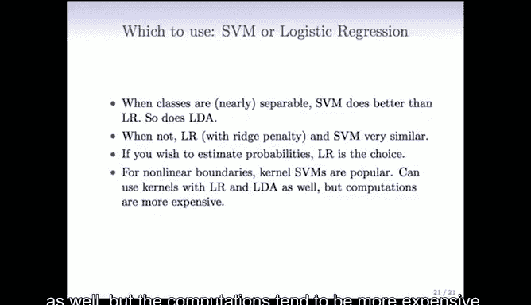

So here we are at the end of the session。 Rob， do you have anything to add Well。

 I was going to add about you know there's sort of a no- freeee lunch principle with support vector machines we saw a way with kernels to finesse to get a solution essentially in high dimensions for free。

 but one price you pay is you don't get a feature selection like you get for the laso for L1 penalties right where we explicitly put a penalty on the features and as a result。

 allow the features to set to zero， we support vector machines one disadvantages it uses all the features and it doesn't easily select which features are important。

 So for high dimensional problems that can be a drawback not so much for the classification performance the interpretation of the solution。

The other point that Trevor mentioned about probabilities， that's a really important point。

 like if you're working at a cancer diagnosis problem。

 you very often you don't just want to classify， but you want to know the probabilities the estimated class probabilities because if something's got probability being cancer of 0。

51 as opposed to 0。99， the classifications is the same but the implications in the actual situation are very different。

 so class probabilities are very important and support vector machines don't provide an easy way of getting those。

TheThe community and support vector machines have tried to address these problems with sort of post post ad hoc kind of add on something called recursor feature elimination。

 And also they have ways of actually getting probabilities by fitting logistic regressions after fitting support vector machines。

 But we can do that directly with with with。For example， Le Su regularized logistic regression。

