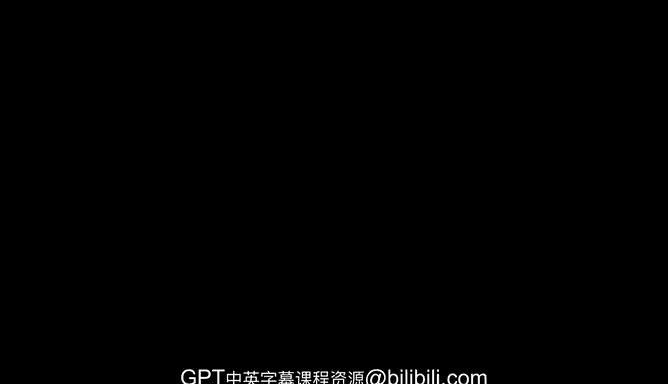
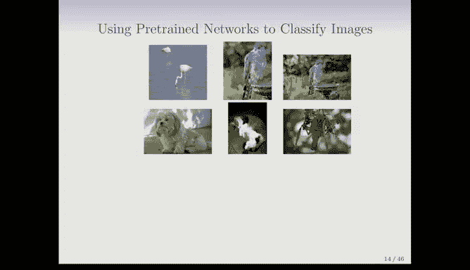

# 斯坦福大学《统计学习导论2023R语言版｜An Introduction to Statistical Learning with R》中英字幕 - P69：-069-Statistical Learning_ 10.2 Convolutional Neural Networks.zh_en - GPT中英字幕课程资源 - BV1yU421o7WA

Okay。

The next topic we're going to talk about is convolutional neural networks or CNNs。

And this is what's used commonly used these days for classifying natural images or images of any kind。

 but in particular， natural images。And here's a palette of natural images。

You've seen 100 different images here。 This is a data set that it's known as a C4 100。

 and the100 stands for。100 different image classes， right So you can see there's fish， animals。

 butterflies。Cas， so they naturally images and they fall into 100 classes。

 so that's a lot of classes。And each image is a 32 by 32 color image。Okay。

 so that's a little different to what we've worked with before。And neural networks。

 when they reemerged in 2010， their big success story was classifying images。

 they got spectacular results and as a result of having these much larger training sets and much better computing power。

For C4R 100， there's 50，000 training images and 10，000 test images。Now。

 each image here is a three dimensional array or feature map。So that means that it's got a red。

 green and blue channel so that's。The third dimension。And the other two channels， the red。

 green and blue channels are images that are going to look like these。

 but they represent the three different colors and each of those is going to be 32 by 32。

 This is just a little schematic that sort of gives intuition of CNN's work。

So what it does here we've got a little cartoon image of a tiger。

And the CNN builds up an image in a kind of hierarchical fashion。First。

It tries to identify little shapes or little colour splotches or edges or so on in in the image。

 but small， typically small。 So you can see in this cartoon that's picked up an ear。

 It's picked up part of the mouth。 Maybe is a little bit of red。 That's the tongue。

 So these are really small little localized parts of the image。And then。If you go up the layers。

 these here are used as building blocks to build up more composite aspects of the images。

 they piece together to form more complex shapes， eventually assembling the target image。

And this hierarchical construction is achieved using what's known as convolution and poolin layers。

And that's where the name。Convolution is where the CNN comes from convolutional neural networks。Okay。

 so we're going to tell you about。Both of these layers。

 the convolutional filter and the poolin layer。So， yeah， we've showing you。Using little matrices。

 how convolution photo works。So let's suppose your input image was this one and we've just represented the pixels as letters。

And the convolution filter is itself a little image， and it's small。 Yeah。

 we've shown a convolution filter， which is just two by two。

 So it's just four numbers arranged in a two by two array。Okay。

Now what we do is we take this two by two array。And we move it on top of。

The left hand part of the image， so it sits on top of these four numbers。

And then we multiply the elements together and sum them up。

So you can see that's what's happened over here。We multiplied them together and summed them up。

So the a times the alpha， the b times the beta and so on。

Then we slide this filter along to the right， just one column， right， so theyre overlap in。

And we do it again。 And so there you can see。what's known as a dot product between this little2 by two block and this filter。

And then we do it， then we move down a row and we do it again， so now we use these four guys here。

 that's what's going on over here and so on。😊，So that operation is known as a convolution。

Youve got a filter， you've got the big image， and you do this convolution where you slide this little filter around the image and do these dot products。

So the way it works is if the little sub image over which we hover in the filter。😊。

Is similar to the filter， then that dot product computes a large number。In other words。

 it's detected something that looks like itself in that place。Otherwise， it'll be a small number。

 the number will be low。Okay， so。If this fault is any good。

 what it's going to do is is it's going to make a new image and that image is going to highlight。

Parts of the image where。This little image was seen， basically or close to being seen。

And the other nice thing is that we don't supply these little filters。

They learned when you learn the network， and we're going to have many of them。

So here's an illustration。Target the image of tiger。And we've got two filters。

Right let's pretend these faults will learned。 And so these are two small little filters。

 And you can see this one's got a vertical stripe with two black stripes and a vertical white stripe。

 This one's got a horizontal stripe。And we do the convolution over the image。

 they're going to look for vertical and horizontal stripes in the image。And it's not 100% clear。

 but you can see when we do the vertical stripe one， this image of the tiger。😊。

Tends to accentuate vertical stripes。And when we do the horizontal stripe1。

 it tends to accentuate horizontal stripes again， not perfect， but it' it's kind of doing the job。

So the result of the convolution is a new feature map。

 so this image here consists of red green and blue channels。

 we just shown one fault here but it's got red green and blue channels。

 but when you do the convolution it produces a new image right。😊，Also， what we call a feature map。

So since images have three colors。😊，It turns out these filters do have as well。

So you'll have a filter for the red， the filter for the green and the filter for the blue。

And then you do the dot product separately on the red， green， and blue。

 and then you add up the results。And so from one color image， you get one new feature map。Okay。

 so that's the convolution。And again， the weights and the filters are learned in the network。

We'll tell you a bit more about that in a moment。 But let me tell you also about pooling。So yes。

 let's say the feature map that we obtained from doing a convolution。

What poolin does is and this is called Max pooling。It takes non overlapping blocks in this case。

 two by two blocks， which is what we actually use。And we replace each block by its maximum。

RightSo here's the first two by two block， it's got one，2，3 and0。

 the maximum value in there is  three。 so we put in a three。The next block is 5312。

 the maximum a is5， we put a five。And so on。 And so you get a reduced image， which has got 3，5，2。

 and 4。So this sharpens the feature identification。

 if we thought of the convolution as highlight in areas where we saw a feature。By doing this pooling。

 we sharpen things and we allow a little bit of location invari to where that feature is by picking the place where it's maximum。

It also reduces the dimension by a factor of four， so in this case。

 a factor of two in each dimension。Okay， so here's the architecture of a CNN。

So you'll see there's many convolving pool layers。Here's the first convolve layer。

And you can see we've got a number of feature maps here。The input image was 32。

 we come out with these feature maps are 32 by 32。Well， how come they so many？😊，Well。

 for each filter that we have， we get a new feature map。And so in this case， we've got one， two。

 three， four， five， six。Okay， well， now we think of these new feature maps。😊。

As new channels along this hierarchy， we had three color channels for the input。

We've now created eight channels。Okay。We then do a max pool layer。And。

say that filters are typically small example three by three。Right。

Each filter creates a new channel in the convolution layer， and in this case we see eight。

As the pooling reduces the size， the number of filters channels is typically increased。Okay。

 so we had eight here， we still have eight here， but they've dropped in size to half the dimensions in each direction。

And now。We have filters that get applied to these guys。

But now remember this we seen in eight channels here。

 so the filter has to have eight channels as well， remember we had three channels in the filter for the input。

😊，We've got eight channels here， each filter has eight channels。One。One for each of these。

Feature maps here。And because things are getting smaller in size， we have more filters。

 and so then the output becomes。We increase the number of feature map that we produce。

As what's happening here we're we start on the left where the features are very local， very fine。

 and then as you pull and and evolve， the features are more and more coarse， is that right， Yes。

 they're not as local as you move up。Yeah， that's right。

 because that Max pooling is allowing a feature to sort of move around and get localized。

And and sort of zone in where it is because you could have two images of a tiger and even though they've been standardized in some way。

 yeah could be in different places for sure， and so this allows that kind of location invariance it's almost like looking through the camera and the lens you start it very close and then you sort of pan back yes。

So this carries on， right， We keep on going， and we have a max pool layer。

 Then we have another convolve layer。 Each time the max pool drops dimensions。

And the images get smaller and smaller， and we actually go all the way until we're down to some really small images like two by two。

 and then we just collapse what's known as flattening into the individual pixels in all those images and we have a fully connected layer to the output layer where there's 100 classes。

 So that that's how it works。And like we say， the number of layers can be very large。

 So there's a one network that was trained on on 1 thousand0。Class image database known as Inet。

And it's got 50 layers。RightSo you see about eight layers， this one's got 50 layers。

 and we're going to demonstrate it in a little while。In fact， we demonstrated it right now。

So just to remind you， the parameters or the weights in these networks。the4。

If we go back to our little filtertsia， you can see。

These four numbers here are weights that need to be learned。For a counter image。

 we're going to have three channels。 so that's going to be。4our times 3 is 12 weights for one filter。

 If you have many filters， the weights add up。 Then when you go to these ones here。

 weve got eight channels。 So now each filter has eight channels。

 So the number of weights in each filter is eight times， say we said three by3。For the CNN。

 so they add up right， so those that's where the parameters come in and they get learned during training。

So there's IageNets， one big image training database， there's even bigger ones today。

And massive neural networks are trained on these image databases and trained used in distributed software by companies like Google and Facebook。

 and the nice thing is they make these pretrained networks available。

So here's a collection of photographs。Taken from a photograph album。Of natural images。

 And we're going to use the pre trained Rasnet network to try and classify these images。

And in the lab， we go through how we show you how to do that。

 but here we're just going to show the result。And。This procedure is going to produce probabilities。

For each of the hundred， in this case，10 classes， but we're going to show the top three。

And for the first one， it says gives 0。83 probability to a flamingo， and indeed it was a flamingo。

This guy is known as a Cooper's hawk。They abandoned in Northern California。It calls it a kitite。

 which is a kind of raptor， it gives 60% probability to that second guess is a great gray owl。

Third guess with very small probability is a robin， that's way off。Yeah。

 we zoom out of the Cooper's Hawk picture and you can see it's sitting on a water fountain。

And the network gets confused。 So now it classifies his picture as a fountain and ignores the  hook。

And then。It seems to go off the rails because the next guess is a hook， a nail。

 and then the next one's a hook。Here's a picture of a cute little dog。He's actually a Laso Upa。

 which is a kind of Tibetan God dog。It gets classified as a Tibetan terrier and they look somewhat similar and with 56% probability。

And then the second guess is Eliasa， which is correct， and the third is the caucus spaniel。

Here's a cat lying in a curled up position and this completely fooled the network。

 I thought it was an old English sheep dog way down in the list is a Persian cat and slightly high as a Shiitsu dog。

And the last one， this is a cape weaver bird in its nest， and it gets classified as a jackcommal。

 which is is a kind of bird that hangs out in trees and bulls nest in trees。

 It second and third guess are also birds。 You can do go back to the picture of the CNN。

 I just was unclear about something you say pretrained。

 So when you apply this now to the photographs， which part is is obtained from the。😊。

Database and which weights are trained for this data。Oh， I see。 In this case， Rob。

 we took the network as is and just classified the images。Also there's there's no training at all。

 there's no training， I said in this case， there's no training。

 but I think you're getting on to another point which is interesting as well， Rob。

About using pre trained networks for other tasks， right？

So when you train a neural network on natural images， either you know。

 let's say the resnet one that we have yeah。A lot of the early layers of the network are just picking up。

😊，Features in natural images。And a lot of the training goes to learning those。😊。

You may have a problem where you've got， say medical images of lungs or mammograms or something like that。

And those pre traineded features can be helpful in in。You know。

 in classifying or diagnosing medical images， so what you can do is you can。

 you can pick out those pre trained layers from an image network。

And then you can use some training data for the problem at hand to learn the remaining layers and I guess the one is for mammograms。

 you my tip only have a few hundred training observations but their pretraining might come from 1 hundred thousand images right so there's a lot more data for the pretraining。

