# 斯坦福大学《统计学习导论2023Python版｜An Introduction to Statistical Learning with Python》中英字幕 - P70：-070-Statistical Learning_ 9.Py Support Vector Machines I 2023.zh_en - GPT中英字幕课程资源 - BV1u4421A7ZU

Okay， welcome back。 today we're going to talk about we're going to do the lab for Chapt 9。

 that is the chapterpt on support vector machines。

And as usual， you know we have some imports and we have some new imports so today we're talking about support vector machines in particular support vector classifiers So that's what this SVC stands for。

 There are other estimators support vector regression and other things that we're not going to talk about。

 So that's the main estimator that we'll use from psychit learn today。

 the other thing we're going to do is compare classifiers using this an ROC curve。

 and so there's a nice way to plot on our ROC curve for a given estimator that we'll use from psychit learn And finally we wrote a little helper function to sort of display some of the boundaries of support vector the support vector classifiers that we'll use that will help us visualize what these things how these things work。

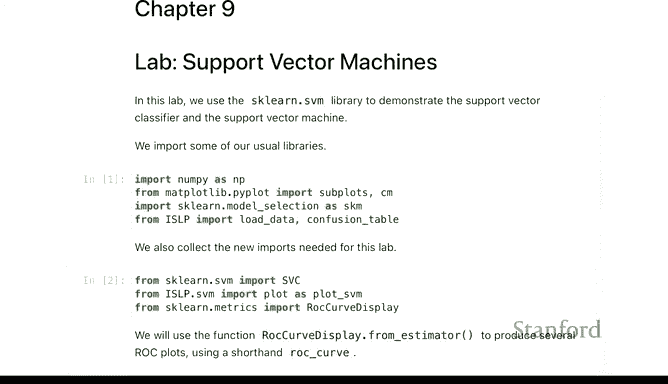

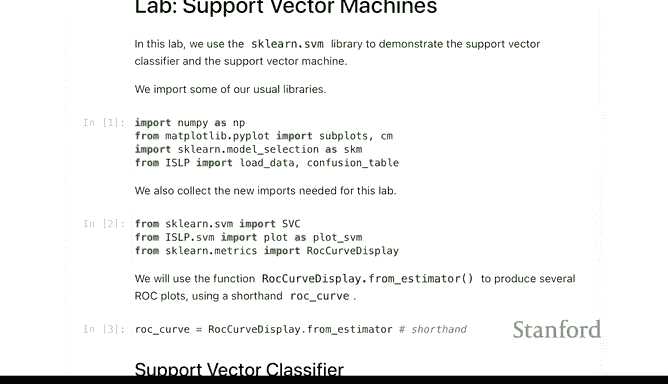

Okay。嗯。So， we're going to use。Our support vector classifier。

 and let's just make a tory little data set here。So， I'm not gonna。

Dwell on the code we use to make it。For us， we're going to look at the color the points today so we're going to start off with a case where the two classes are not very well separated or they're not actually separable in this case and fit a classifier to that to see what kind of support points we get and how the support changes a little bit as we change the cost parameter。

 That's the main parameter in support vector classifier。Okay。

 so here's how we fit a support vector classifier， we have to give it a cost parameter and if you remember in the class we discussed how that cost parameter plays。

 the higher the cost the more support vectors we have and the wider the margin is。

There's also this argument here kernel and we'll see we're going to use a linear kernel here that means that the boundaries are going to be know determined by linear functions。

 there are other kernels one of the most commonly used kernel which we'll see later is the radio basis function kernel also the Gaussian kernel so these are the two main arguments you have to choose when fitting the support vector classifier。

Okay， so again， it's a psyic learn estimator， so we fit it the same way and we can predict the same way。

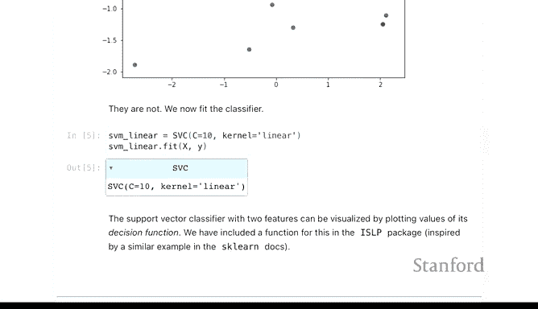

So， here's。The function we've made this function， plot SVM that takes a feature matrix and an outcome and a fitted classifier and plots the decision boundaries as well as the support points。

So in this SVM linear， there's information about what points are used as the support points。

 and we've labeled those with a plus here。I see。 change colour on us。The， the reds have become green。

 Yes， yeah。 and that's a bit unfortunate。 That is likely be， well， I didn't re plotot them。

 It plotted them itself。 Yeah， yes， that's， yes。Okay， so。

So what we see here is the decision boundary， it is linear for this linear classifier。

These points here， these are points within the margin。

 And these are the points that are or that are sort of on the wrong side of the margin。 They are。

 they are marked here with a plus。 So these， these here should be green。

 and these here should be blue。Okay。And there are about 25 points there， I'm not exactly sure。

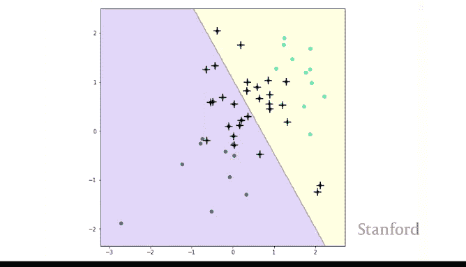

So we're going to change the cost parameter。

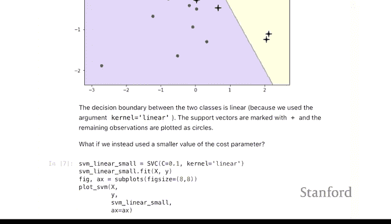

Pot1。And， oh， I think I misspoke before。 there is a。 So yes， to my， to my defense。

 there are a few different， Let me say， how did I misveak before。Please go。 No， I see it now。

 It is the cost。 So the cost。If there're lower cost and being on the other side of the margin。

 you'll you'll， you'll allow more points on on the other side。 And that's yes。

 I was hoping you could just it one slip by anyway， you picked up Yes， well， I mean。

 so the smaller the cost， the more support points you get。 Yes。

 you pay less of a price for on the wrong side of the margin。 Yes， and I would my， you know。

 it's like there some people parameterized cost inversely。 So。

 and then I would have been okay in that case。 But it it matters actually how how it's parameterized。

 And so with this cost the smaller one means there's smaller cost being on the wrong side。

 So it's easier。Okay， and what we're meant to see here is that there are more support points。

 There are about the same number of support points。

 but there are some regions like this region here that have come in。

 And if you could look at the margin， let's see this point here。Must not be in the other plot。

 let's take a look， that's the farthest one。See that point is not。

 is not across the margin when I use at 10。 So in a sense， the， the smaller the cost。

 the more points the support points you got。And that means that solutions somehow are more regularized because you're using more of the training data to determine the orientation of the margin of the decision boundaries。

 That's right。 Like that， yes， the slope of this line here is determined by somehow averaging the points of these two the points on each side。

So if you only have a few， then it will be less robust。

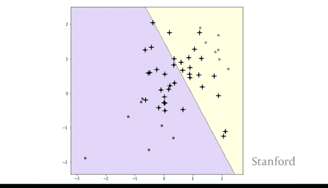

Okay， so since it's a linear classifier， you can actually find the direction of the the decision boundary。

 that， of course， would be not this direction here， but to be this direction here。

 sort of that you can use to determine the classifier。

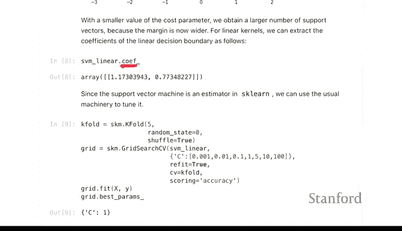

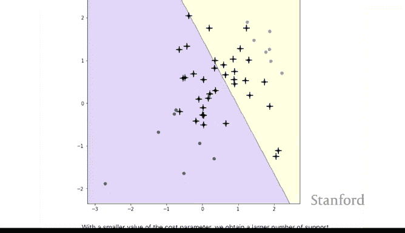

Okay， well， we have this tuning parameter C， we had used two values before 0。1 and 10。

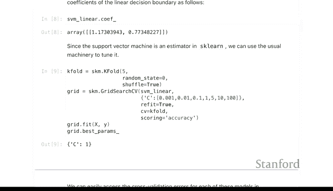

Why don't we see if we can find。A good one automatically。Well， this is， you know。

 this is what one of the nice things that about I could learn， of course。

 is that if you have an estimator， you can pick a cross validation method like5fold cross validation or or a train test split。

 And then you can use this grid search CV to try and。To that parameter。

 So the parameters that we're going to search over are given by the second argument。

And here this is a dictionary with the argument C。Being the possible values that we so we'll look at C from 0。

01。200。Fitting the grid search。 Yeah， and by the way。

 we saw the cross validation in action in the labs for chapterpter 6 as well。 That's right。

 That's where we encountered this grid search TV。And so it's picked the best parameters and the cost being one。

So and like in chapter 6， the best estimator is stored as grid dot best underscore estimator underscore so we can use that to predict new methods going forward。

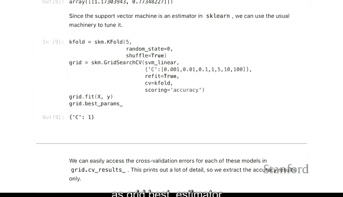

Okay， so let's。

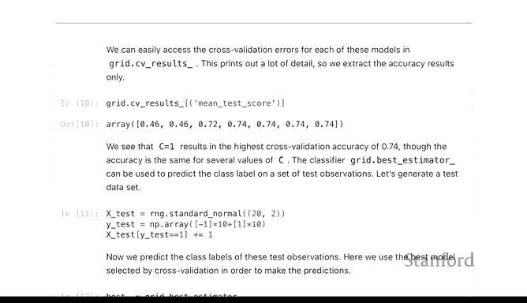

Take a look at how this choice was made。 If we， as we saw in in chapterpter 6， the grid。

Compututees the test score as a function of the different parameters。 And we can see here。

 here's the mean test score in this case， accuracy。 And actually， although it picked this value。

1 here， that's the index corresponding to 。1。 there are actually four different cost parameters that gave us the same classification go。

 So it's not necessarily a very。You know， very clear cut choice。 That point1 that one is the best。

 But so since small Cs correspond to more regularization， it's， it's choosing。

The most regularized solution。That gives the same among the same errors。Yeah。Okay。

And if we want to evaluate you know， this， this estimator， again。

 the grid dot best estimator is the one that was tuned by grid search TV。

 we can generate new data from the same distribution and and。

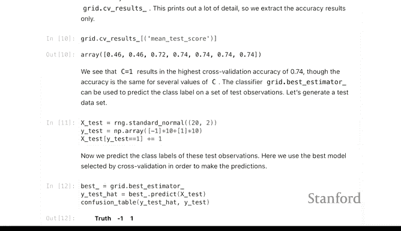

Compute。Computer confusion matrix。 So here we're just going to generate some new x's and Y's using the same data generating mechanism as above。

And。We'll compute the predictions using our best estimator and compare them to our actual labels。

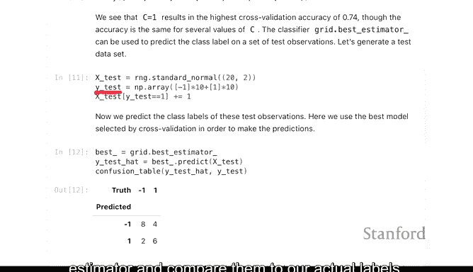

U。And。Here， our classifier got about 70% accurate， which is pretty close to the 74% that the yeah。

 we only used， you know，20 points。 we could have used more。 It might have gotten even closer to 74%。

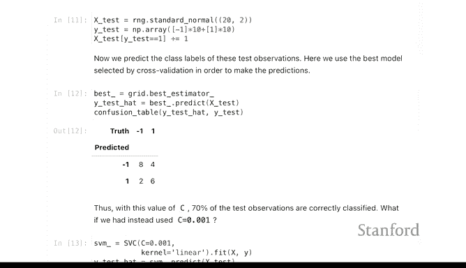

Okay。So if we instead of taking the best estimator， we choose one that was not。

A parametermeter that was not chosen to be best， like something very small。So this is， this is。

Quite regularized。Right， now I， I getting the index wrong again here， it's 60% on this data set， so。

You know， it did seem to make a reasonable choice at choosing point1。

 at least one seems better than 0。001。Okay， let's。Also。We're gonna。

Look at an example where we can linear linearly separate the data。

 So here we've just moved the mean of the red and the blue points a little bit further apart。And。

If we， if we。Fit the sport vector machine。 We should see that it should be separable。

 And here we put a very large cost here。 So this if， if the cost is not is I wonder if any cost。

If we're a very high cost， it should， it should pick the separable solution， but for low cost。

 actually， off the top of my head， I'm not sure if it would pick the separable solution。 No。

t it would still allow Yeah， more support points。

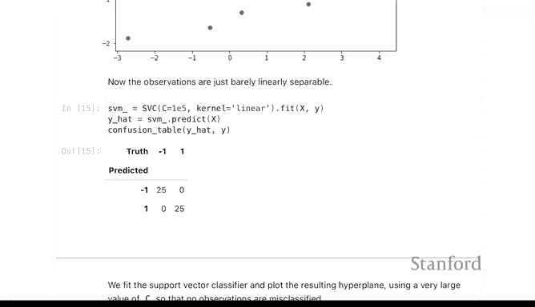

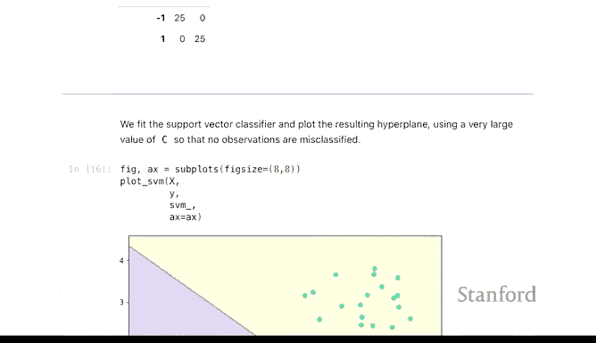

Okay， and here we can see that this is a case where there's a very few support points compared to the 20 or so we had before we had three。

 so。If we sort of change this class a little bit or this class a little bit。

 these points here that are the support points are likely to move and hence the plane。

 as we discussed before， formed by these support points might also be quite variable and of course there are many separated hyperplanes here。

 So we'd expect this to vary a lot as we change training and test data as statisticians。

 when we look at this plot， we see that the decision boundaries determined here by just three data points。

And so that makes you suspect it's not that robust。

 because these are data points on the boundaries of each of their classes。And， you know， so they。

 as Jonathan said， change it data a little bit。 and that can change the orientation of the the decision boundary dramatically。

 Yeah， and， I mean， there's are also， as we like this is one separating hyperplane。

 but there are many here， right， yes。Yes， exactly。

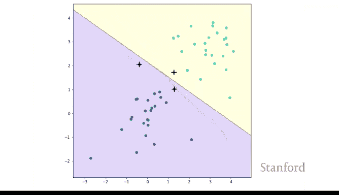

嗯。

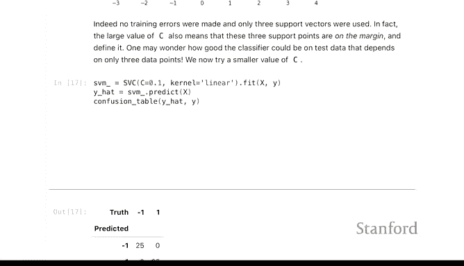

Okay。So I'm just going to move on to the。

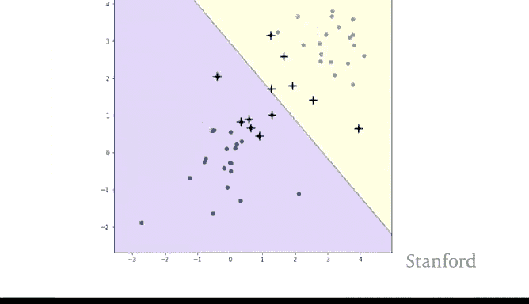

The next topic with， and this is。We saw above the linear support factor classifier。

 So that's used as linear decision boundaries。 One of the main uses of support factor classifiers is。

For nonlinear boundaries， and the way it does that is changing this kernel argument Earl。

 we used kernel as linear。Other popular choices are polynomial or radio basis function kernel。

 so the radio basis function kernel， that's a Gaussian， so it looks something you know like this。

And then so under the hood， what's gonna happen is there will be each， each。

Point in the two classes will have a potential little radio basis function attached to it。

 and the weights we saw for the linear decision boundary will be attached to the points。

To multiplying those bumps we saw before。 So in this case。

 the decision boundary is going to be where some linear combination of bumps like this bump and that bump where that's zero。

 So it's going to be some kind of possibly complicated shape。

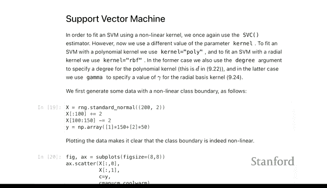

Okay， so we're going to make a slightly more complex data set here。

 and by hiding sort of one cloud of one class within。

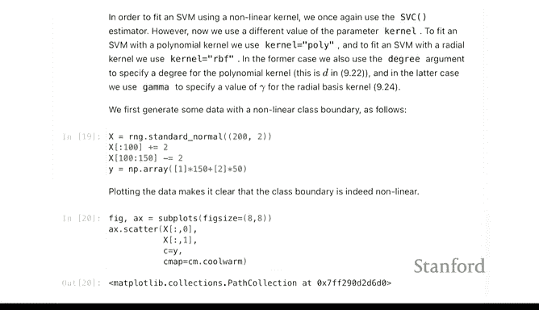

Between two one red class in between two two blue classes。 So let's just take a look at。

What our data looks like here。 so this is one where we wouldn't expect a linear decision boundary could do very well。

 right， because there's blue。 anyway we cut through the red。

 there's going to be blue on either side of it。So using this radio basis function。

 if you abstractly we could put a big bump here， a big bump here with positive weights。

 and then maybe a bump down here with negative weights。

 and that might separate the classes pretty well。It's not exactly doing one or two bumps like that。

 but it's doing， it's doing some linear combination of bumps to try and make a good boundary in a nonlinear space。

 That's a weird dataset set， isn't it。Yes， yeah， I wonder why we chose it。 Well。

 I think to make it more complicated。 because the next picture looks really good。

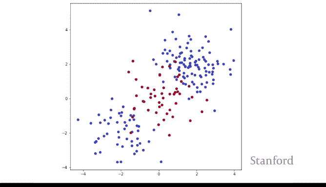

Yes。Okay。So。We， we're gonna do it。Training and test split to evaluate it later。 And we're going to。

Fit our SVM on， on the training data， so。Here is the part where we actually fit the sport vector machine。

 we give it this kernel argument as radio basis function。

 we still have this cost and then there's this gamma parameter and this gamma parameter sort of determines the size of the bumps not necessarily the height but really the width so I've just made it one month so as you change gamma you'll get different sizes like that。

And you should check the documentation whether the radial basis function looks like e to the minus gamma x squared over 2。

 that's going to disappear， whether gamma ist above or e to the minus x squared over two gamma down there。

 and that will make a difference as how you vary gamma whether it makes a bigger one or smaller one。

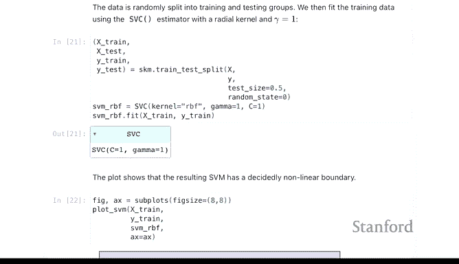

Okay。

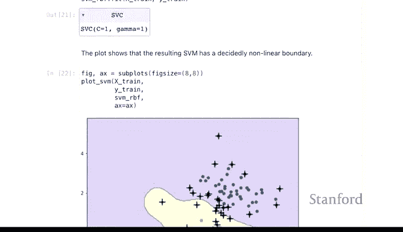

So let's see what's happened。 Oh， wow， that did really well。 It must always do really well， right。

 too。 Oh， that's too bad。Yes， so we did pick a data set for which， you know。

 some nonlinear method like the radio basis function will， will produce a nice plot。You know。

Obviously， any particular method is not going to work well in every case。

 but we're trying to illustrate how you can use the radio basis function to make a nonlinear boundary。

 And here you know it it did relatively well。 And again。

 these these points here indicate the support vector。

 So the decision boundary is a linear combination of those bumps and it has a weight for each of these points here。

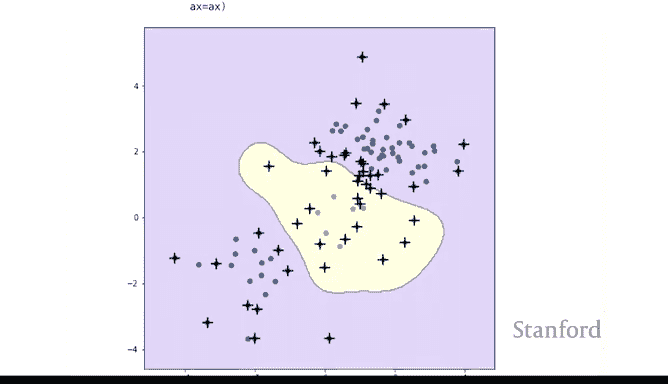

Adding the bumps with those weights makes a function on the plane。

 And this decision boundary is really the zero set of that function。 So when it's positive。

 let's say will'll classify as blue， which was originally red and when it's negative will classify as blue。

The the support points aren't as intuitive in this picture as it was in the in the linear one。 No。

 it's not clear why。We have these far points there and that's because this。

 there is a linear separation in in a higher dimensional space。

 And we're only seeing some sort of the two dimensional picture here。

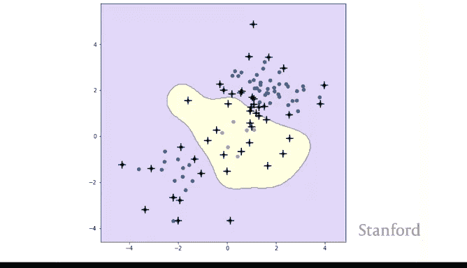

Okay。

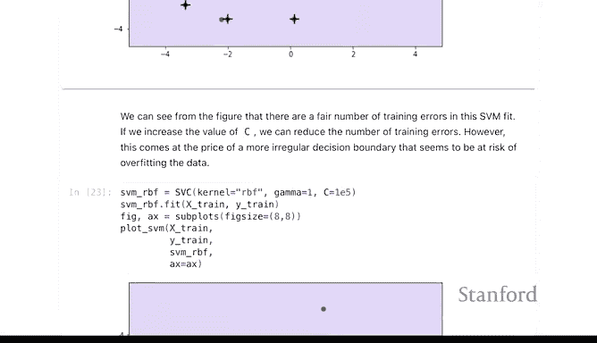

嗯。So let's see。Again， we can change this cost parameter。 So if we increase the cost parameter。

 that should be。

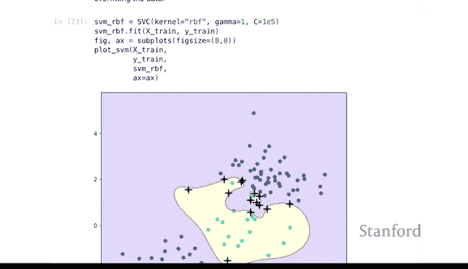

We'd expect to see fewer support points。As we did in a linear case and actually with a quite high value here。

 we have gotten rid of a lot of these support points around here and and you're going to get more wiggly solutions now because it's what it's trying to do is not misclassify any of the training data so it's going to make its decision boundary wrap around to an example there's no mistakes there's a little tiny island if we compare that to the previous one it's considerably smoother it doesn't have any little islands。

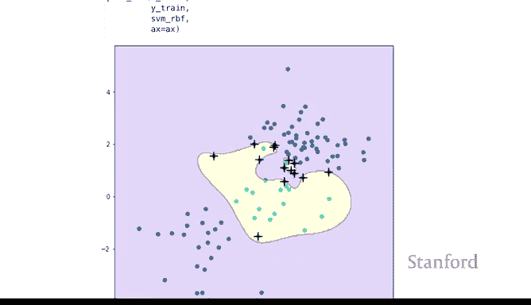

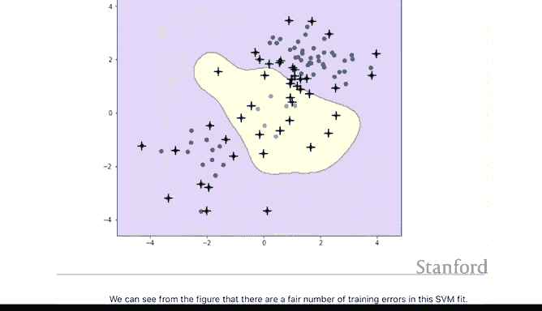

So overfitting in a case like this。

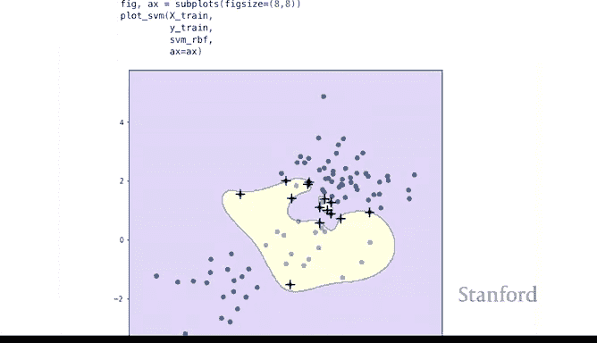

So， let's see what。

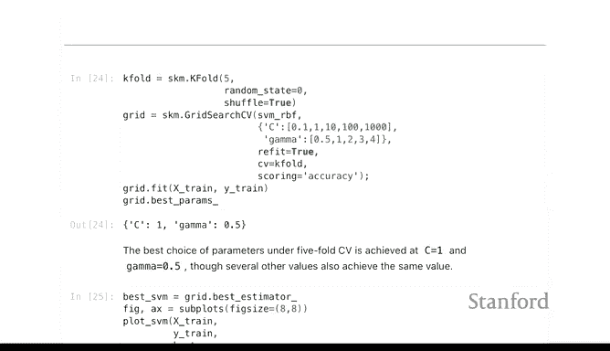

The grid search thinks is the best parameter。 So now we're gonna look at an example。

 We'll use the grid search TV again。 But our radio basis function support vector machine has two parameters cost and a gamma。

 and we're going to use。

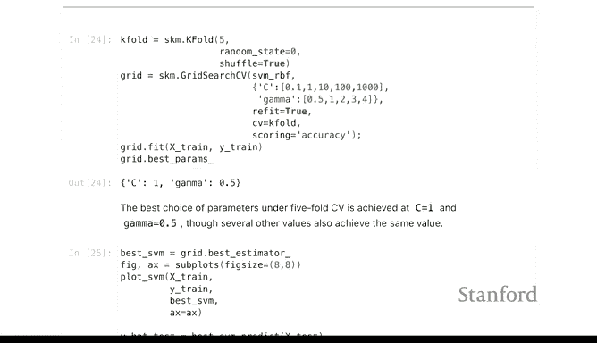

The grid search C function， as we have another example to find the two the best parameters。 Now。

 one difference in this example is that we have two parameters。

 So the argument we give for the grid of values is a dictionary with two entries。

 one for the cost and one for gamma。But other than that， it's an estimator that we fit。

 and it still returns the best parameters。 But now there are two parameters in the dictionary because we had two grids。

 a grid of costs and a grid of gammas to search over。

 So this is practical for small grids and simple estimators。 if you have many parameters。 Of course。

 this is going to be a lot of estimators to fit。 And that might take a while。Okay。

 so it tells us cost 1 and gamma 0。5 is the best estimator。

 and we're going to evaluate the accuracy of this best estimator on our test data and take a look at the decision boundary。

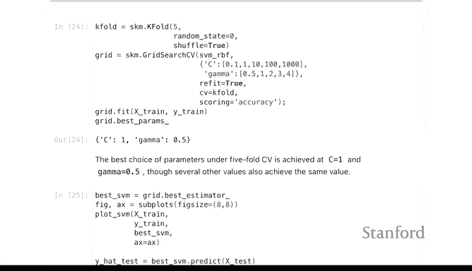

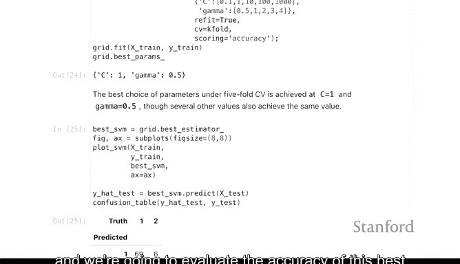

Okay， so。We produce our predictions on the test data， as we always do。

 we've stored the best estimator as best underscore SVM。

 and we make a confusion matrix as we had and we saw chapter4， and it does quite well。

 it has about 88% accuracy here。

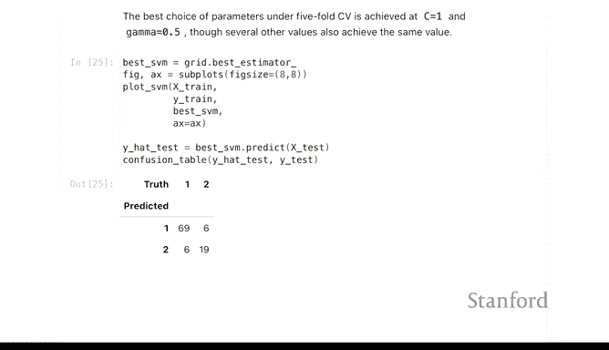

let's take a look at the decision boundary。 it got a little push down in this file here。

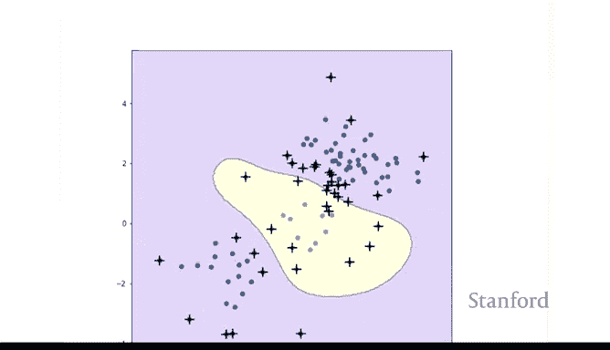

But if we look at this one， it looks pretty smooth。

 similar to the one we saw our first set of parameters。

And perhaps has a few fewer support vectors on the outskirts。

 but it definitely looks smoother than the very highly flexible one， but very high cost。

Looks really good。

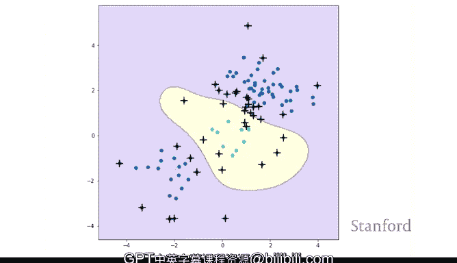

